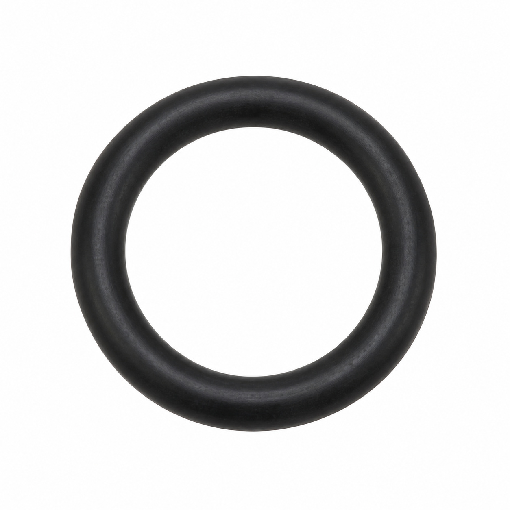
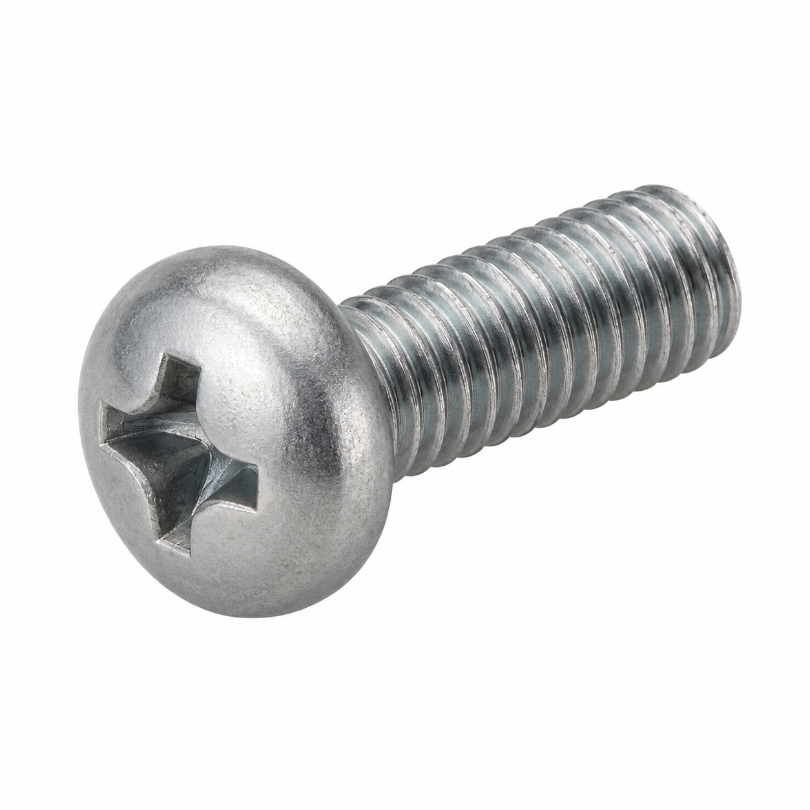
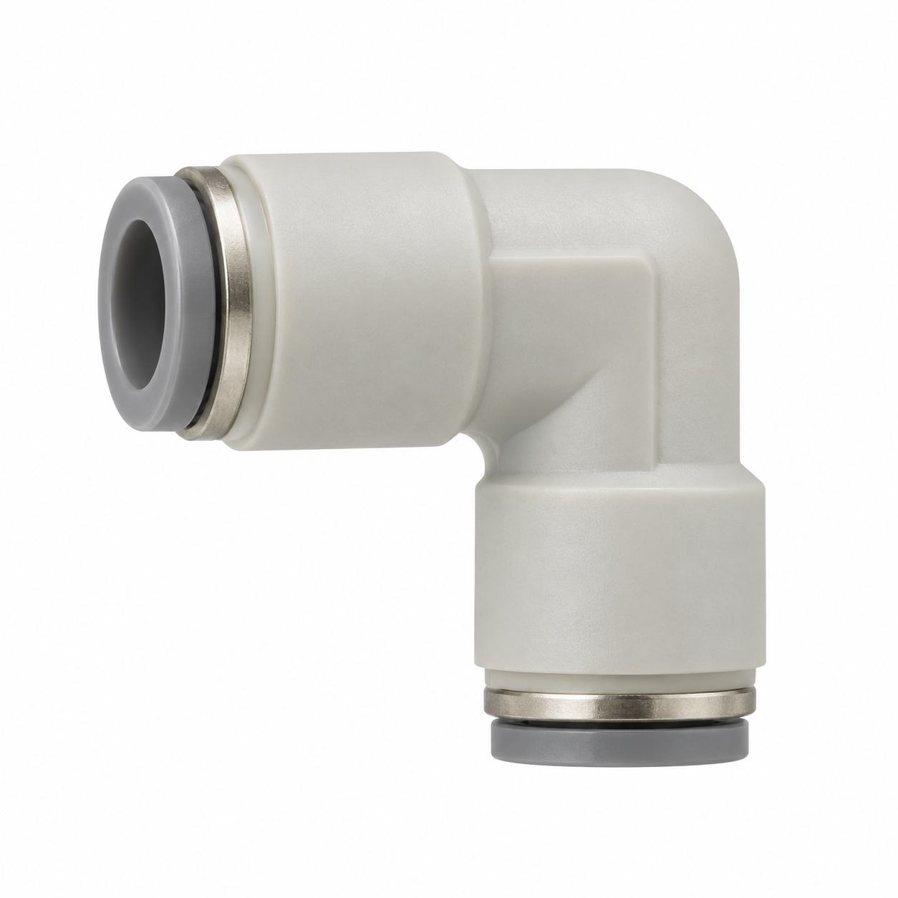
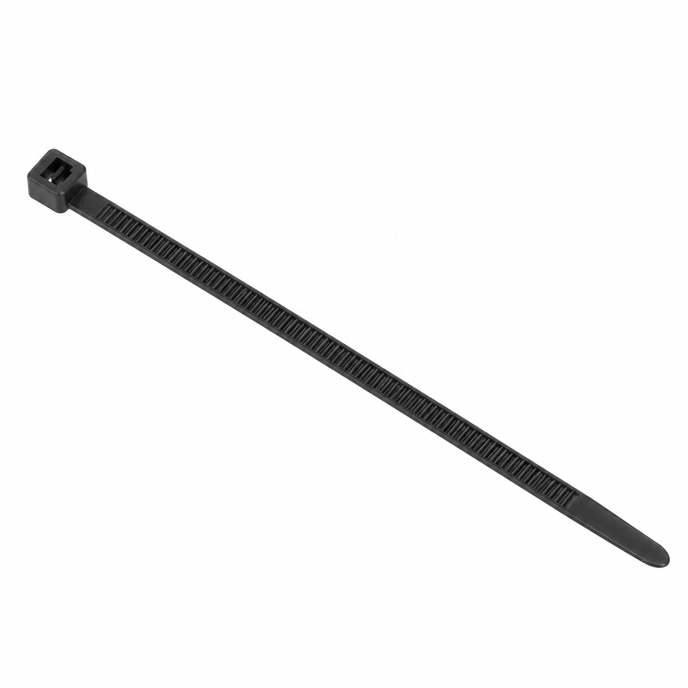
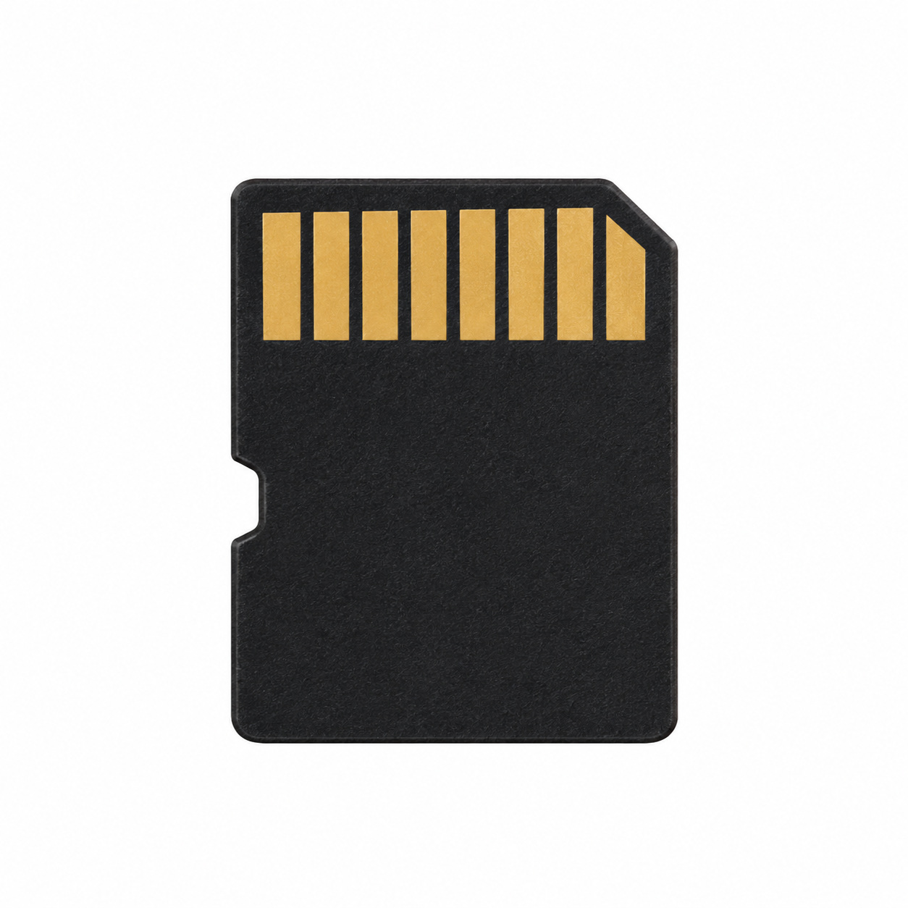
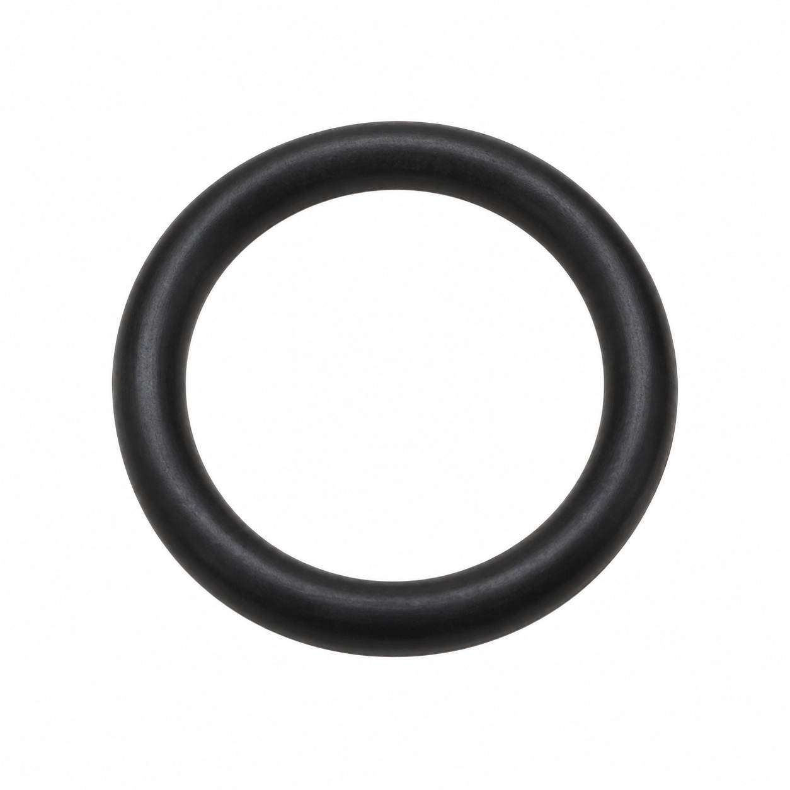
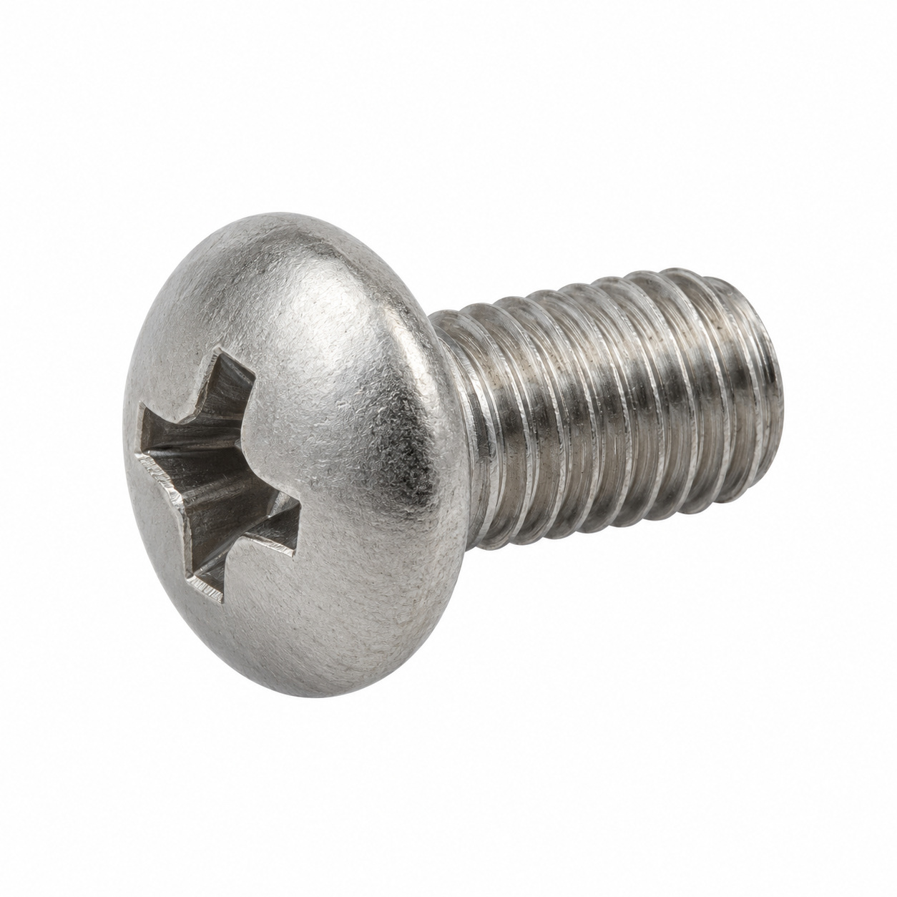
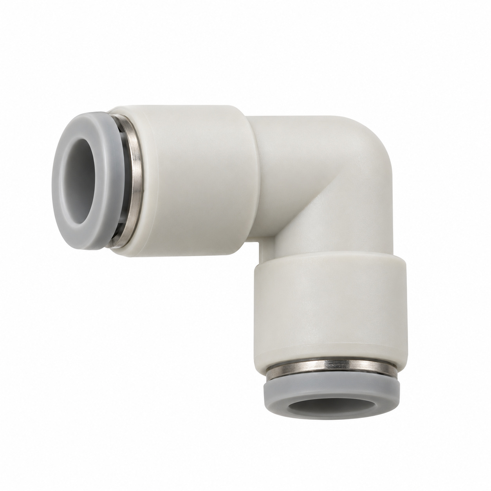
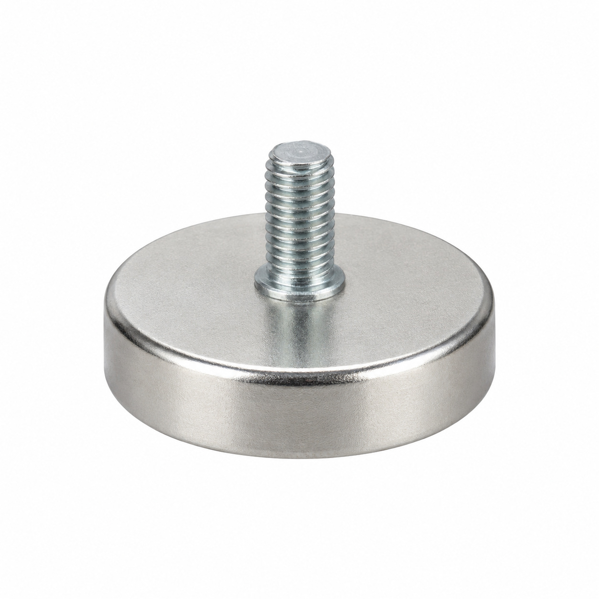
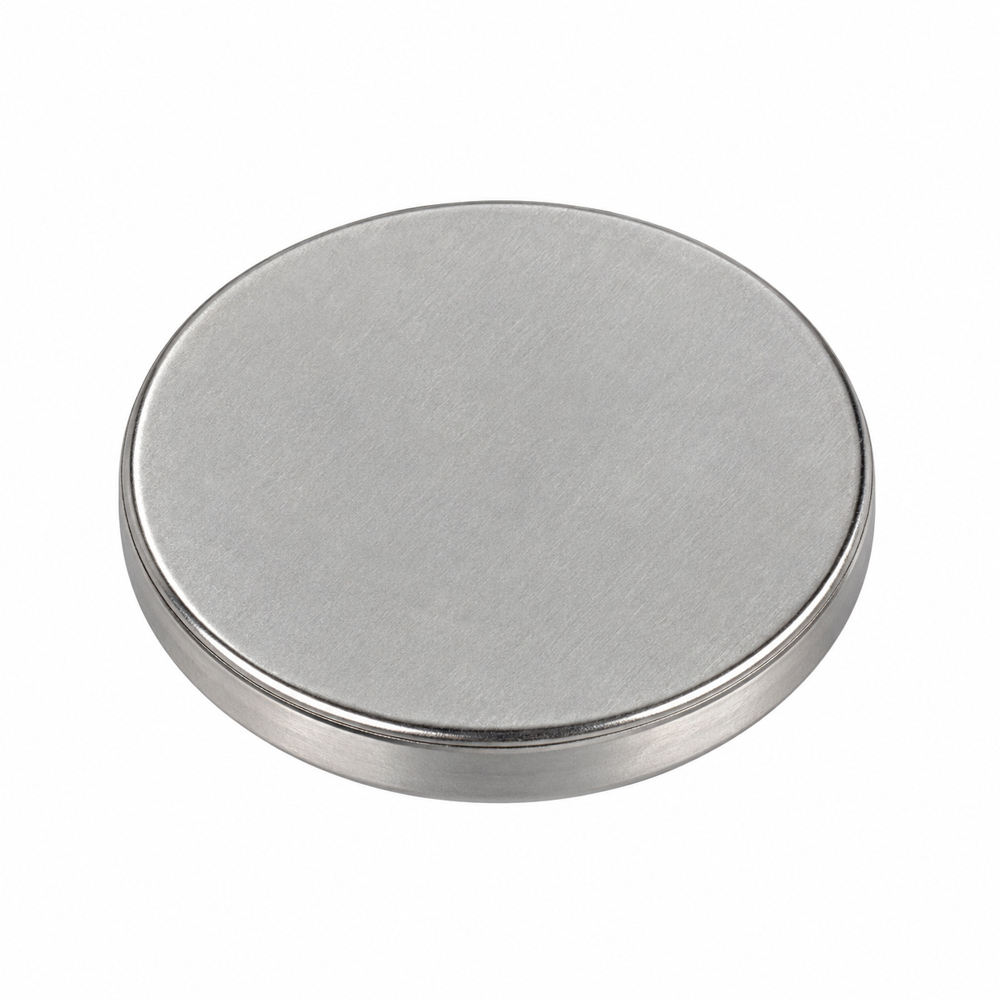

# Generic illustrations — batch 01

Ten name-based illustrations for review. These are generic component types, not exact photos or confirmed manufacturer geometry. Catalog names and SKUs identify the intended entry, not a visual match to a reference photo. No specifications, color, dimensions or fitment should be inferred from the image.

[Back to full gallery](README.md)

| SKU | Catalog name | Image |
| --- | --- | --- |
| 120.859 | O-Ring 5.60x2.40 FKM 75.5/VA75F | [Open image](generic-120.859.jpg) |
| 104.024 | Lens head screw M04x10 Phillips | [Open image](generic-104.024.jpg) |
| 117.802 | Elbow connector 6-6 | [Open image](generic-117.802.jpg) |
| 103.239 | Cable tie 140...150 x 3.2/3.4/3.5/3.6 | [Open image](generic-103.239.jpg) |
| 127.442 | micro SD-Card | [Open image](generic-127.442.jpg) |
| 121.359 | O-Ring 7.60x2.40 FKM 75.5/VA75F | [Open image](generic-121.359.jpg) |
| 104.049 | Oval head screw M4x6 Phillips | [Open image](generic-104.049.jpg) |
| 119.994 | Elbow connector 6-4 | [Open image](generic-119.994.jpg) |
| 116.166 | Magnet 4 kg M4x6 | [Open image](generic-116.166.jpg) |
| 127.814 | Button cell battery CR2032 | [Open image](generic-127.814.jpg) |

## 120.859 — O-Ring 5.60x2.40 FKM 75.5/VA75F

## 104.024 — Lens head screw M04x10 Phillips

## 117.802 — Elbow connector 6-6

## 103.239 — Cable tie 140...150 x 3.2/3.4/3.5/3.6

## 127.442 — micro SD-Card

## 121.359 — O-Ring 7.60x2.40 FKM 75.5/VA75F

## 104.049 — Oval head screw M4x6 Phillips

## 119.994 — Elbow connector 6-4

## 116.166 — Magnet 4 kg M4x6

## 127.814 — Button cell battery CR2032

