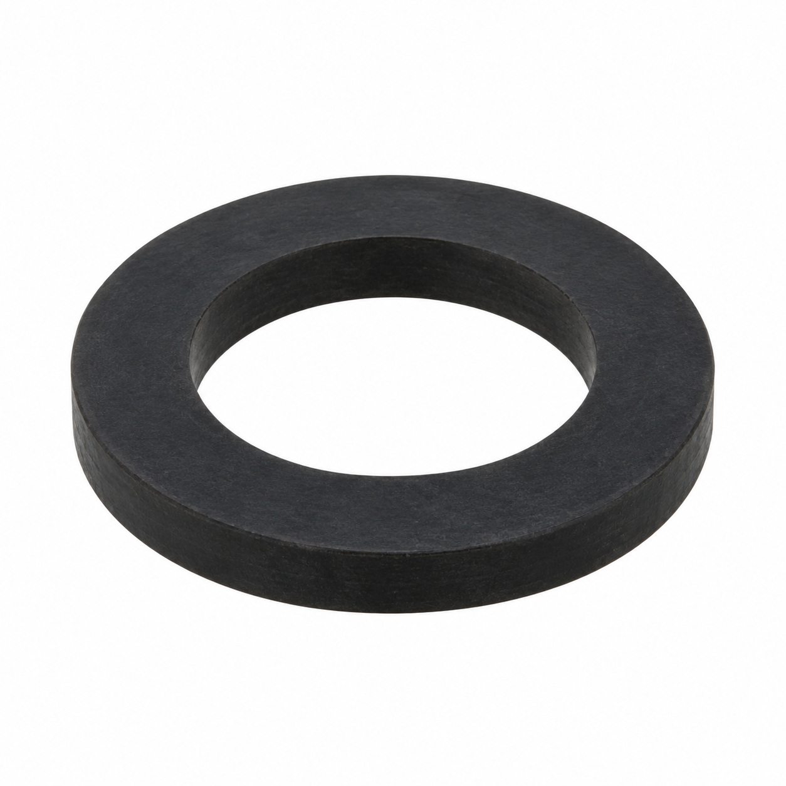
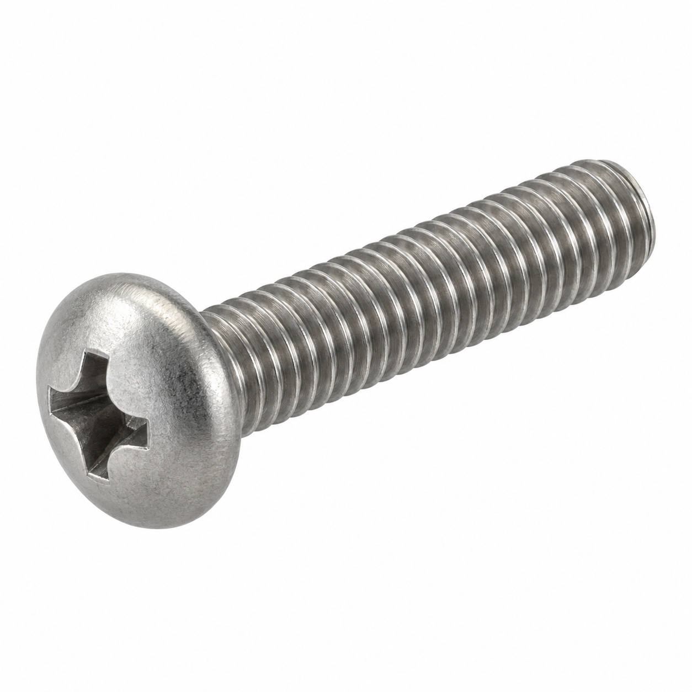
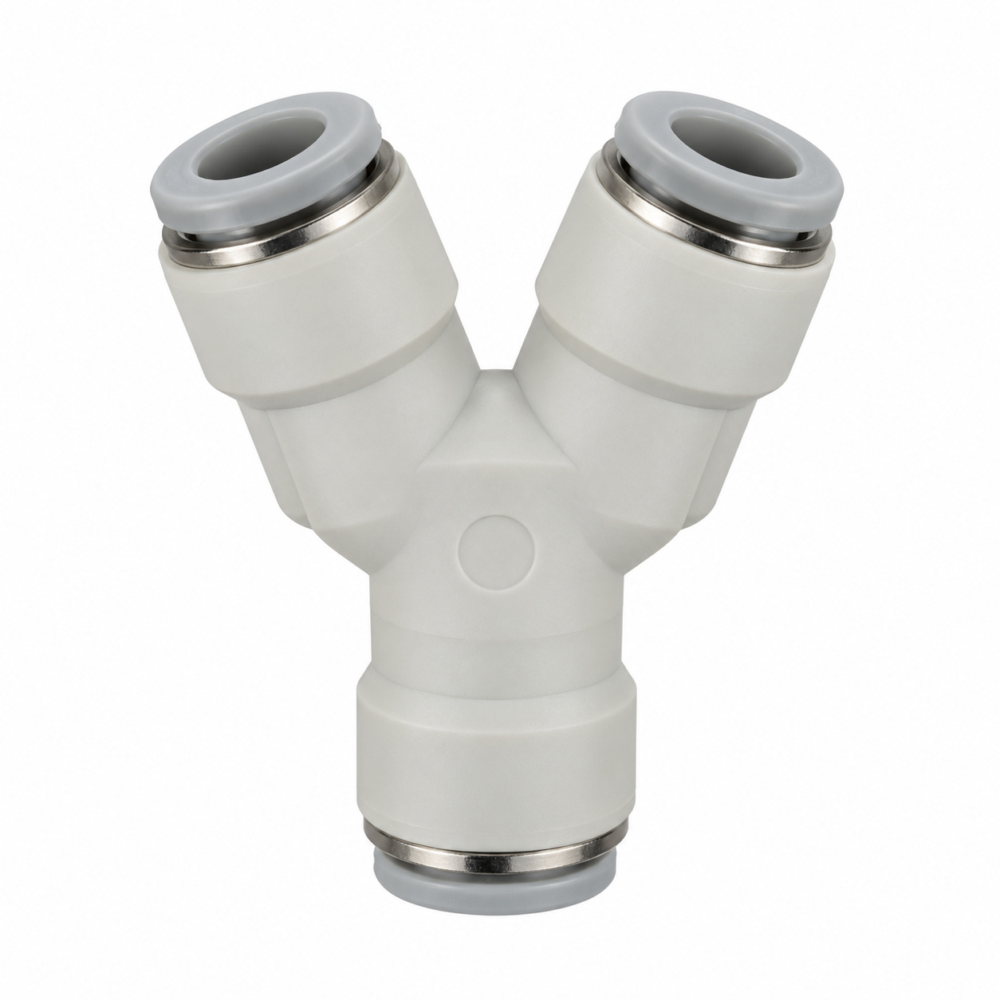
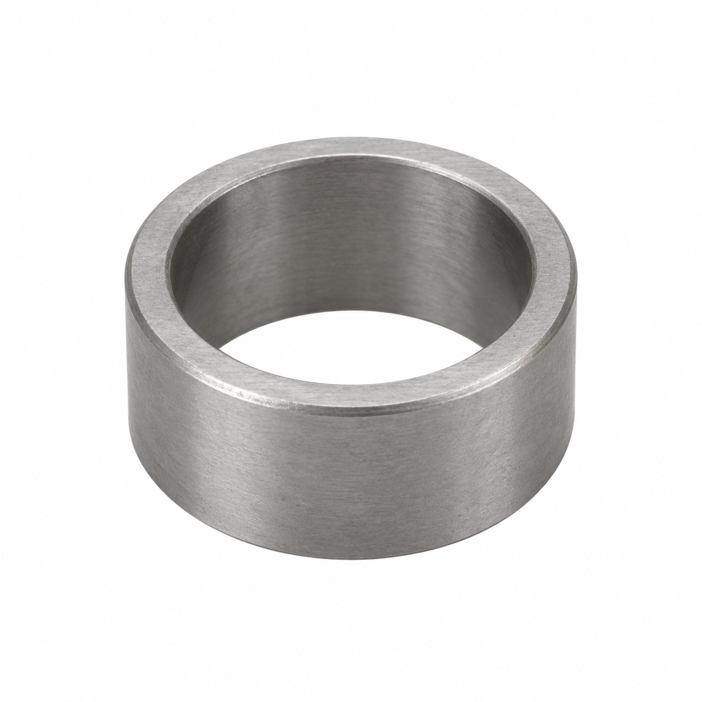
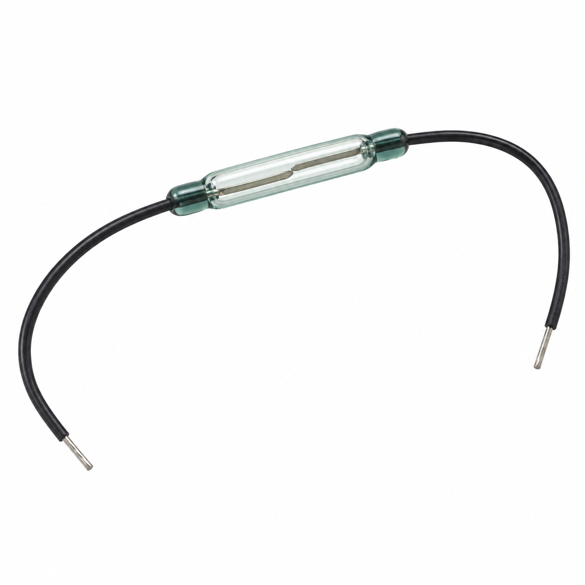
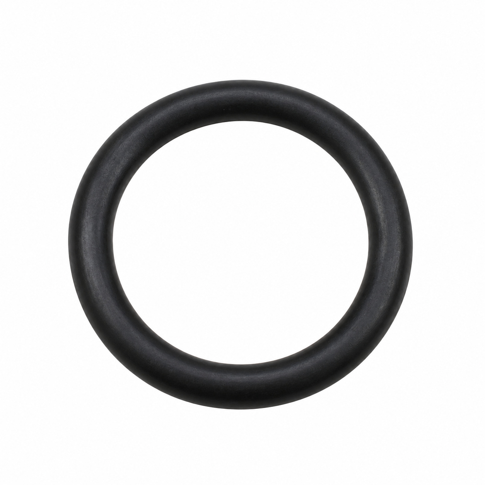
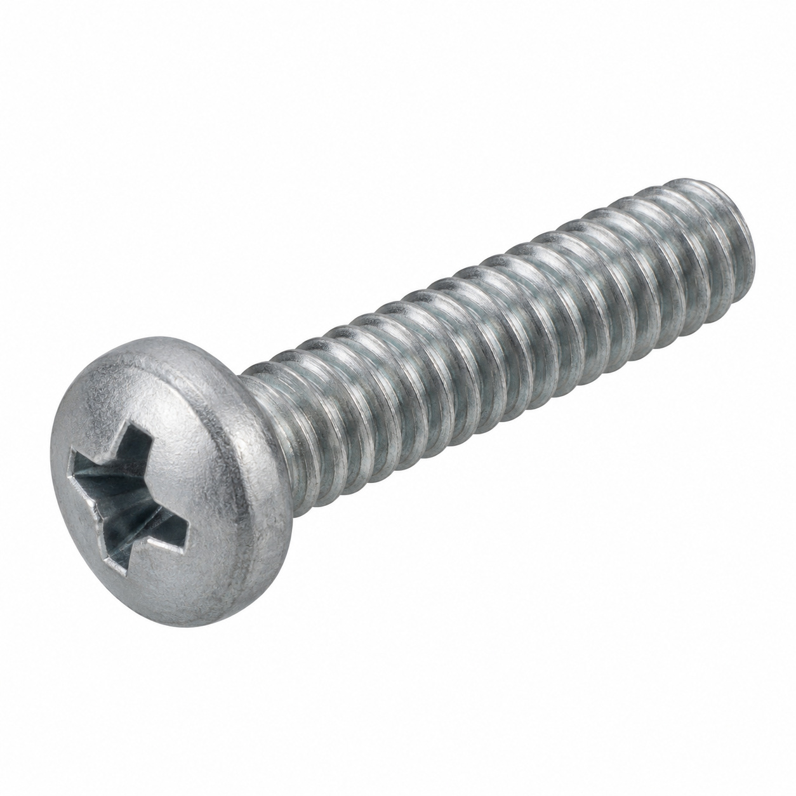
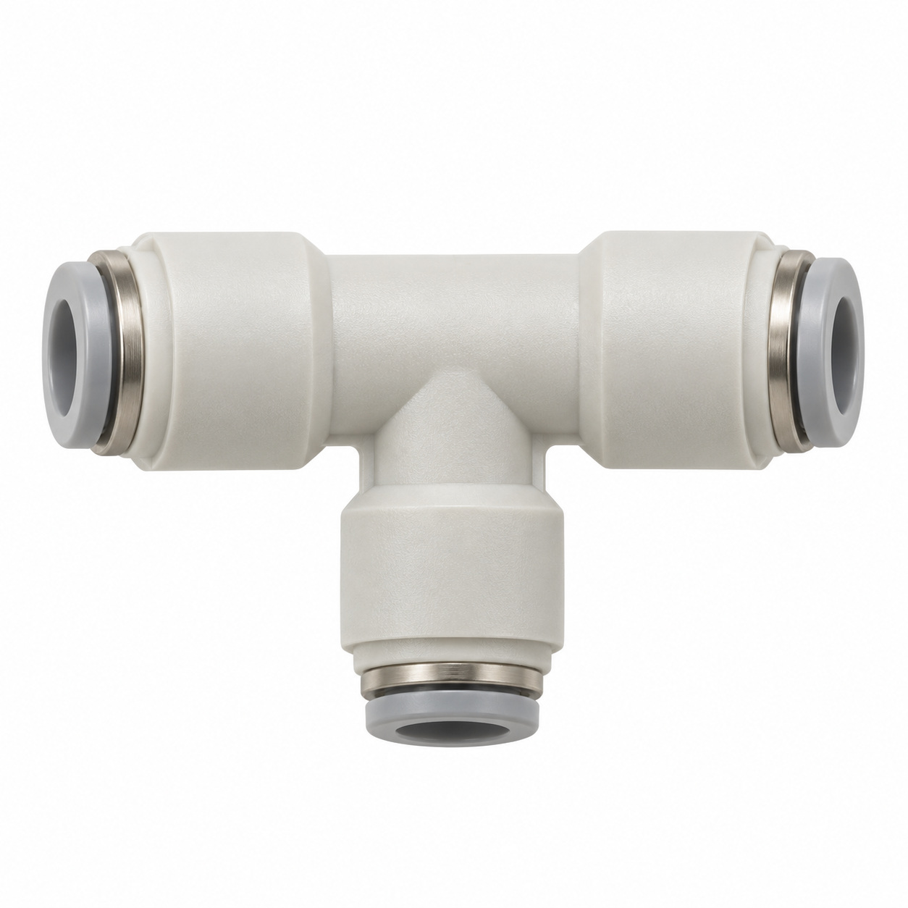
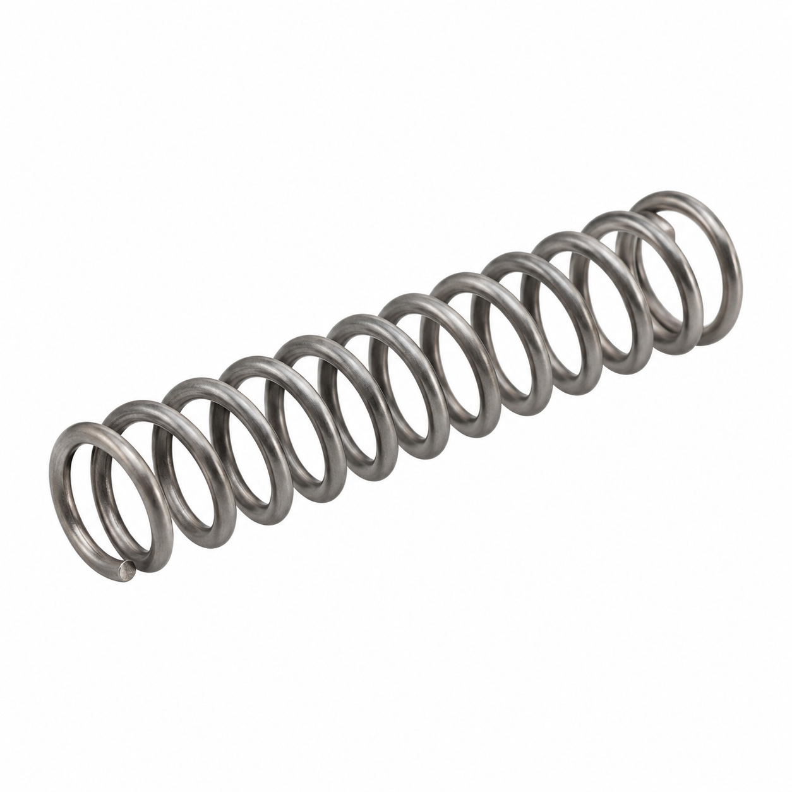
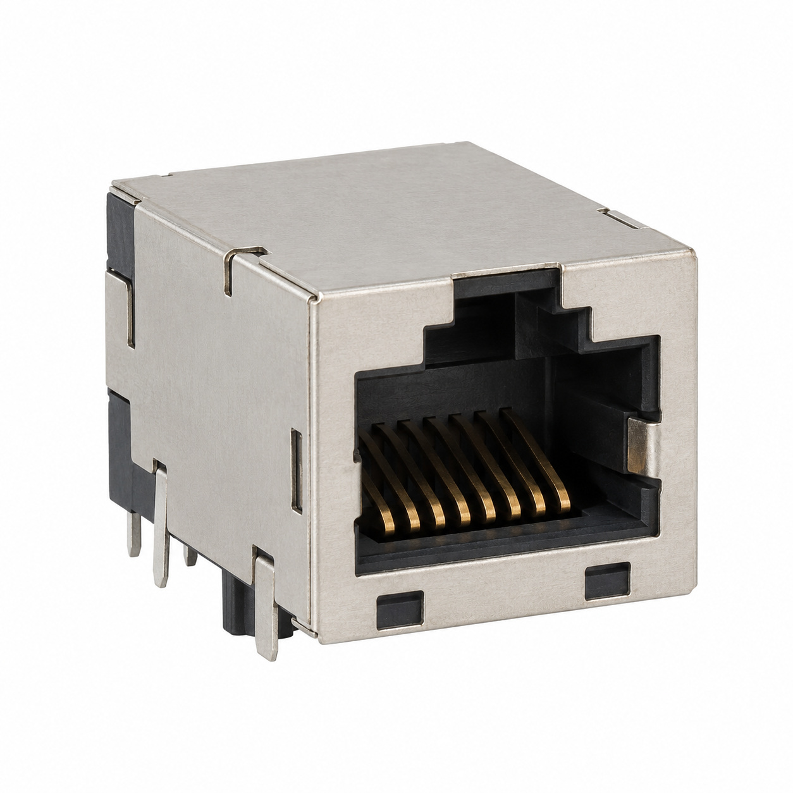

# Generic illustrations — batch 02

Ten name-based illustrations for review. These are generic component types, not exact photos or confirmed manufacturer geometry. Catalog names and SKUs identify the intended entry, not a visual match to a reference photo. No specifications, color, dimensions or fitment should be inferred from the image.

[Back to full gallery](README.md)

| SKU | Catalog name | Image |
| --- | --- | --- |
| 133.454 | Gasket PE TS03F 15.1x10x3.5 (4) | [Open image](generic-133.454.jpg) |
| 116.106 | PT screw lens head KA40x10 | [Open image](generic-116.106.jpg) |
| 128.484 | Y-plug connector 6-6 | [Open image](generic-128.484.jpg) |
| 115.666 | Sleeve ø10/15x3.6 | [Open image](generic-115.666.jpg) |
| 133.664 | Reed switch assy. | [Open image](generic-133.664.jpg) |
| 134.638 | O-Ring 9.50x1.50 EPDM FDA | [Open image](generic-134.638.jpg) |
| 121.464 | PT screw KA30x10 philips | [Open image](generic-121.464.jpg) |
| 130.256 | T-connector | [Open image](generic-130.256.jpg) |
| 128.948 | Compression spring 1x6.3x21.5 | [Open image](generic-128.948.jpg) |
| 122.636 | Receptacle RJ45 | [Open image](generic-122.636.jpg) |

## 133.454 — Gasket PE TS03F 15.1x10x3.5 (4)

## 116.106 — PT screw lens head KA40x10

## 128.484 — Y-plug connector 6-6

## 115.666 — Sleeve ø10/15x3.6

## 133.664 — Reed switch assy.

## 134.638 — O-Ring 9.50x1.50 EPDM FDA

## 121.464 — PT screw KA30x10 philips

## 130.256 — T-connector

## 128.948 — Compression spring 1x6.3x21.5

## 122.636 — Receptacle RJ45

