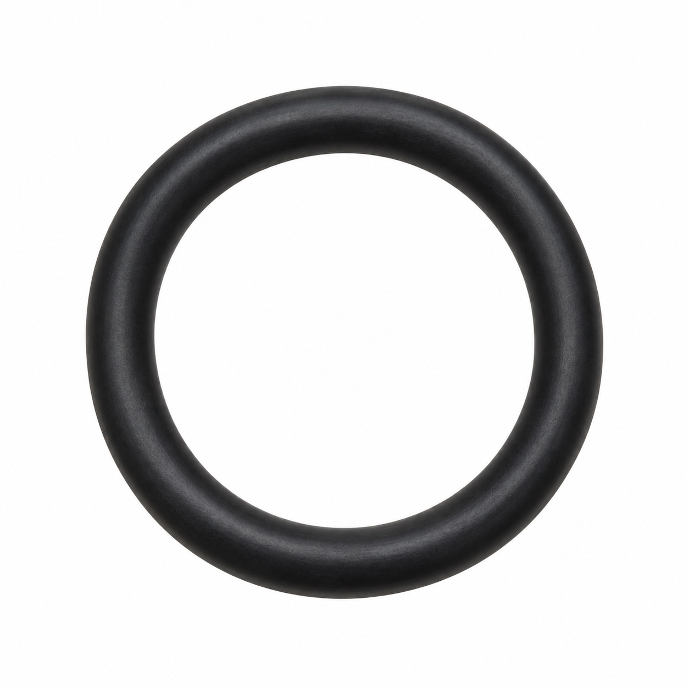
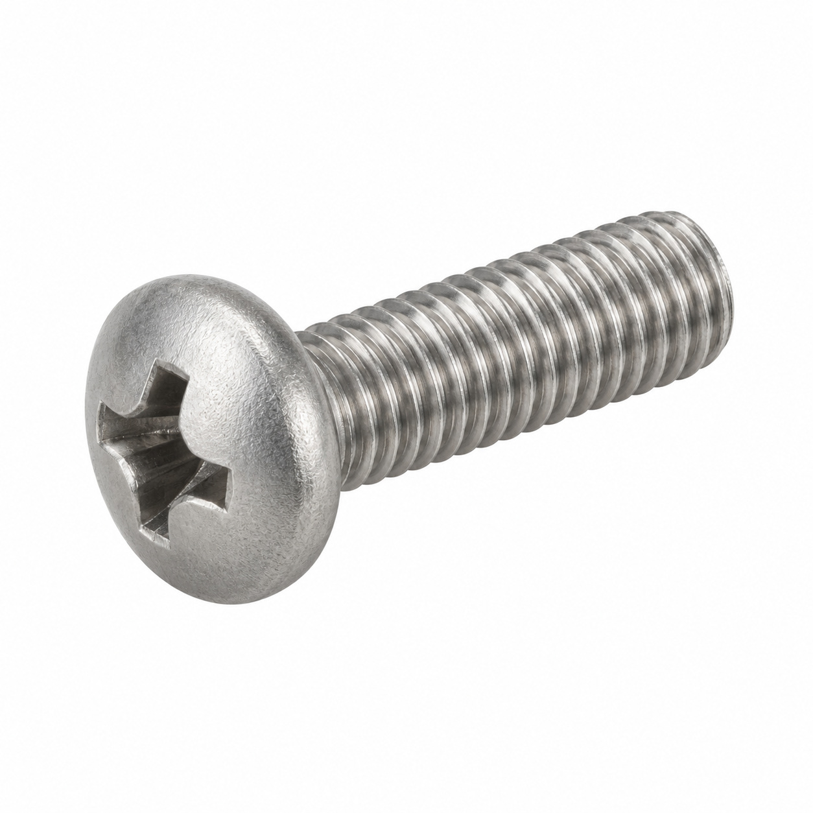
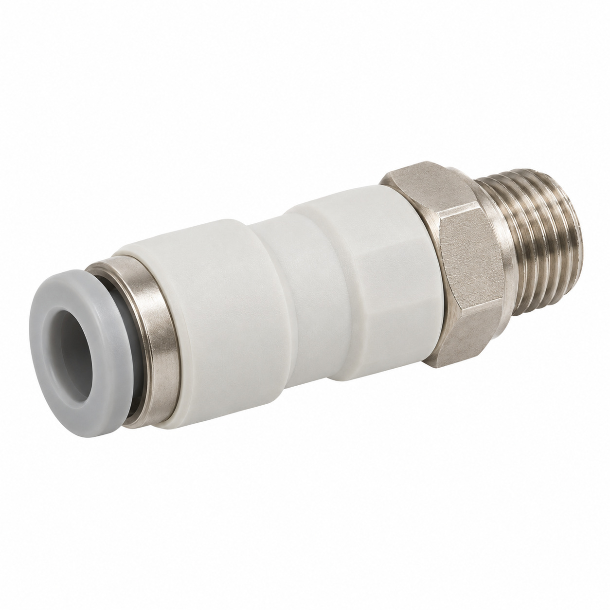
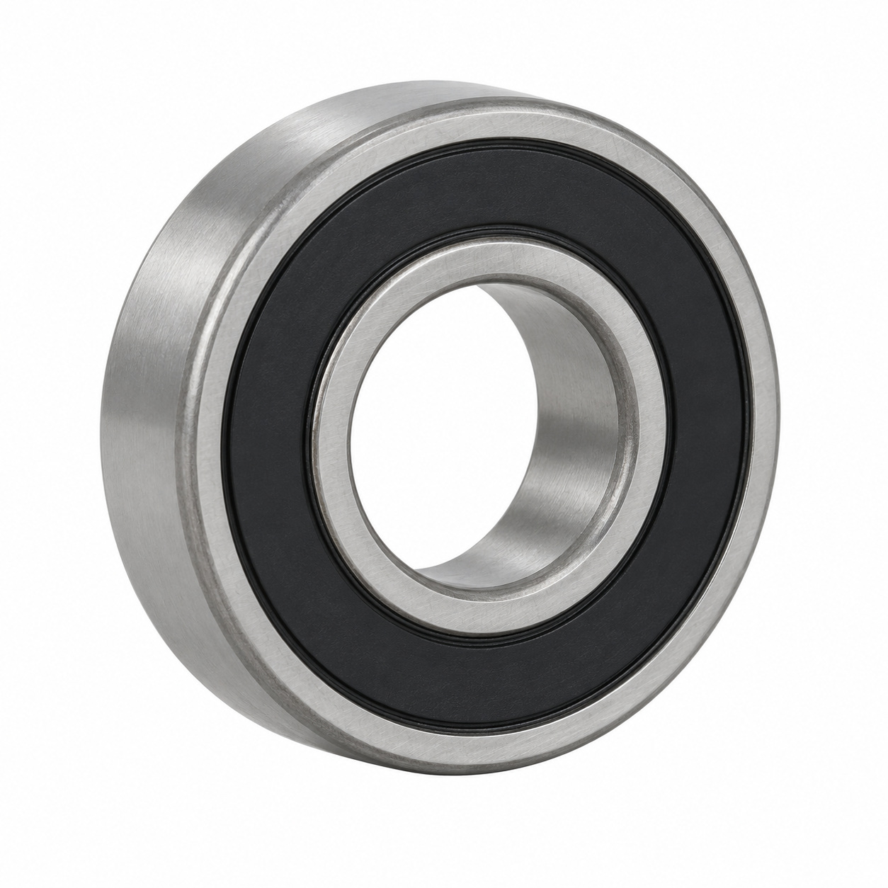
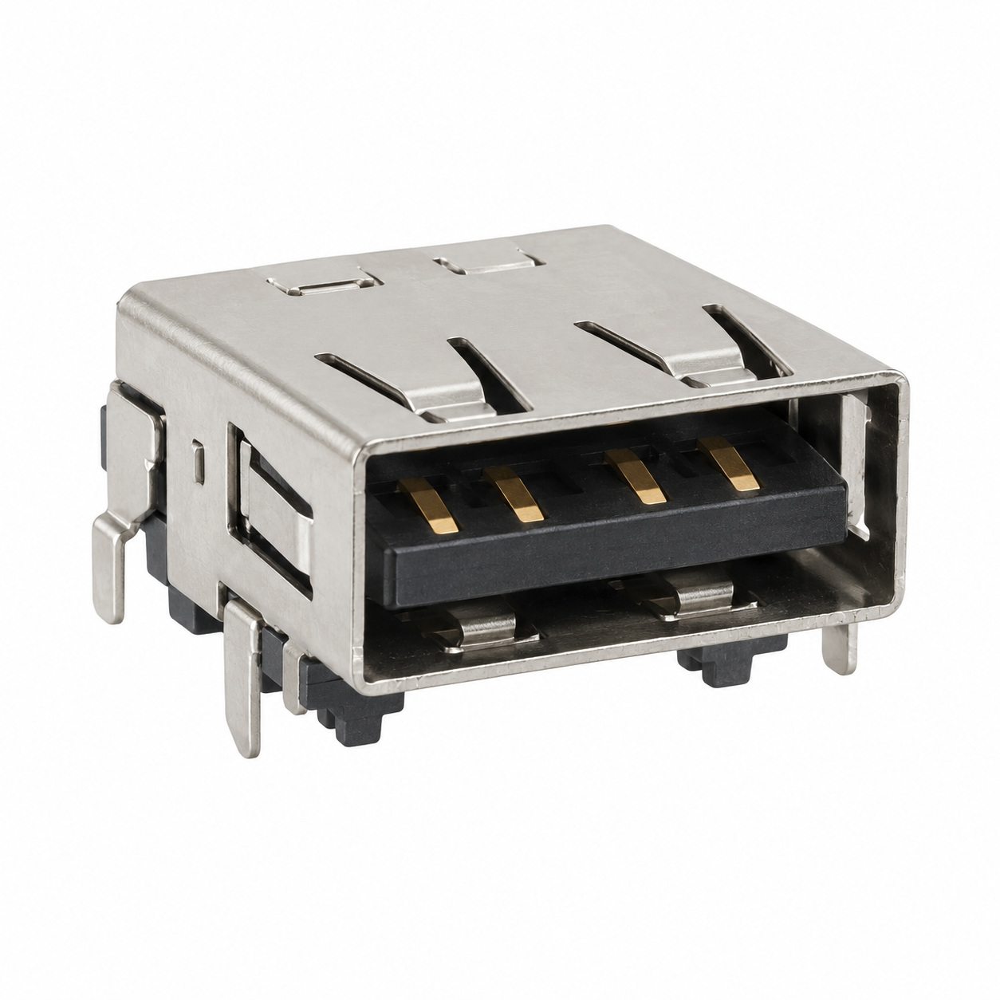
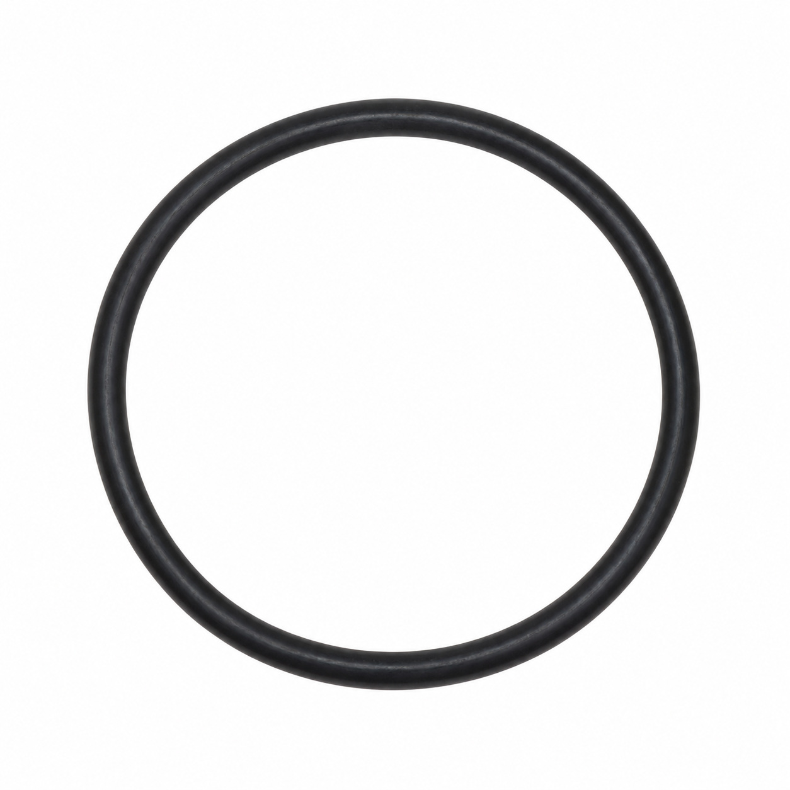
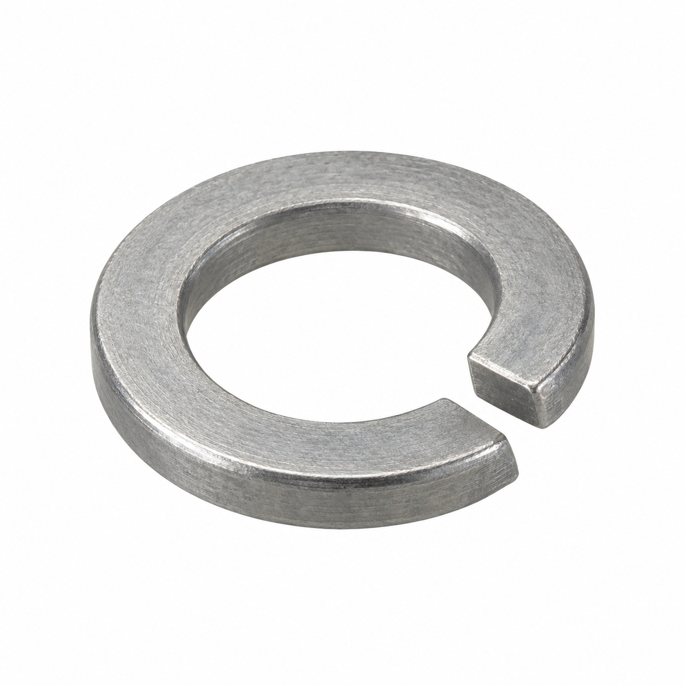
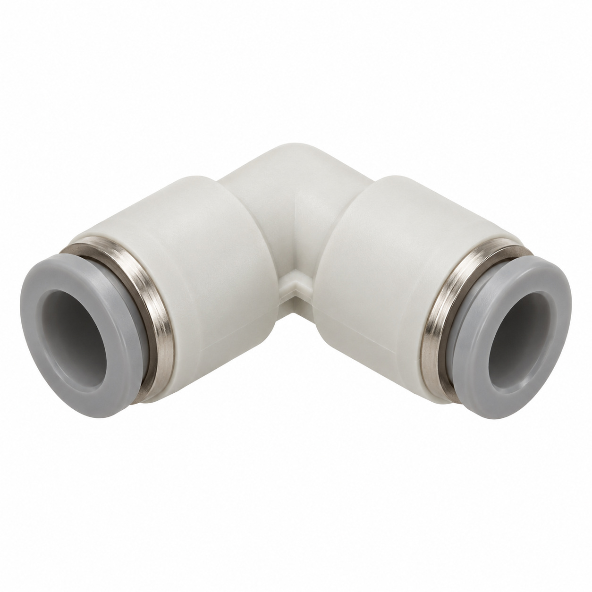
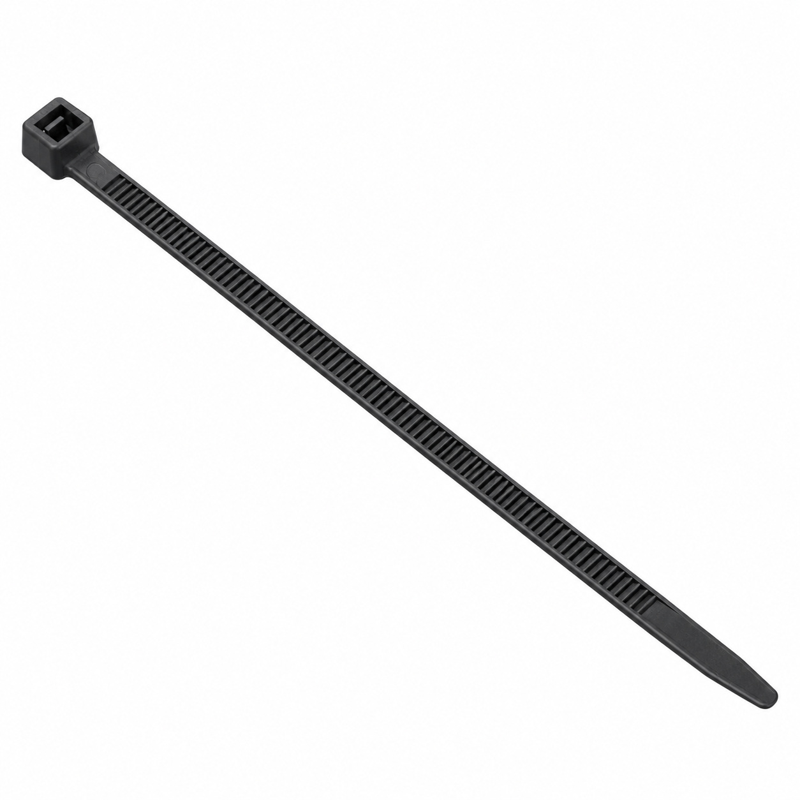
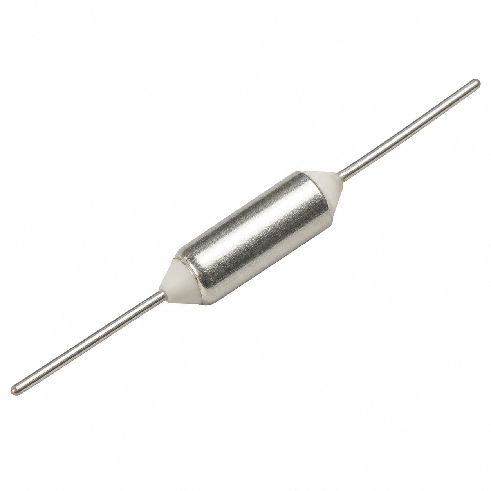

# Generic illustrations — batch 03

Ten name-based illustrations for review. These are generic component types, not exact photos or confirmed manufacturer geometry. Catalog names and SKUs identify the intended entry, not a visual match to a reference photo. No specifications, color, dimensions or fitment should be inferred from the image.

[Back to full gallery](README.md)

| SKU | Catalog name | Image |
| --- | --- | --- |
| 104.837 | O-Ring 14.00x1.78 FKM | [Open image](generic-104.837.jpg) |
| 135.200 | Oval head screw Phillips M4x12 | [Open image](generic-135.200.jpg) |
| 109.557 | Straight connector 4-M5 | [Open image](generic-109.557.jpg) |
| 129.788 | Deep groove ball bearing 61800 2RS NS7 | [Open image](generic-129.788.jpg) |
| 129.419 | Receptacle USB | [Open image](generic-129.419.jpg) |
| 104.884 | O-Ring 67.00x2.00 NBR 70.5/P5F | [Open image](generic-104.884.jpg) |
| 142.611 | Elastic clip washer ø05 | [Open image](generic-142.611.jpg) |
| 127.698 | Elbow connector 4-4 | [Open image](generic-127.698.jpg) |
| 103.238 | Cable tie 80...100 x 2.3/2.4/2.5 | [Open image](generic-103.238.jpg) |
| 107.286 | Thermical security 125°C HM | [Open image](generic-107.286.jpg) |

## 104.837 — O-Ring 14.00x1.78 FKM

## 135.200 — Oval head screw Phillips M4x12

## 109.557 — Straight connector 4-M5

## 129.788 — Deep groove ball bearing 61800 2RS NS7

## 129.419 — Receptacle USB

## 104.884 — O-Ring 67.00x2.00 NBR 70.5/P5F

## 142.611 — Elastic clip washer ø05

## 127.698 — Elbow connector 4-4

## 103.238 — Cable tie 80...100 x 2.3/2.4/2.5

## 107.286 — Thermical security 125°C HM

