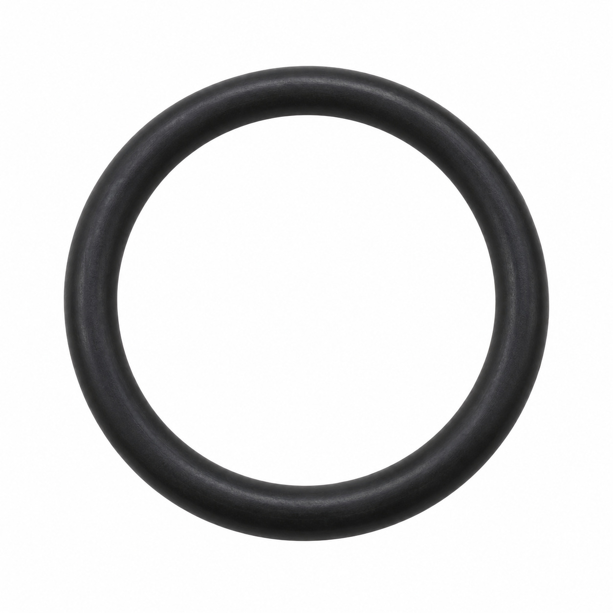
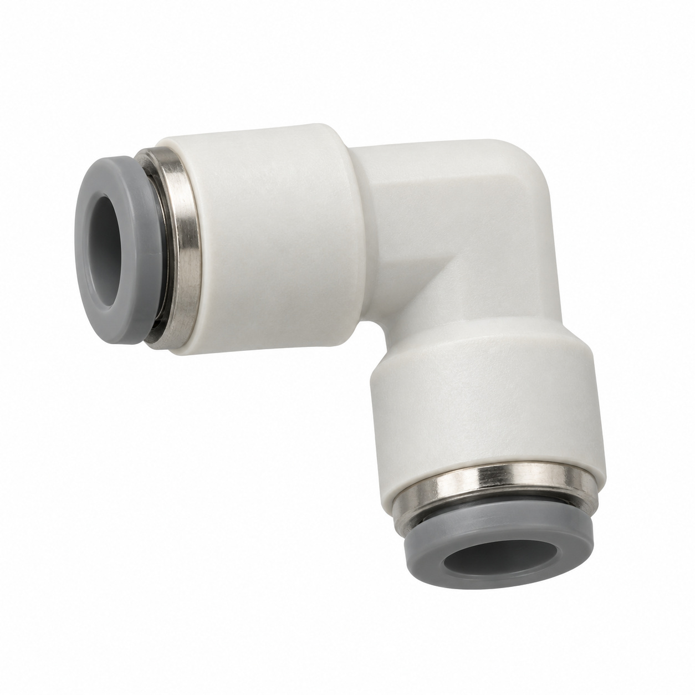
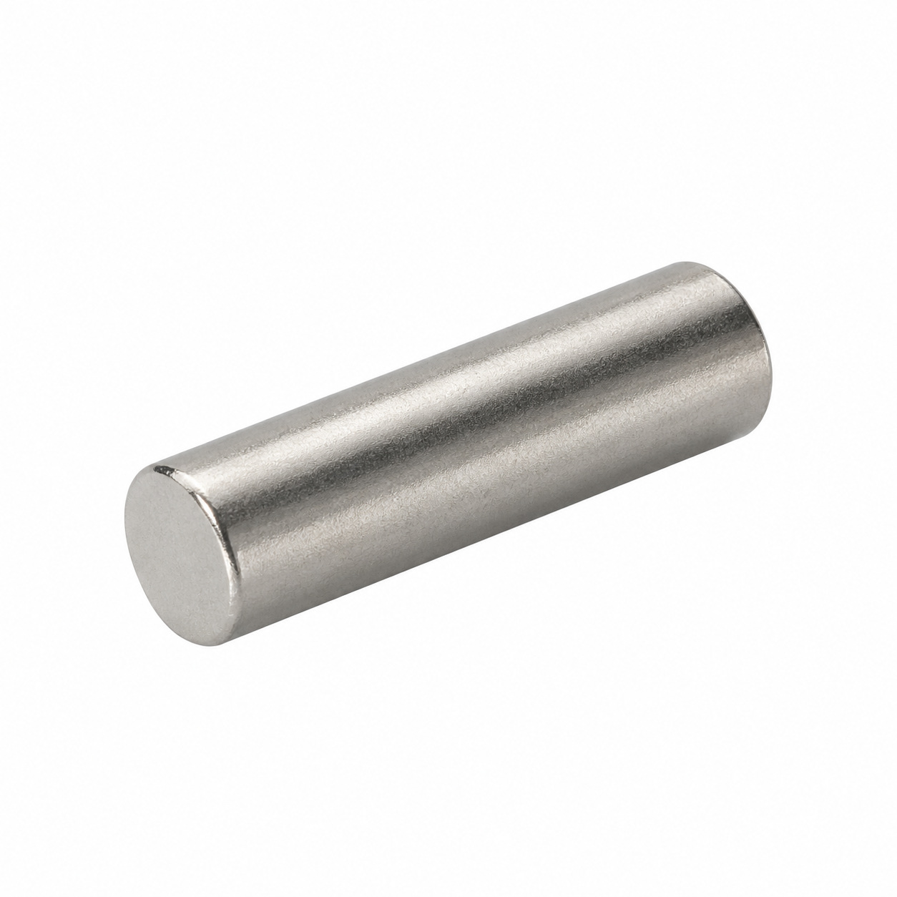
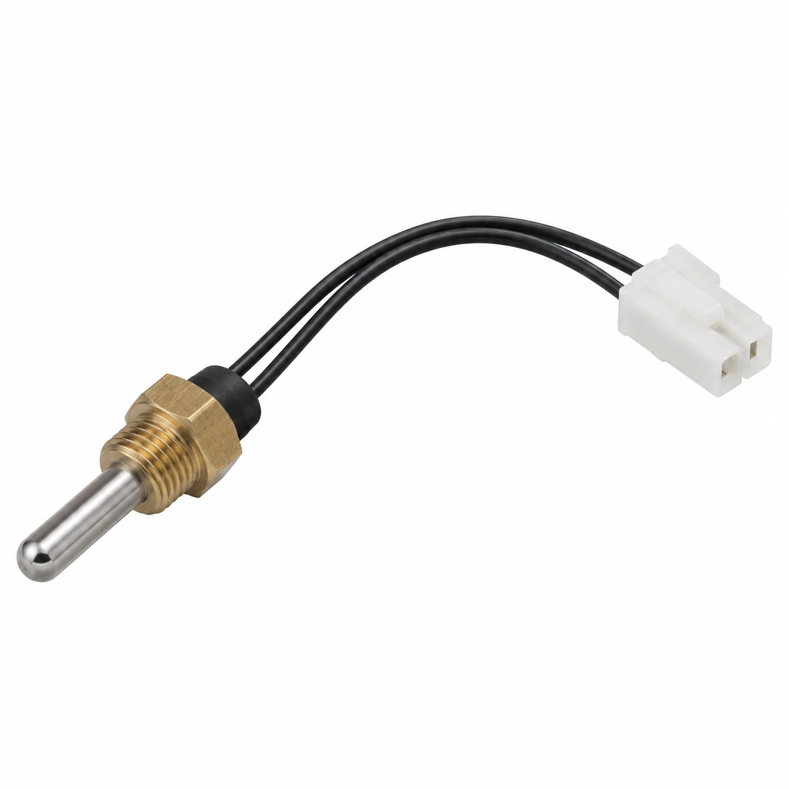
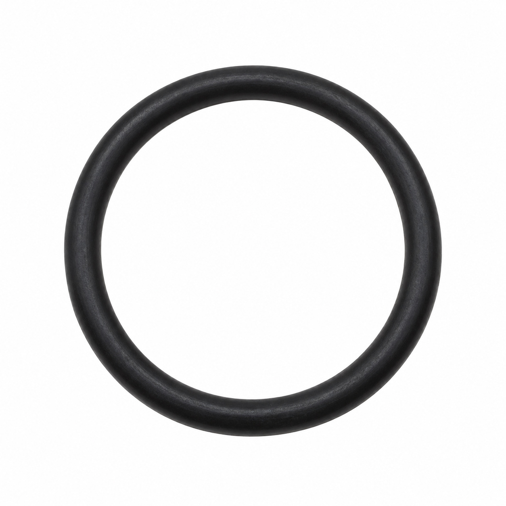
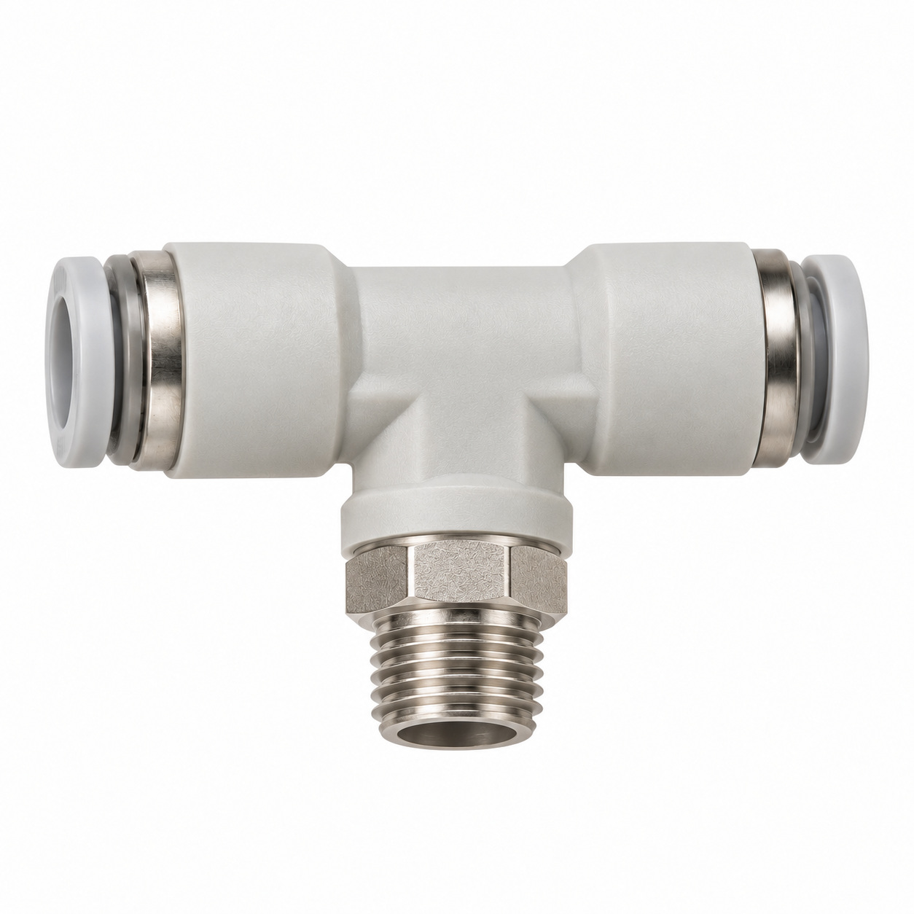
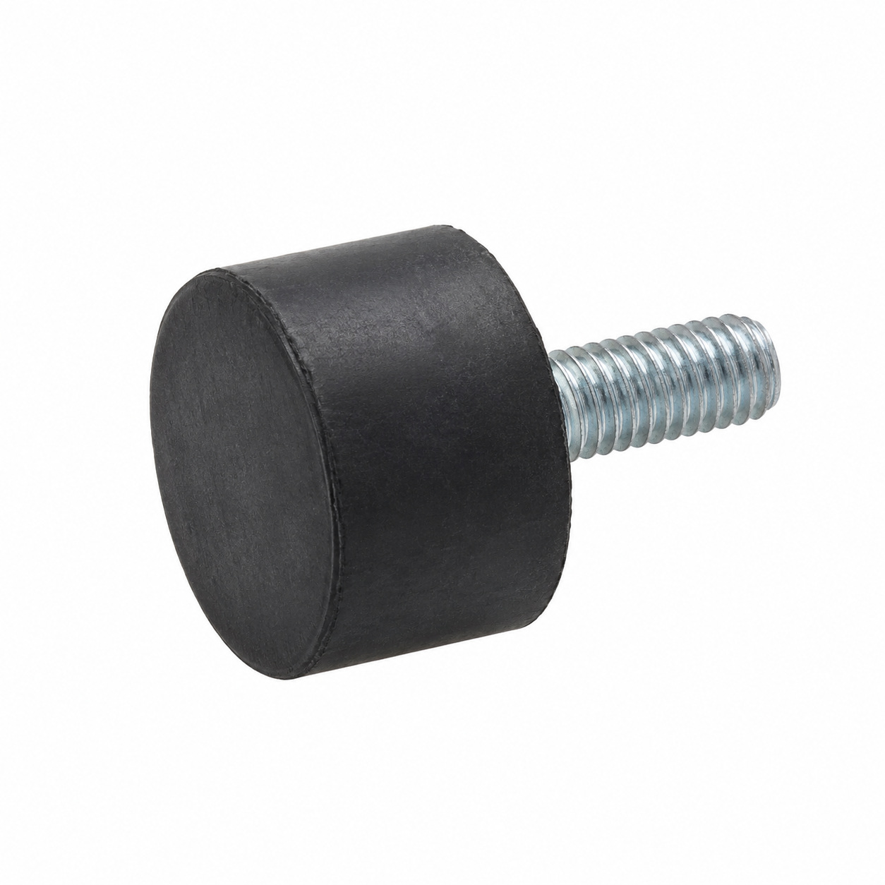
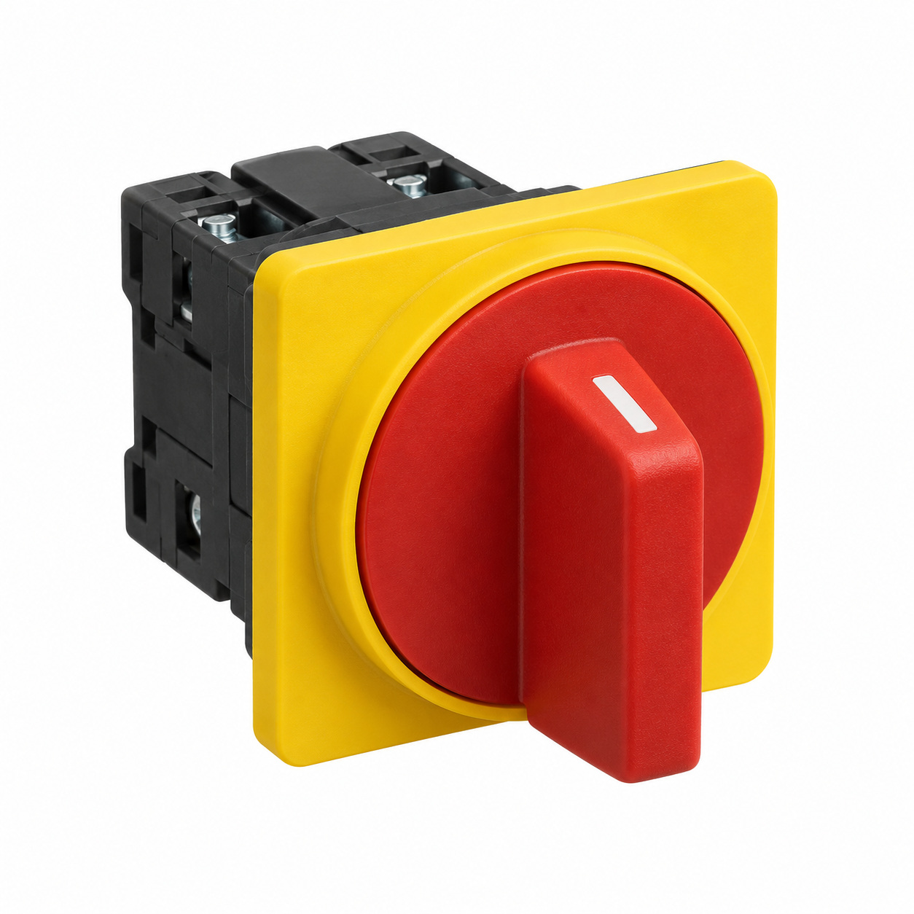

# Generic illustrations — batch 04

Ten name-based illustrations for review. These are generic component types, not exact photos or confirmed manufacturer geometry. Catalog names and SKUs identify the intended entry, not a visual match to a reference photo. No specifications, color, dimensions or fitment should be inferred from the image.

[Back to full gallery](README.md)

| SKU | Catalog name | Image |
| --- | --- | --- |
| 133.046 | O-Ring 23.39x3.53 FKM | [Open image](generic-133.046.jpg) |
| 104.029 | Oval head screw Phillips M3x8 | [Open image](generic-104.029.jpg) |
| 124.867 | Angle plug connection 6-4 | [Open image](generic-124.867.jpg) |
| 130.818 | Rod magnet ø4x15 | [Open image](generic-130.818.jpg) |
| 132.595 | NTC probe assy. boiler 10k | [Open image](generic-132.595.jpg) |
| 130.531 | O-Ring 18.00x2.00 EPDM 75.5/KW75F | [Open image](generic-130.531.jpg) |
| 104.034 | Oval head screw Phillips M4x12 | [Open image](generic-104.034.jpg) |
| 125.870 | T-fitting 4-1/8 | [Open image](generic-125.870.jpg) |
| 128.841 | Circular buffer ø15x14/M4x13 | [Open image](generic-128.841.jpg) |
| 102.744 | Main power switch | [Open image](generic-102.744.jpg) |

## 133.046 — O-Ring 23.39x3.53 FKM

## 104.029 — Oval head screw Phillips M3x8

## 124.867 — Angle plug connection 6-4

## 130.818 — Rod magnet ø4x15

## 132.595 — NTC probe assy. boiler 10k

## 130.531 — O-Ring 18.00x2.00 EPDM 75.5/KW75F

## 104.034 — Oval head screw Phillips M4x12

## 125.870 — T-fitting 4-1/8

## 128.841 — Circular buffer ø15x14/M4x13

## 102.744 — Main power switch

