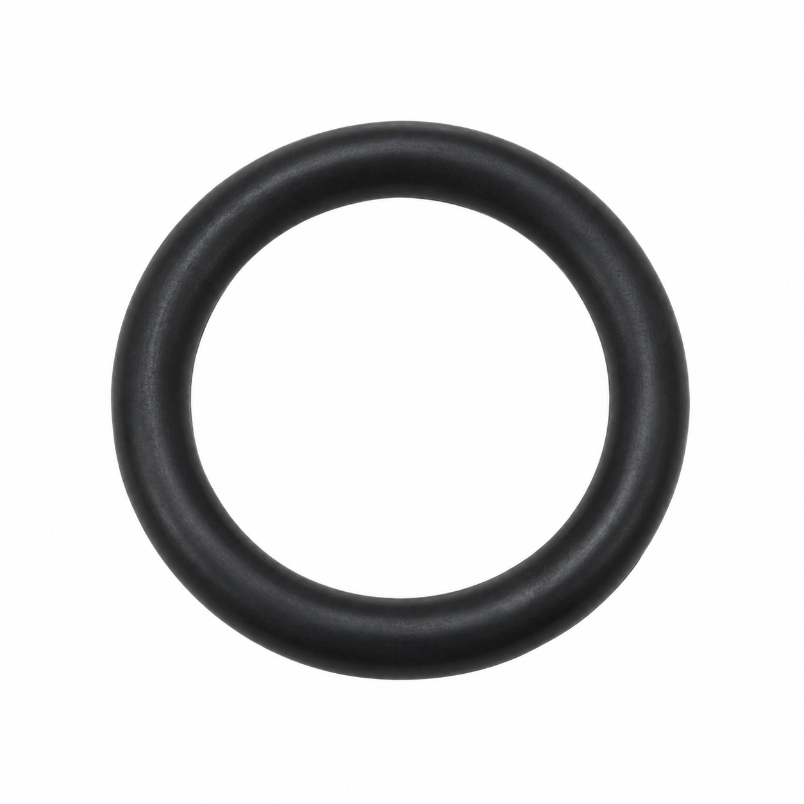
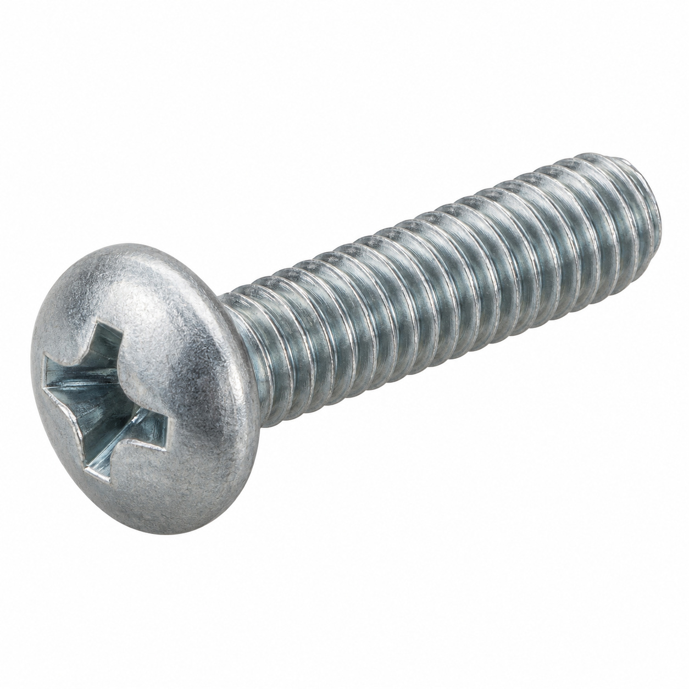
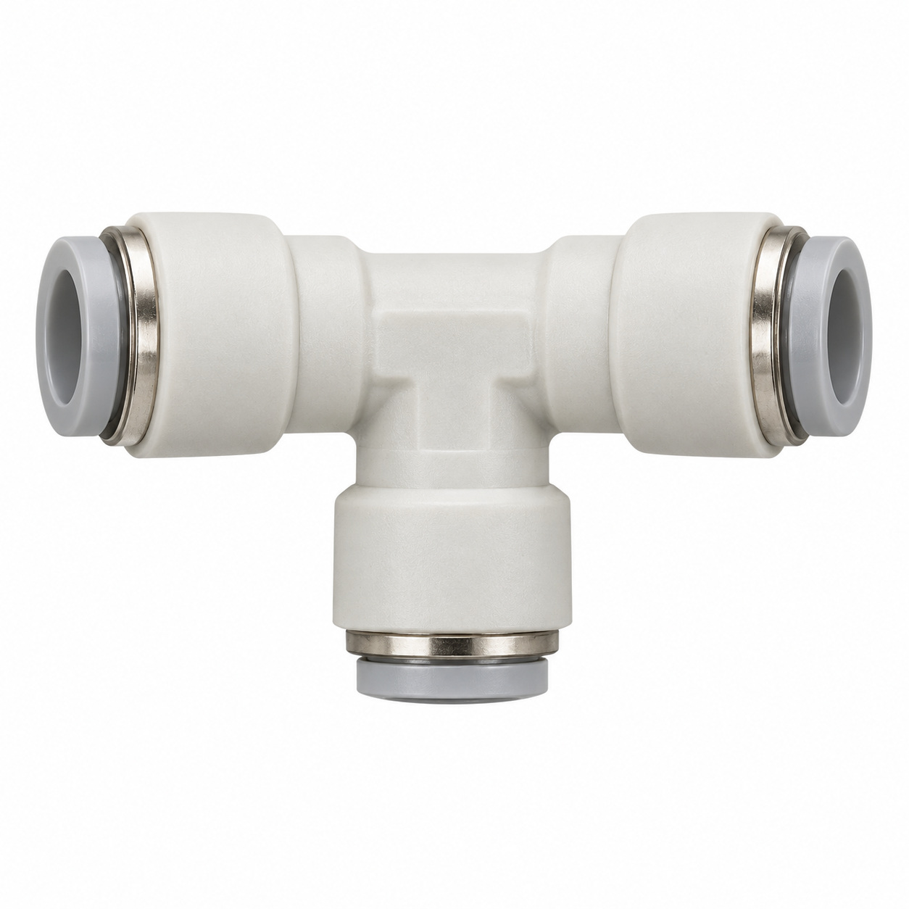
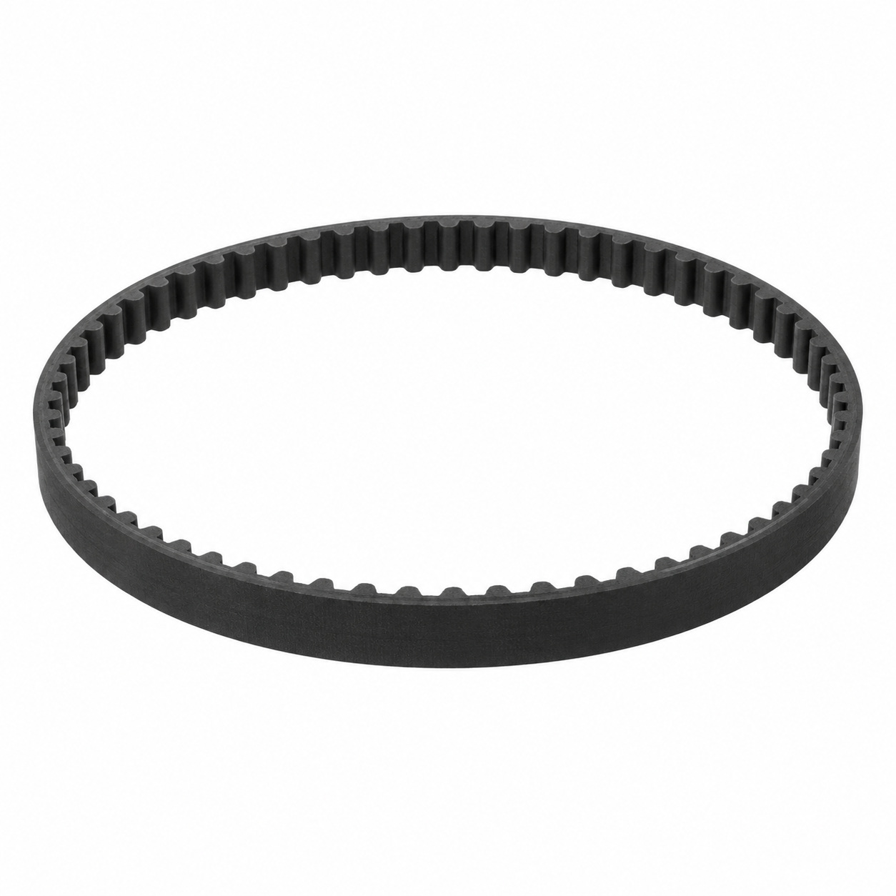
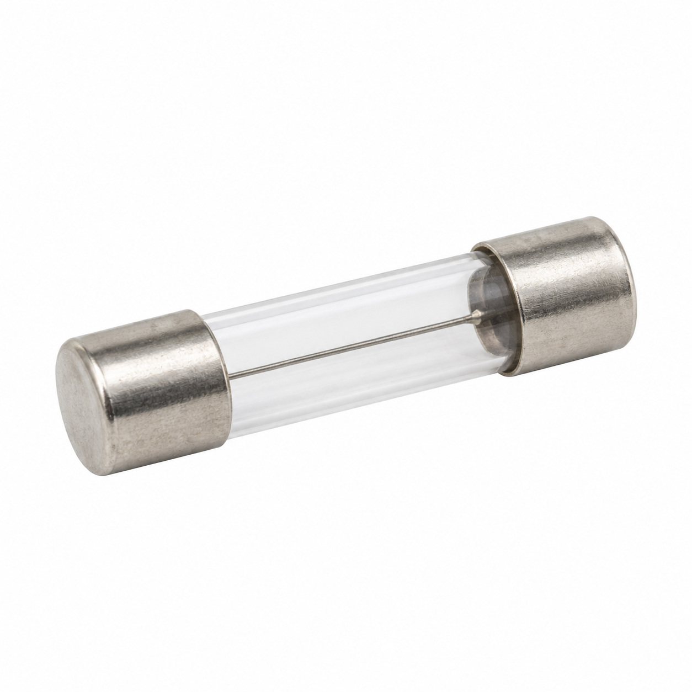
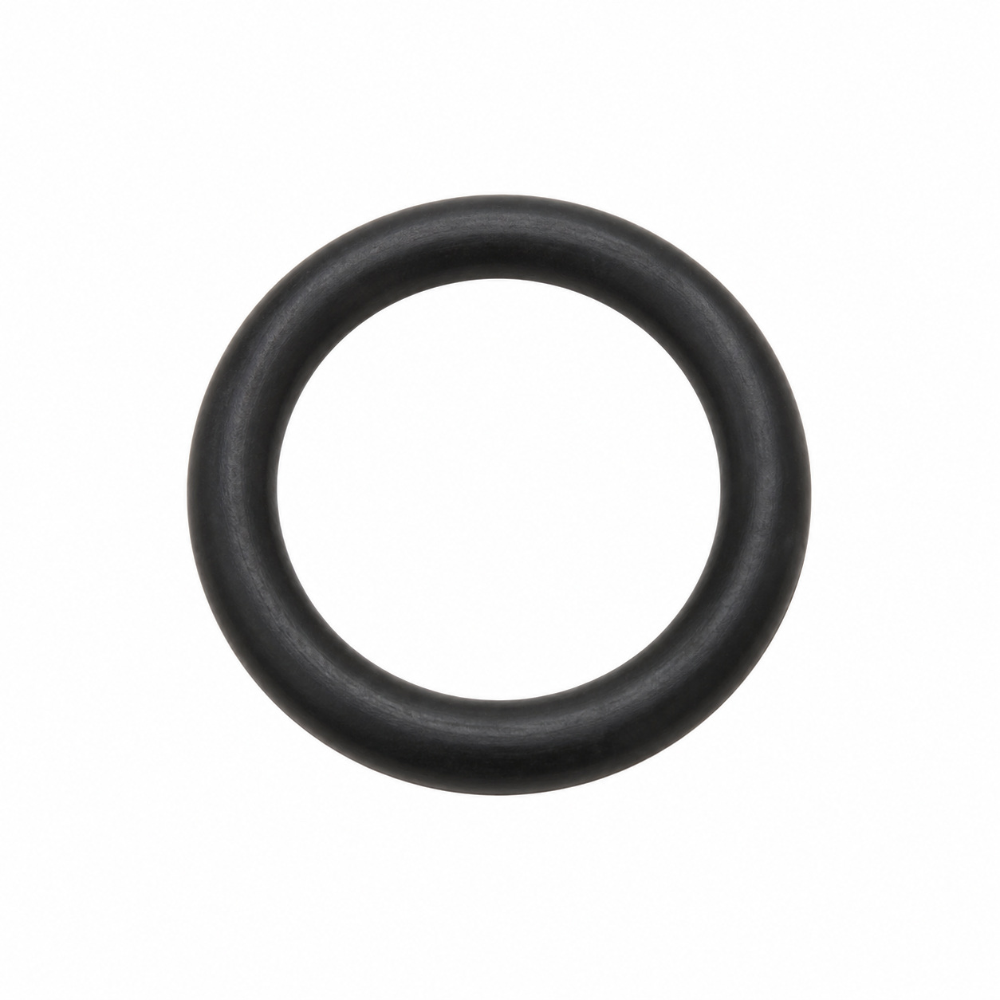
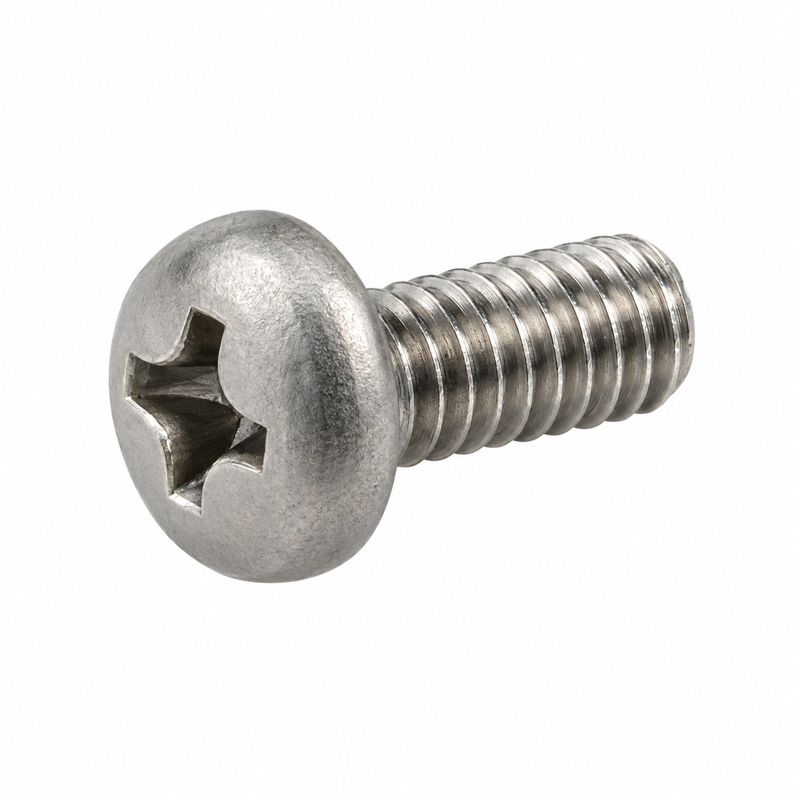
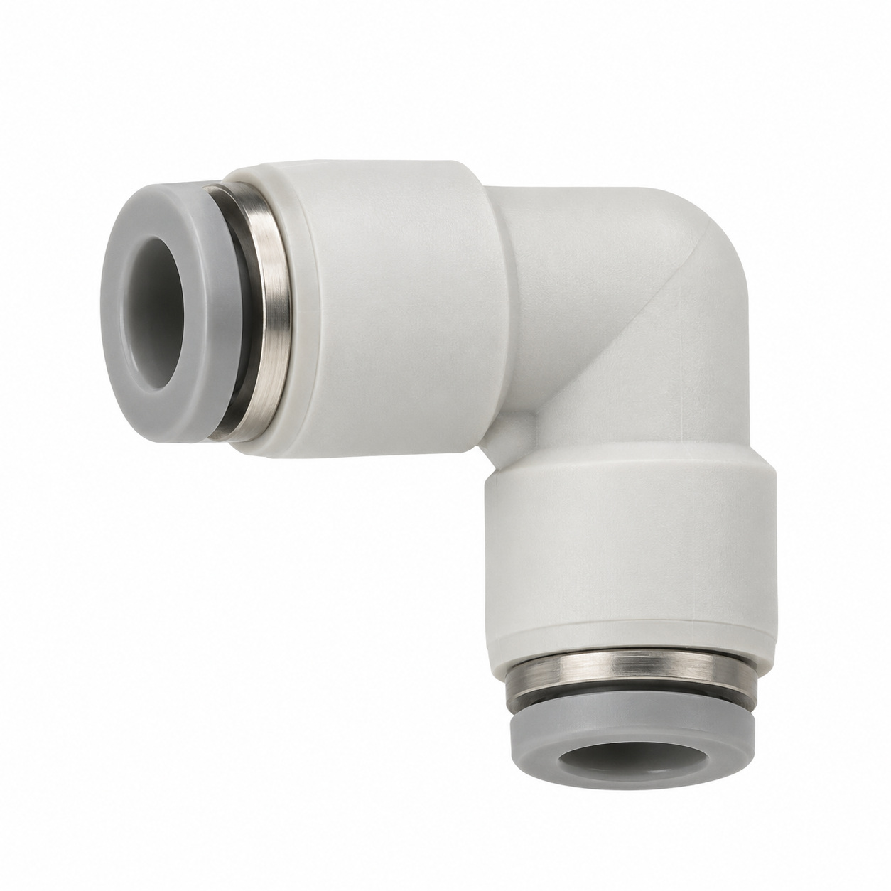
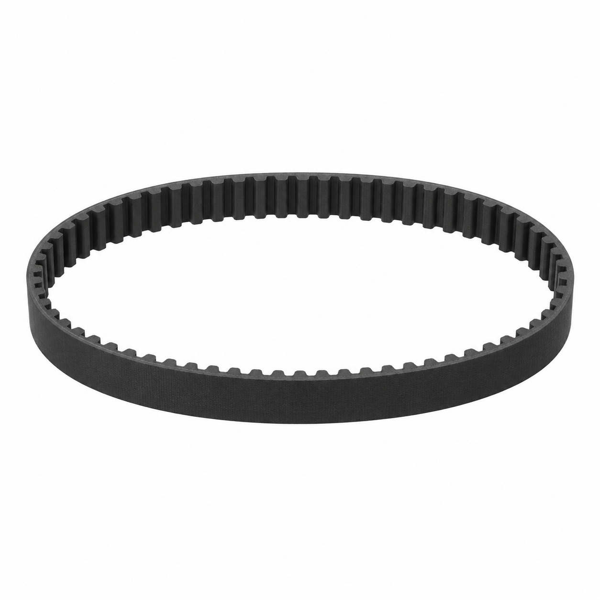
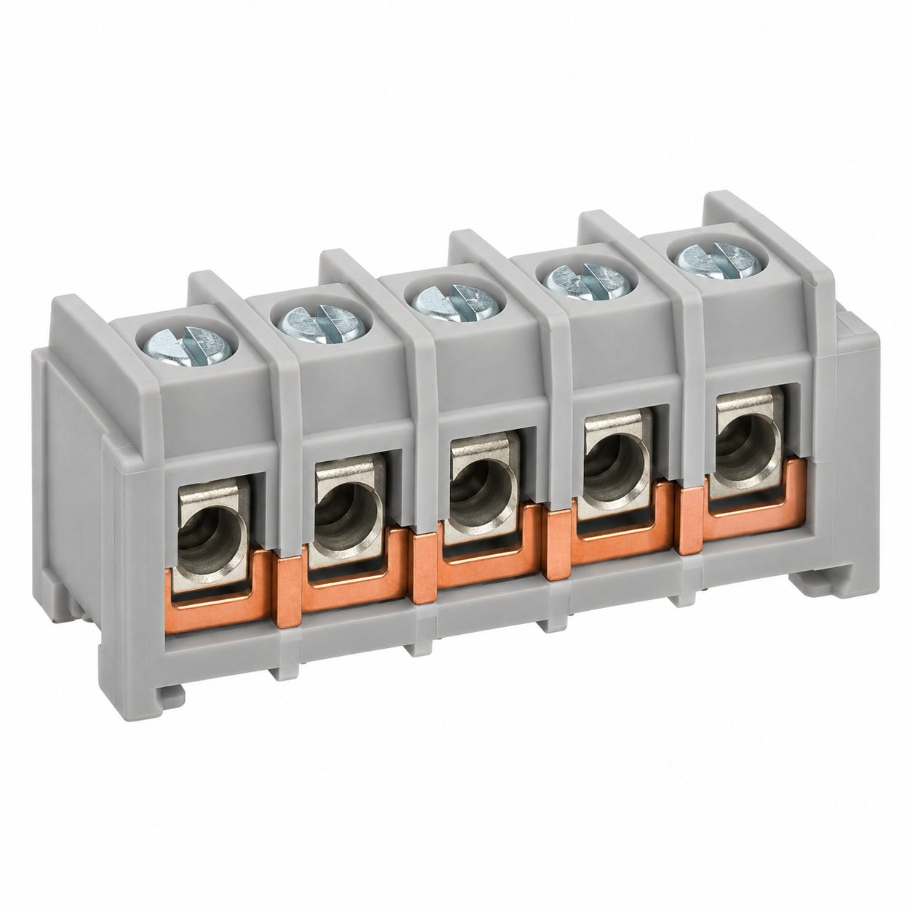

# Generic illustrations — batch 05

Ten name-based illustrations for review. These are generic component types, not exact photos or confirmed manufacturer geometry. Catalog names and SKUs identify the intended entry, not a visual match to a reference photo. No specifications, color, dimensions or fitment should be inferred from the image.

[Back to full gallery](README.md)

| SKU | Catalog name | Image |
| --- | --- | --- |
| 132.508 | O-Ring 6.07x1.78 FKM 75.5/VA75F | [Open image](generic-132.508.jpg) |
| 127.651 | Oval-head screw M4x16 Phillips | [Open image](generic-127.651.jpg) |
| 130.380 | T-connector 4-4-4 | [Open image](generic-130.380.jpg) |
| 124.077 | Toothed belt 305-5M-9 | [Open image](generic-124.077.jpg) |
| 115.843 | Fuse T 2.0A (ø5x20) | [Open image](generic-115.843.jpg) |
| 104.797 | O-Ring 6.75x1.78 FKM | [Open image](generic-104.797.jpg) |
| 104.028 | Phillips screw M3x6 | [Open image](generic-104.028.jpg) |
| 128.499 | Elbow connector 6-6 | [Open image](generic-128.499.jpg) |
| 127.349 | Toothed belt 265-5M-9 | [Open image](generic-127.349.jpg) |
| 125.556 | Terminal 5P with copper bridges | [Open image](generic-125.556.jpg) |

## 132.508 — O-Ring 6.07x1.78 FKM 75.5/VA75F

## 127.651 — Oval-head screw M4x16 Phillips

## 130.380 — T-connector 4-4-4

## 124.077 — Toothed belt 305-5M-9

## 115.843 — Fuse T 2.0A (ø5x20)

## 104.797 — O-Ring 6.75x1.78 FKM

## 104.028 — Phillips screw M3x6

## 128.499 — Elbow connector 6-6

## 127.349 — Toothed belt 265-5M-9

## 125.556 — Terminal 5P with copper bridges

