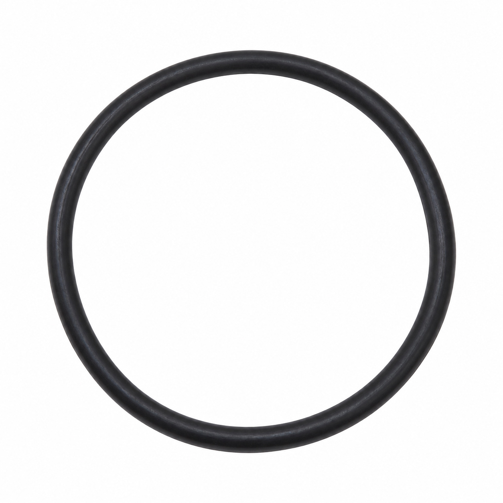
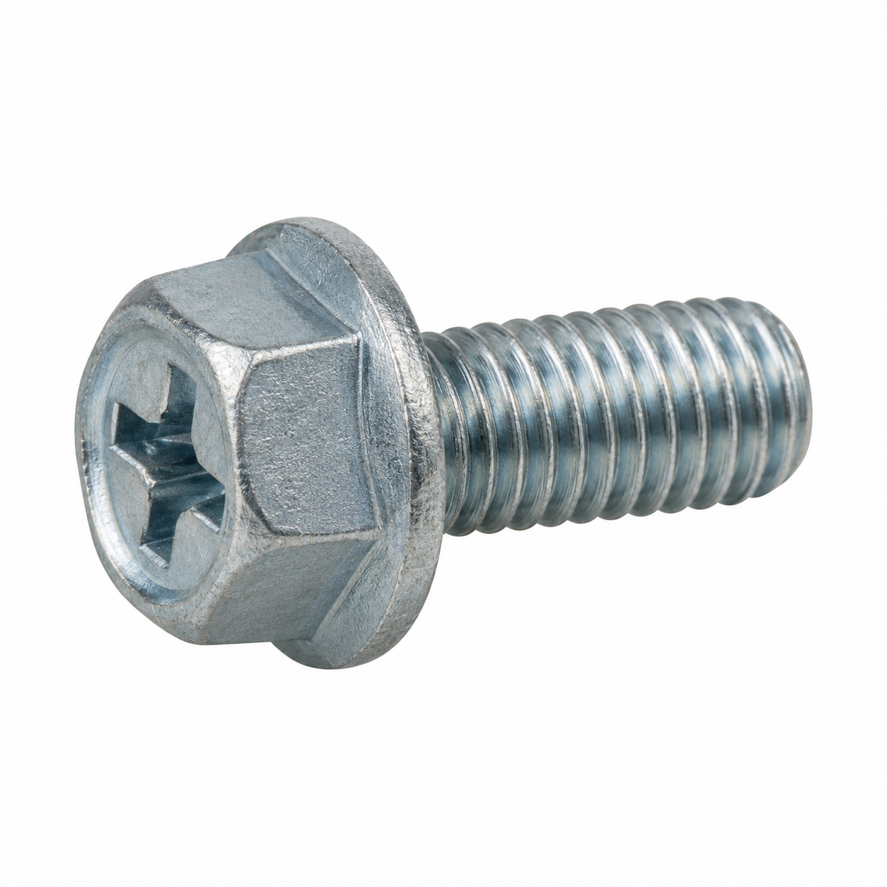
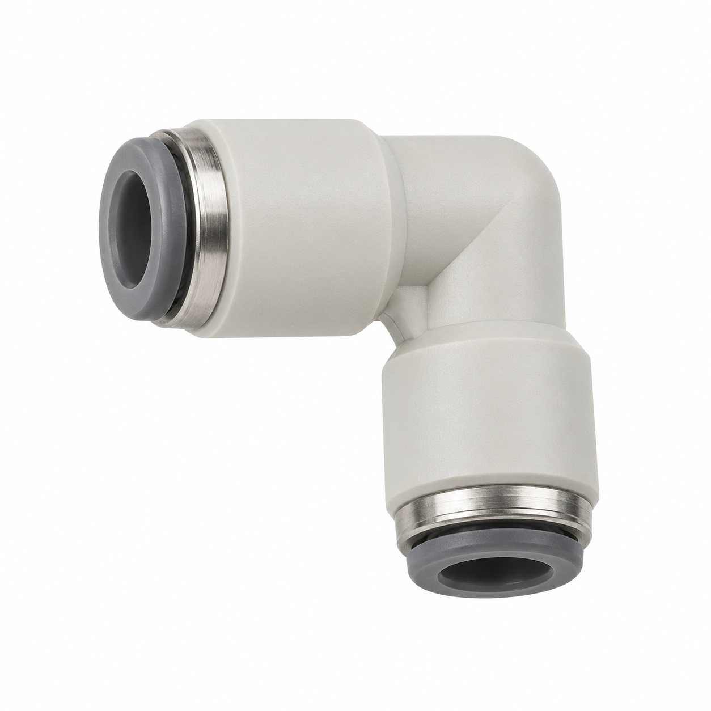
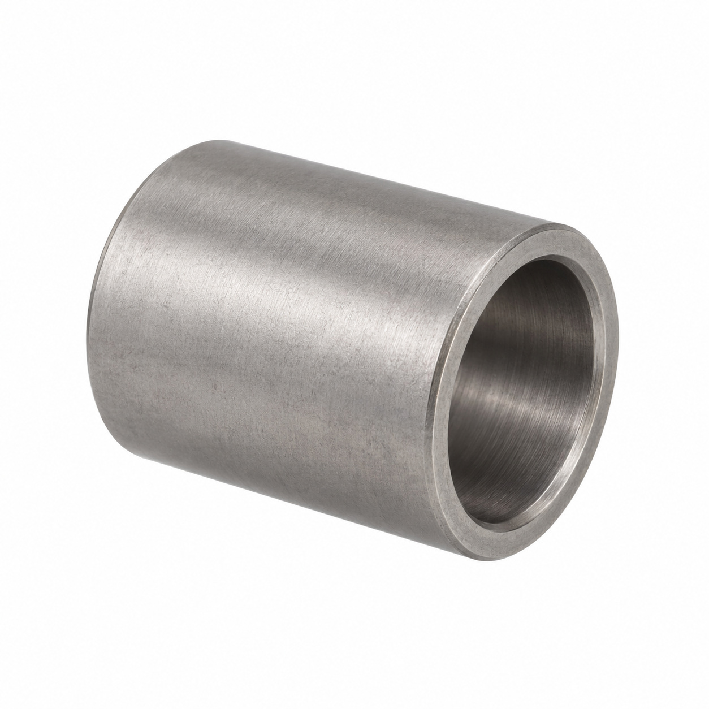
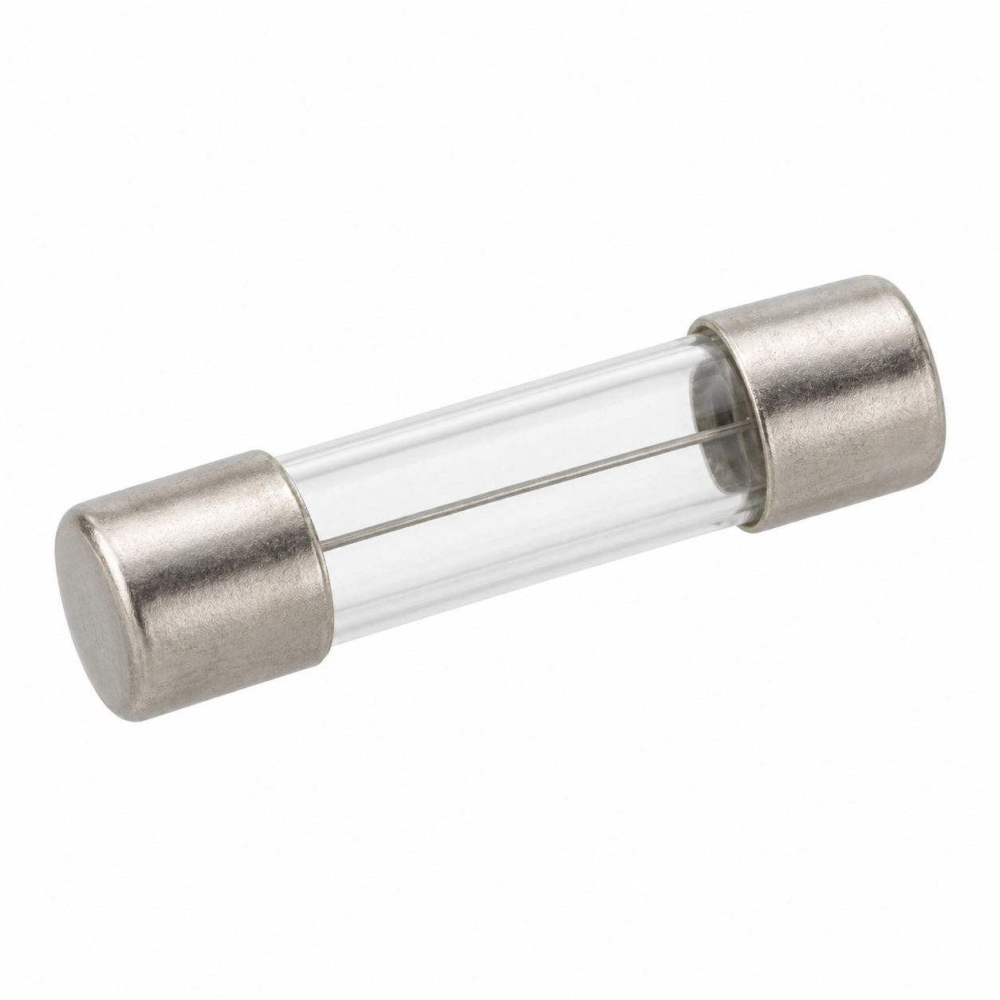
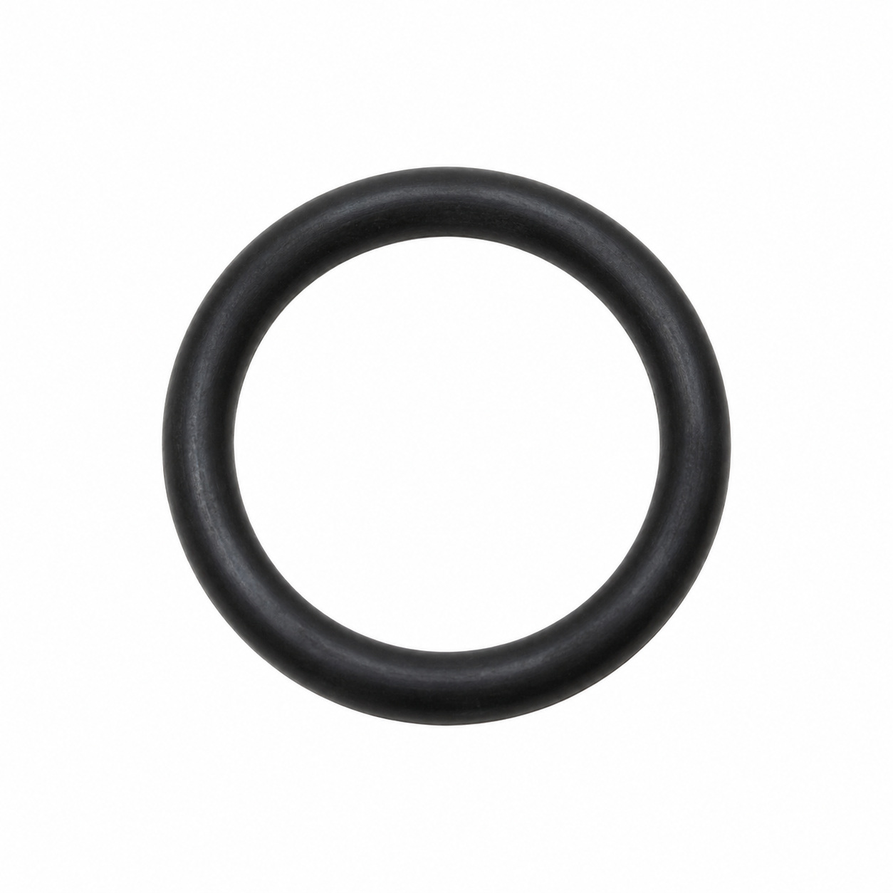
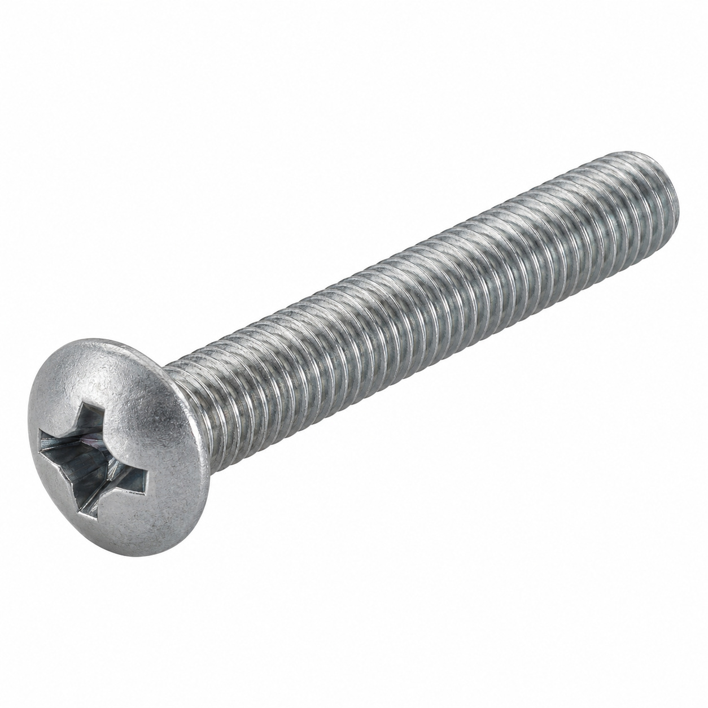
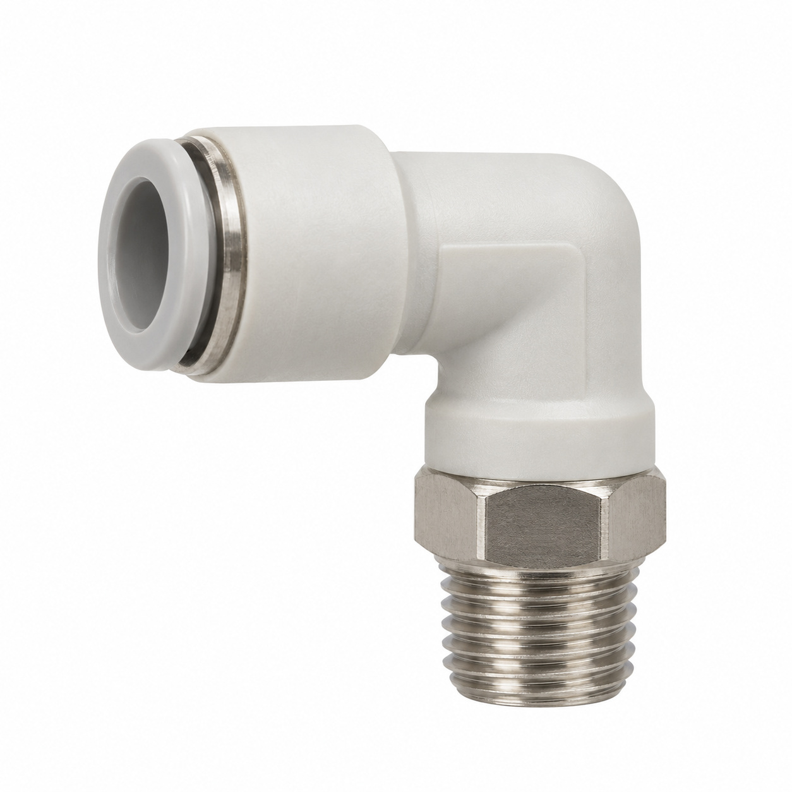
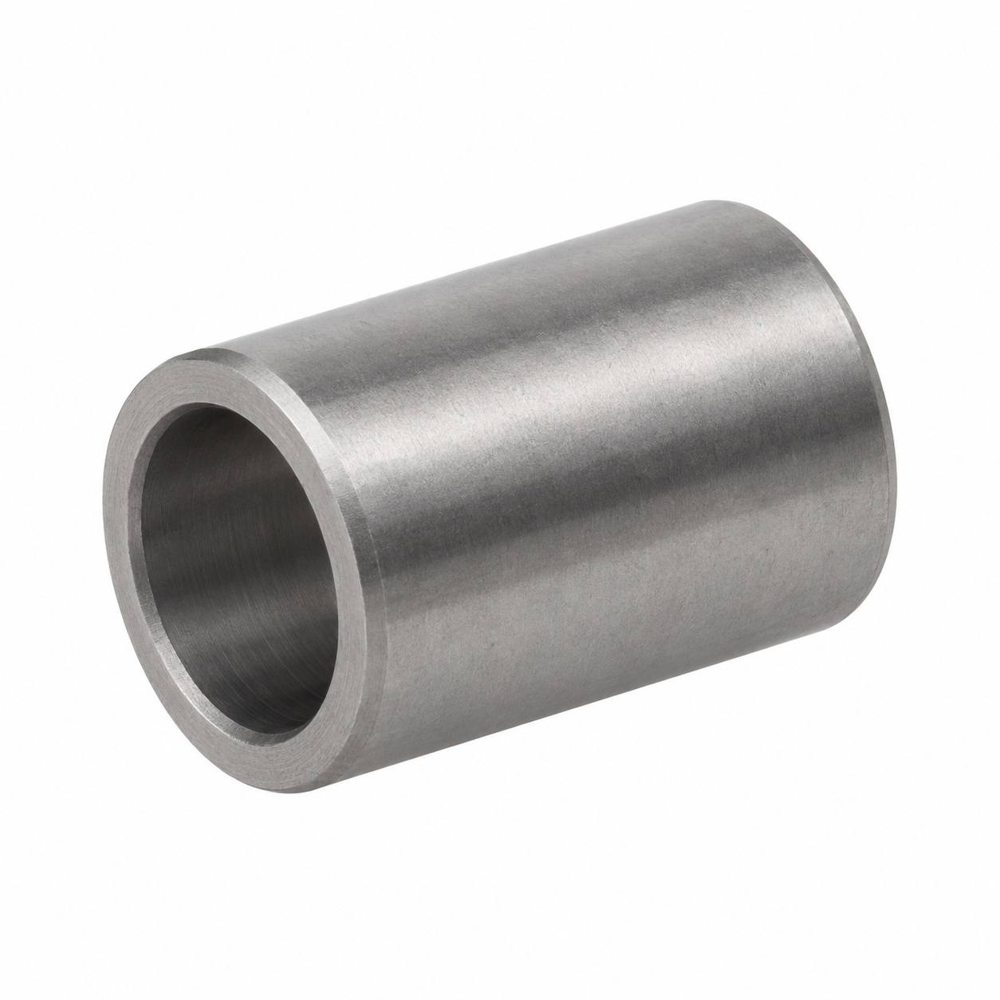
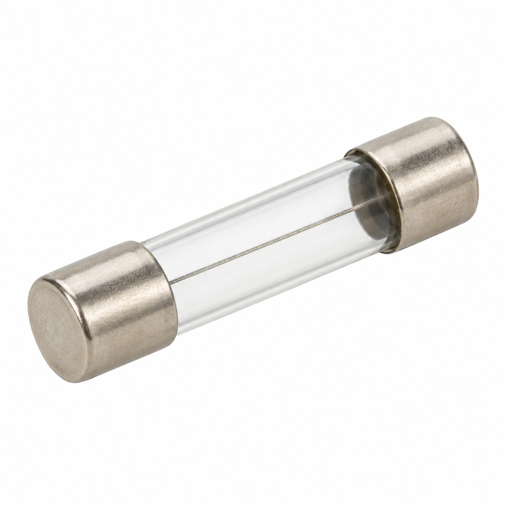

# Generic illustrations — batch 06

Ten name-based illustrations for review. These are generic component types, not exact photos or confirmed manufacturer geometry. Catalog names and SKUs identify the intended entry, not a visual match to a reference photo. No specifications, color, dimensions or fitment should be inferred from the image.

[Back to full gallery](README.md)

| SKU | Catalog name | Image |
| --- | --- | --- |
| 125.393 | O-Ring 85.00x2.50 EPDM 291 | [Open image](generic-125.393.jpg) |
| 126.543 | Hexagonal head screw combi M6x16 | [Open image](generic-126.543.jpg) |
| 134.088 | Elbow connector 6-4 EPDM | [Open image](generic-134.088.jpg) |
| 129.200 | Guide sleeve PAP 2510 P10 | [Open image](generic-129.200.jpg) |
| 129.387 | Fuse 250VAC, F 8A (ø5x20) | [Open image](generic-129.387.jpg) |
| 134.403 | O-Ring 10.82x1.78 EPDM | [Open image](generic-134.403.jpg) |
| 104.043 | Oval head screw Phillips M4x35 | [Open image](generic-104.043.jpg) |
| 127.954 | Elbow connector 8/6-1/4K | [Open image](generic-127.954.jpg) |
| 104.945 | Guide sleeve PAP 1010 P10 | [Open image](generic-104.945.jpg) |
| 130.441 | Fuse 5x20/4A | [Open image](generic-130.441.jpg) |

## 125.393 — O-Ring 85.00x2.50 EPDM 291

## 126.543 — Hexagonal head screw combi M6x16

## 134.088 — Elbow connector 6-4 EPDM

## 129.200 — Guide sleeve PAP 2510 P10

## 129.387 — Fuse 250VAC, F 8A (ø5x20)

## 134.403 — O-Ring 10.82x1.78 EPDM

## 104.043 — Oval head screw Phillips M4x35

## 127.954 — Elbow connector 8/6-1/4K

## 104.945 — Guide sleeve PAP 1010 P10

## 130.441 — Fuse 5x20/4A

