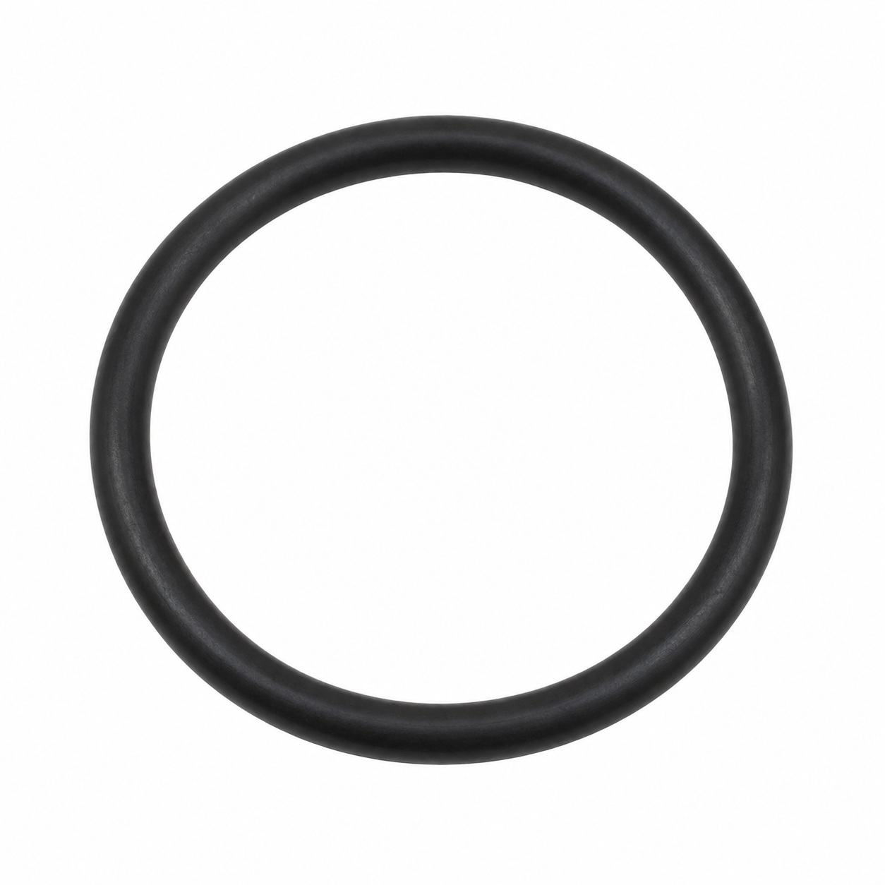
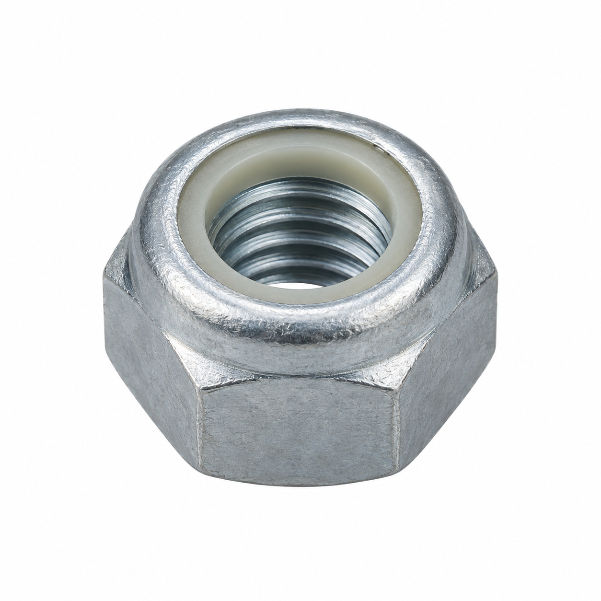
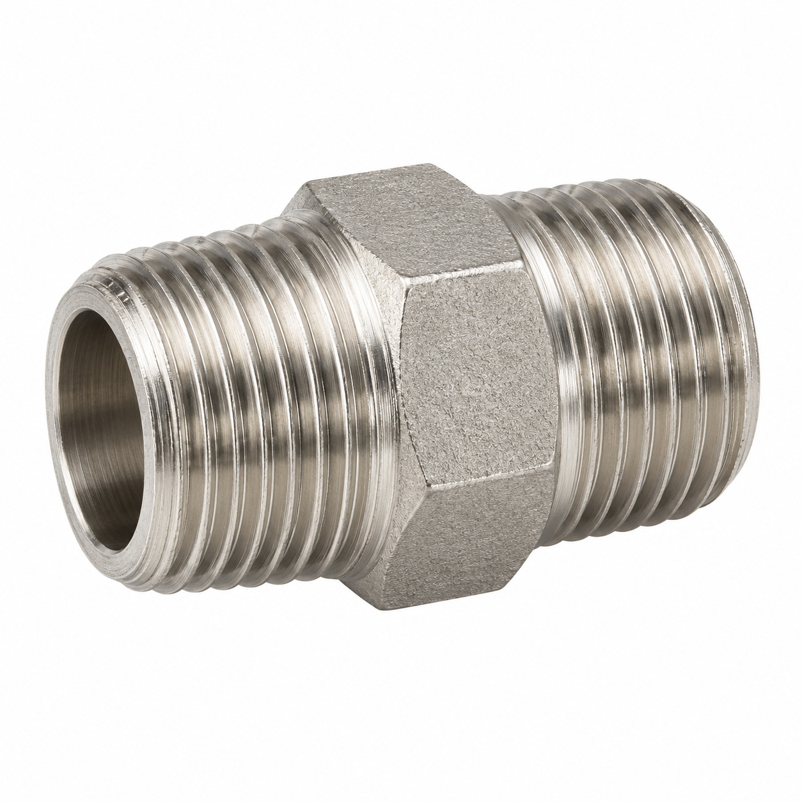
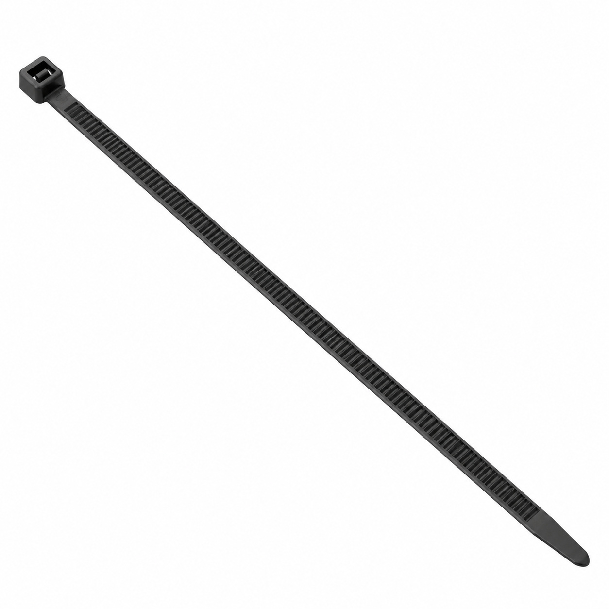
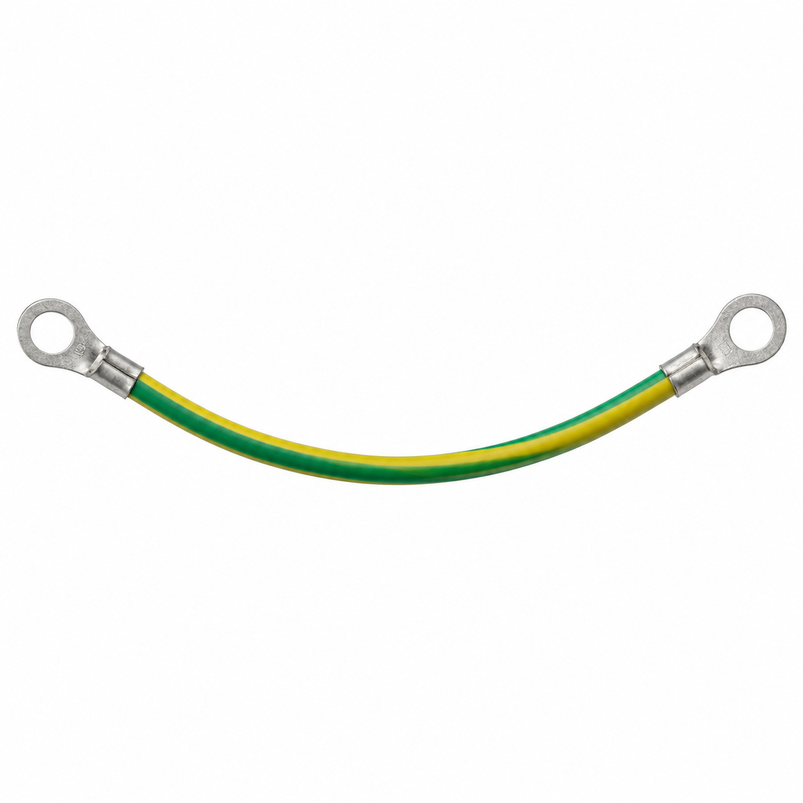
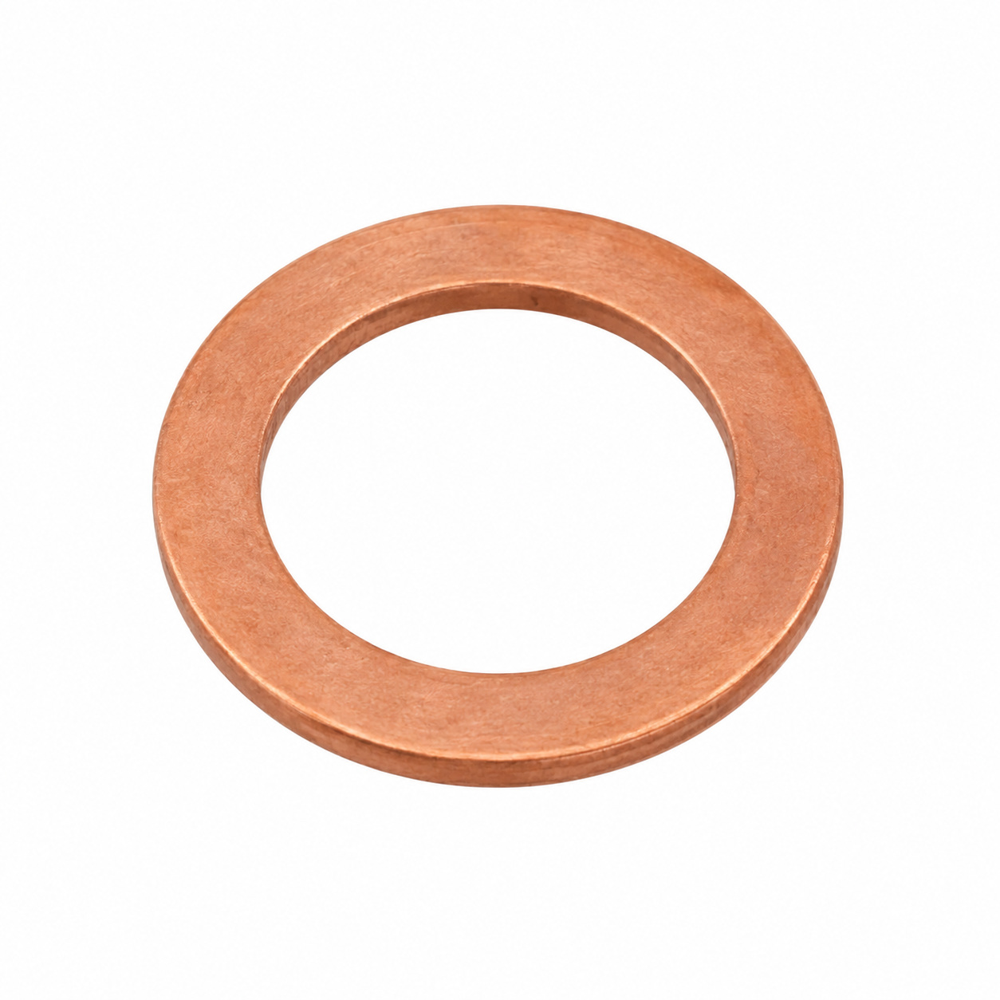
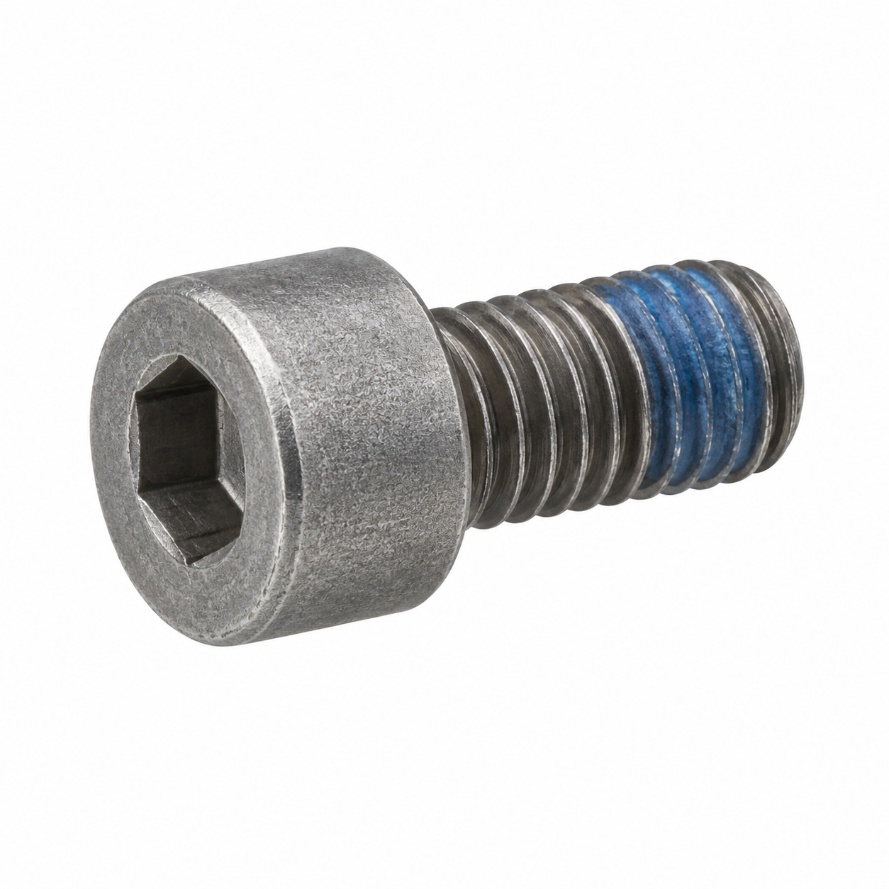
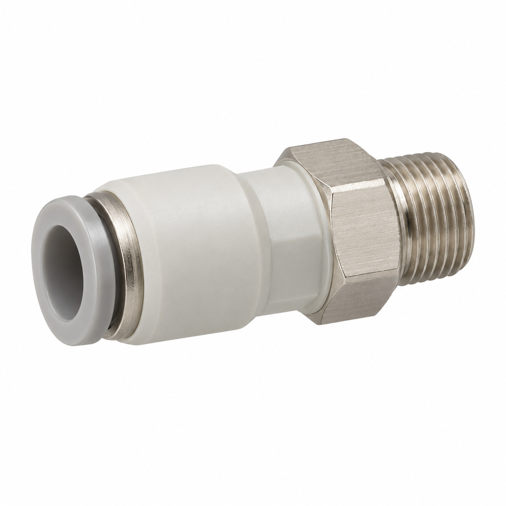
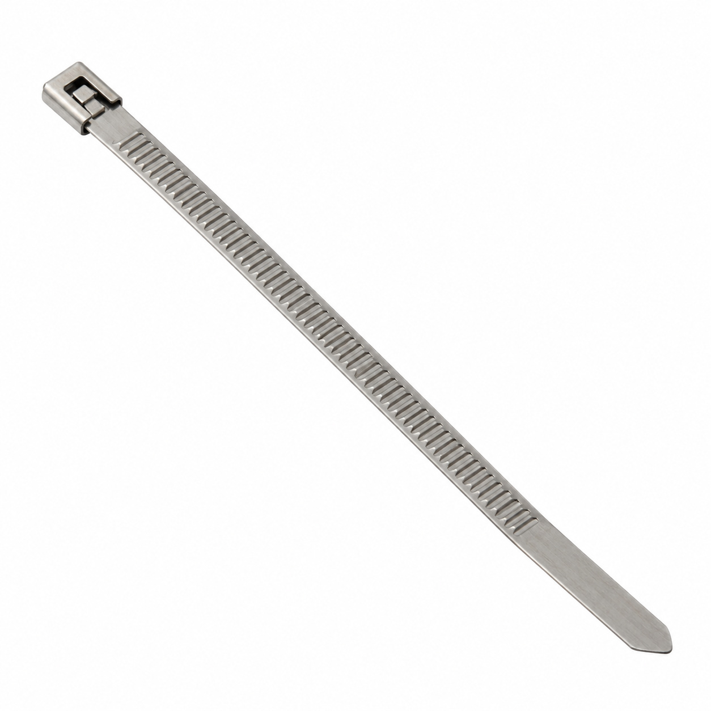
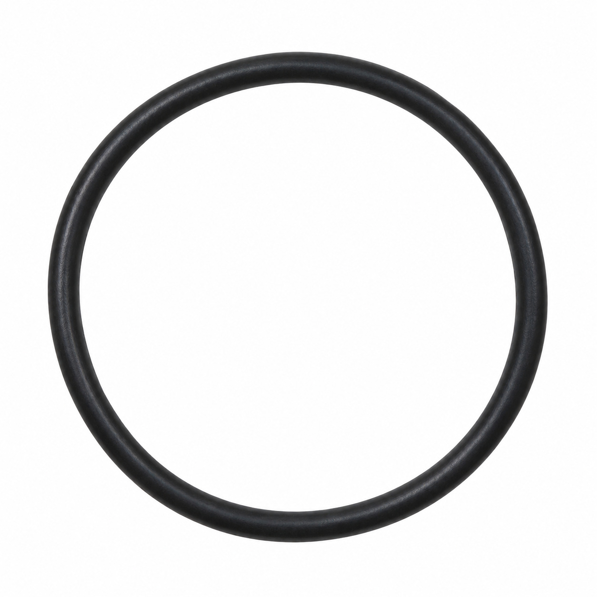

# Generic illustrations — batch 07

Ten name-based illustrations for review. These are generic component types, not exact photos or confirmed manufacturer geometry. Catalog names and SKUs identify the intended entry, not a visual match to a reference photo. No specifications, color, dimensions or fitment should be inferred from the image.

[Back to full gallery](README.md)

| SKU | Catalog name | Image |
| --- | --- | --- |
| 104.857 | O-Ring 21.95x1.78 FKM 75.5/VA75F | [Open image](generic-104.857.jpg) |
| 106.524 | Lock nut M8 Serpress | [Open image](generic-106.524.jpg) |
| 128.247 | Double fitting tapered 1/4-1/4 | [Open image](generic-128.247.jpg) |
| 103.236 | Cable tie 530x8.9 | [Open image](generic-103.236.jpg) |
| 108.629 | Grounding cable 115mm | [Open image](generic-108.629.jpg) |
| 129.288 | Sealing washer M05 | [Open image](generic-129.288.jpg) |
| 108.366 | Socket head screw M4x9 Tuflok | [Open image](generic-108.366.jpg) |
| 133.691 | Body to straight connector 6/4-1/4K | [Open image](generic-133.691.jpg) |
| 133.281 | Metal zip tie | [Open image](generic-133.281.jpg) |
| 129.165 | O-Ring 126.59x3.53 EPDM 291 | [Open image](generic-129.165.jpg) |

## 104.857 — O-Ring 21.95x1.78 FKM 75.5/VA75F

## 106.524 — Lock nut M8 Serpress

## 128.247 — Double fitting tapered 1/4-1/4

## 103.236 — Cable tie 530x8.9

## 108.629 — Grounding cable 115mm

## 129.288 — Sealing washer M05

## 108.366 — Socket head screw M4x9 Tuflok

## 133.691 — Body to straight connector 6/4-1/4K

## 133.281 — Metal zip tie

## 129.165 — O-Ring 126.59x3.53 EPDM 291

