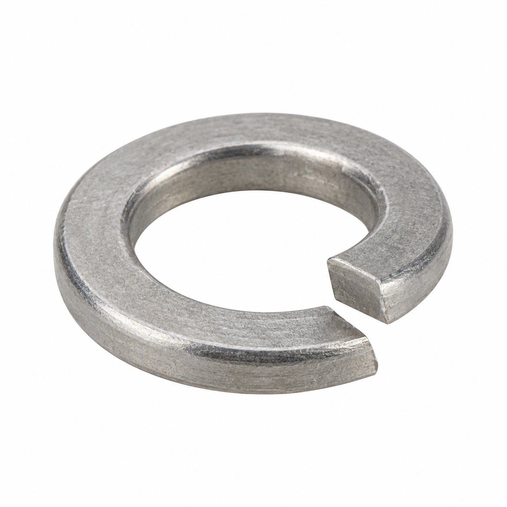
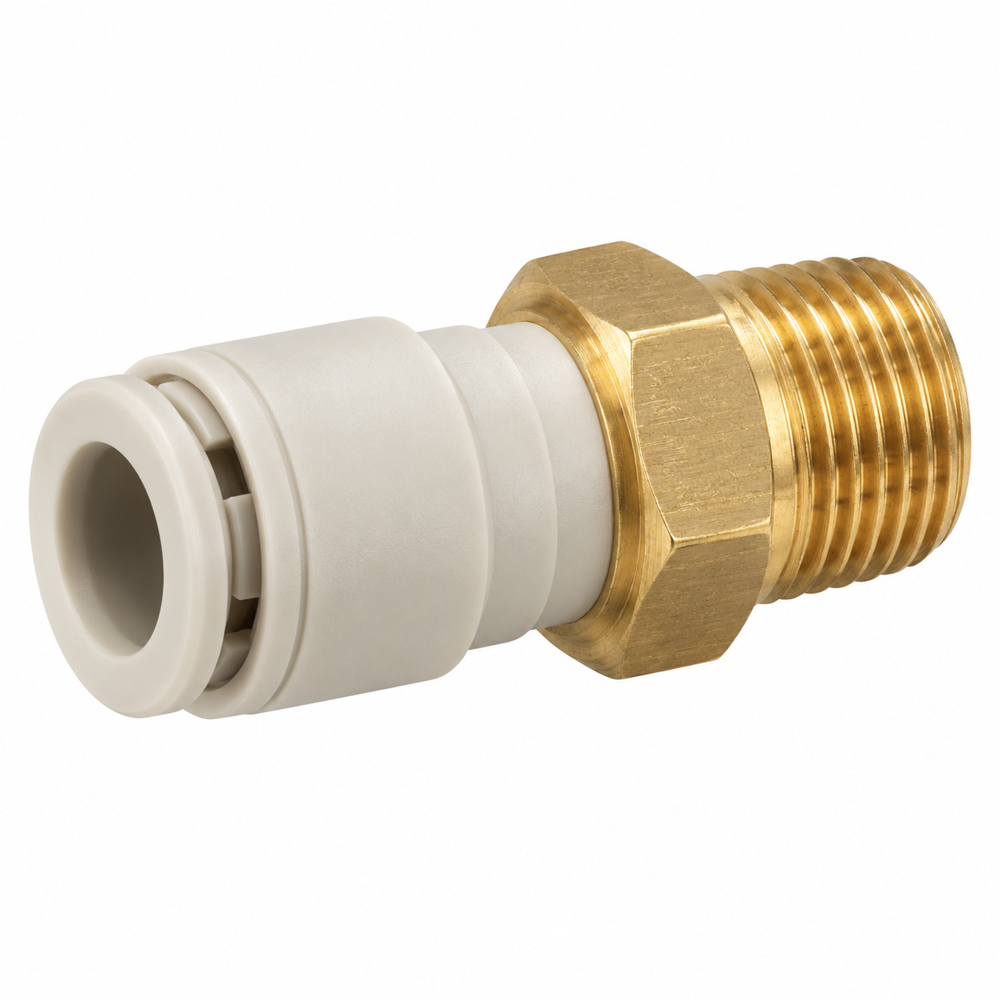
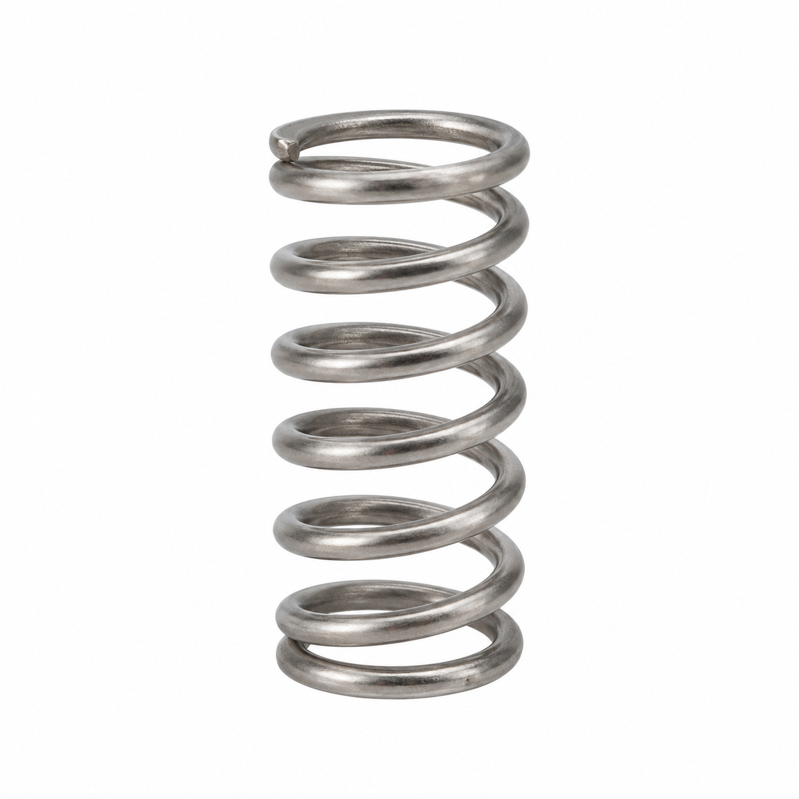
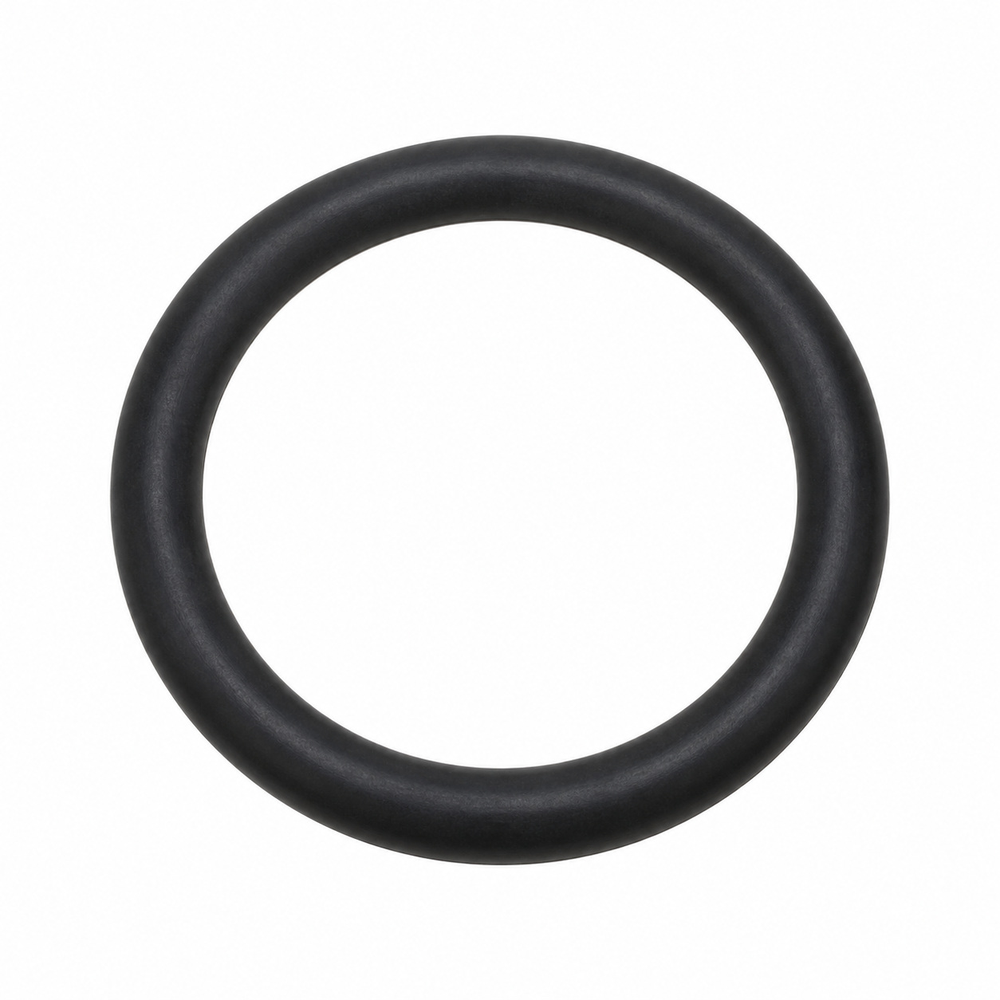
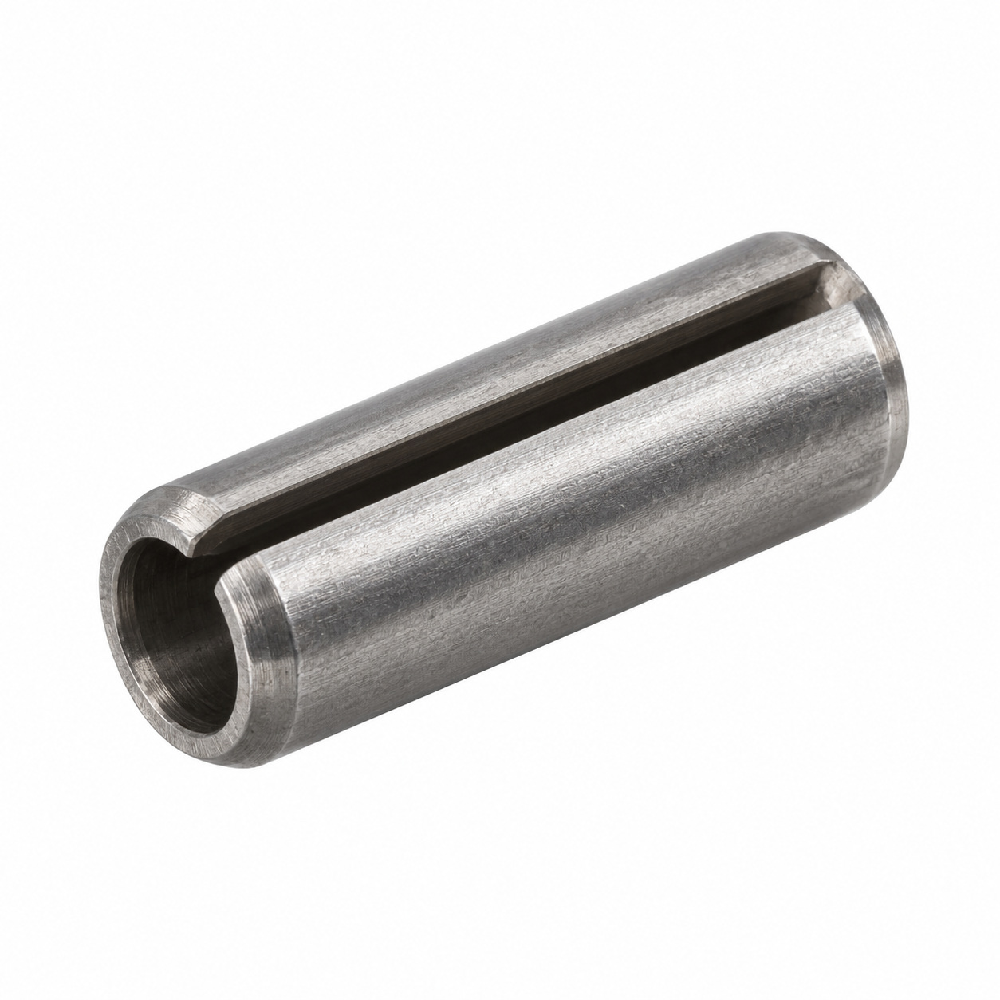
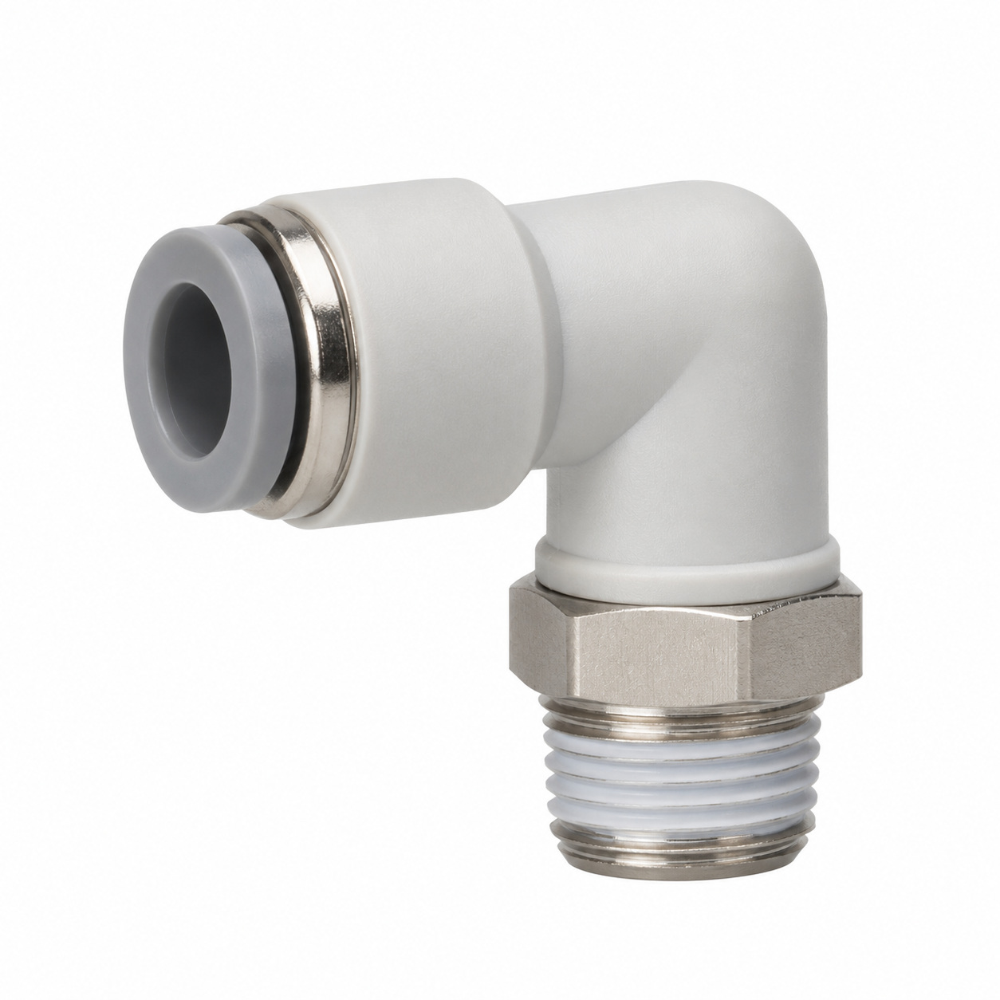
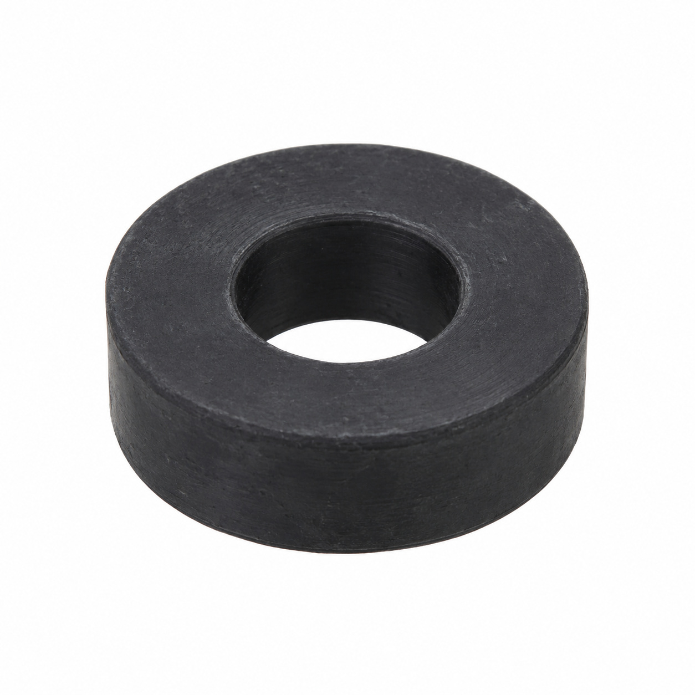
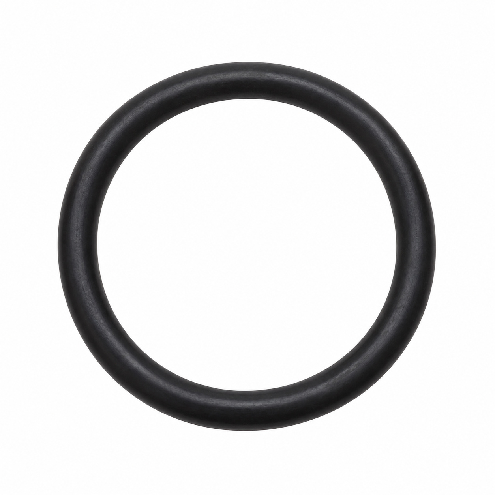
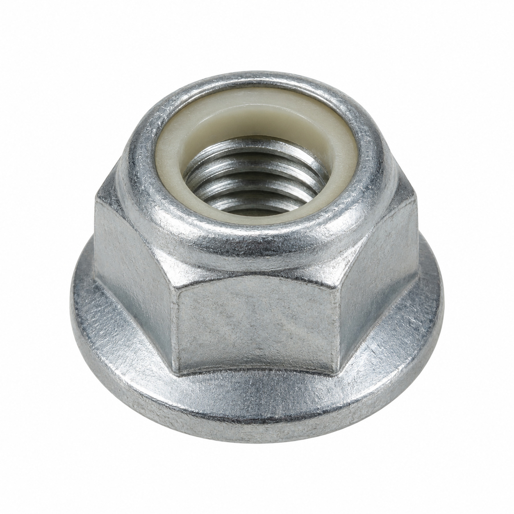
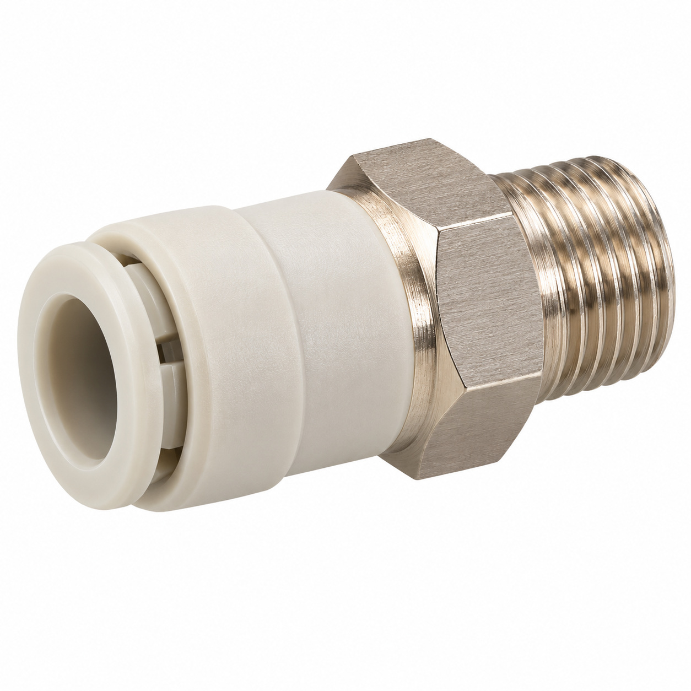

# Generic illustrations — batch 08

Ten name-based illustrations for review. These are generic component types, not exact photos or confirmed manufacturer geometry. Catalog names and SKUs identify the intended entry, not a visual match to a reference photo. No specifications, color, dimensions or fitment should be inferred from the image.

[Back to full gallery](README.md)

| SKU | Catalog name | Image |
| --- | --- | --- |
| 129.324 | Elastic clip washer ø6 | [Open image](generic-129.324.jpg) |
| 120.692 | Straight connector 6-1/8 | [Open image](generic-120.692.jpg) |
| 123.562 | Spring to magnet valve | [Open image](generic-123.562.jpg) |
| 104.809 | O-Ring 8.73x1.78 FKM | [Open image](generic-104.809.jpg) |
| 129.337 | Spring pin ø 5x10 | [Open image](generic-129.337.jpg) |
| 127.038 | Elbow connector 8-1/8 | [Open image](generic-127.038.jpg) |
| 103.253 | Rubber bushing ø6/9/14 thickness 2 | [Open image](generic-103.253.jpg) |
| 120.257 | O-Ring 27.5x3.00 EPDM | [Open image](generic-120.257.jpg) |
| 106.523 | Prevailing torque hex nut M8 with flange | [Open image](generic-106.523.jpg) |
| 128.495 | Straight connector 6-1/8-0.8 | [Open image](generic-128.495.jpg) |

## 129.324 — Elastic clip washer ø6

## 120.692 — Straight connector 6-1/8

## 123.562 — Spring to magnet valve

## 104.809 — O-Ring 8.73x1.78 FKM

## 129.337 — Spring pin ø 5x10

## 127.038 — Elbow connector 8-1/8

## 103.253 — Rubber bushing ø6/9/14 thickness 2

## 120.257 — O-Ring 27.5x3.00 EPDM

## 106.523 — Prevailing torque hex nut M8 with flange

## 128.495 — Straight connector 6-1/8-0.8

