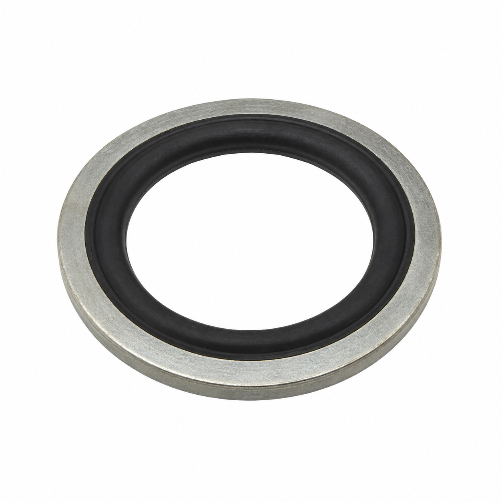
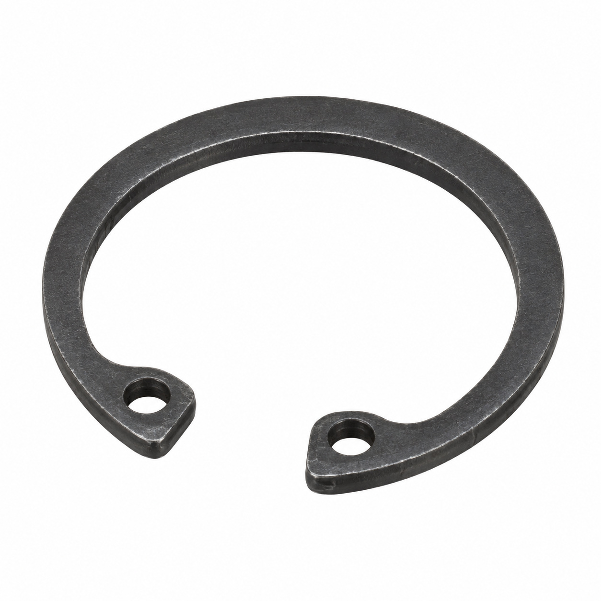
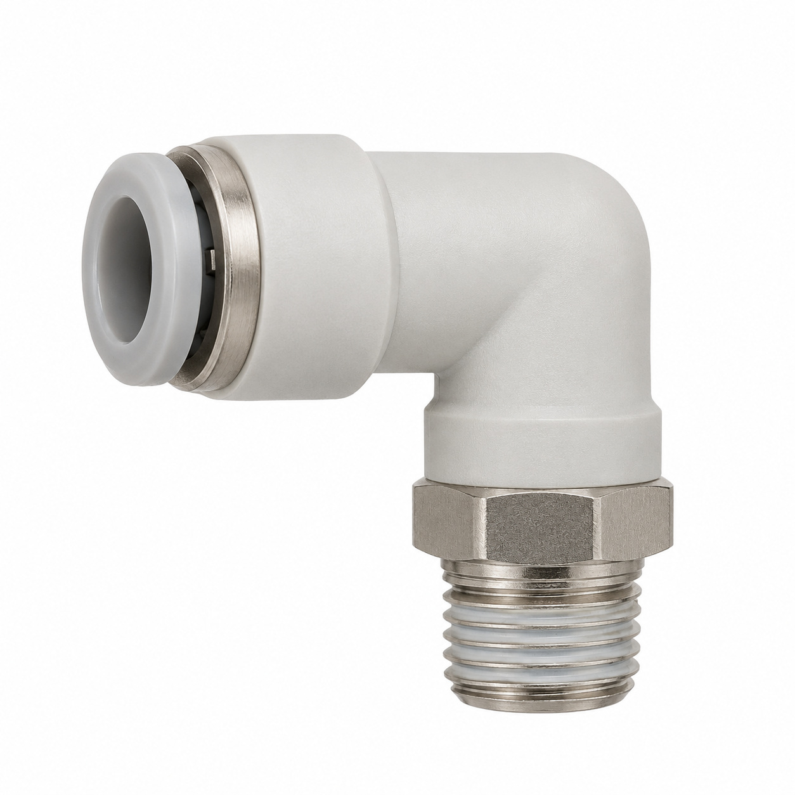
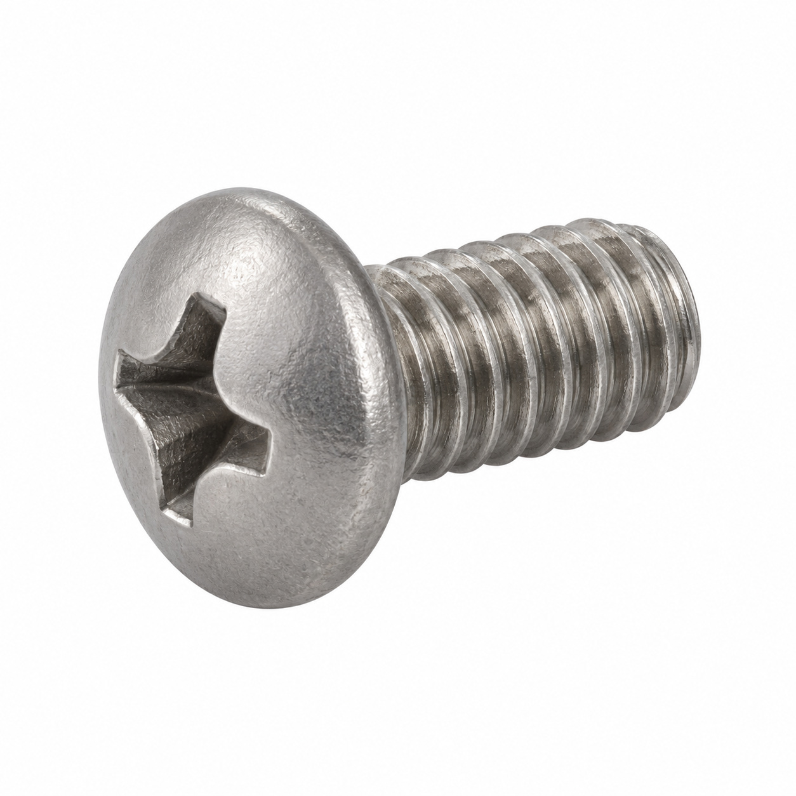
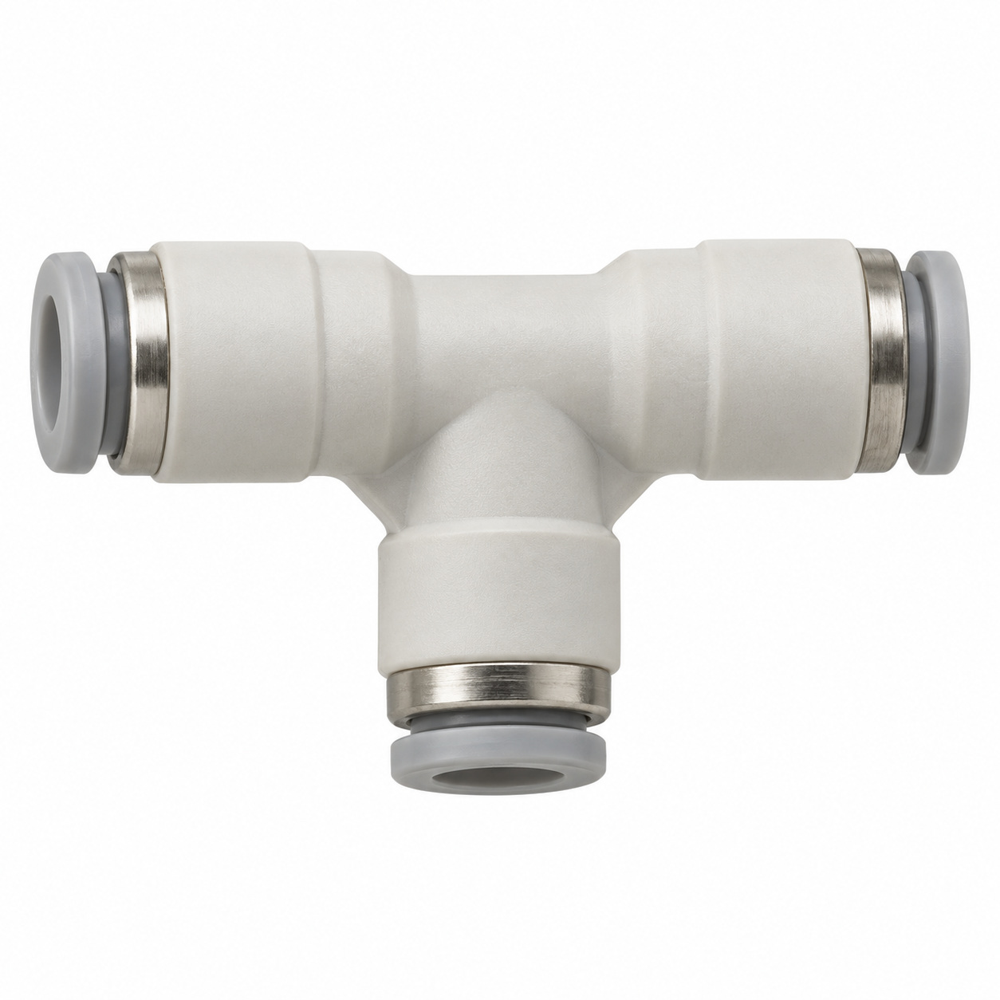
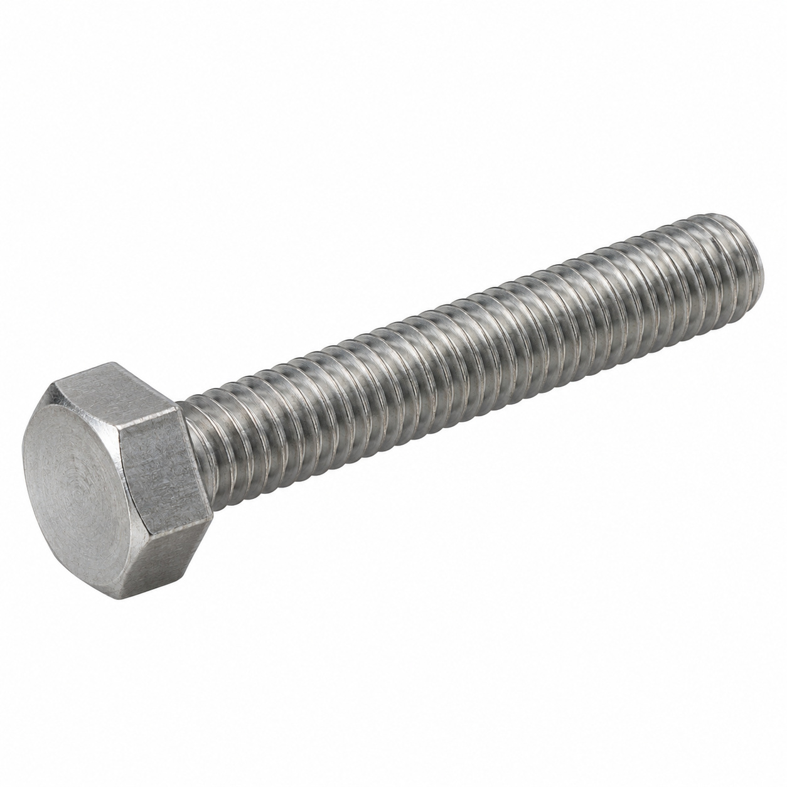
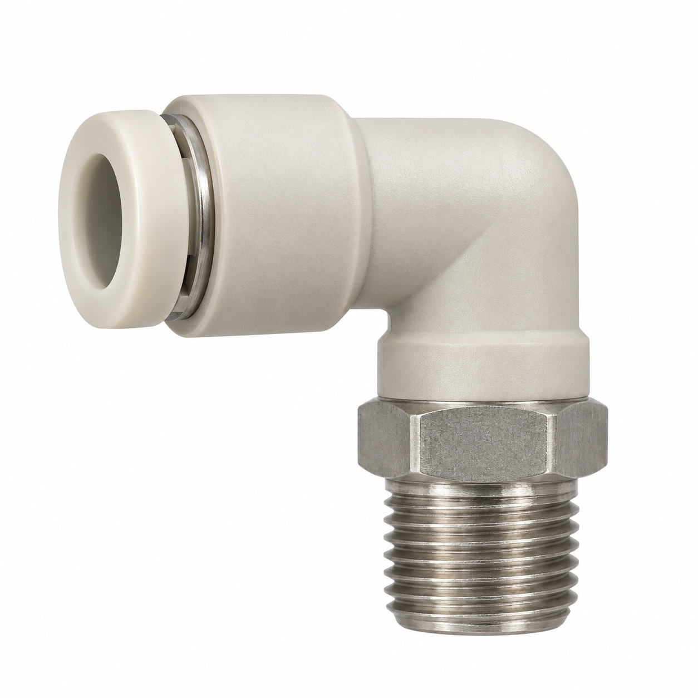
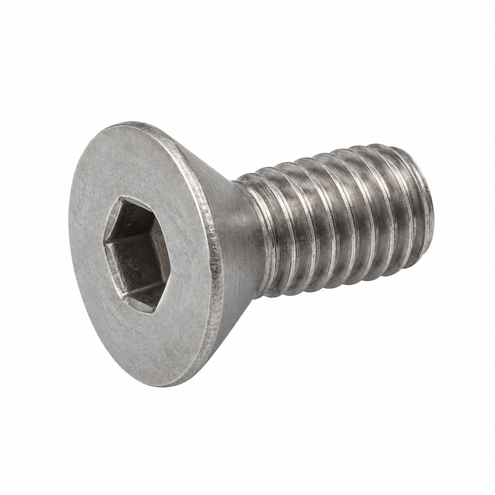
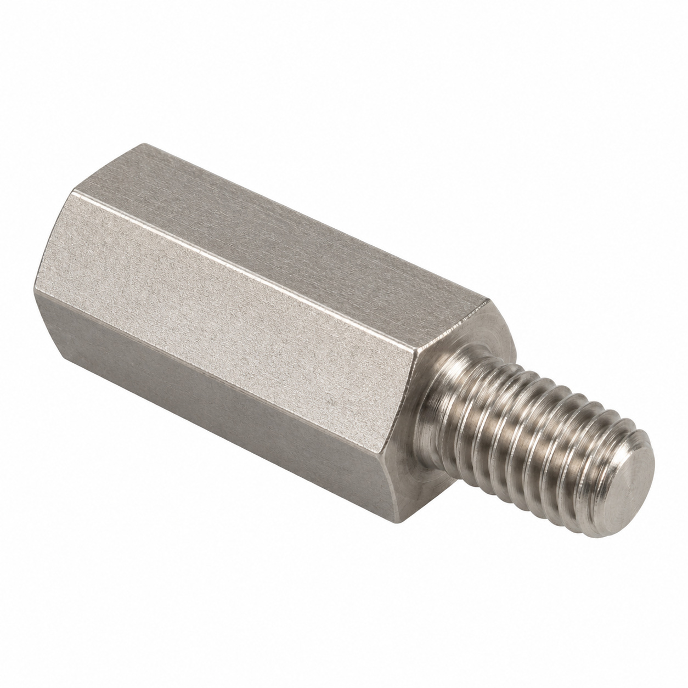
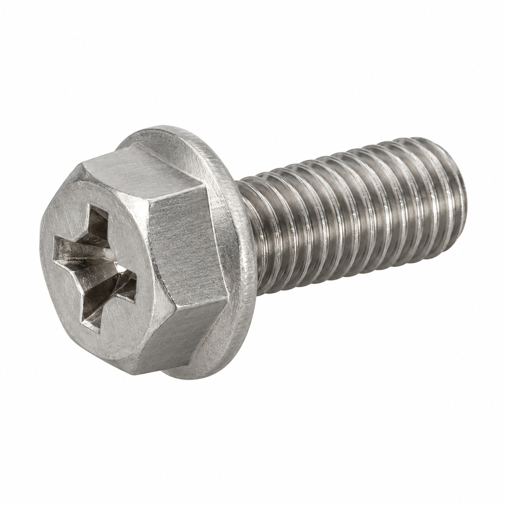

# Generic illustrations — batch 09

Ten name-based illustrations for review. These are generic component types, not exact photos or confirmed manufacturer geometry. Catalog names and SKUs identify the intended entry, not a visual match to a reference photo. No specifications, color, dimensions or fitment should be inferred from the image.

[Back to full gallery](README.md)

| SKU | Catalog name | Image |
| --- | --- | --- |
| 101.384 | Seal 3/8" bi-material | [Open image](generic-101.384.jpg) |
| 106.685 | Snap ring for shaft ø10 | [Open image](generic-106.685.jpg) |
| 129.063 | L-connector ø6-1/8 | [Open image](generic-129.063.jpg) |
| 130.821 | Oval head screw Phillips H M4x6 | [Open image](generic-130.821.jpg) |
| 130.674 | T-connector 8-6-8 | [Open image](generic-130.674.jpg) |
| 106.229 | Hex cap assembled screw M6x50 | [Open image](generic-106.229.jpg) |
| 130.262 | Elbow connector 4-1/8 | [Open image](generic-130.262.jpg) |
| 108.359 | Socket flat head screw M4x6 | [Open image](generic-108.359.jpg) |
| 120.595 | Hexagonal spacer M4x10 | [Open image](generic-120.595.jpg) |
| 131.321 | Hexagonal head screw combi M5x12 A4-80 | [Open image](generic-131.321.jpg) |

## 101.384 — Seal 3/8" bi-material

## 106.685 — Snap ring for shaft ø10

## 129.063 — L-connector ø6-1/8

## 130.821 — Oval head screw Phillips H M4x6

## 130.674 — T-connector 8-6-8

## 106.229 — Hex cap assembled screw M6x50

## 130.262 — Elbow connector 4-1/8

## 108.359 — Socket flat head screw M4x6

## 120.595 — Hexagonal spacer M4x10

## 131.321 — Hexagonal head screw combi M5x12 A4-80

