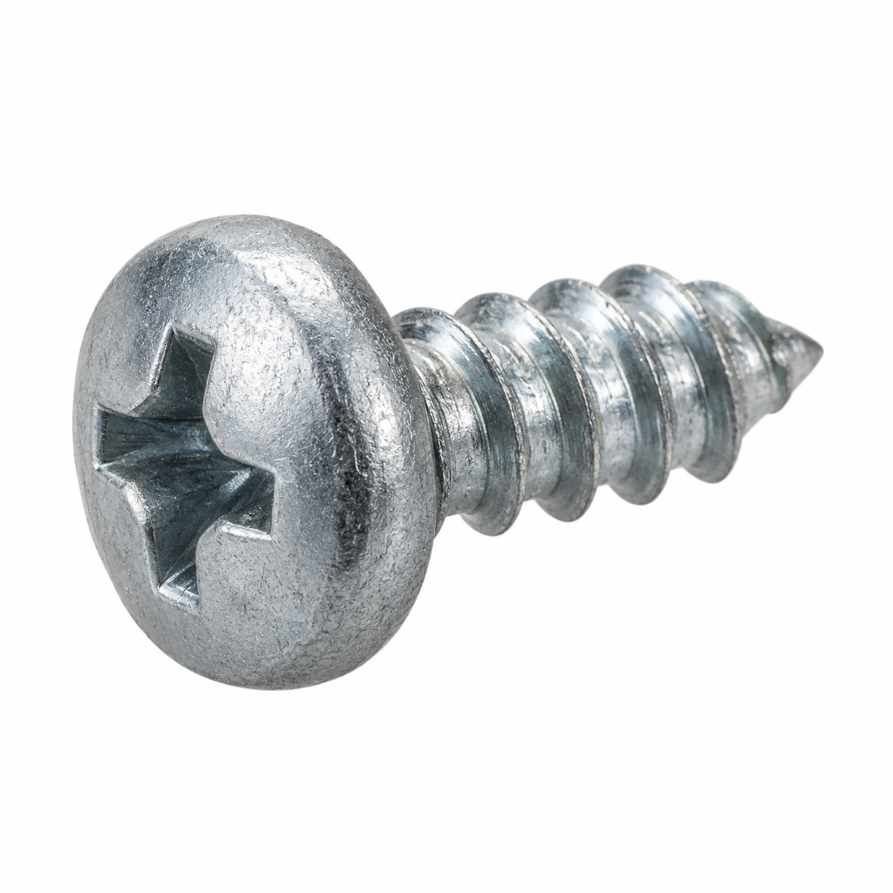
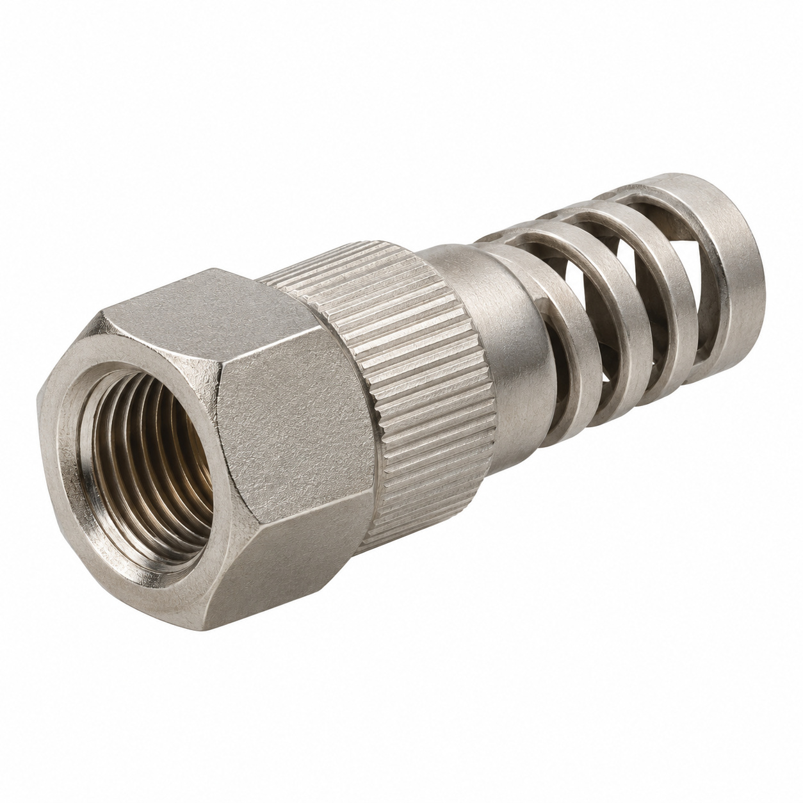
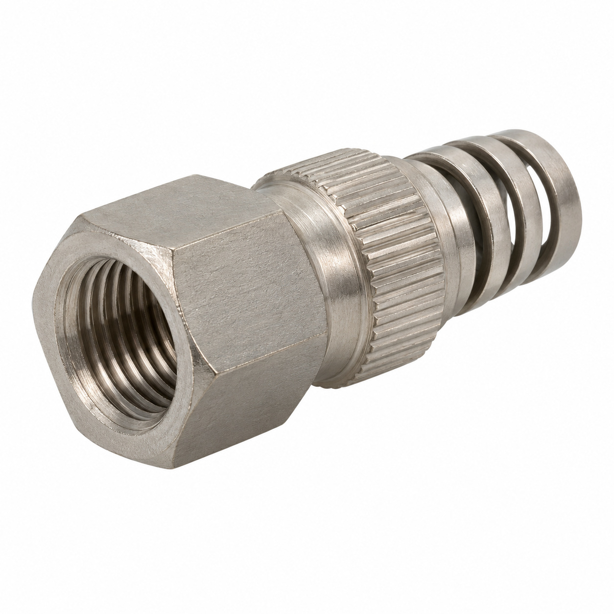
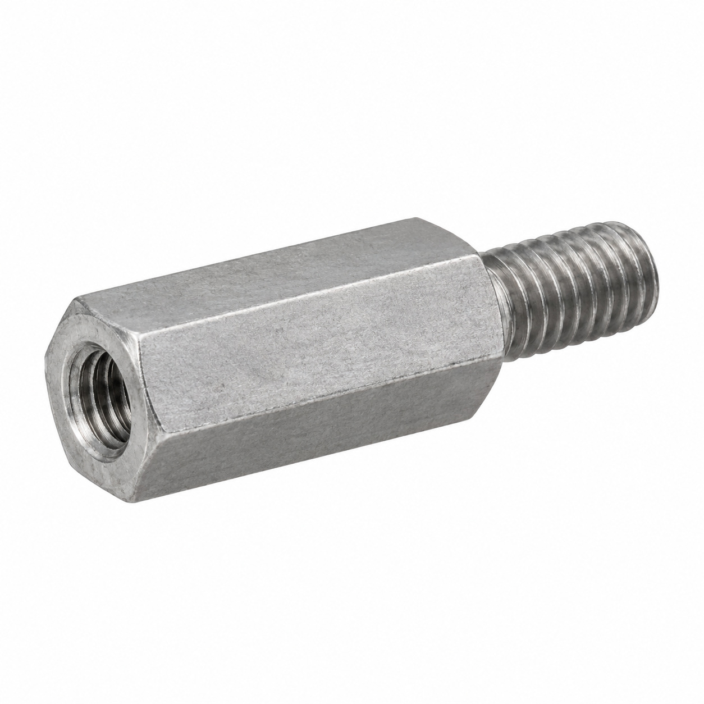
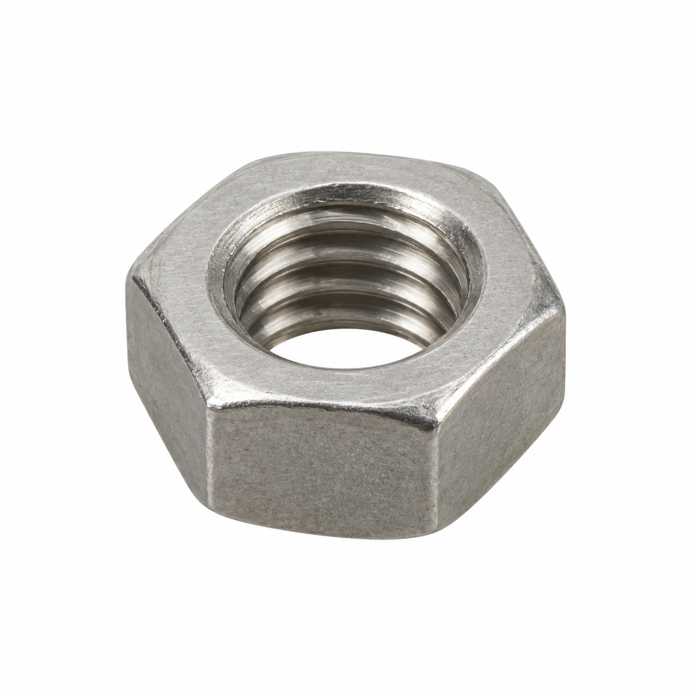
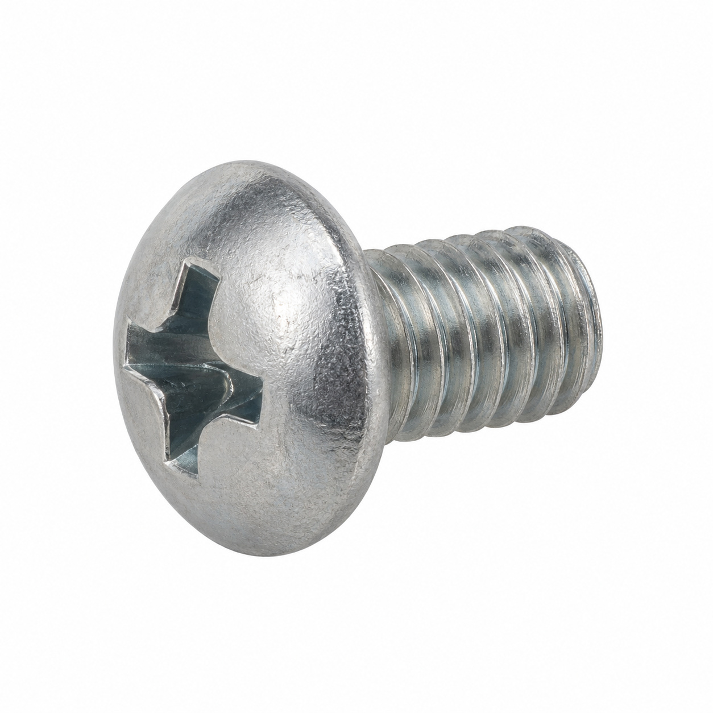
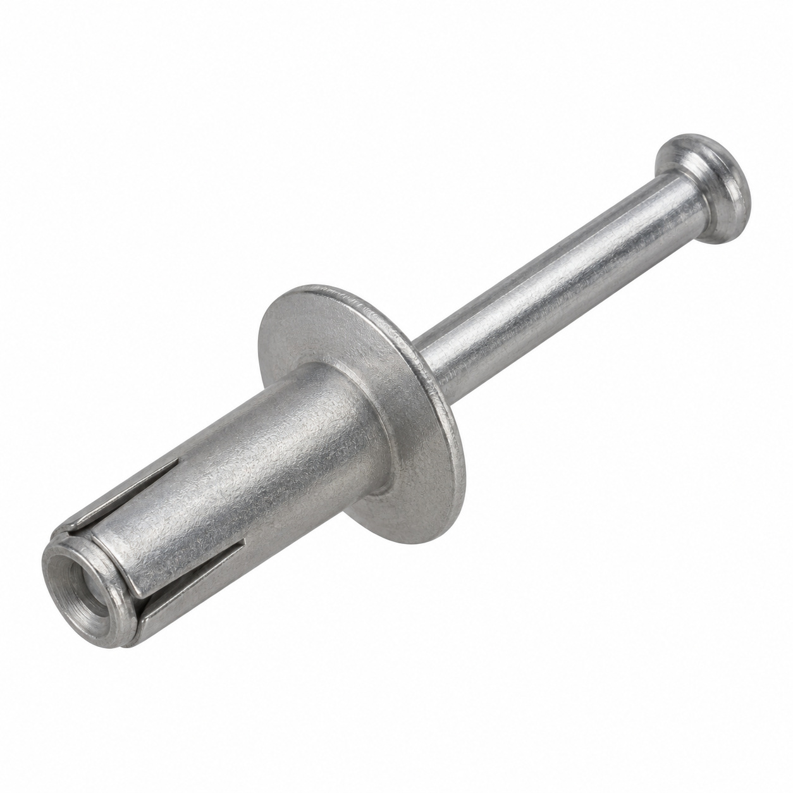
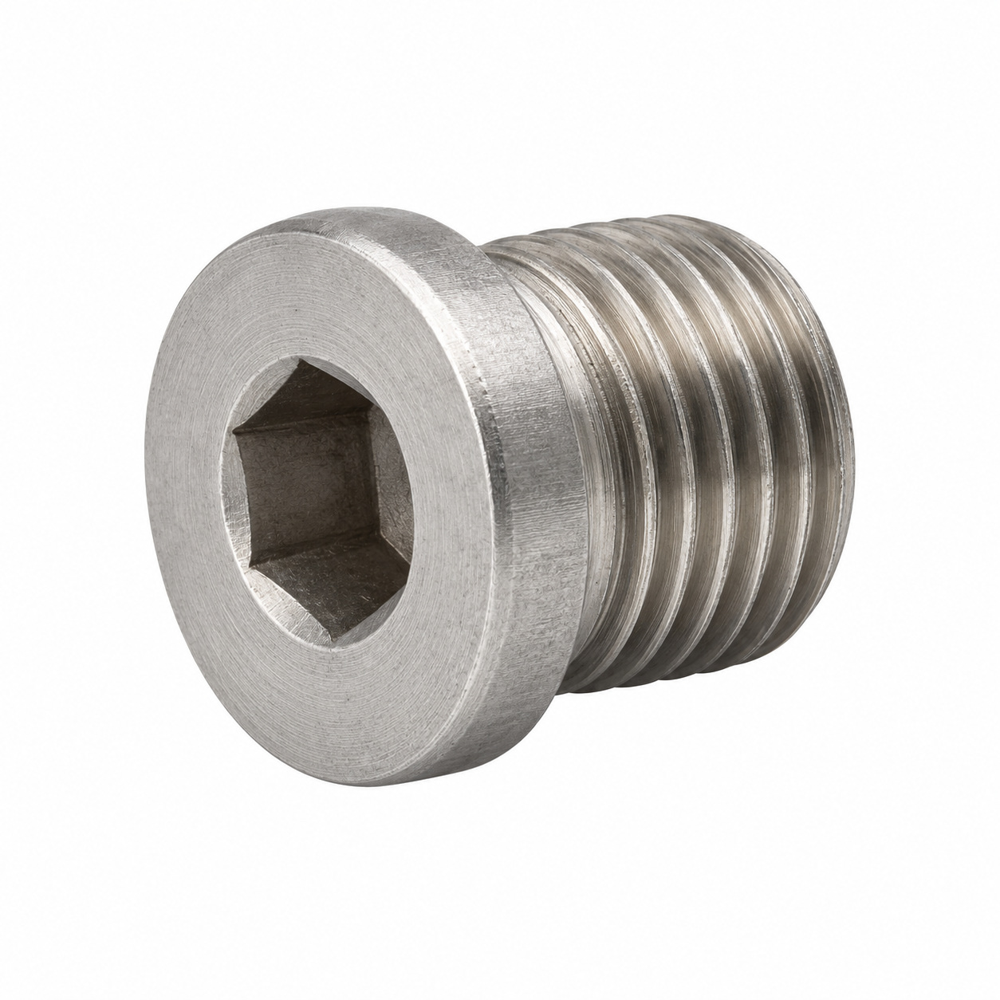
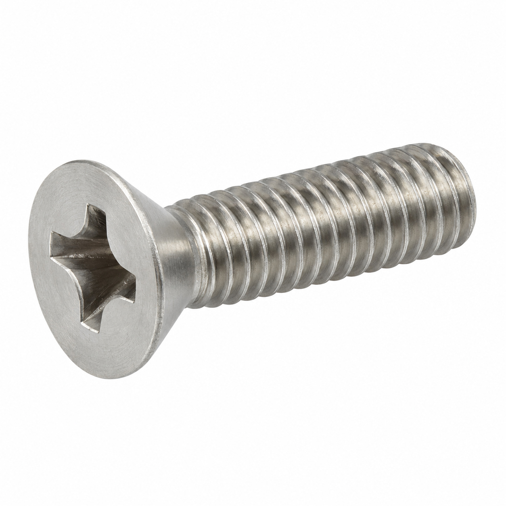
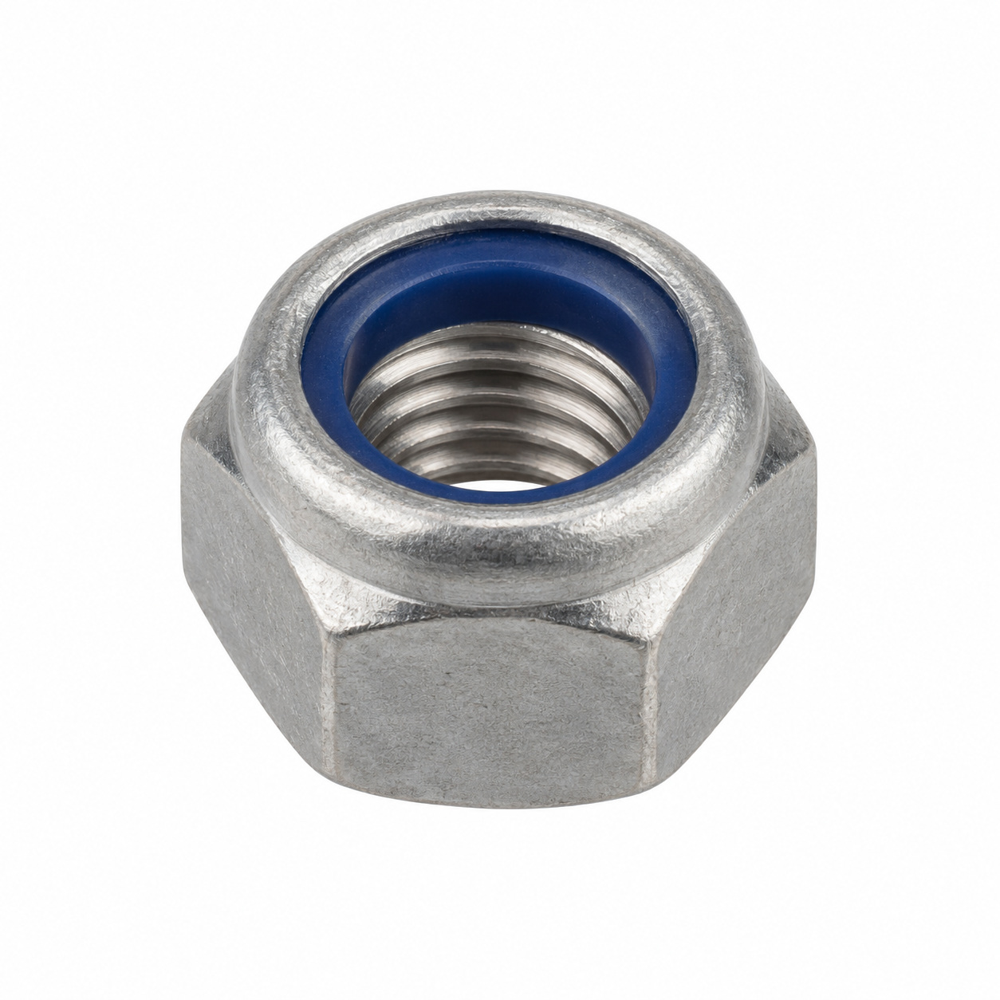

# Generic illustrations — batch 10

Ten name-based illustrations for review. These are generic component types, not exact photos or confirmed manufacturer geometry. Catalog names and SKUs identify the intended entry, not a visual match to a reference photo. No specifications, color, dimensions or fitment should be inferred from the image.

[Back to full gallery](README.md)

| SKU | Catalog name | Image |
| --- | --- | --- |
| 112.002 | Phillips sheet screw ST 3.5x6.5 | [Open image](generic-112.002.jpg) |
| 119.109 | Coupling nut with anti-kink device ø8/6 | [Open image](generic-119.109.jpg) |
| 121.384 | Coupling nut with anti-kink device ø6/4 | [Open image](generic-121.384.jpg) |
| 131.334 | Hexagonal spacer M04x10 Precote 80 | [Open image](generic-131.334.jpg) |
| 103.661 | Nut G1/8" | [Open image](generic-103.661.jpg) |
| 104.063 | Oval head screw Phillips M5x6 | [Open image](generic-104.063.jpg) |
| 127.684 | Pluggable rivet ø4.6x11.1 | [Open image](generic-127.684.jpg) |
| 107.944 | Hexagon socket screw plug G1/8" | [Open image](generic-107.944.jpg) |
| 106.401 | Counter sunk screw M5x16 Phillips | [Open image](generic-106.401.jpg) |
| 106.516 | Lock nut M4 | [Open image](generic-106.516.jpg) |

## 112.002 — Phillips sheet screw ST 3.5x6.5

## 119.109 — Coupling nut with anti-kink device ø8/6

## 121.384 — Coupling nut with anti-kink device ø6/4

## 131.334 — Hexagonal spacer M04x10 Precote 80

## 103.661 — Nut G1/8"

## 104.063 — Oval head screw Phillips M5x6

## 127.684 — Pluggable rivet ø4.6x11.1

## 107.944 — Hexagon socket screw plug G1/8"

## 106.401 — Counter sunk screw M5x16 Phillips

## 106.516 — Lock nut M4

