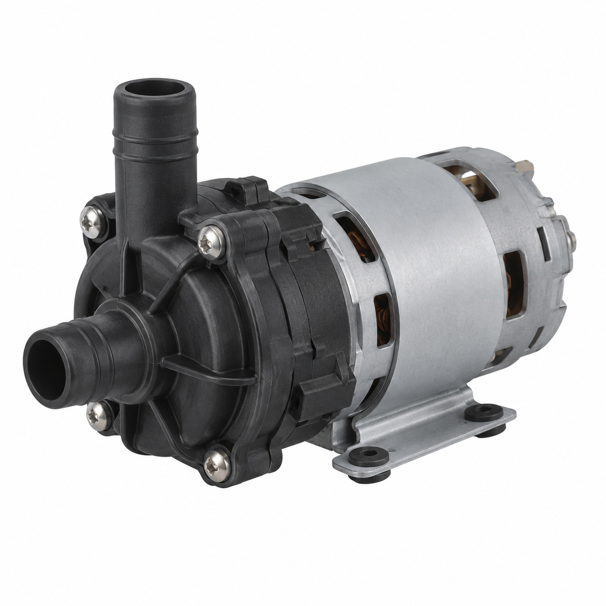
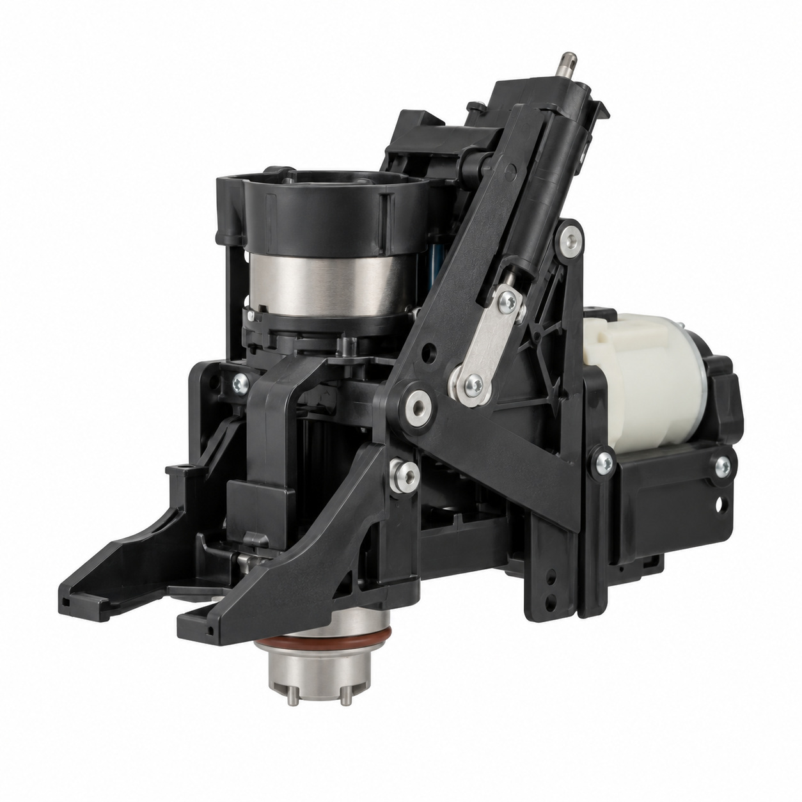
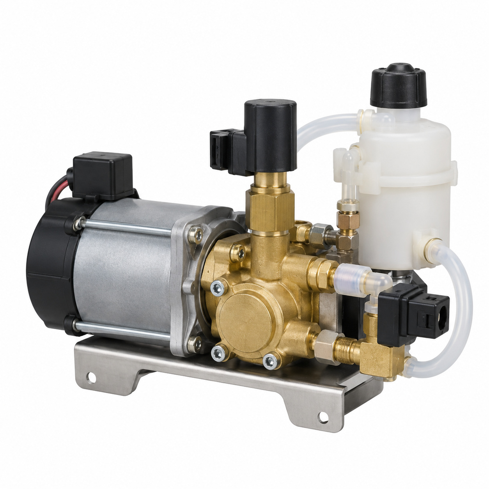
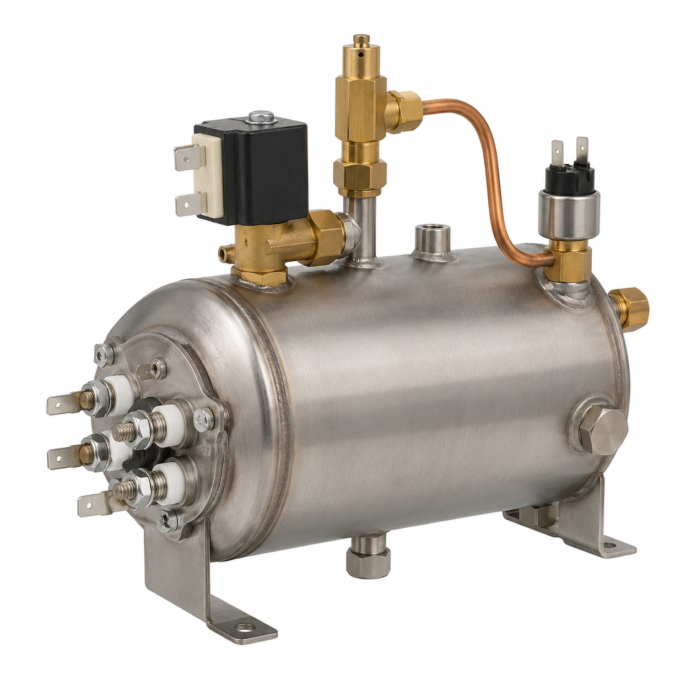
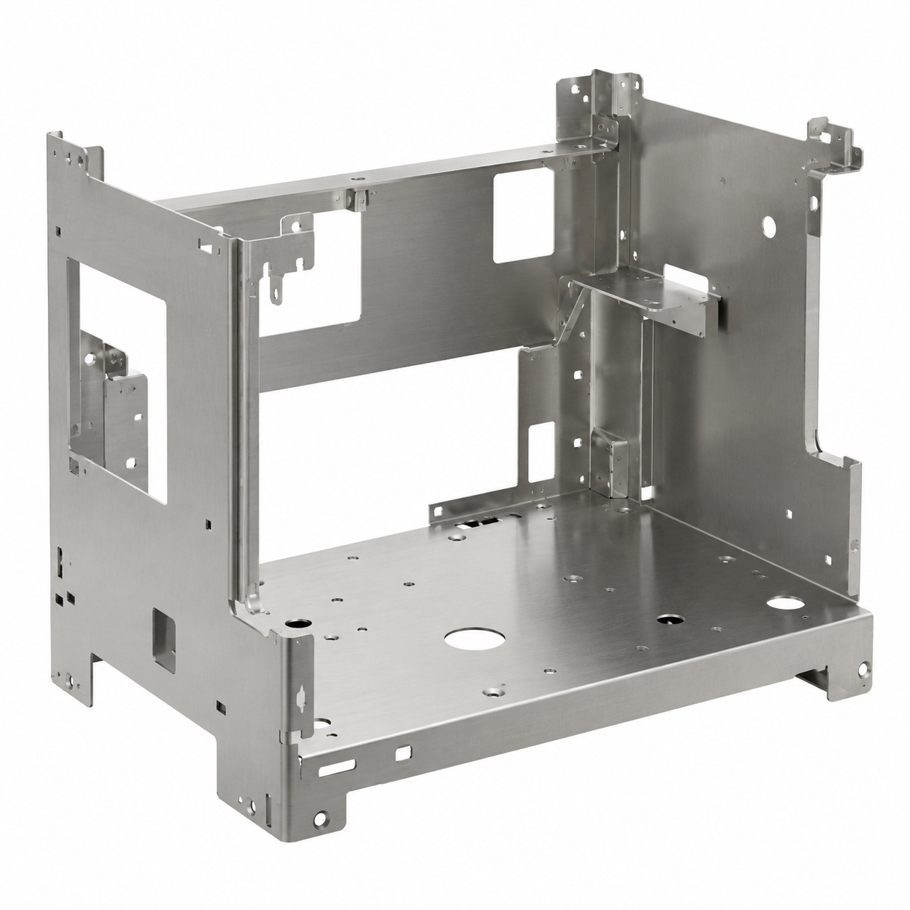
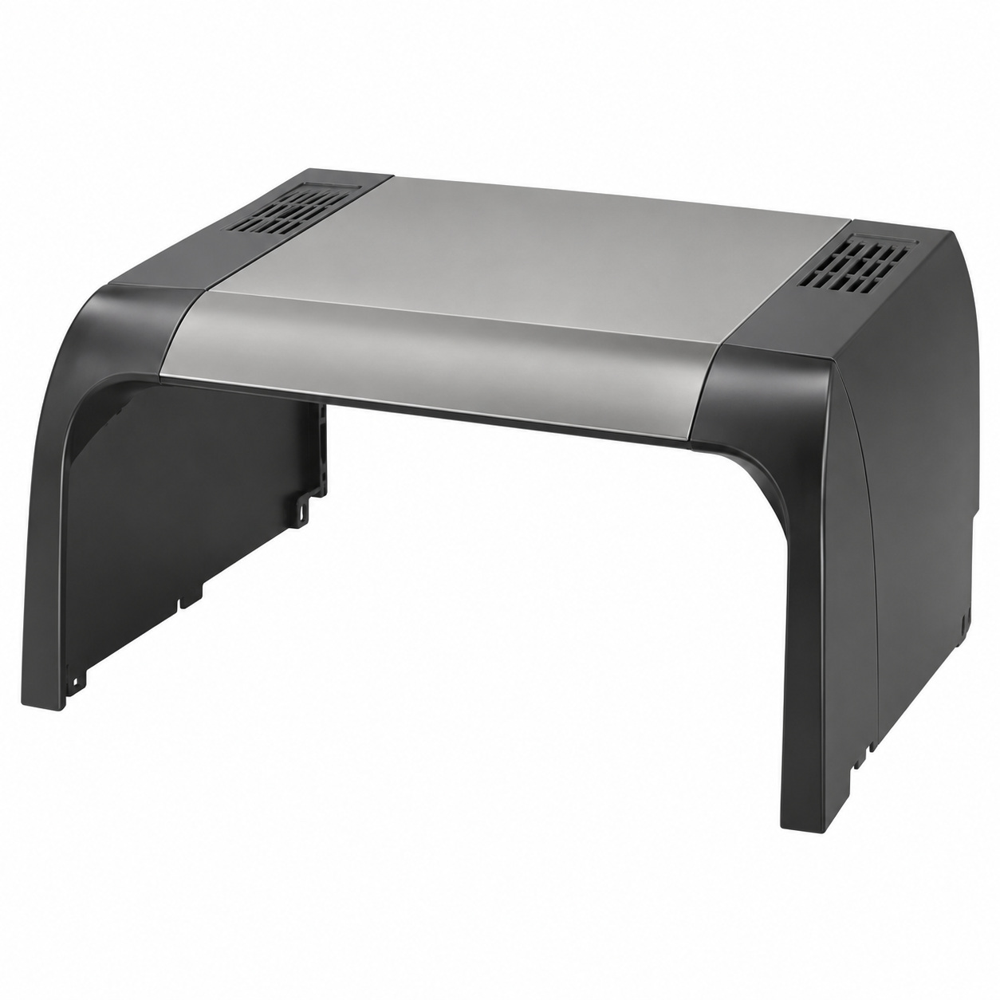
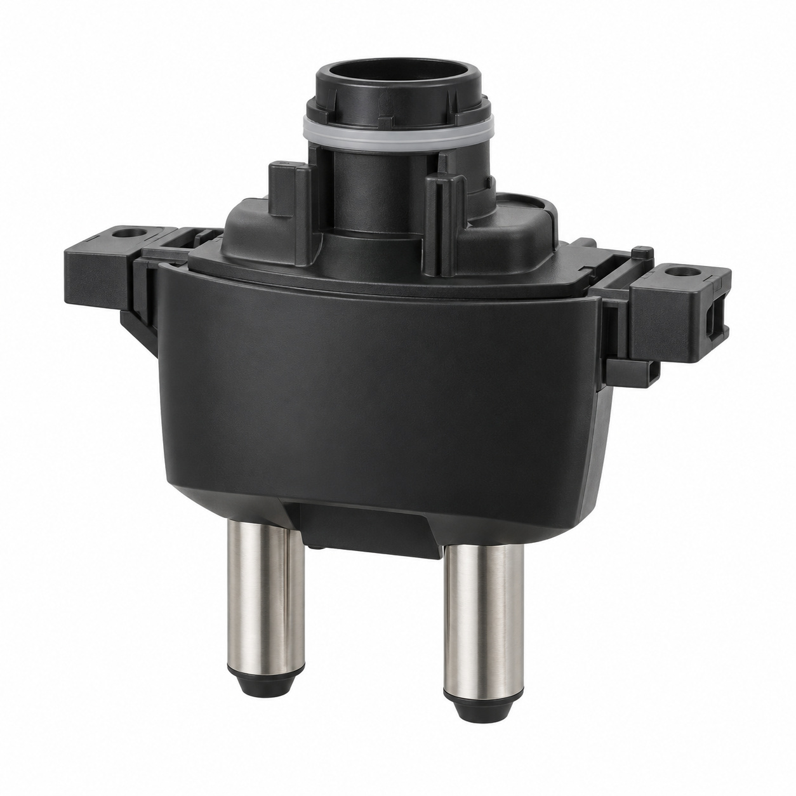
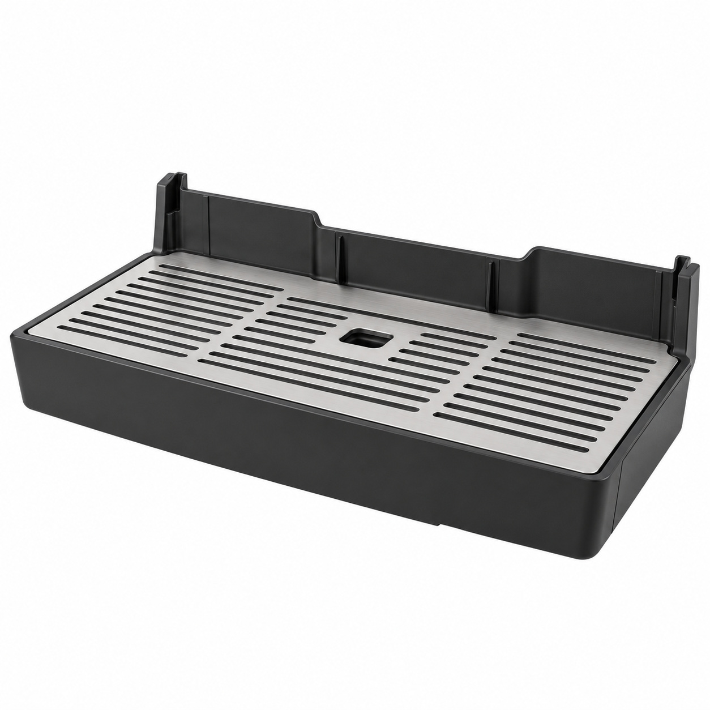
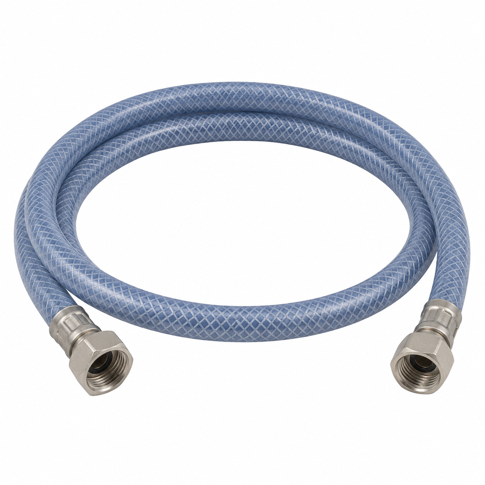

# Remaining catalog illustrations — batch 01

Generic type-based representations for review. Manufacturer-specific shape, internal construction, kit contents and fitment are unverified. Complex assemblies are broad concepts requiring a real photo or drawing. Existing catalog validation is not changed.

[Back to gallery](README.md)

| Target SKU | Description | Image |
| --- | --- | --- |
| 110.533 | Water pump Mastrena CE assy | [Open image](generic-110.533.jpg) |
| 116.093 | Generic cable or wiring assembly | [Open image](generic-116.093.jpg) |
| 127.028 | Generic assembly concept | [Open image](generic-127.028.jpg) |
| 127.734 | Hydraulic module Mastrena II assy. | [Open image](generic-127.734.jpg) |
| 127.950 | Generic boiler or steam component | [Open image](generic-127.950.jpg) |
| 128.036 | Chassis assy. Mastrena II | [Open image](generic-128.036.jpg) |
| 128.037 | Hood assy. Mastrena II | [Open image](generic-128.037.jpg) |
| 128.047 | Coffee outlet assy. Mastrena II | [Open image](generic-128.047.jpg) |
| 128.051 | Drip tray assy. Mastrena II | [Open image](generic-128.051.jpg) |
| 128.065 | Generic tube or hose assembly | [Open image](generic-128.065.jpg) |

## 110.533 — Water pump Mastrena CE assy

## 116.093 — Generic cable or wiring assembly

## 127.028 — Generic assembly concept

## 127.734 — Hydraulic module Mastrena II assy.

## 127.950 — Generic boiler or steam component

## 128.036 — Chassis assy. Mastrena II

## 128.037 — Hood assy. Mastrena II

## 128.047 — Coffee outlet assy. Mastrena II

## 128.051 — Drip tray assy. Mastrena II

## 128.065 — Generic tube or hose assembly

