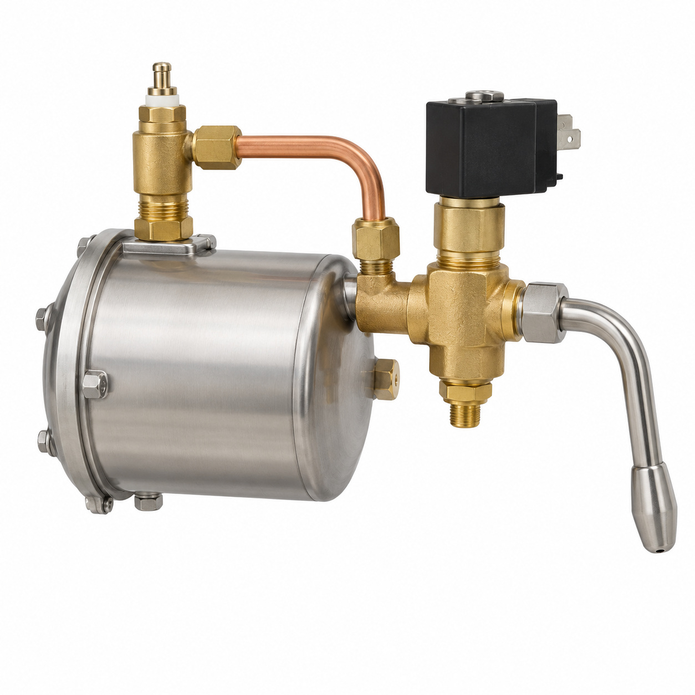
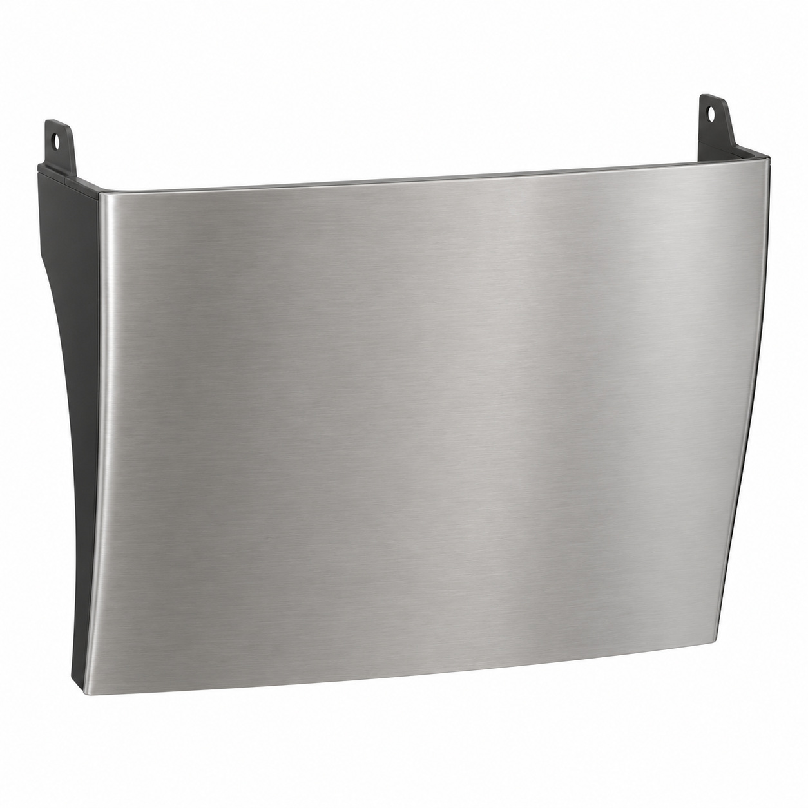
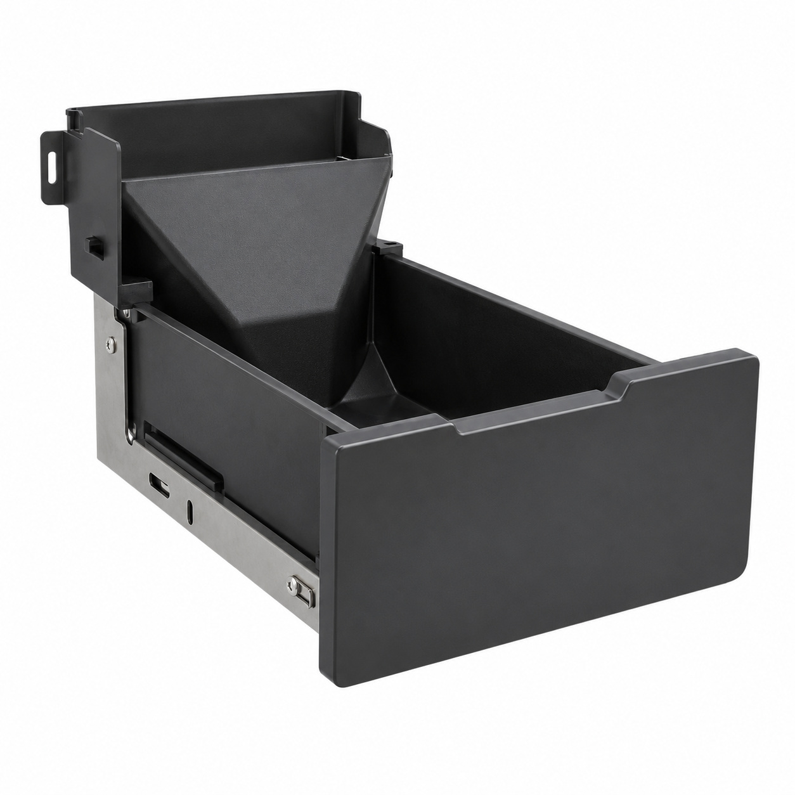
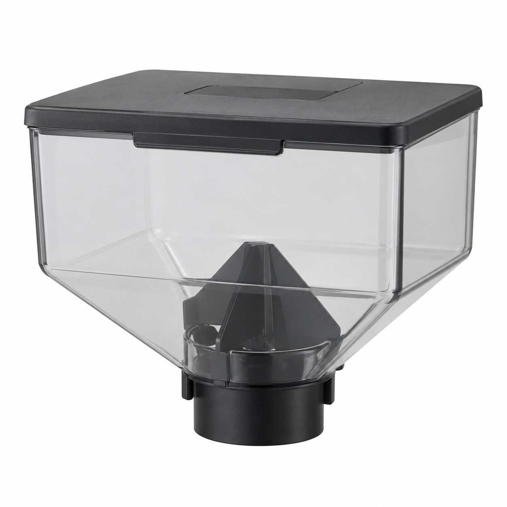
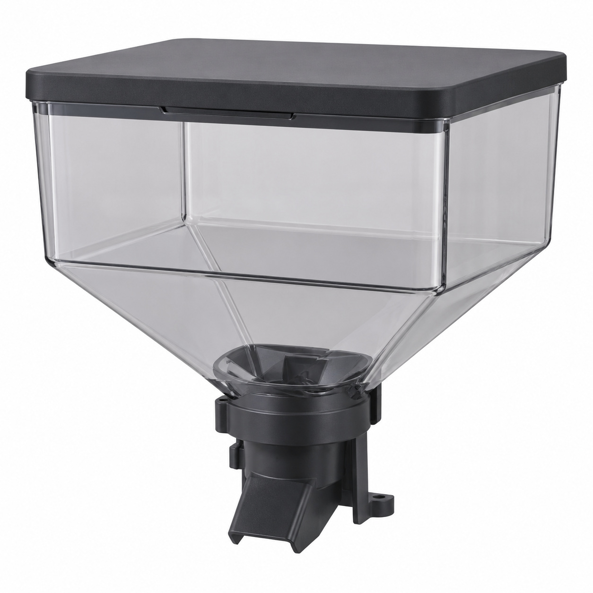
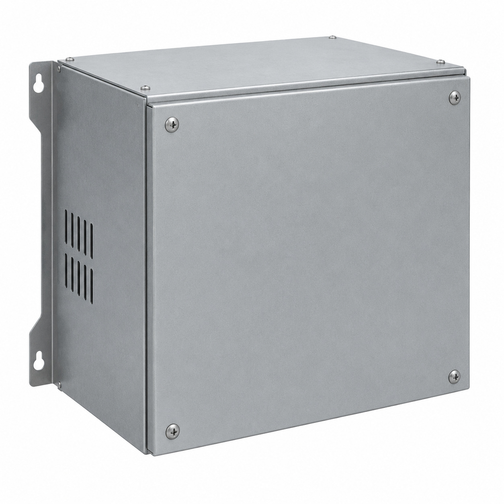
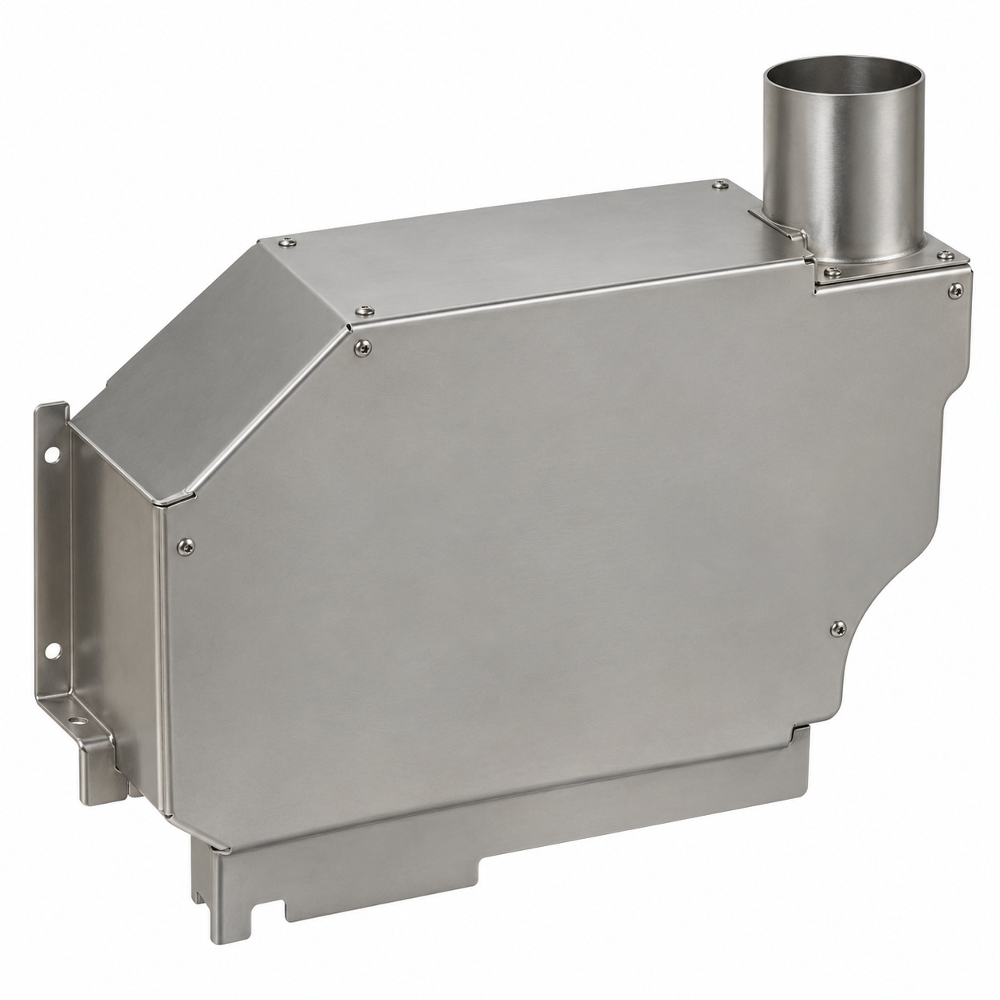
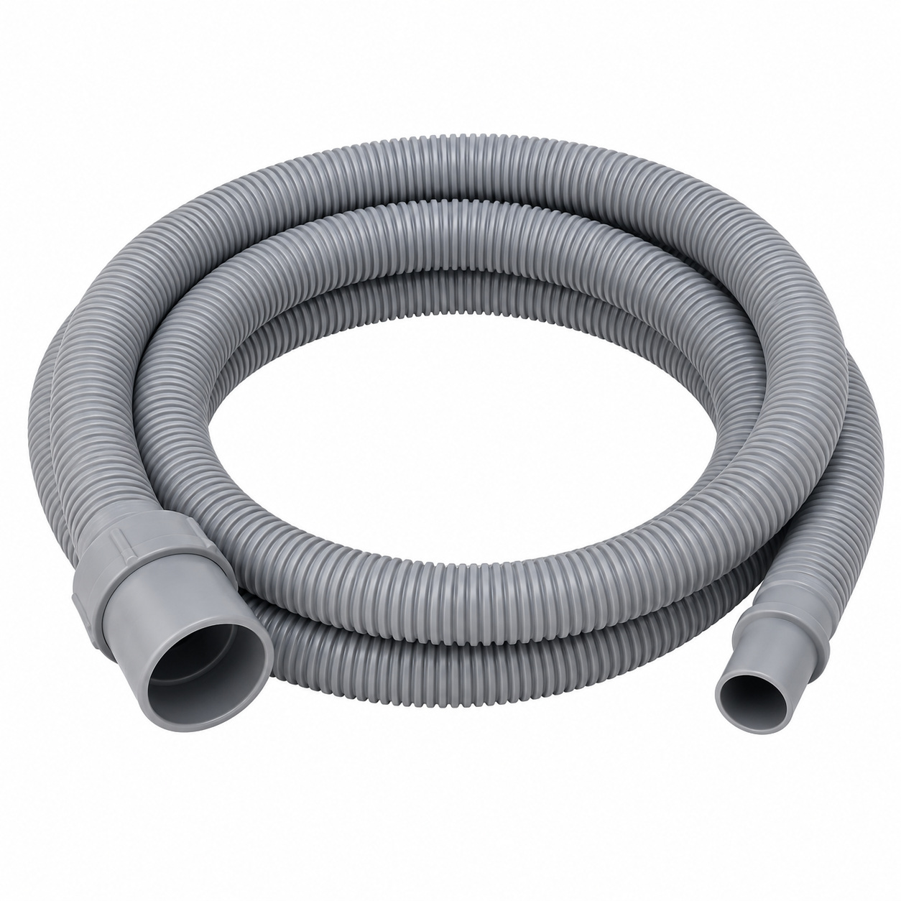
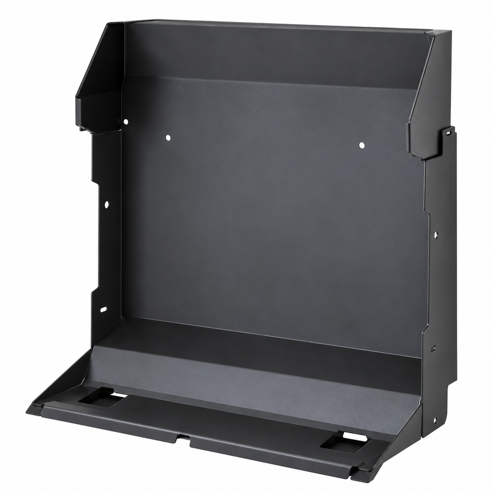
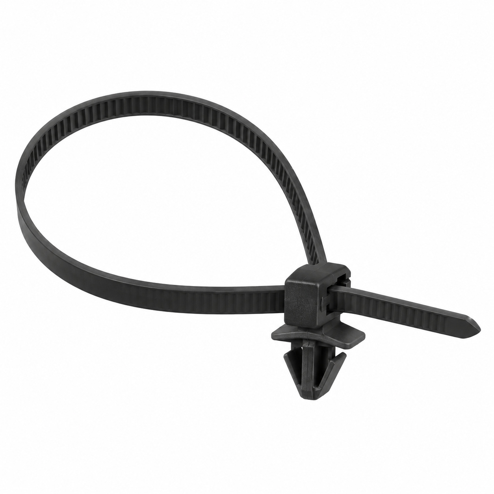

# Remaining catalog illustrations — batch 02

Generic type-based representations for review. Manufacturer-specific shape, internal construction, kit contents and fitment are unverified. Complex assemblies are broad concepts requiring a real photo or drawing. Existing catalog validation is not changed.

[Back to gallery](README.md)

| Target SKU | Description | Image |
| --- | --- | --- |
| 128.386 | Steam outlet assy. Mastrena II | [Open image](generic-128.386.jpg) |
| 128.653 | Generic cover, housing or mounting component | [Open image](generic-128.653.jpg) |
| 129.562 | Ground drawer assy. Mastrena II | [Open image](generic-129.562.jpg) |
| 130.702 | Bean hopper small assy. Mastrena II | [Open image](generic-130.702.jpg) |
| 130.704 | Bean hopper big assy. Mastrena II | [Open image](generic-130.704.jpg) |
| 131.365 | Generic cover, housing or mounting component | [Open image](generic-131.365.jpg) |
| 133.029 | Steam casing assy. Mastrena II | [Open image](generic-133.029.jpg) |
| 133.661 | Generic tube or hose assembly | [Open image](generic-133.661.jpg) |
| 133.690 | Generic cover, housing or mounting component | [Open image](generic-133.690.jpg) |
| 122.913 | Cable tie with clip 100mm | [Open image](generic-122.913.jpg) |

## 128.386 — Steam outlet assy. Mastrena II

## 128.653 — Generic cover, housing or mounting component

## 129.562 — Ground drawer assy. Mastrena II

## 130.702 — Bean hopper small assy. Mastrena II

## 130.704 — Bean hopper big assy. Mastrena II

## 131.365 — Generic cover, housing or mounting component

## 133.029 — Steam casing assy. Mastrena II

## 133.661 — Generic tube or hose assembly

## 133.690 — Generic cover, housing or mounting component

## 122.913 — Cable tie with clip 100mm

