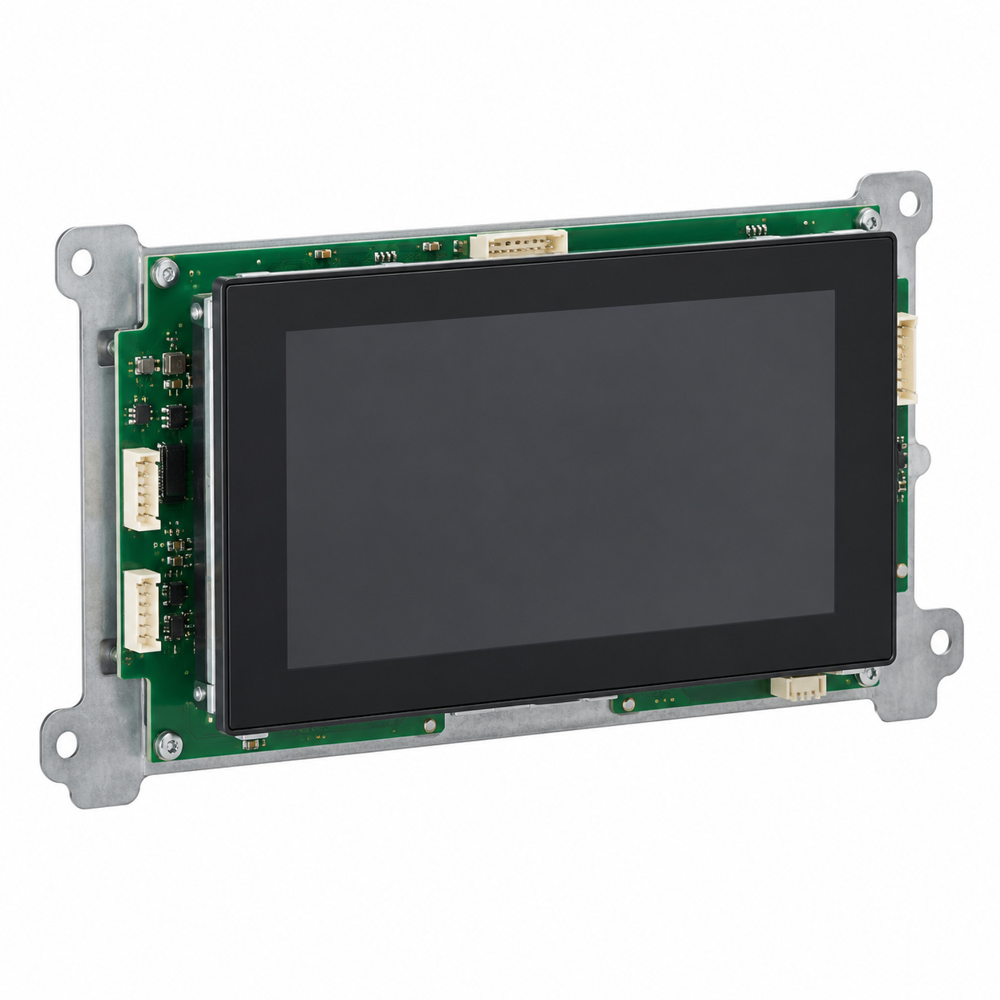
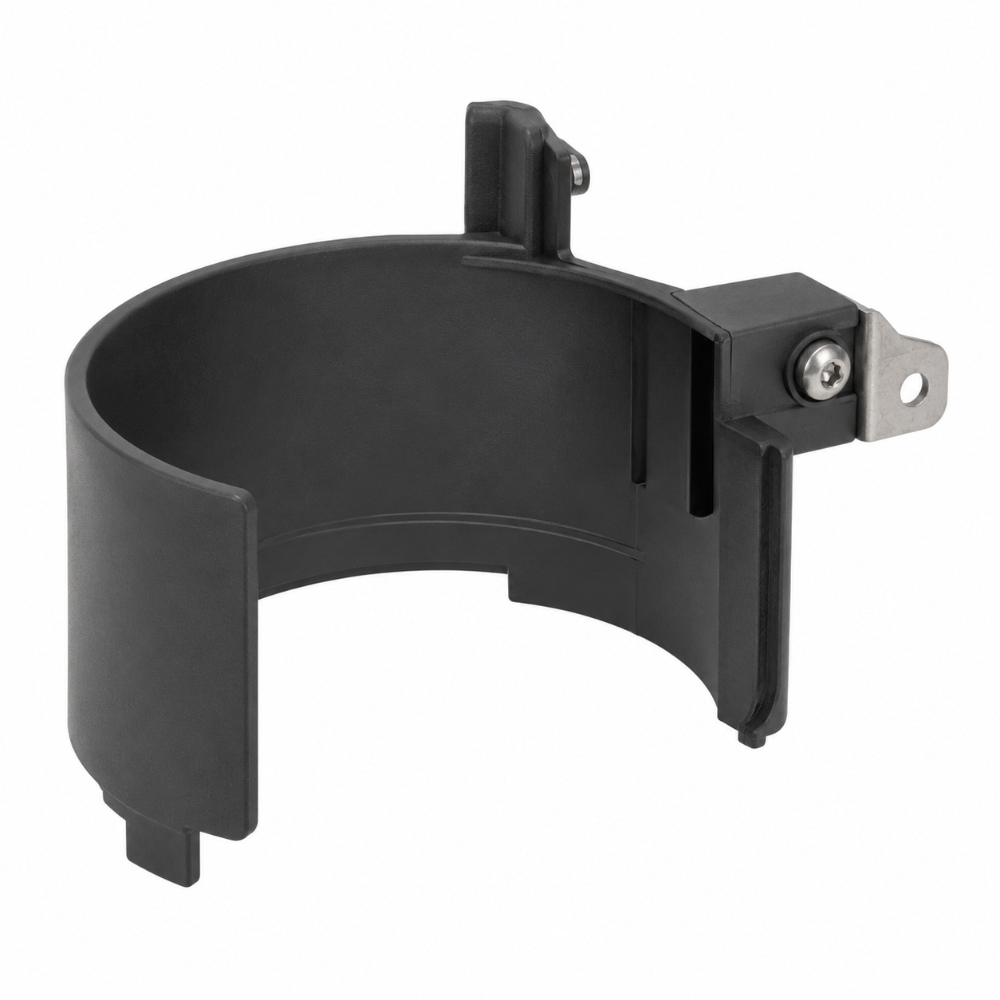
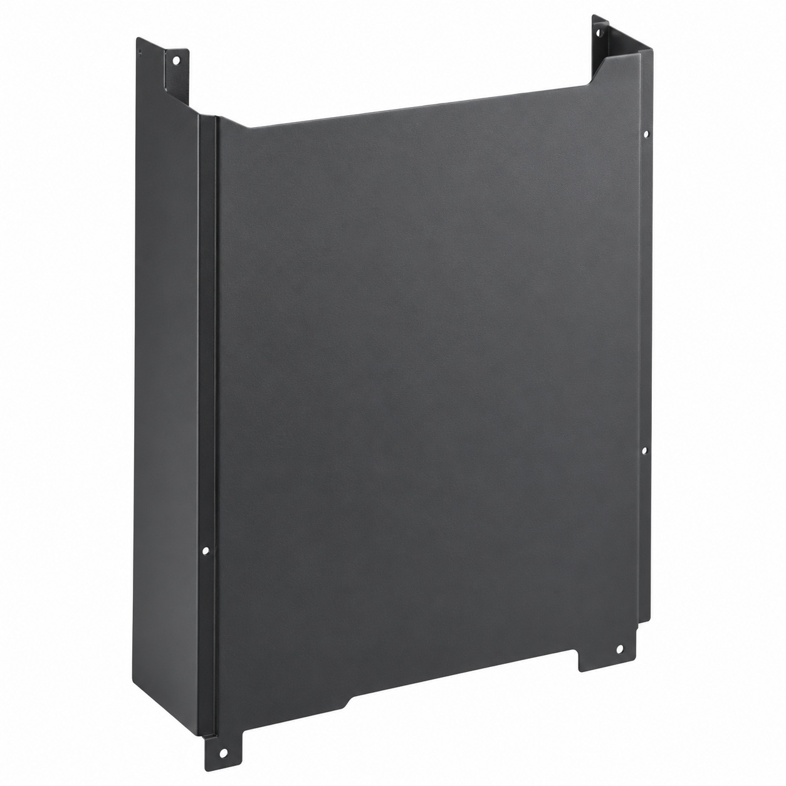
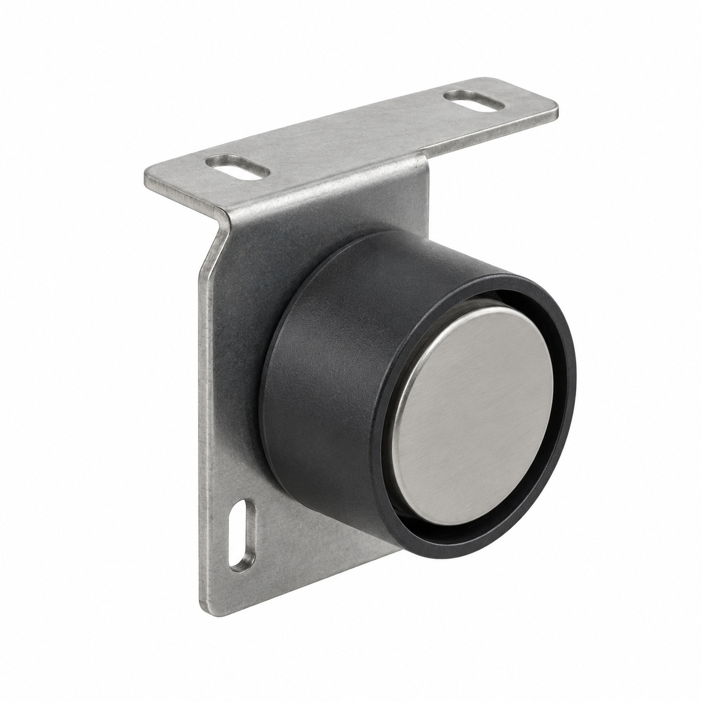
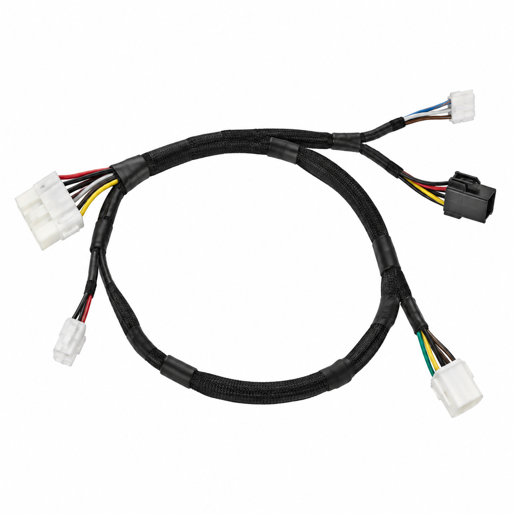
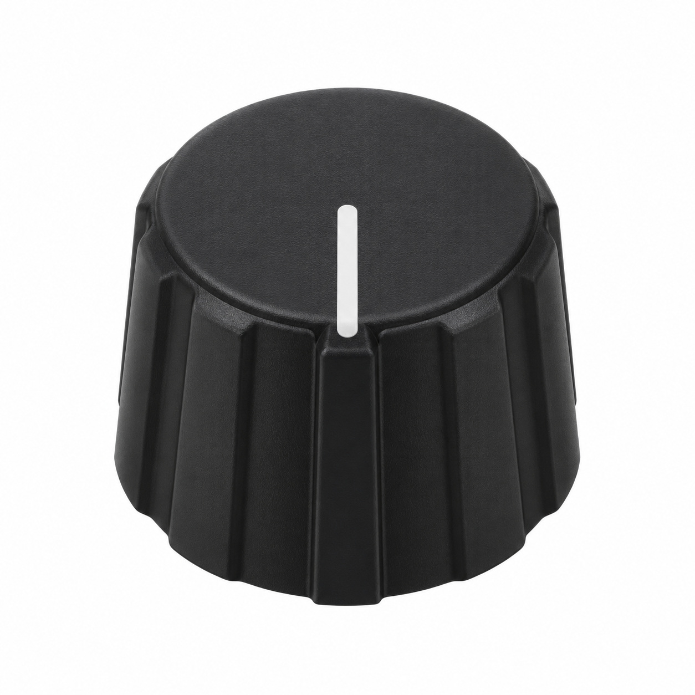
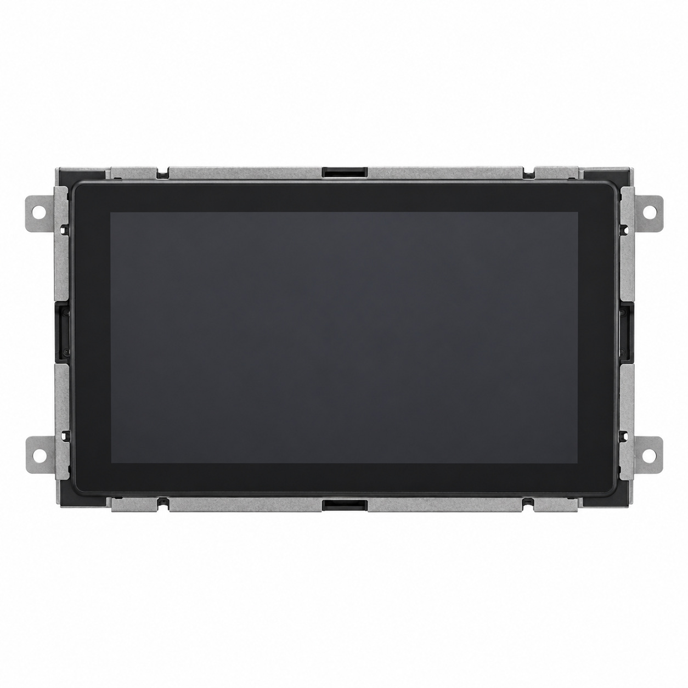
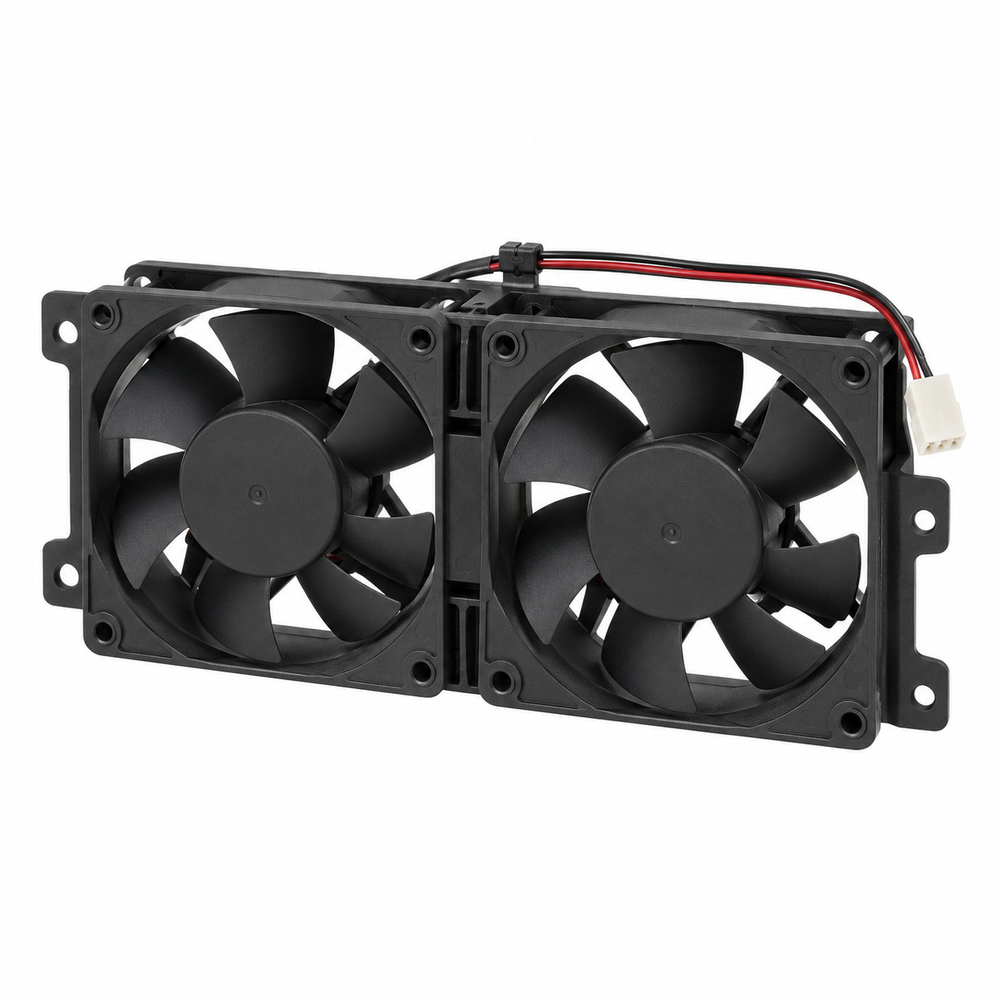
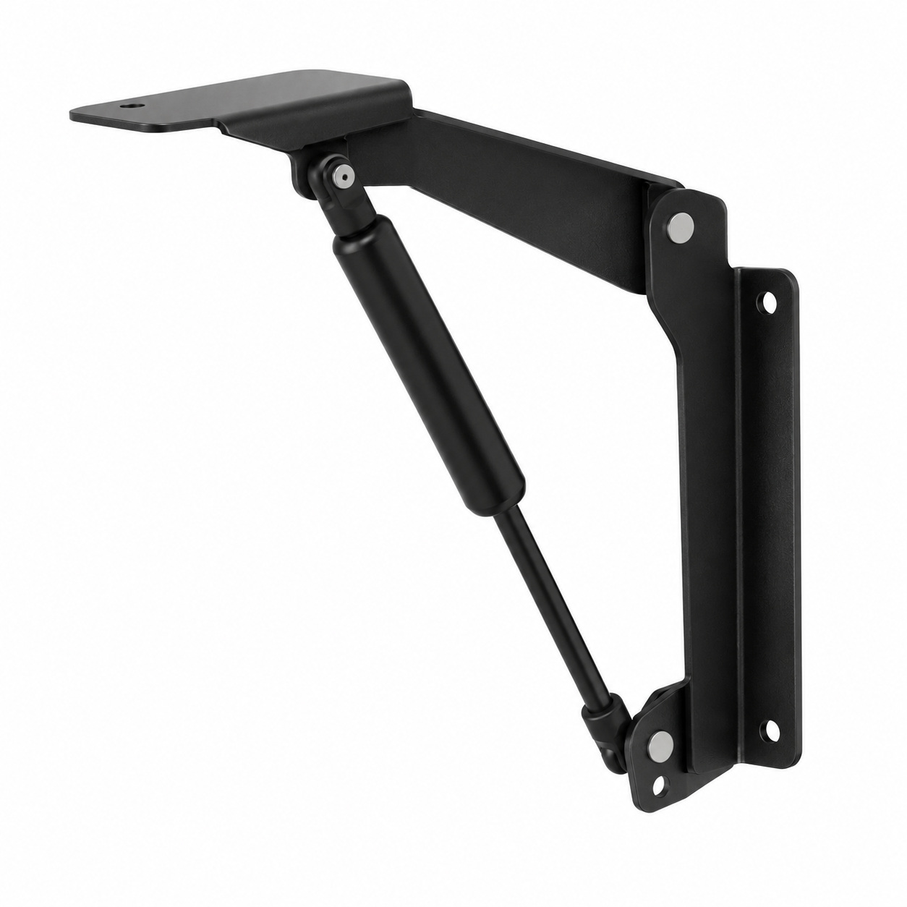
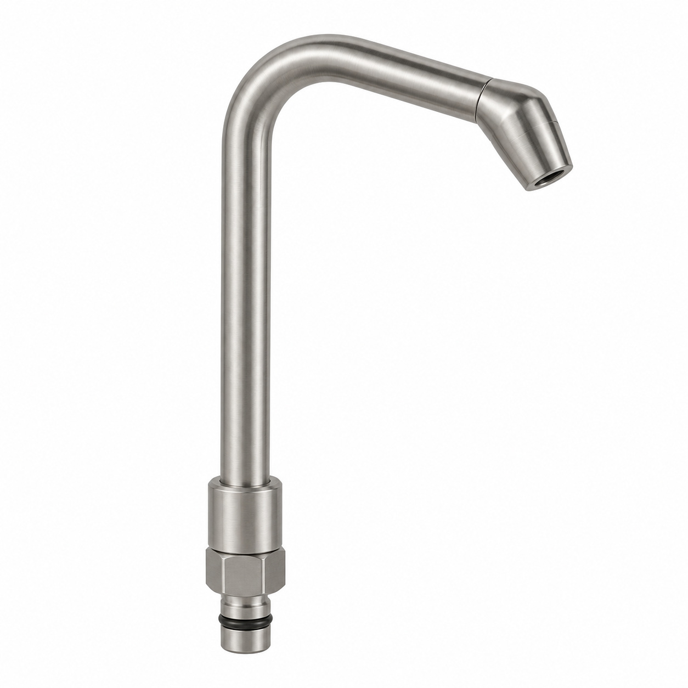

# Remaining catalog illustrations — batch 03

Generic type-based representations for review. Manufacturer-specific shape, internal construction, kit contents and fitment are unverified. Complex assemblies are broad concepts requiring a real photo or drawing. Existing catalog validation is not changed.

[Back to gallery](README.md)

| Target SKU | Description | Image |
| --- | --- | --- |
| 128.040 | Generic electrical component | [Open image](generic-128.040.jpg) |
| 130.835 | Generic assembly concept | [Open image](generic-130.835.jpg) |
| 130.894 | Generic cover, housing or mounting component | [Open image](generic-130.894.jpg) |
| 130.895 | Generic cover, housing or mounting component | [Open image](generic-130.895.jpg) |
| 130.981 | Generic cable or wiring assembly | [Open image](generic-130.981.jpg) |
| 131.572 | Generic mechanical component | [Open image](generic-131.572.jpg) |
| 132.494 | Generic electrical component | [Open image](generic-132.494.jpg) |
| 133.019 | Generic electrical component | [Open image](generic-133.019.jpg) |
| 142.122 | Generic cover, housing or mounting component | [Open image](generic-142.122.jpg) |
| 129.300 | Generic cover, housing or mounting component | [Open image](generic-129.300.jpg) |

## 128.040 — Generic electrical component

## 130.835 — Generic assembly concept

## 130.894 — Generic cover, housing or mounting component

## 130.895 — Generic cover, housing or mounting component

## 130.981 — Generic cable or wiring assembly

## 131.572 — Generic mechanical component

## 132.494 — Generic electrical component

## 133.019 — Generic electrical component

## 142.122 — Generic cover, housing or mounting component

## 129.300 — Generic cover, housing or mounting component

