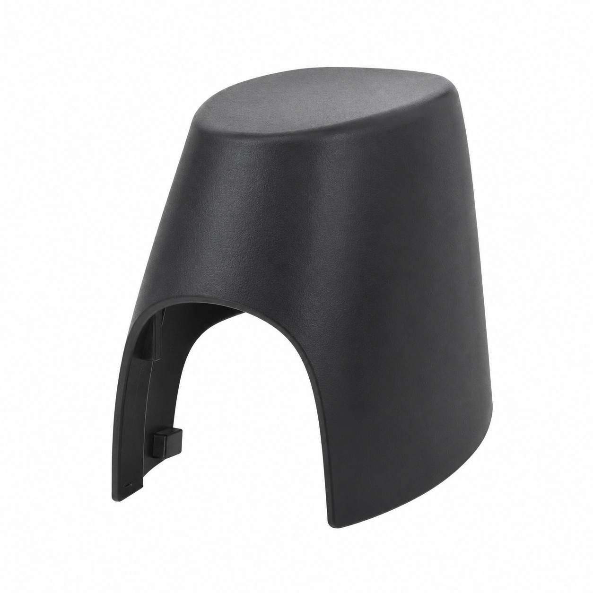
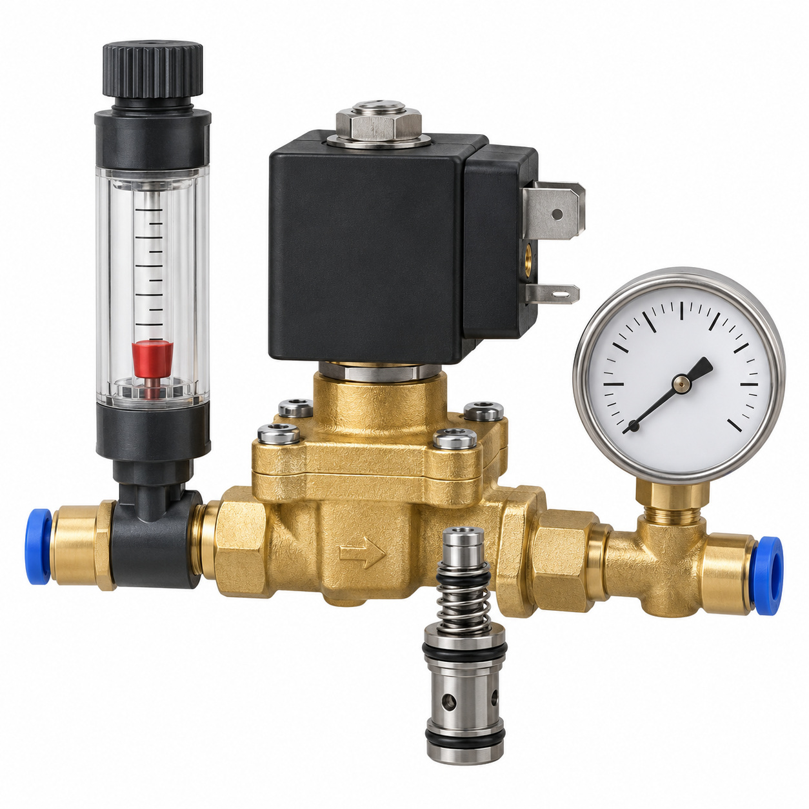
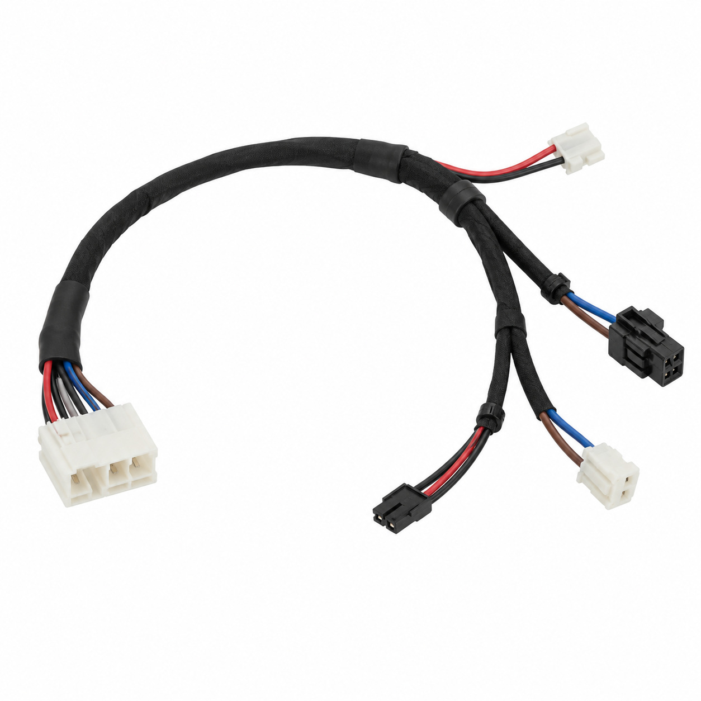
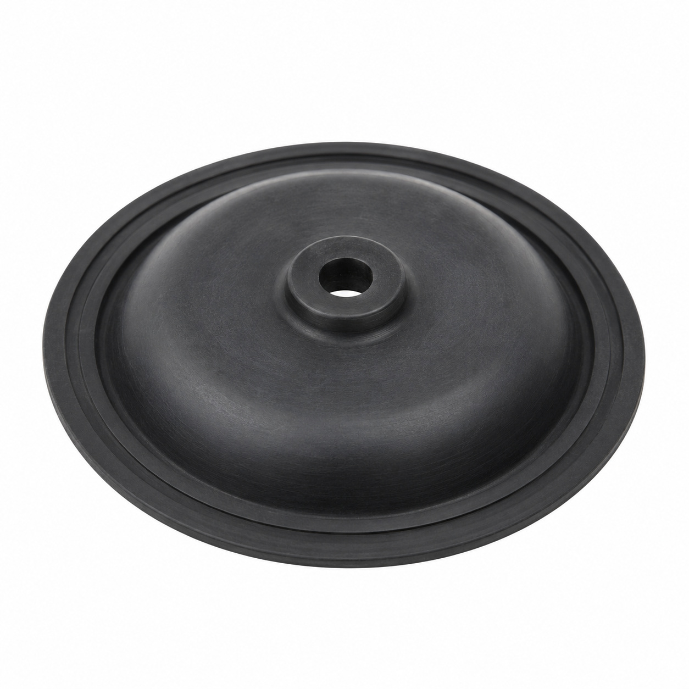
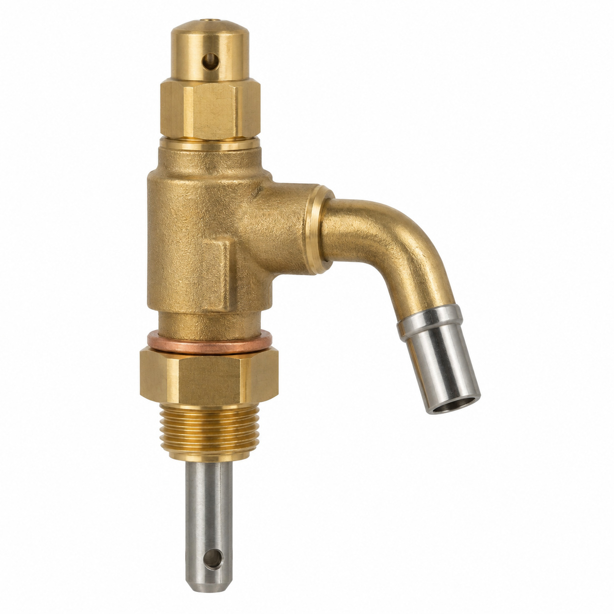
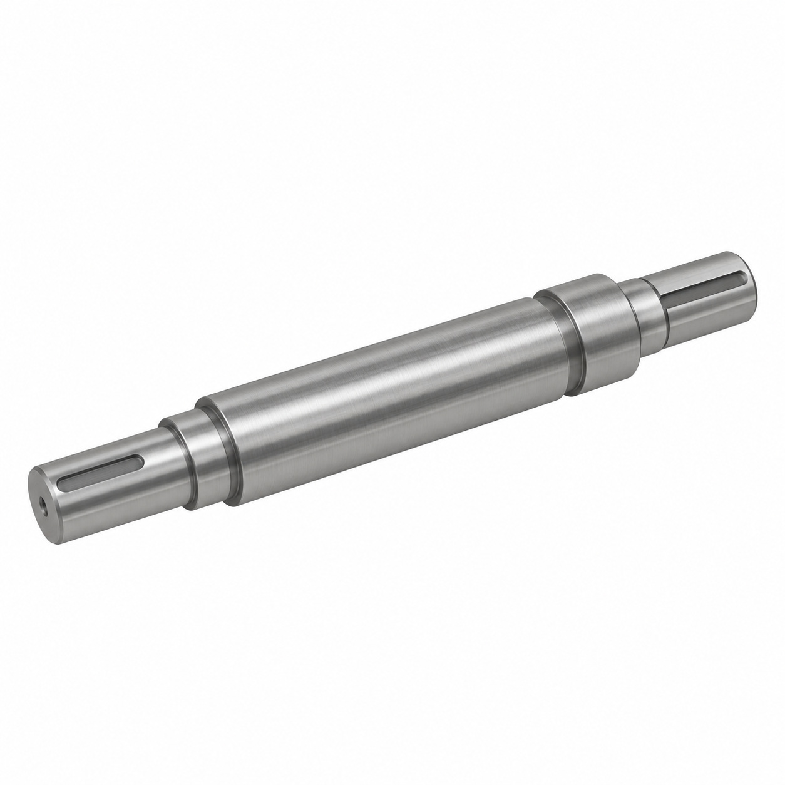
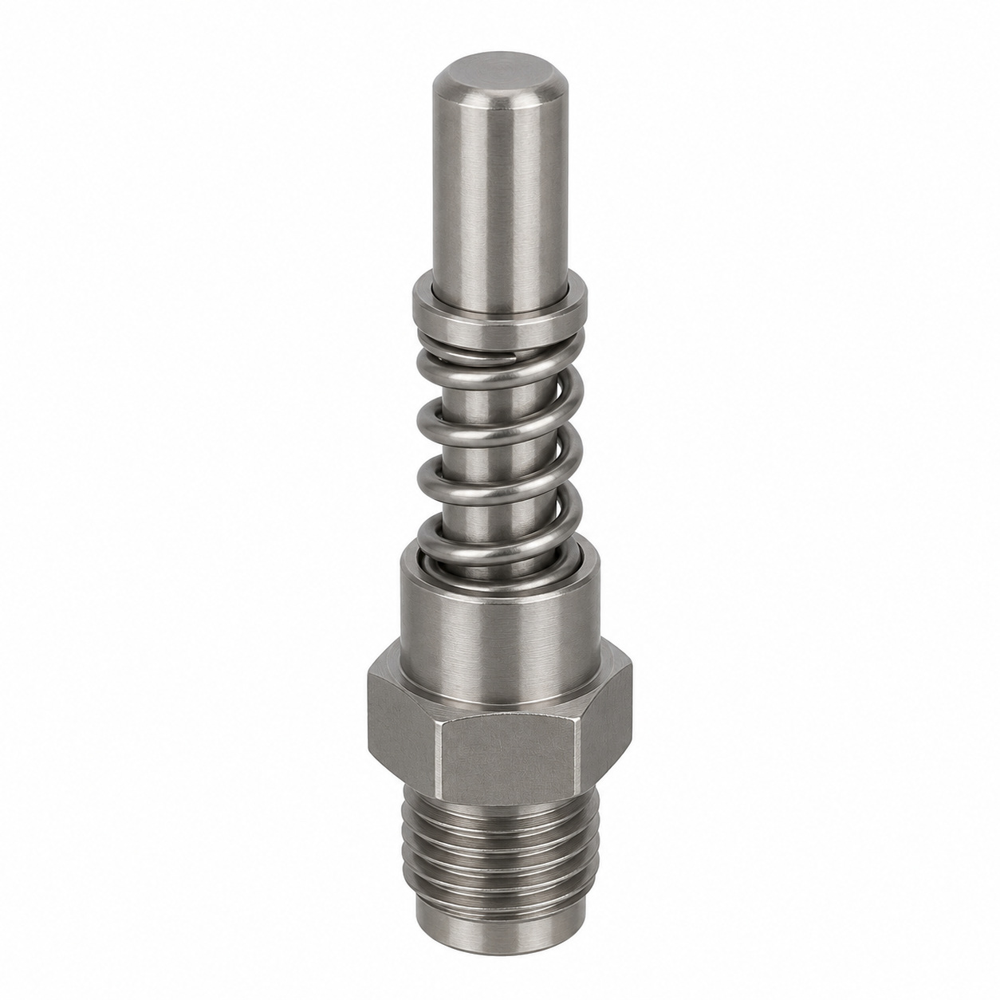
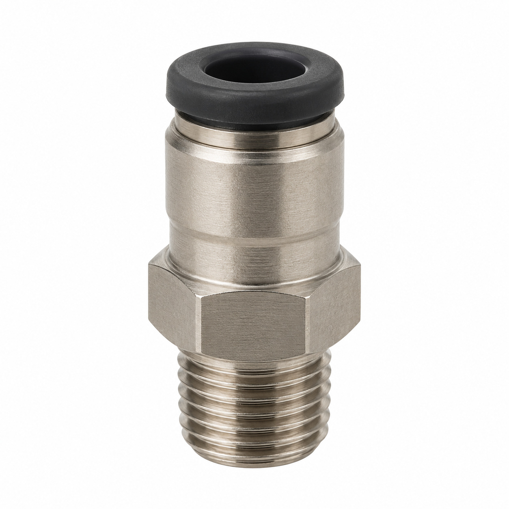
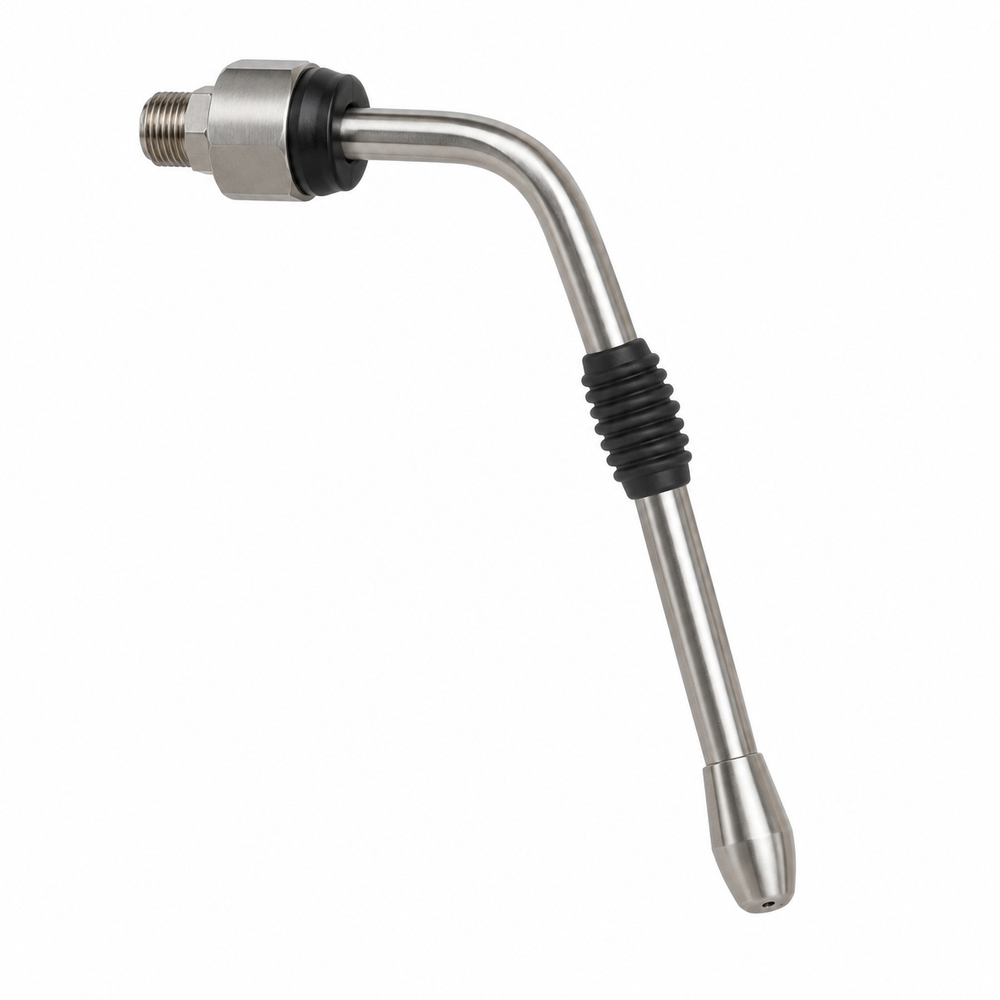
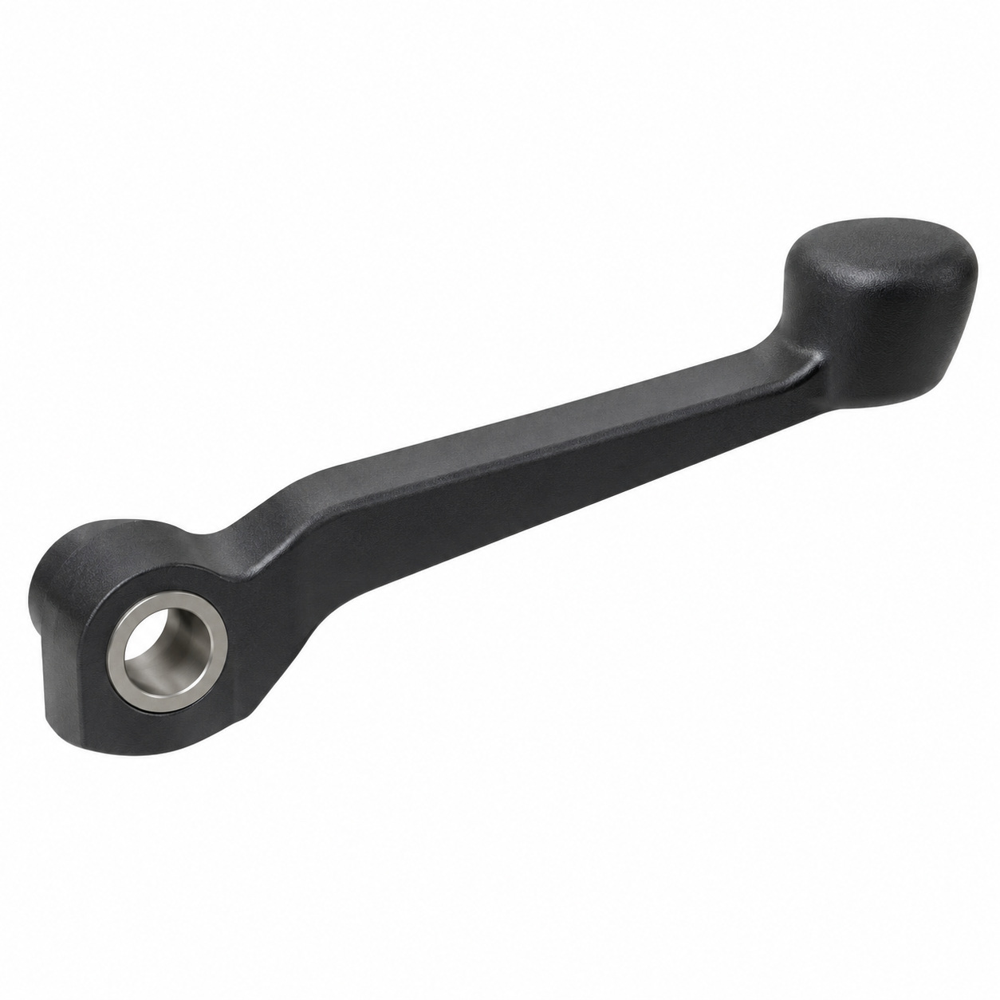

# Remaining catalog illustrations — batch 04

Generic type-based representations for review. Manufacturer-specific shape, internal construction, kit contents and fitment are unverified. Complex assemblies are broad concepts requiring a real photo or drawing. Existing catalog validation is not changed.

[Back to gallery](README.md)

| Target SKU | Description | Image |
| --- | --- | --- |
| 129.354 | Generic cover, housing or mounting component | [Open image](generic-129.354.jpg) |
| 129.371 | 2/2-way magnet valve ø6 DN3 NO | [Open image](generic-129.371.jpg) |
| 129.771 | Generic cable or wiring assembly | [Open image](generic-129.771.jpg) |
| 129.979 | Membrane ETV-200 EPDM | [Open image](generic-129.979.jpg) |
| 130.286 | Generic boiler or steam component | [Open image](generic-130.286.jpg) |
| 128.798 | Generic mechanical component | [Open image](generic-128.798.jpg) |
| 128.815 | Generic fluid-control component | [Open image](generic-128.815.jpg) |
| 129.210 | Generic fluid connector | [Open image](generic-129.210.jpg) |
| 129.907 | Generic boiler or steam component | [Open image](generic-129.907.jpg) |
| 130.042 | Generic mechanical component | [Open image](generic-130.042.jpg) |

## 129.354 — Generic cover, housing or mounting component

## 129.371 — 2/2-way magnet valve ø6 DN3 NO

## 129.771 — Generic cable or wiring assembly

## 129.979 — Membrane ETV-200 EPDM

## 130.286 — Generic boiler or steam component

## 128.798 — Generic mechanical component

## 128.815 — Generic fluid-control component

## 129.210 — Generic fluid connector

## 129.907 — Generic boiler or steam component

## 130.042 — Generic mechanical component

