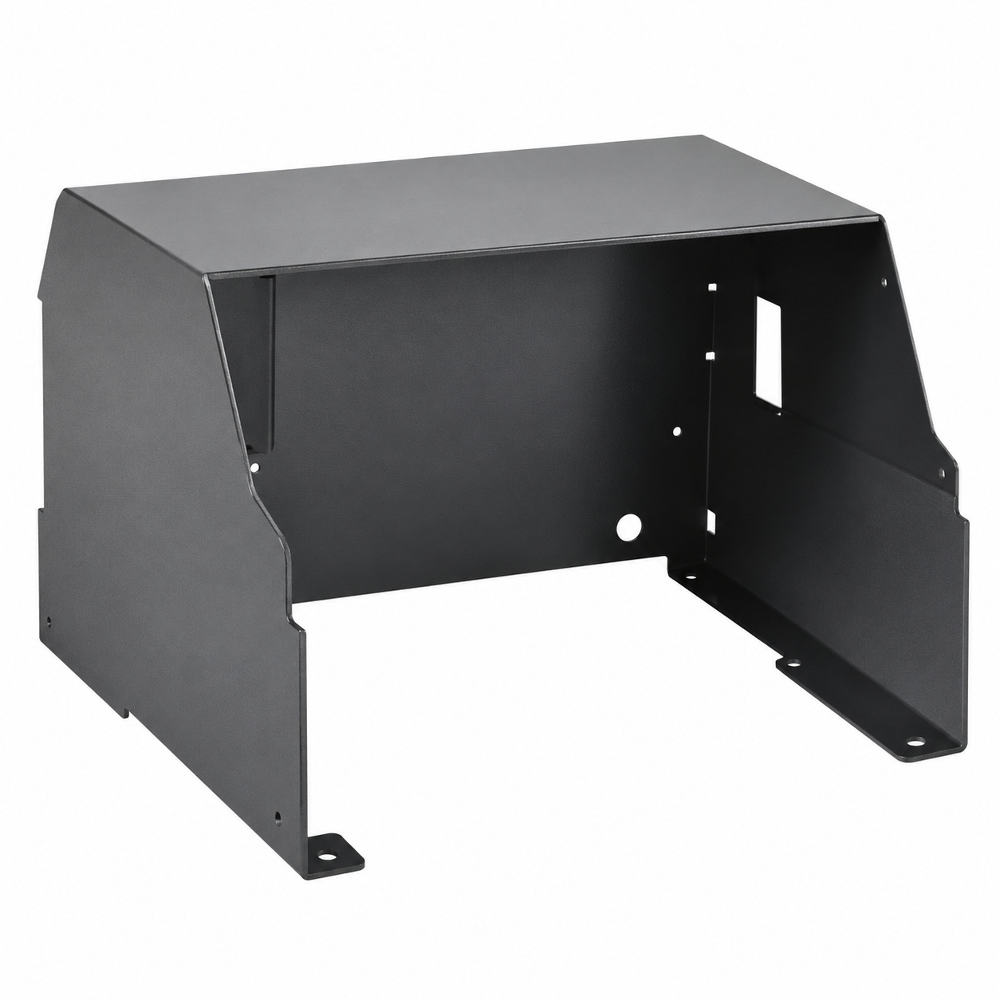
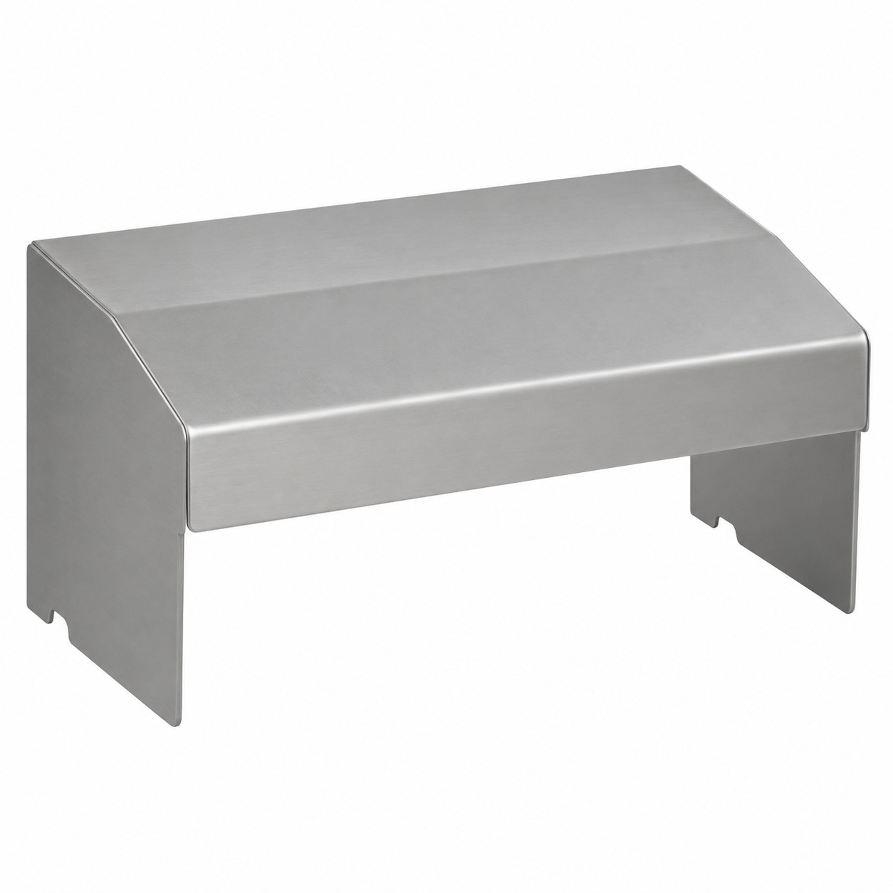
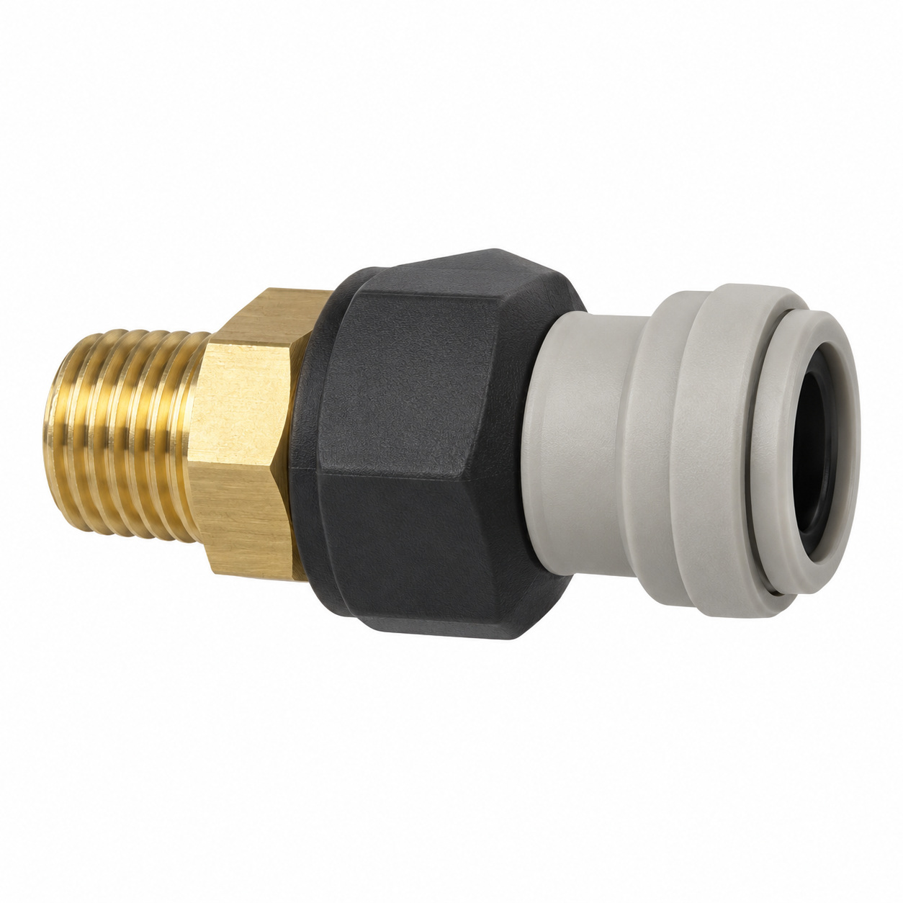
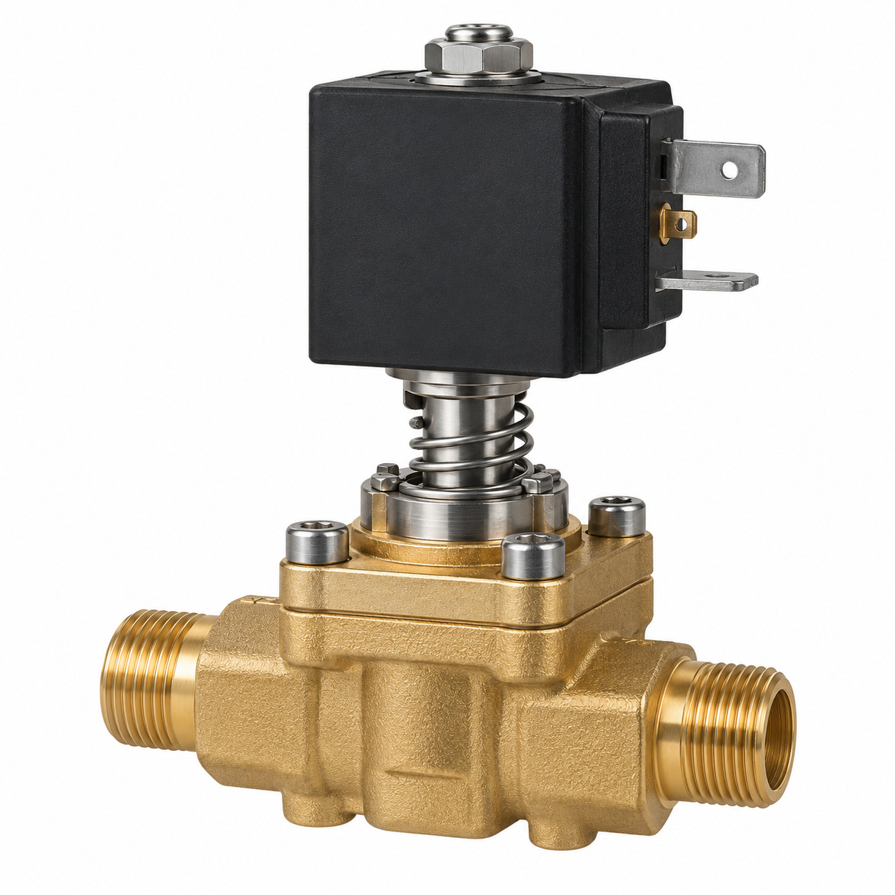
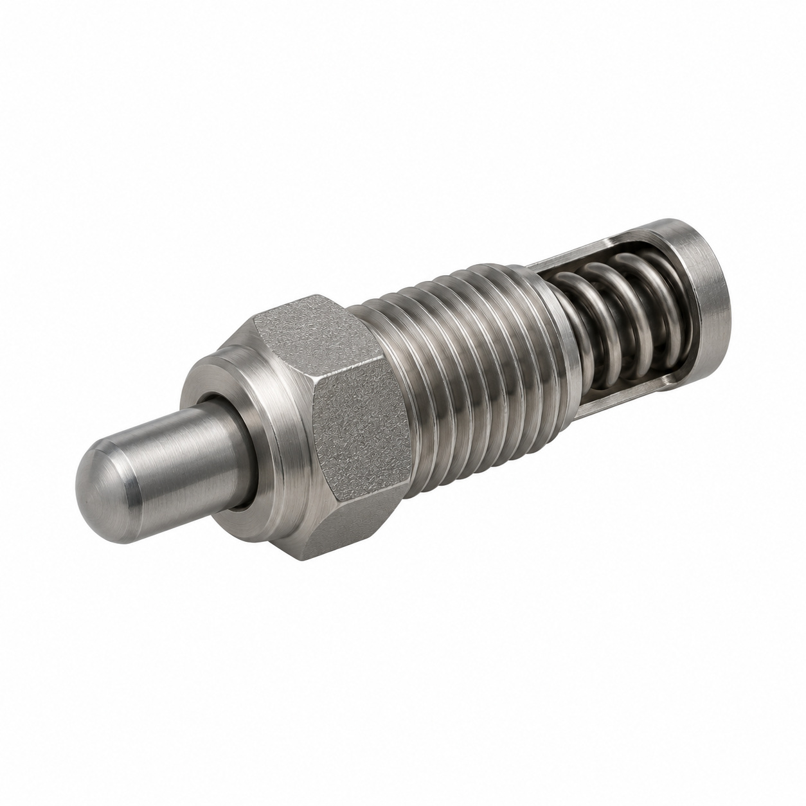
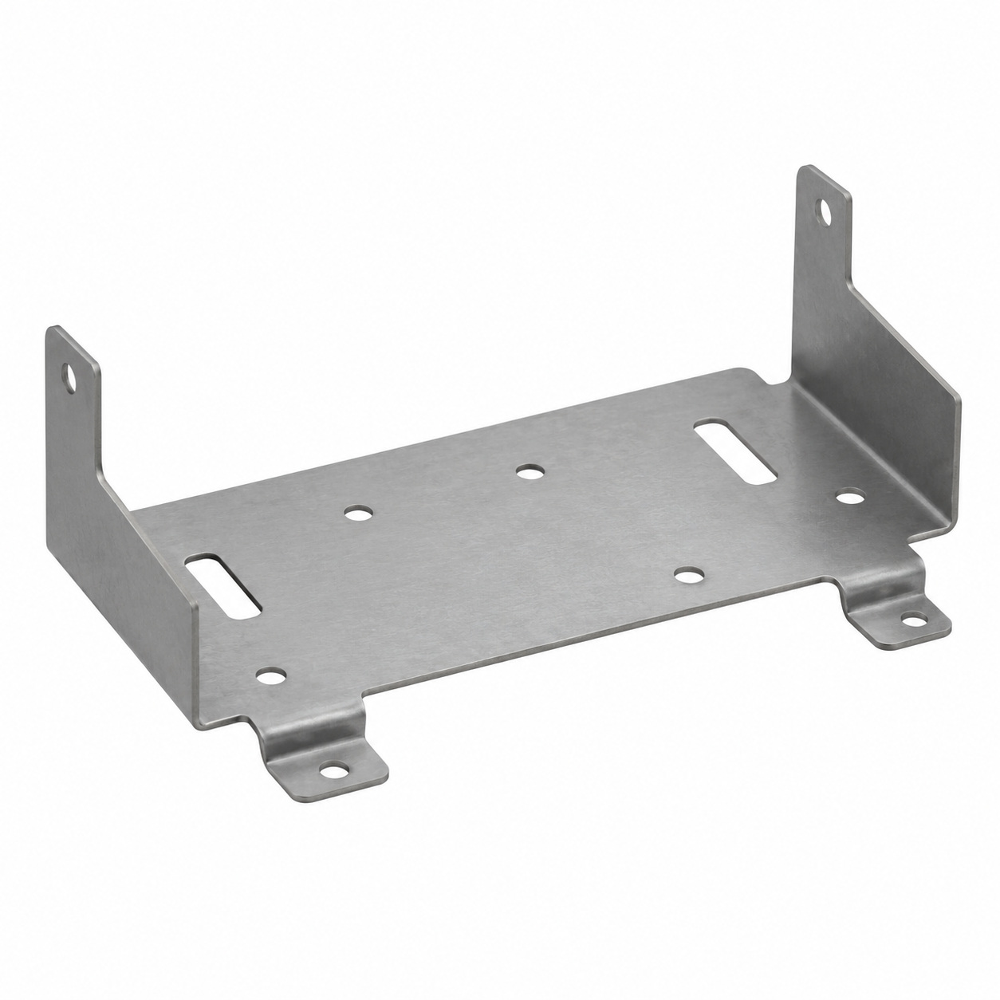
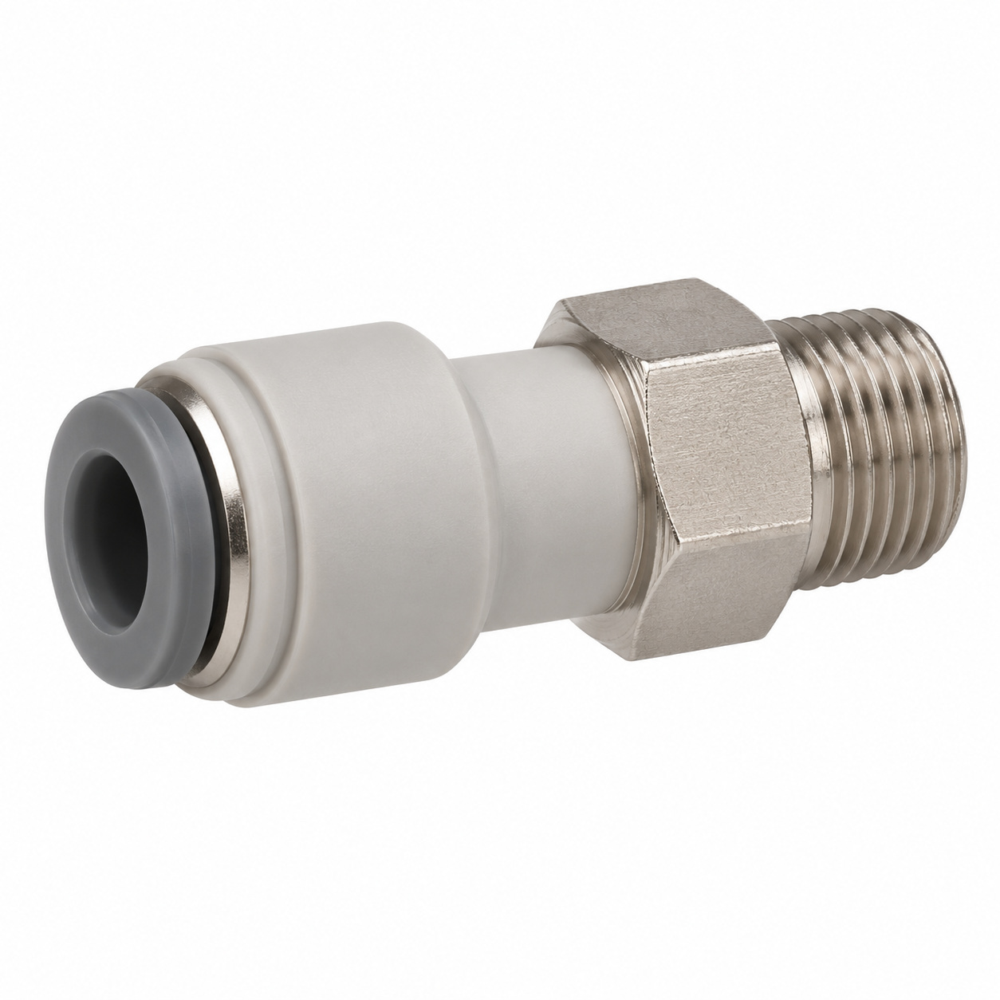
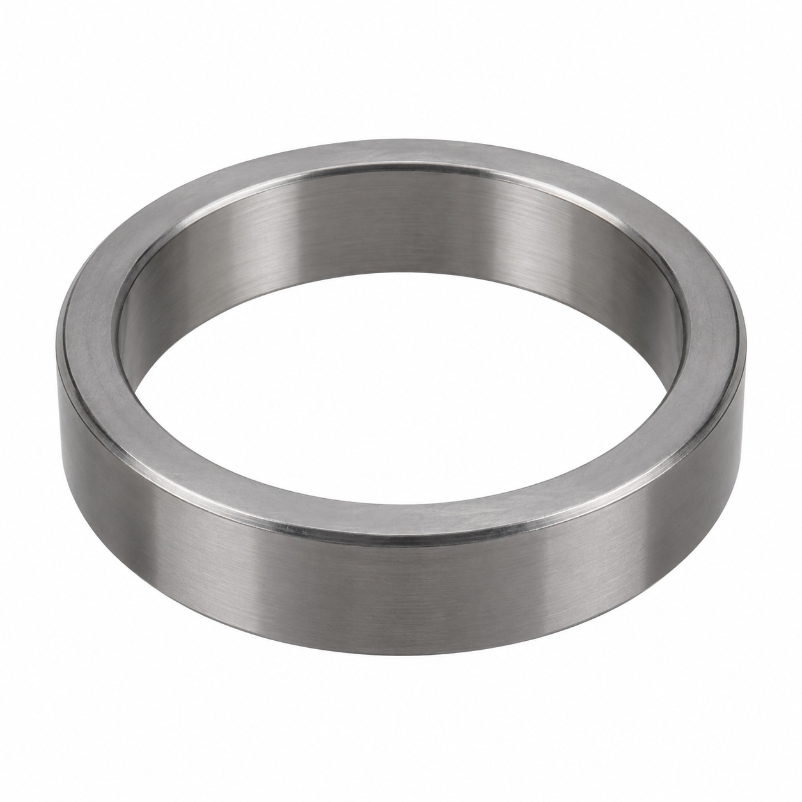
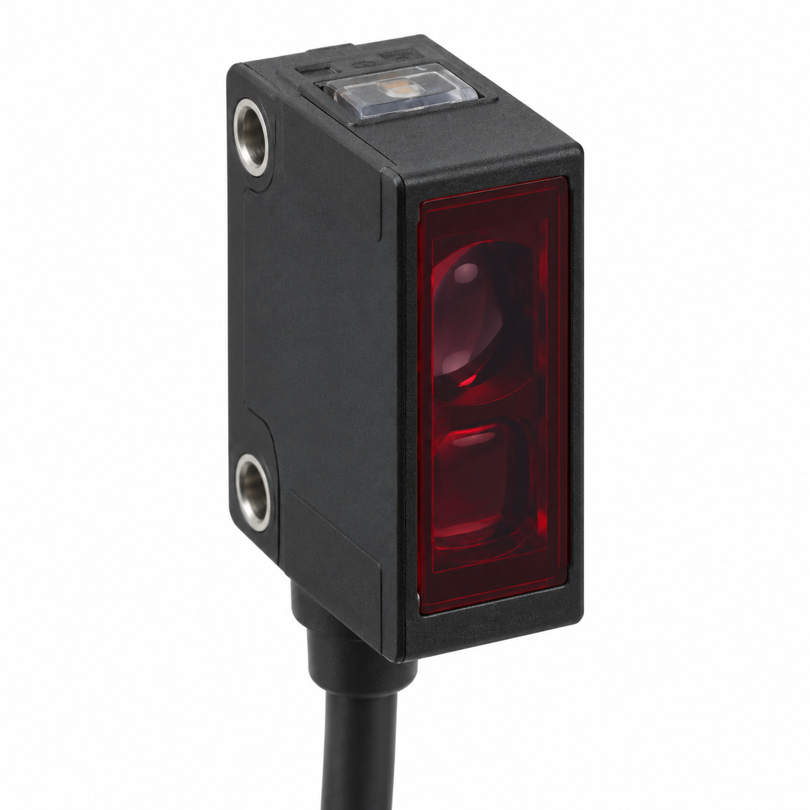
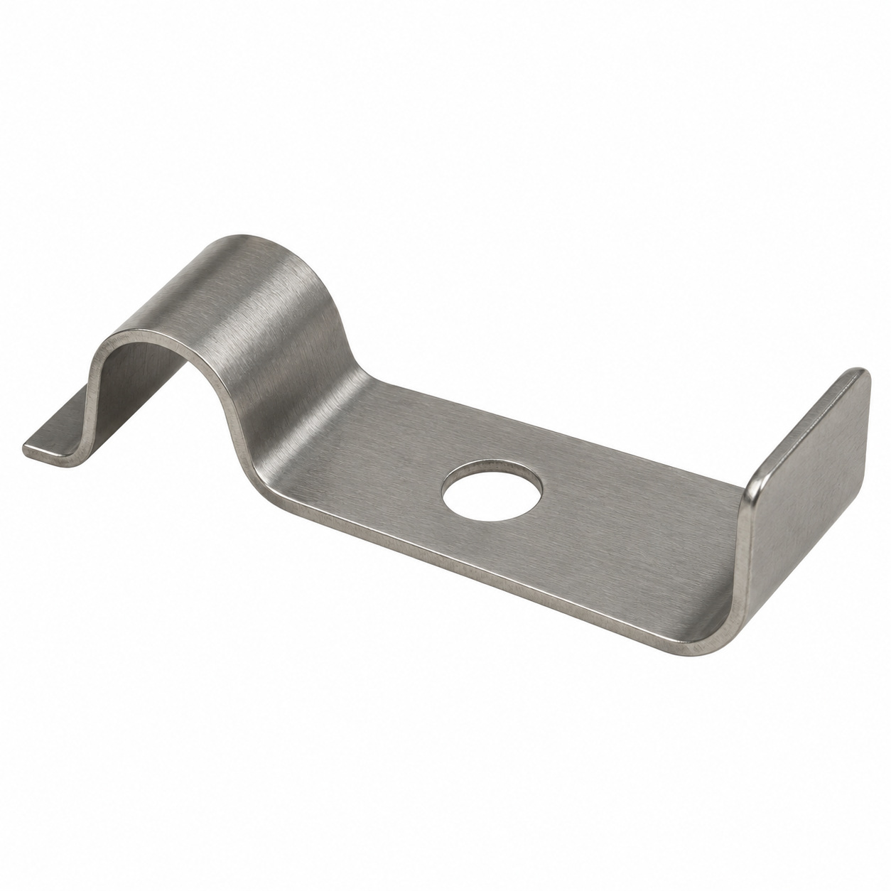

# Remaining catalog illustrations — batch 05

Generic type-based representations for review. Manufacturer-specific shape, internal construction, kit contents and fitment are unverified. Complex assemblies are broad concepts requiring a real photo or drawing. Existing catalog validation is not changed.

[Back to gallery](README.md)

| Target SKU | Description | Image |
| --- | --- | --- |
| 130.278 | Generic cover, housing or mounting component | [Open image](generic-130.278.jpg) |
| 130.287 | Generic cover, housing or mounting component | [Open image](generic-130.287.jpg) |
| 130.288 | Generic assembly concept | [Open image](generic-130.288.jpg) |
| 130.290 | Generic fluid-control component | [Open image](generic-130.290.jpg) |
| 130.292 | Generic fluid-control component | [Open image](generic-130.292.jpg) |
| 130.293 | Generic cover, housing or mounting component | [Open image](generic-130.293.jpg) |
| 130.310 | Generic fluid connector | [Open image](generic-130.310.jpg) |
| 130.312 | Generic mechanical component | [Open image](generic-130.312.jpg) |
| 130.734 | Generic electrical component | [Open image](generic-130.734.jpg) |
| 131.170 | Generic cover, housing or mounting component | [Open image](generic-131.170.jpg) |

## 130.278 — Generic cover, housing or mounting component

## 130.287 — Generic cover, housing or mounting component

## 130.288 — Generic assembly concept

## 130.290 — Generic fluid-control component

## 130.292 — Generic fluid-control component

## 130.293 — Generic cover, housing or mounting component

## 130.310 — Generic fluid connector

## 130.312 — Generic mechanical component

## 130.734 — Generic electrical component

## 131.170 — Generic cover, housing or mounting component

