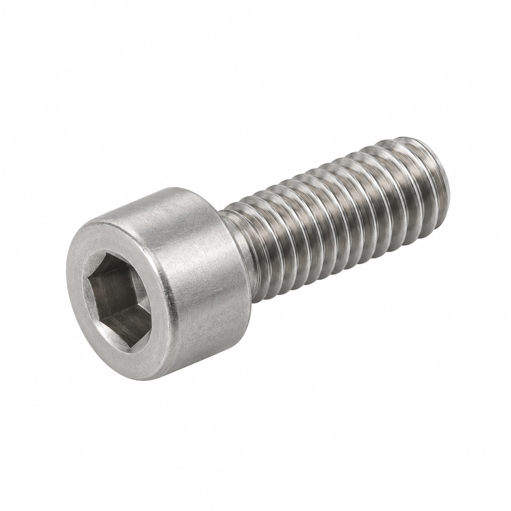
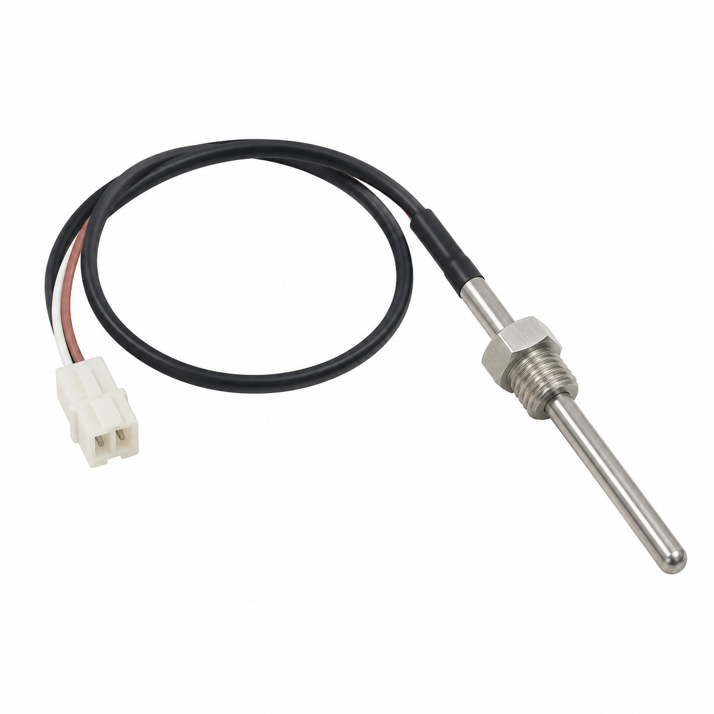
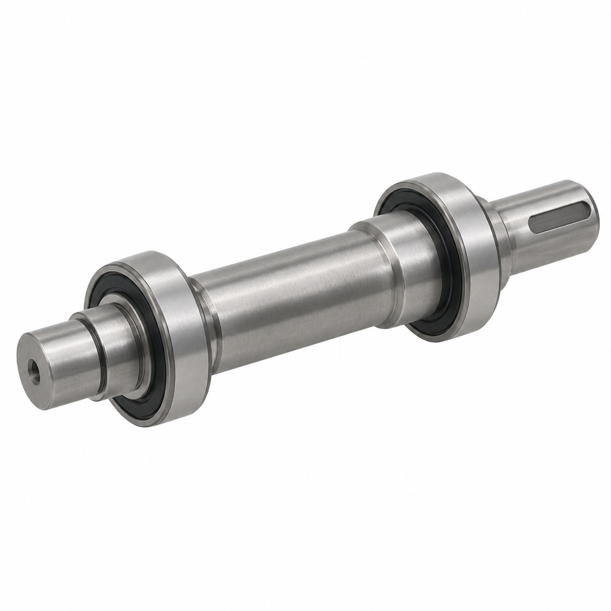
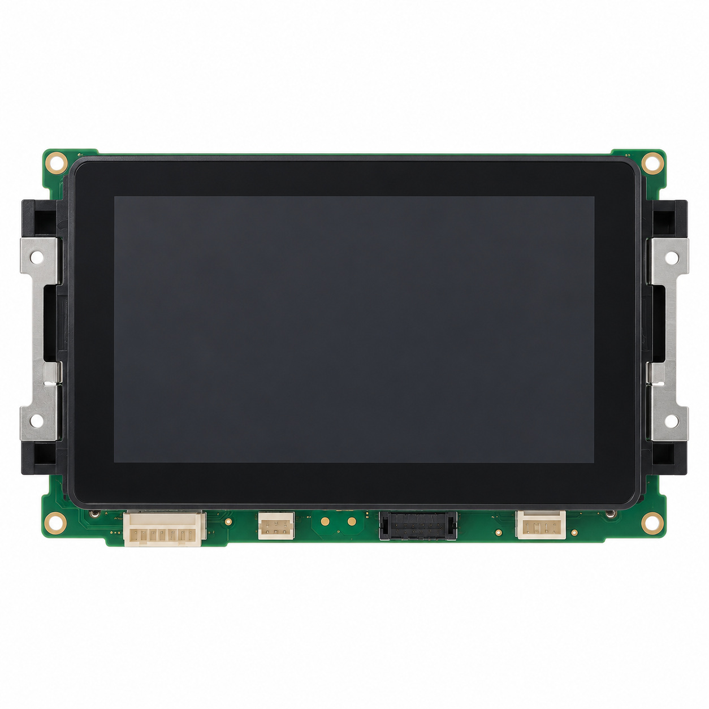
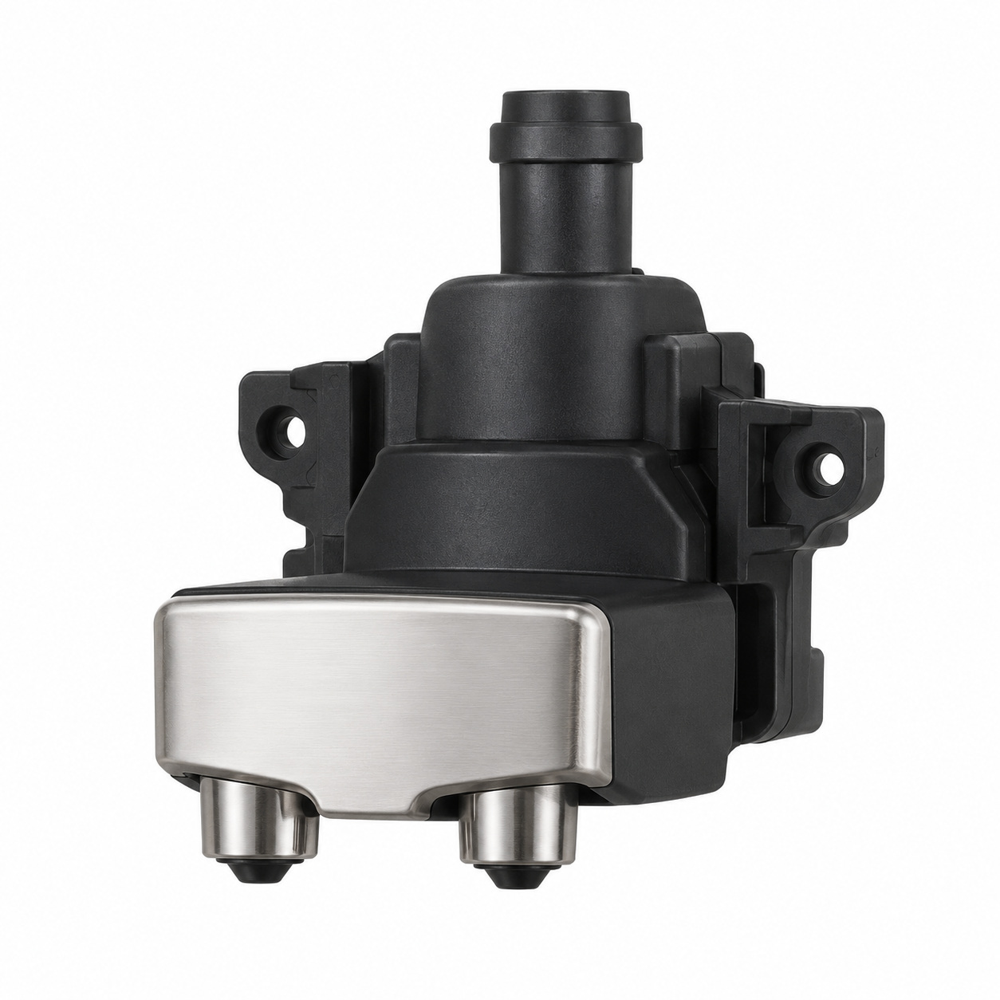
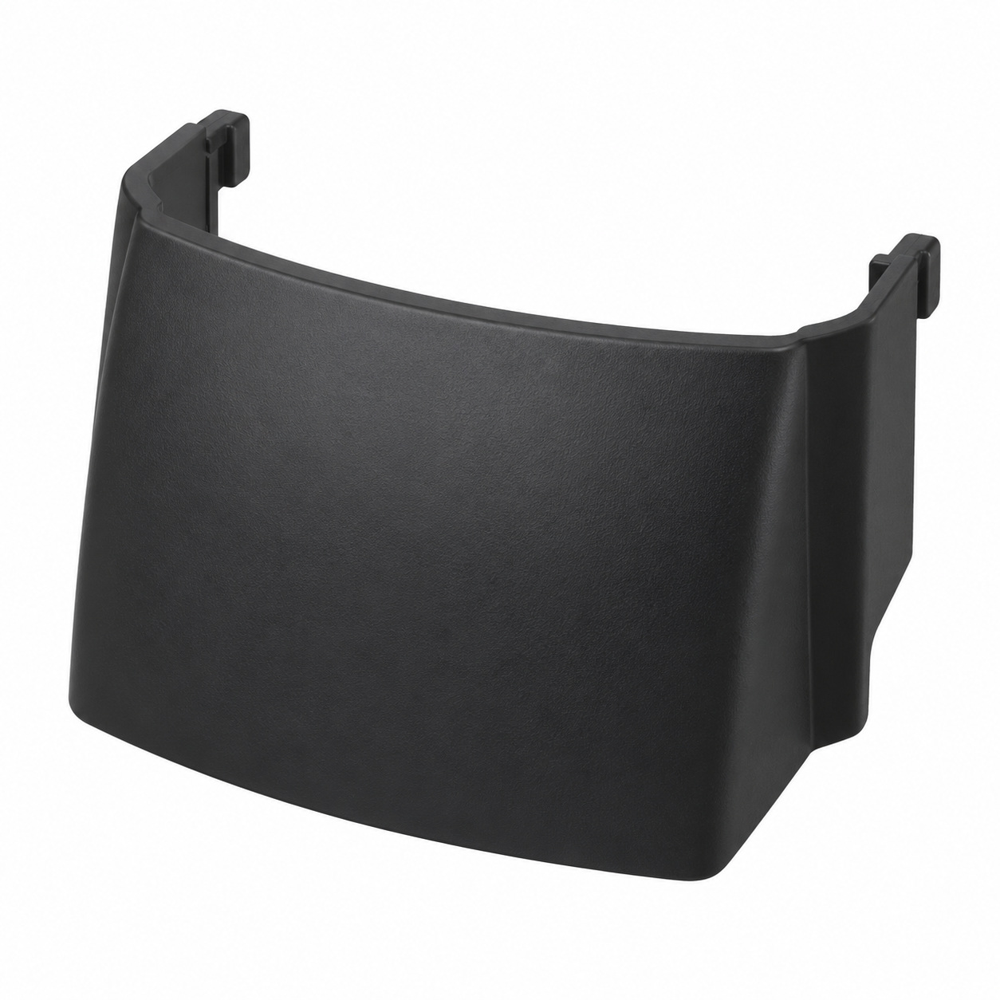
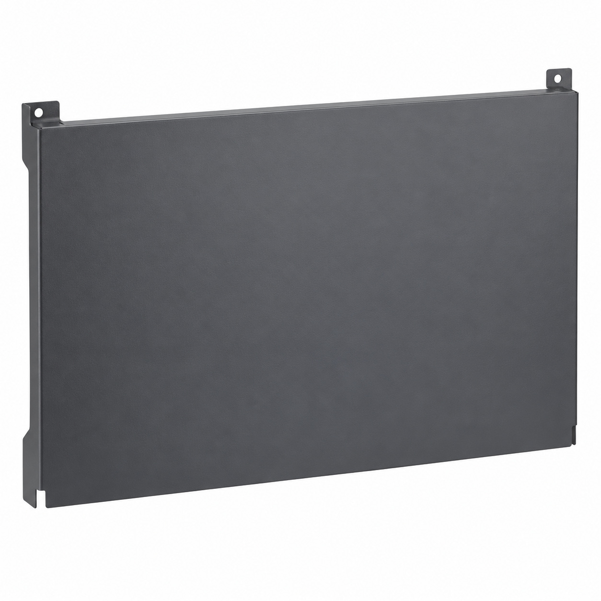
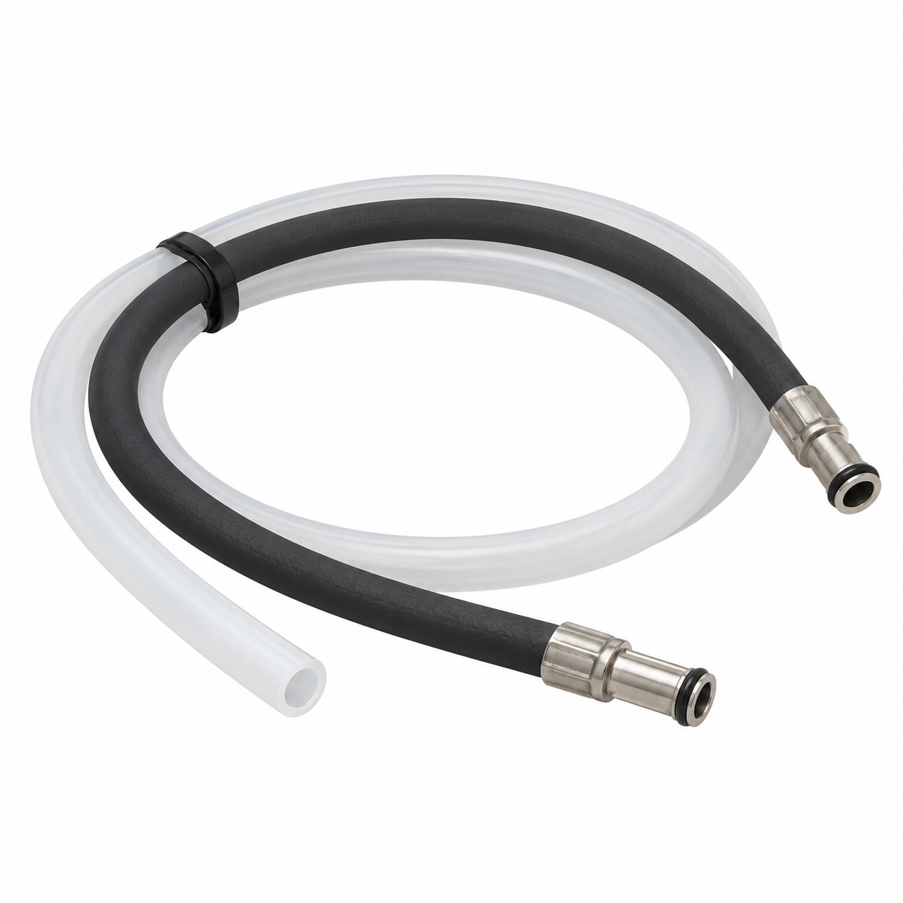
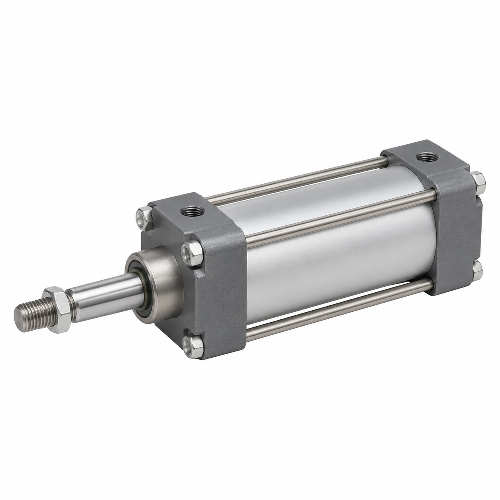
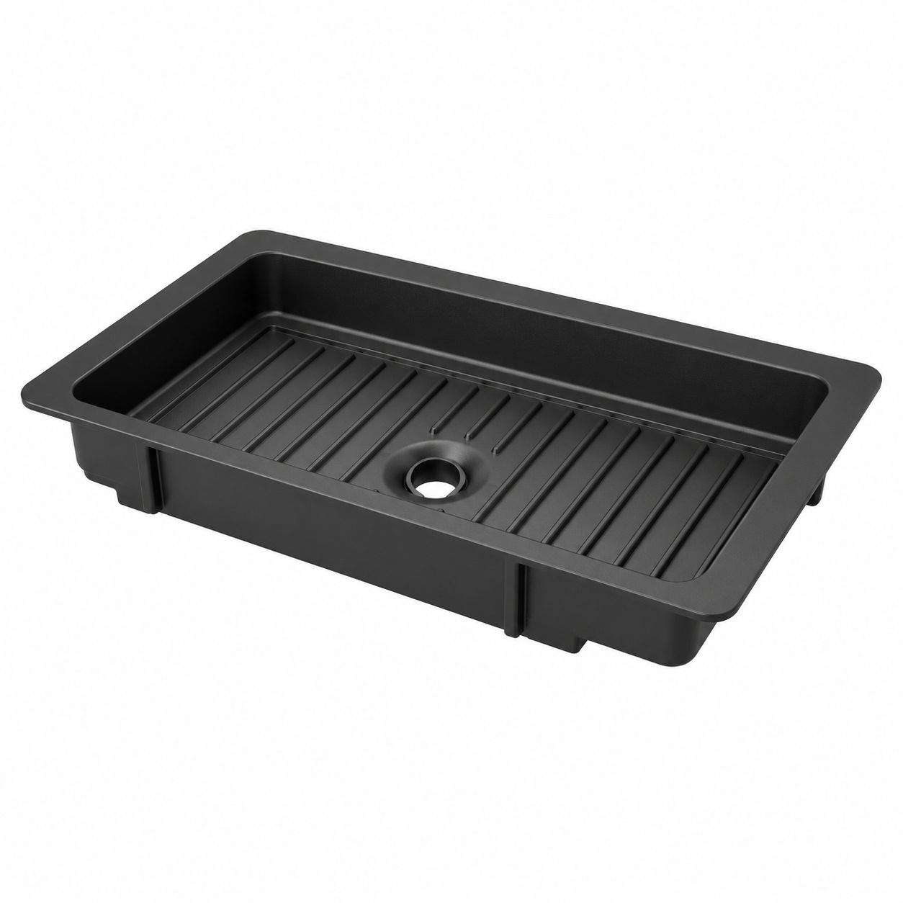

# Remaining catalog illustrations — batch 06

Generic type-based representations for review. Manufacturer-specific shape, internal construction, kit contents and fitment are unverified. Complex assemblies are broad concepts requiring a real photo or drawing. Existing catalog validation is not changed.

[Back to gallery](README.md)

| Target SKU | Description | Image |
| --- | --- | --- |
| 131.209 | Generic fastener | [Open image](generic-131.209.jpg) |
| 131.228 | Generic electrical component | [Open image](generic-131.228.jpg) |
| 139.898 | Generic mechanical component | [Open image](generic-139.898.jpg) |
| 128.049 | Generic electrical component | [Open image](generic-128.049.jpg) |
| 128.498 | Generic assembly concept | [Open image](generic-128.498.jpg) |
| 129.355 | Generic cover, housing or mounting component | [Open image](generic-129.355.jpg) |
| 131.618 | Generic cover, housing or mounting component | [Open image](generic-131.618.jpg) |
| 132.167 | Generic tube or hose assembly | [Open image](generic-132.167.jpg) |
| 130.772 | Generic mechanical component | [Open image](generic-130.772.jpg) |
| 128.852 | Drip tray inlay | [Open image](generic-128.852.jpg) |

## 131.209 — Generic fastener

## 131.228 — Generic electrical component

## 139.898 — Generic mechanical component

## 128.049 — Generic electrical component

## 128.498 — Generic assembly concept

## 129.355 — Generic cover, housing or mounting component

## 131.618 — Generic cover, housing or mounting component

## 132.167 — Generic tube or hose assembly

## 130.772 — Generic mechanical component

## 128.852 — Drip tray inlay

