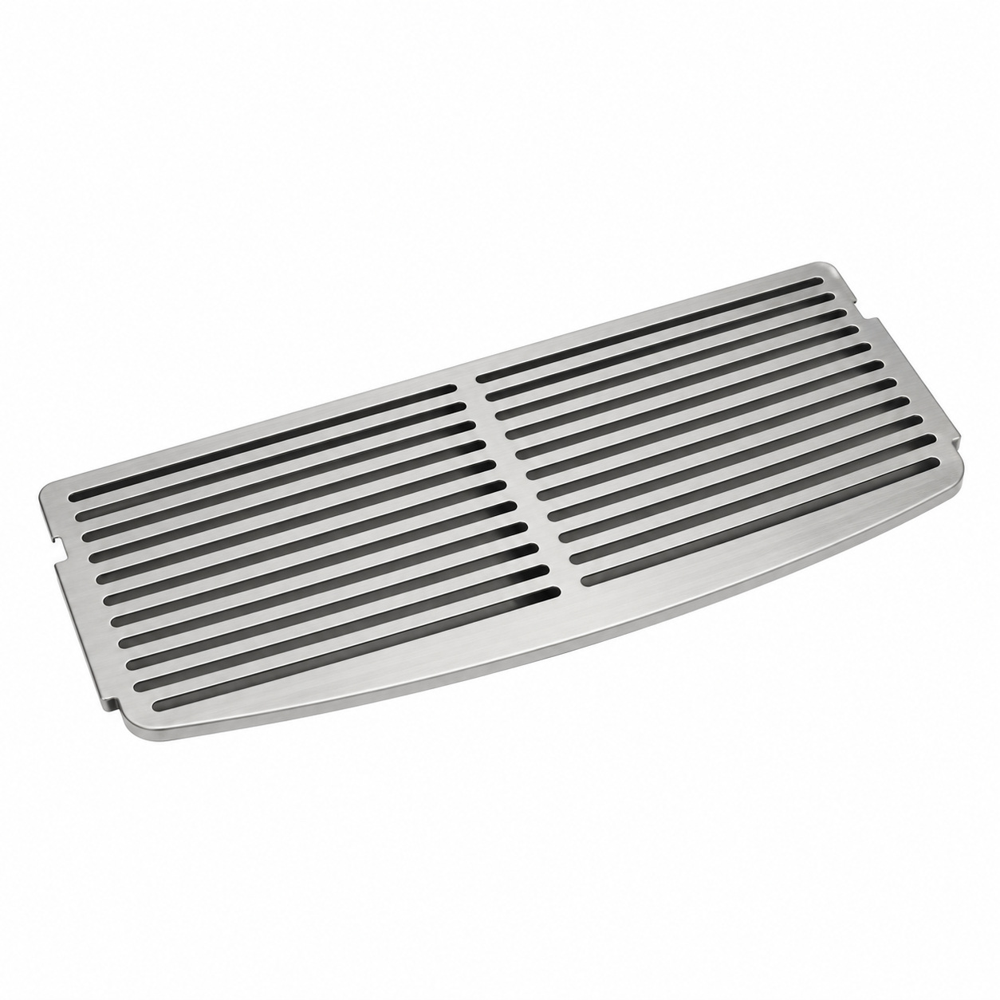
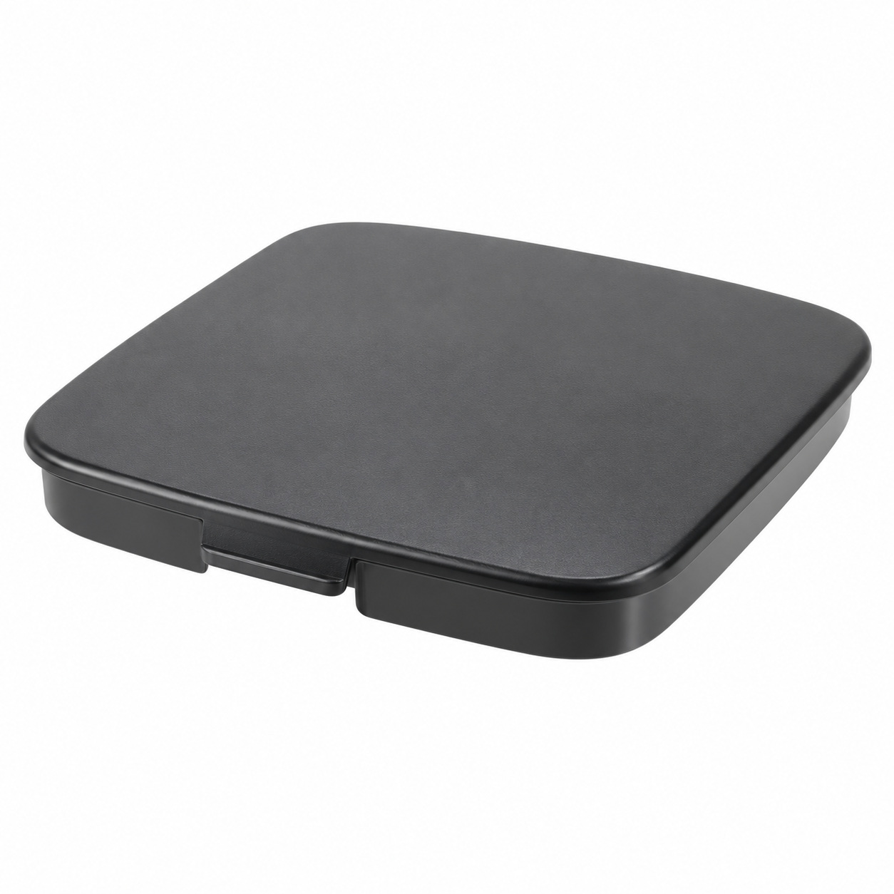
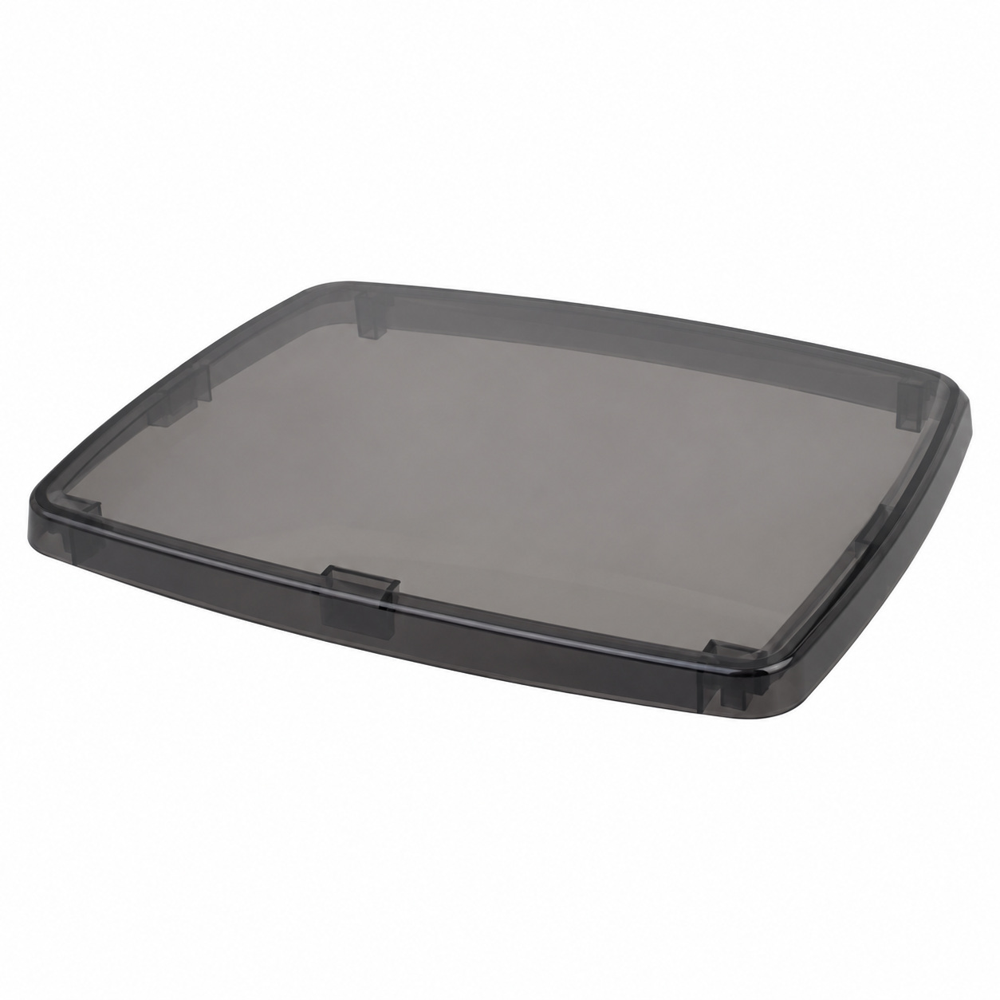
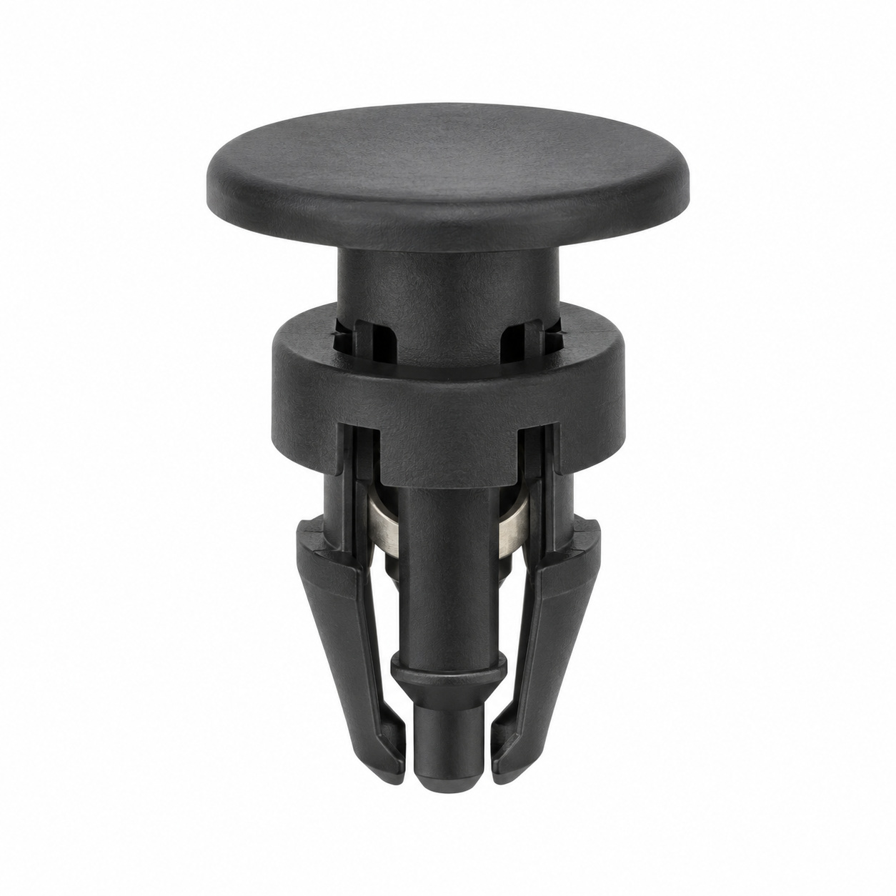
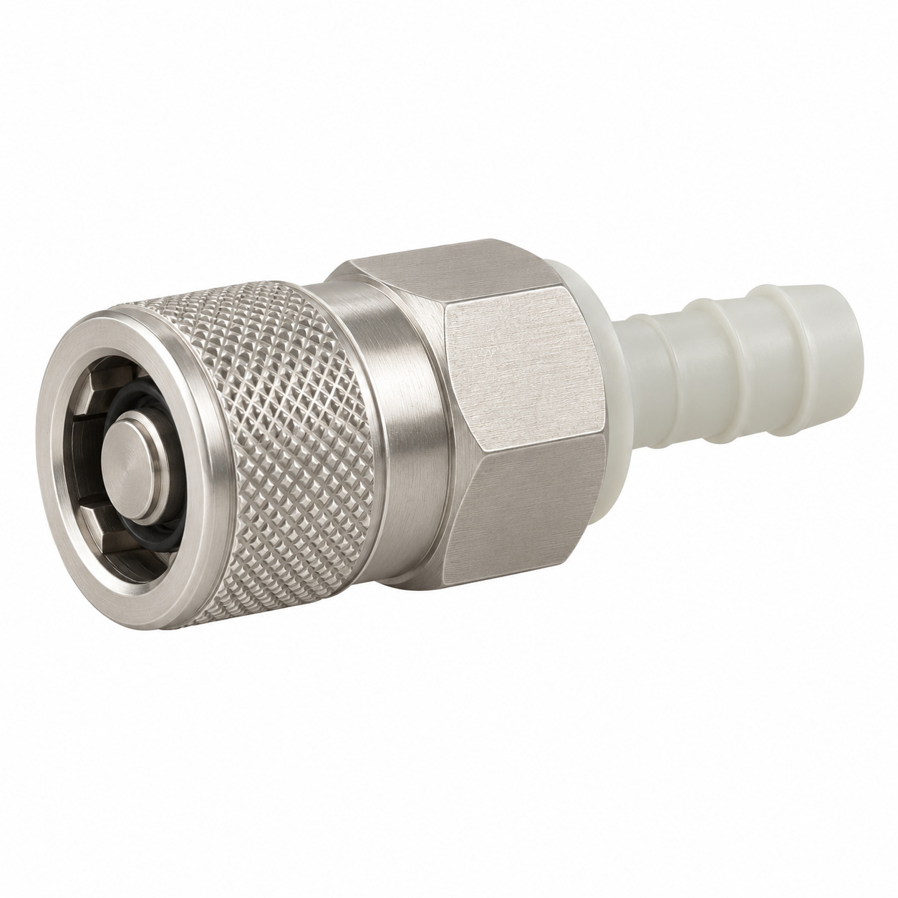
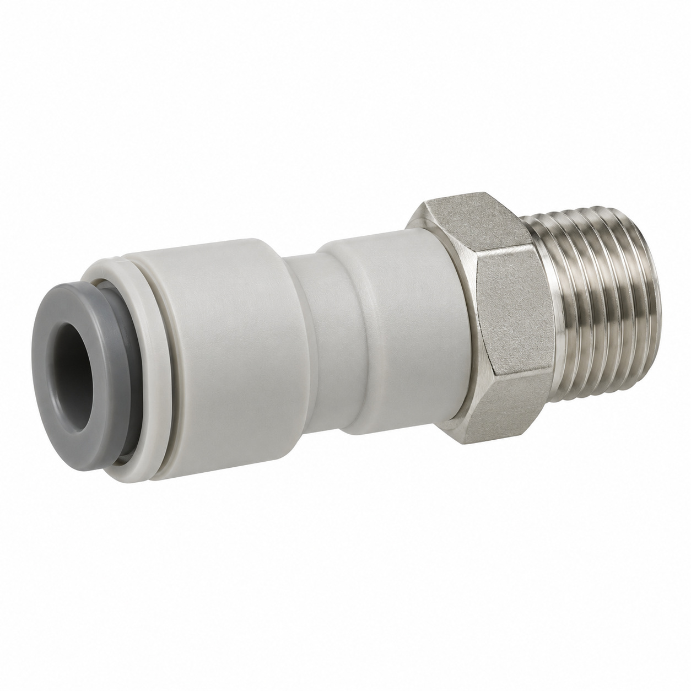
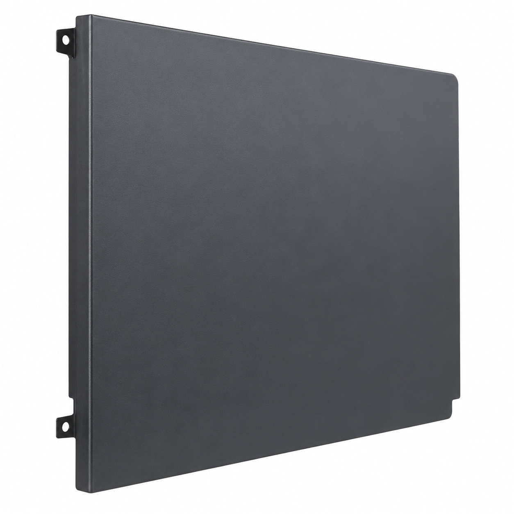
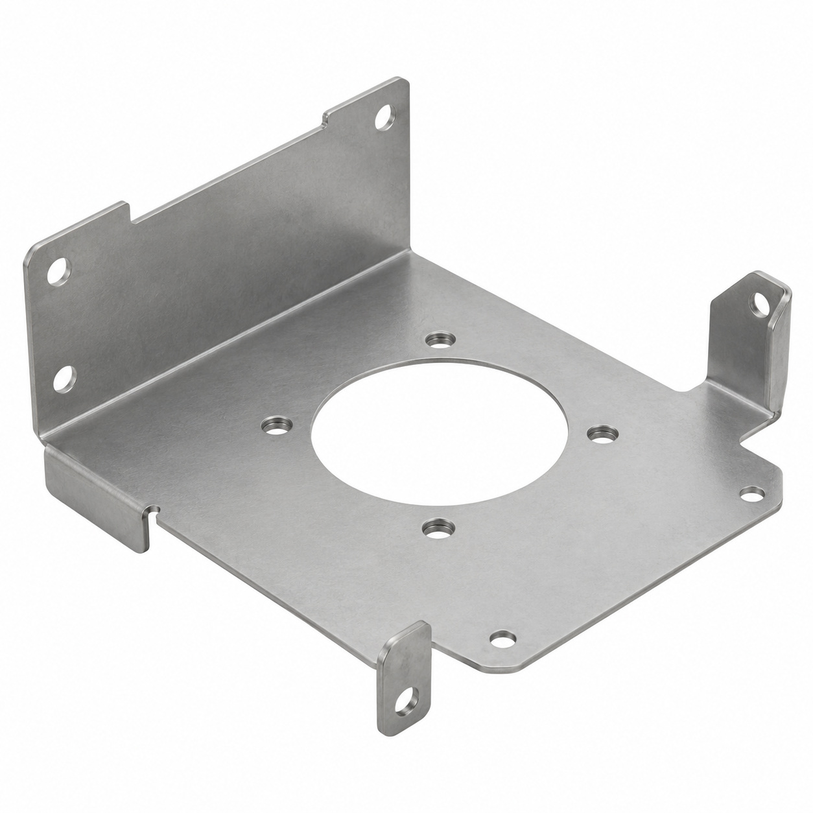
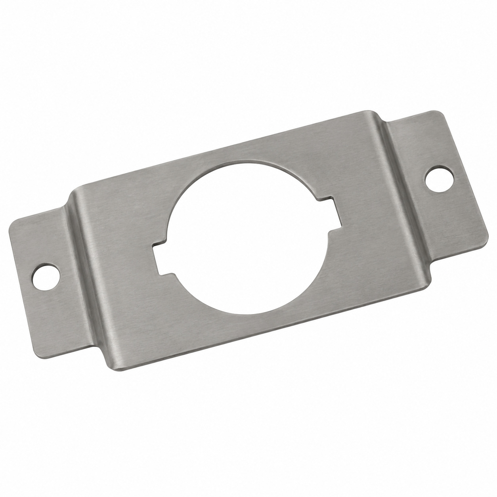
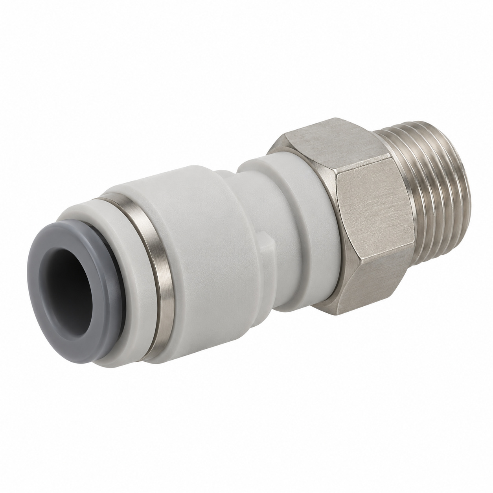

# Remaining catalog illustrations — batch 07

Generic type-based representations for review. Manufacturer-specific shape, internal construction, kit contents and fitment are unverified. Complex assemblies are broad concepts requiring a real photo or drawing. Existing catalog validation is not changed.

[Back to gallery](README.md)

| Target SKU | Description | Image |
| --- | --- | --- |
| 129.162 | Drip tray grill Mastrena II | [Open image](generic-129.162.jpg) |
| 130.609 | Generic cover, housing or mounting component | [Open image](generic-130.609.jpg) |
| 130.610 | Bean hopper lid big | [Open image](generic-130.610.jpg) |
| 106.086 | Generic mechanical component | [Open image](generic-106.086.jpg) |
| 125.690 | Generic fluid-control component | [Open image](generic-125.690.jpg) |
| 127.996 | Generic fluid connector | [Open image](generic-127.996.jpg) |
| 128.033 | Generic cover, housing or mounting component | [Open image](generic-128.033.jpg) |
| 128.287 | Generic cover, housing or mounting component | [Open image](generic-128.287.jpg) |
| 128.289 | Generic cover, housing or mounting component | [Open image](generic-128.289.jpg) |
| 129.078 | Generic fluid connector | [Open image](generic-129.078.jpg) |

## 129.162 — Drip tray grill Mastrena II

## 130.609 — Generic cover, housing or mounting component

## 130.610 — Bean hopper lid big

## 106.086 — Generic mechanical component

## 125.690 — Generic fluid-control component

## 127.996 — Generic fluid connector

## 128.033 — Generic cover, housing or mounting component

## 128.287 — Generic cover, housing or mounting component

## 128.289 — Generic cover, housing or mounting component

## 129.078 — Generic fluid connector

