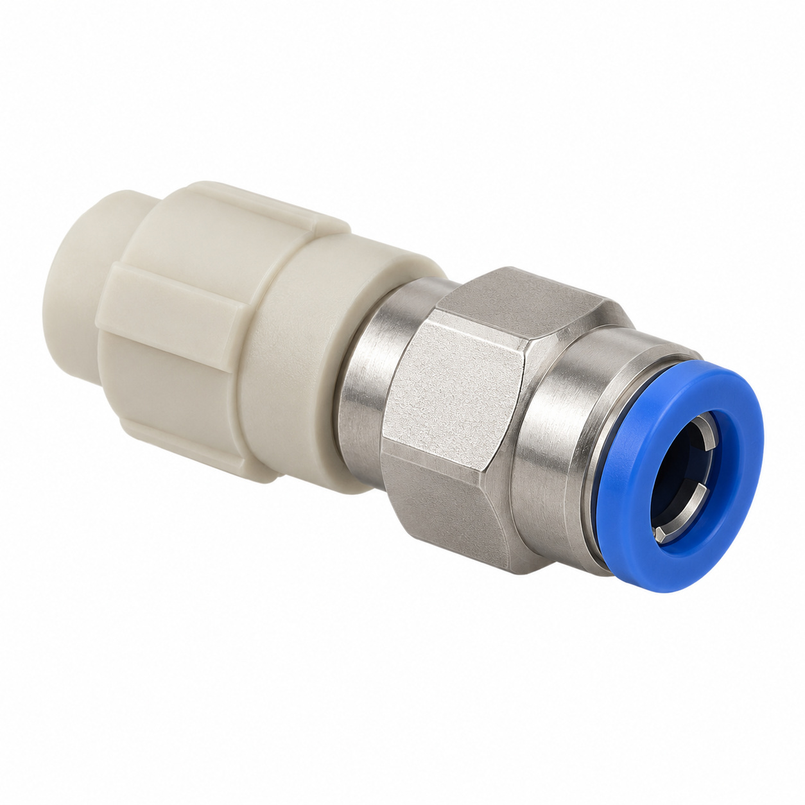
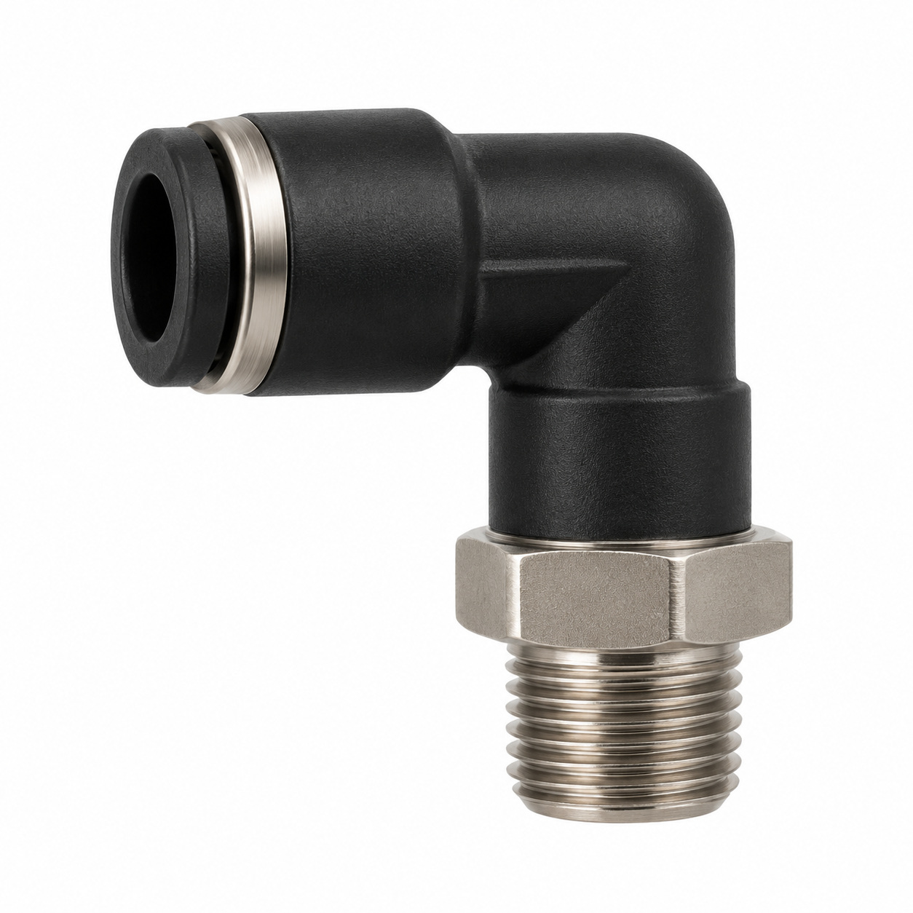
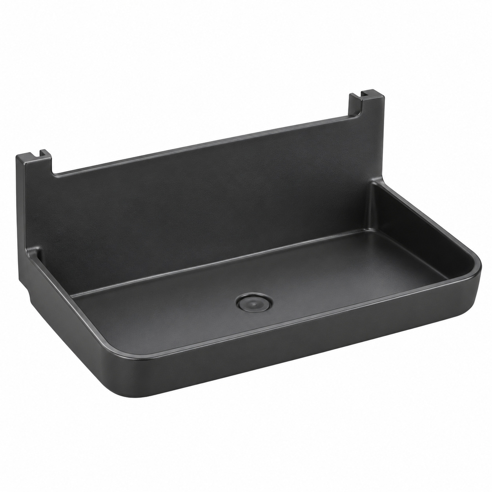
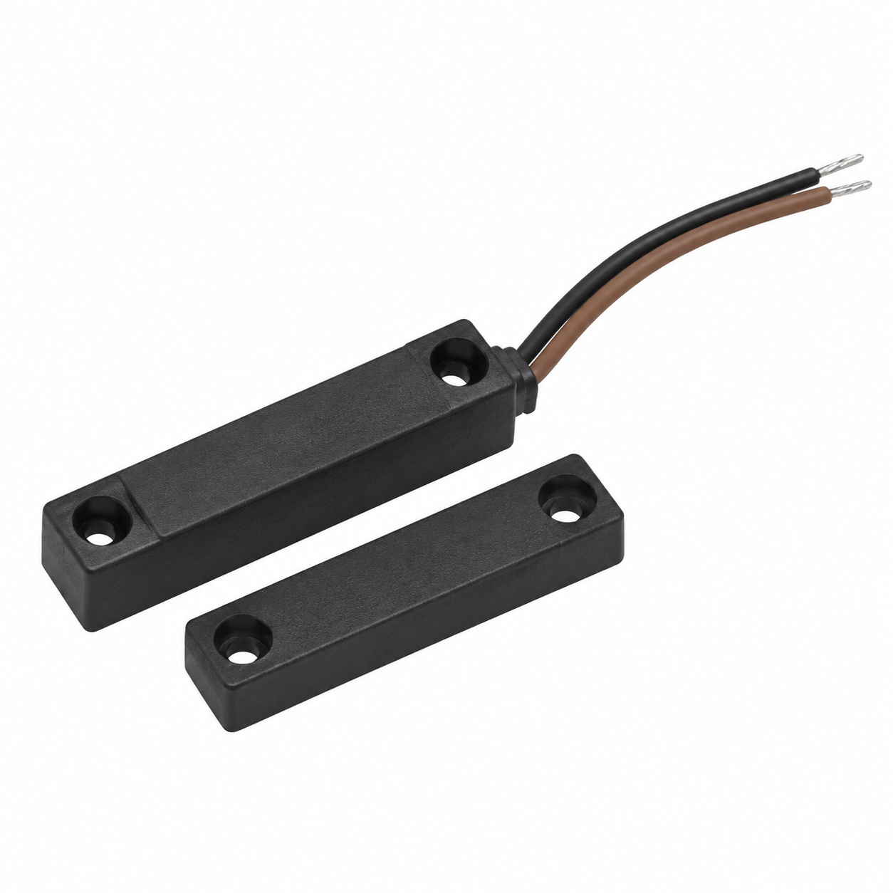
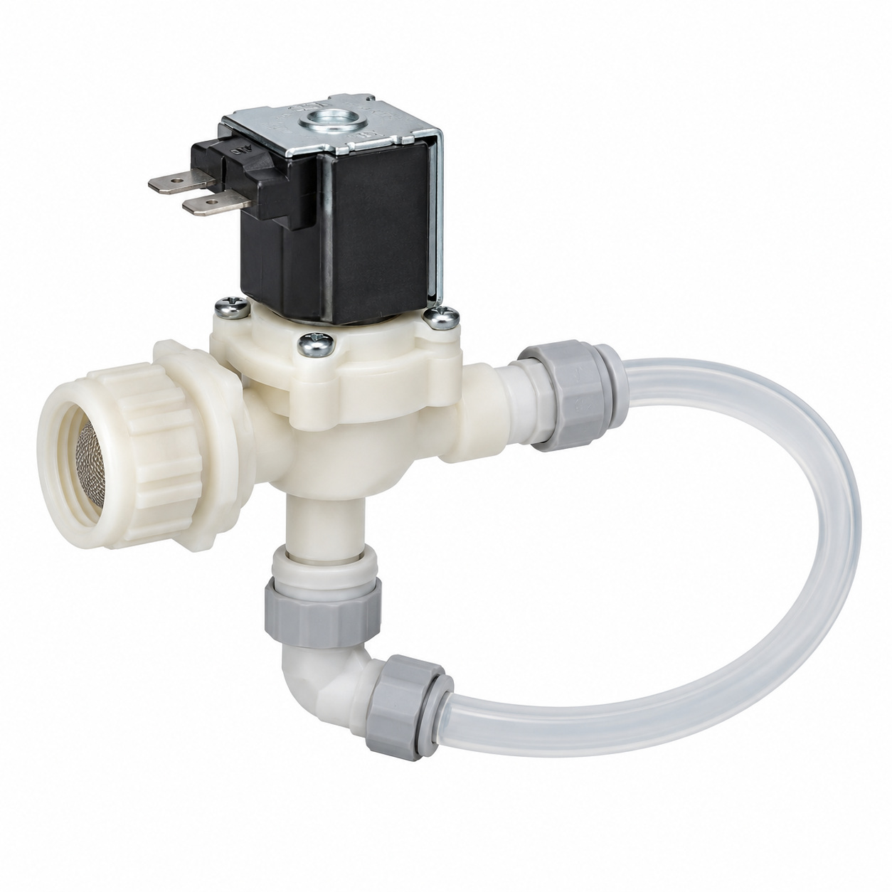
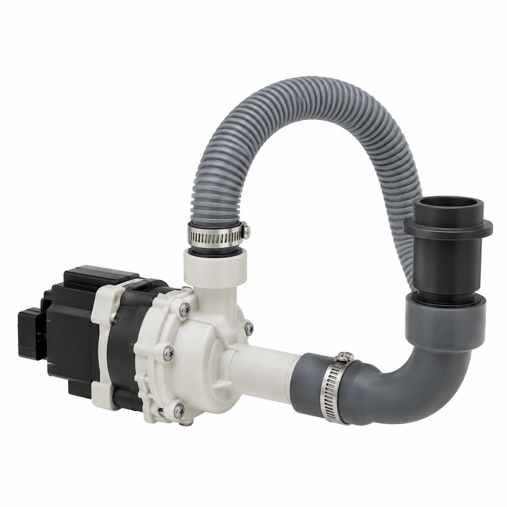
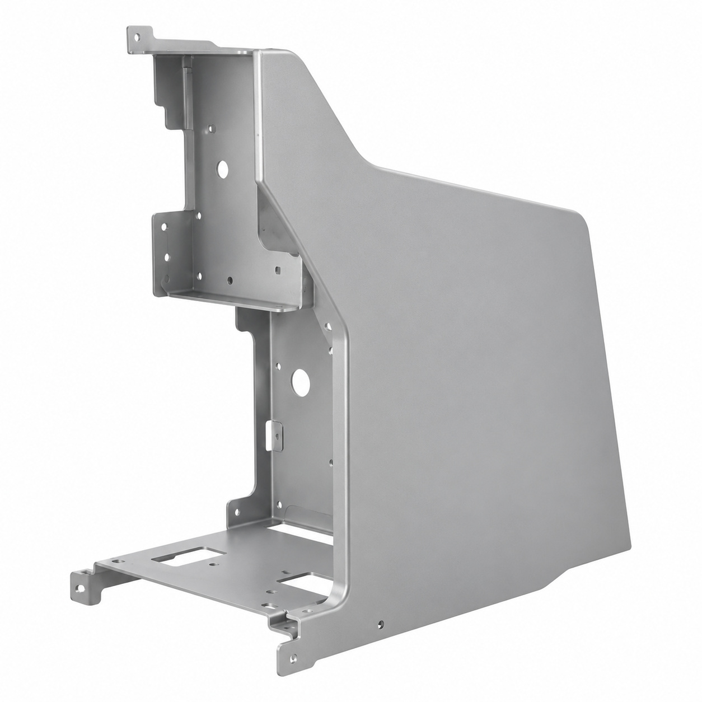
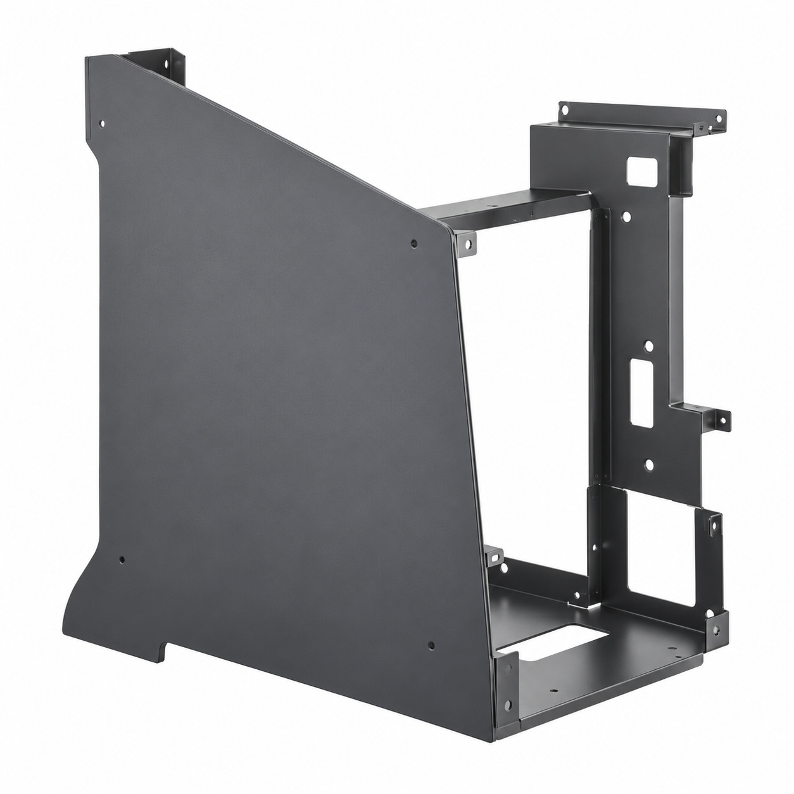
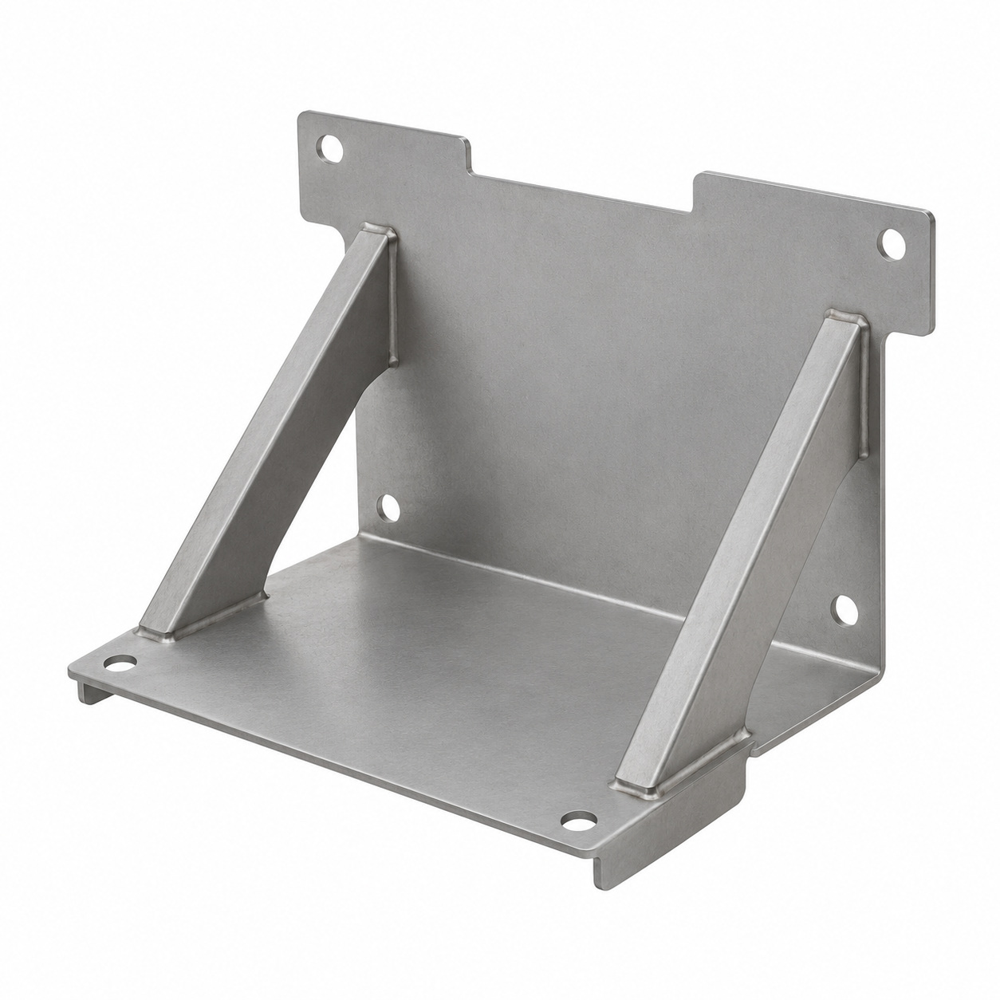
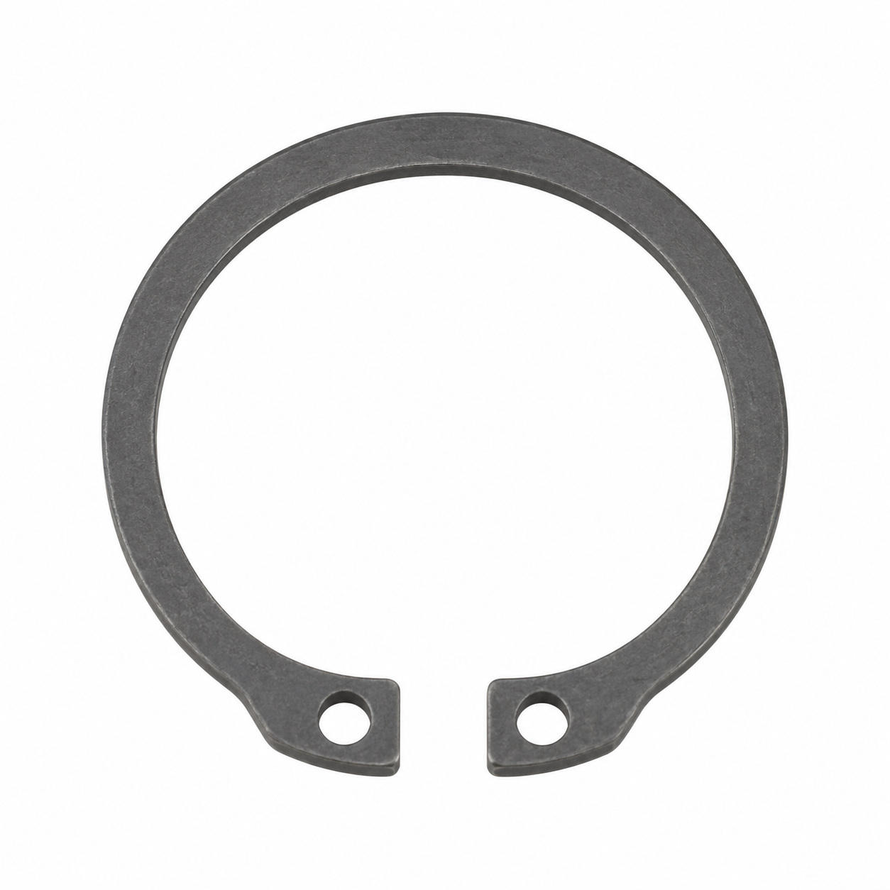

# Remaining catalog illustrations — batch 08

Generic type-based representations for review. Manufacturer-specific shape, internal construction, kit contents and fitment are unverified. Complex assemblies are broad concepts requiring a real photo or drawing. Existing catalog validation is not changed.

[Back to gallery](README.md)

| Target SKU | Description | Image |
| --- | --- | --- |
| 129.095 | Generic fluid-control component | [Open image](generic-129.095.jpg) |
| 129.341 | Generic fluid connector | [Open image](generic-129.341.jpg) |
| 129.413 | Generic cover, housing or mounting component | [Open image](generic-129.413.jpg) |
| 130.055 | Generic electrical component | [Open image](generic-130.055.jpg) |
| 130.563 | Generic assembly concept | [Open image](generic-130.563.jpg) |
| 130.898 | Drainsystem assy. | [Open image](generic-130.898.jpg) |
| 132.326 | Generic cover, housing or mounting component | [Open image](generic-132.326.jpg) |
| 132.327 | Generic cover, housing or mounting component | [Open image](generic-132.327.jpg) |
| 133.662 | Generic cover, housing or mounting component | [Open image](generic-133.662.jpg) |
| 134.166 | Generic mechanical component | [Open image](generic-134.166.jpg) |

## 129.095 — Generic fluid-control component

## 129.341 — Generic fluid connector

## 129.413 — Generic cover, housing or mounting component

## 130.055 — Generic electrical component

## 130.563 — Generic assembly concept

## 130.898 — Drainsystem assy.

## 132.326 — Generic cover, housing or mounting component

## 132.327 — Generic cover, housing or mounting component

## 133.662 — Generic cover, housing or mounting component

## 134.166 — Generic mechanical component

