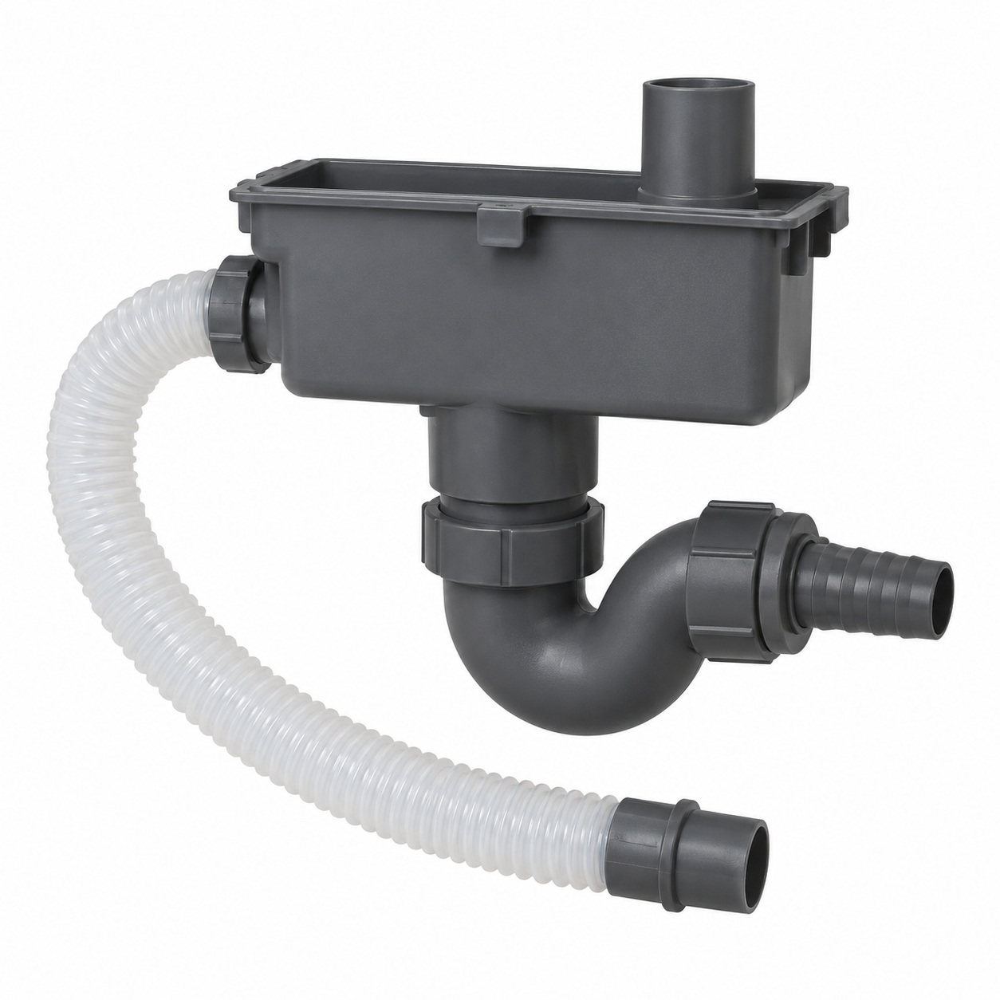
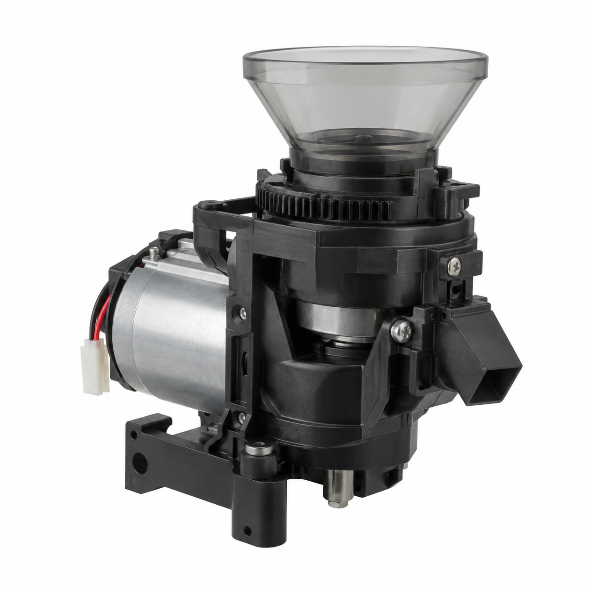
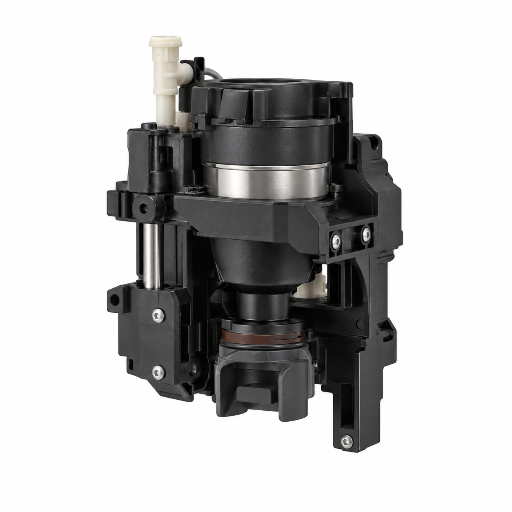
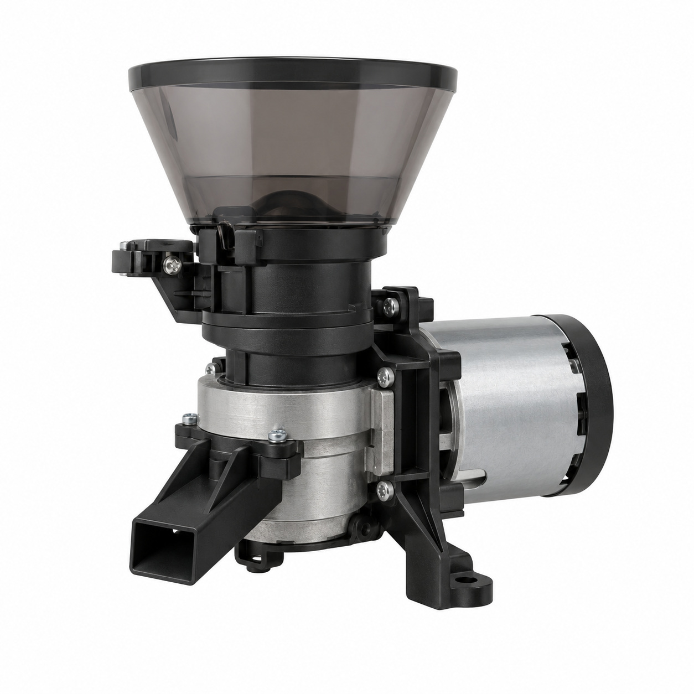
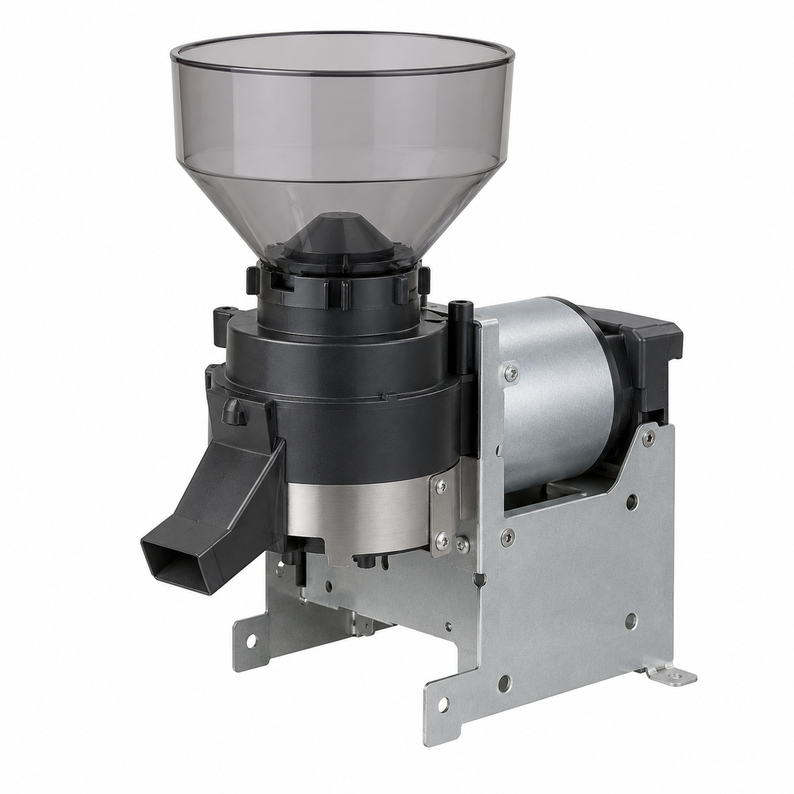
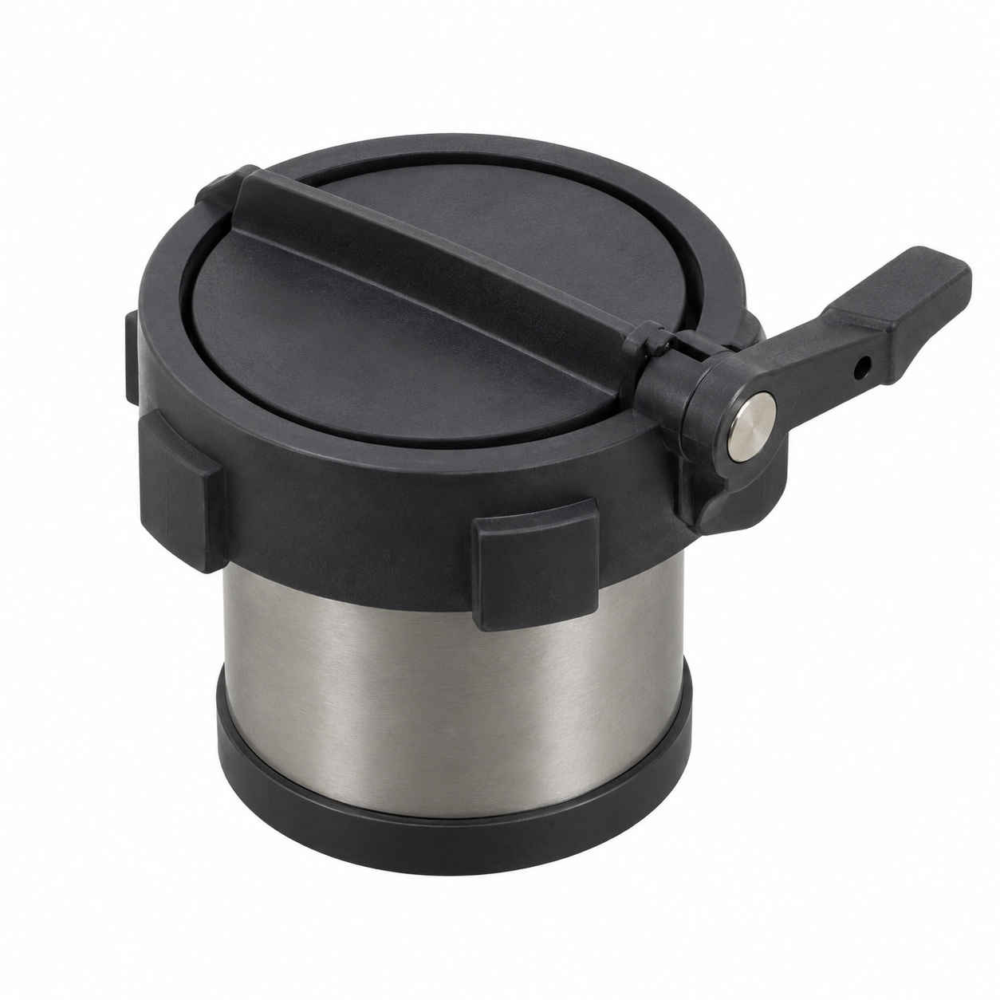
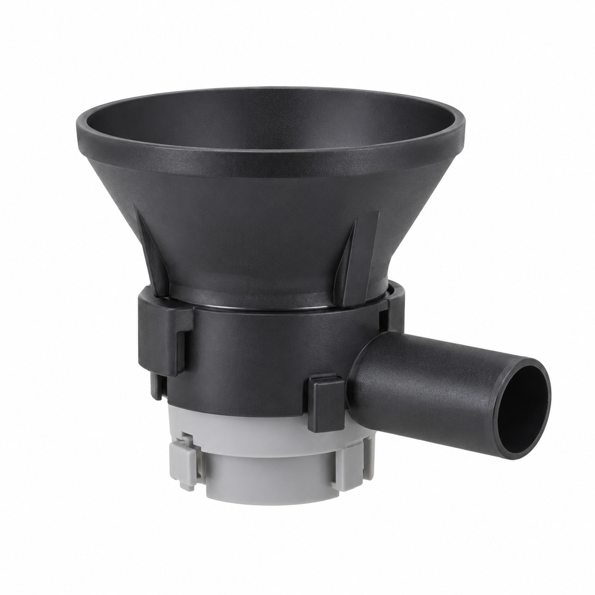
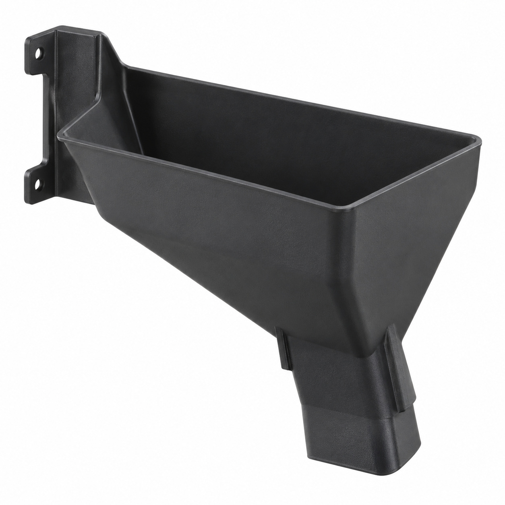
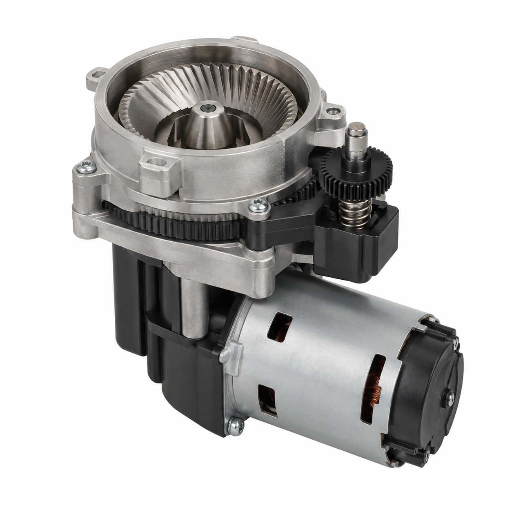
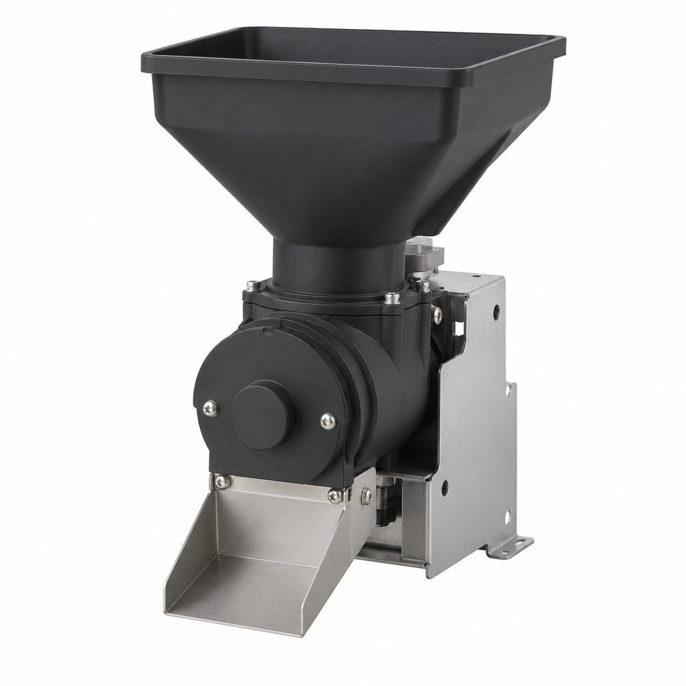

# Remaining catalog illustrations — batch 09

Generic type-based representations for review. Manufacturer-specific shape, internal construction, kit contents and fitment are unverified. Complex assemblies are broad concepts requiring a real photo or drawing. Existing catalog validation is not changed.

[Back to gallery](README.md)

| Target SKU | Description | Image |
| --- | --- | --- |
| 140.927 | Generic assembly concept | [Open image](generic-140.927.jpg) |
| 127.595 | Grinder module left Mastrena II | [Open image](generic-127.595.jpg) |
| 127.596 | Generic assembly concept | [Open image](generic-127.596.jpg) |
| 127.846 | Grinder module right Mastrena II | [Open image](generic-127.846.jpg) |
| 127.392 | Grinder unit with chassis | [Open image](generic-127.392.jpg) |
| 127.842 | Powder pass ø50 closure | [Open image](generic-127.842.jpg) |
| 127.843 | Powder diffusor ø50 assy. | [Open image](generic-127.843.jpg) |
| 130.474 | Generic cover, housing or mounting component | [Open image](generic-130.474.jpg) |
| 127.394 | Auto adjustable grinder | [Open image](generic-127.394.jpg) |
| 128.276 | Generic cover, housing or mounting component | [Open image](generic-128.276.jpg) |

## 140.927 — Generic assembly concept

## 127.595 — Grinder module left Mastrena II

## 127.596 — Generic assembly concept

## 127.846 — Grinder module right Mastrena II

## 127.392 — Grinder unit with chassis

## 127.842 — Powder pass ø50 closure

## 127.843 — Powder diffusor ø50 assy.

## 130.474 — Generic cover, housing or mounting component

## 127.394 — Auto adjustable grinder

## 128.276 — Generic cover, housing or mounting component

