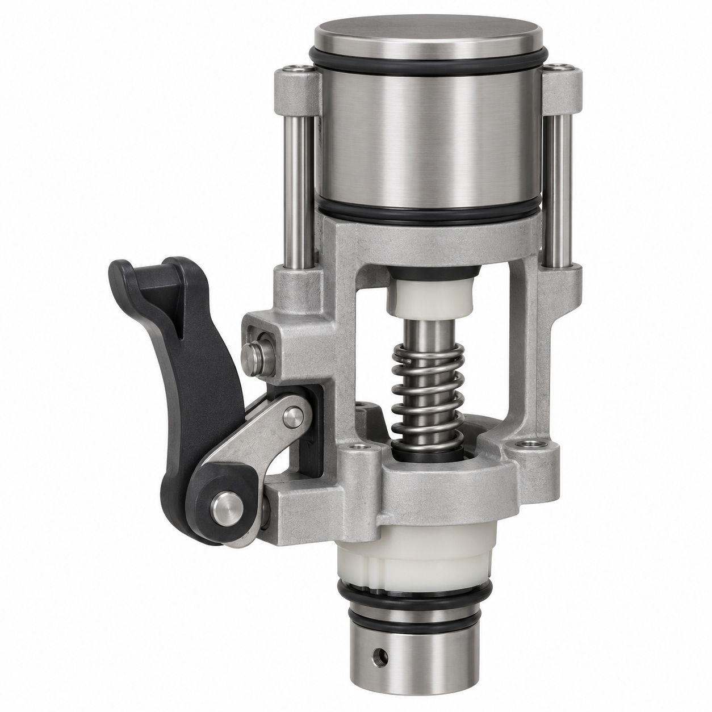
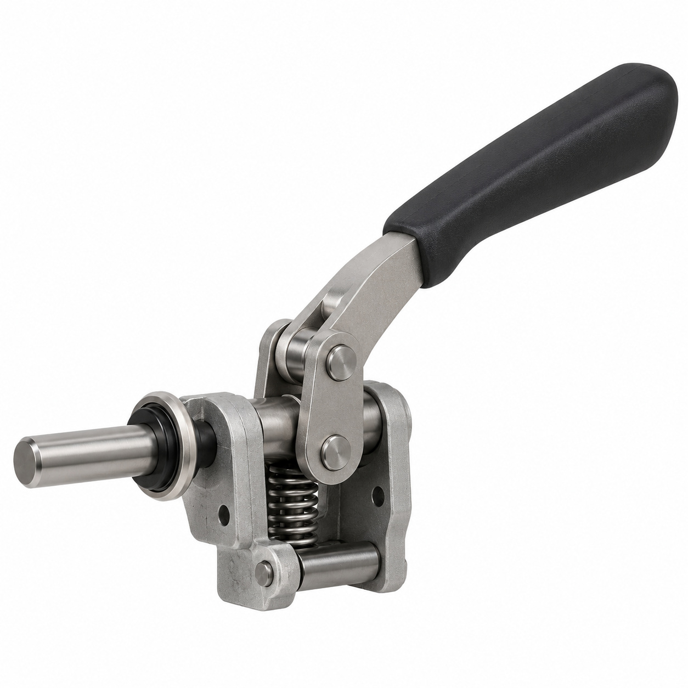
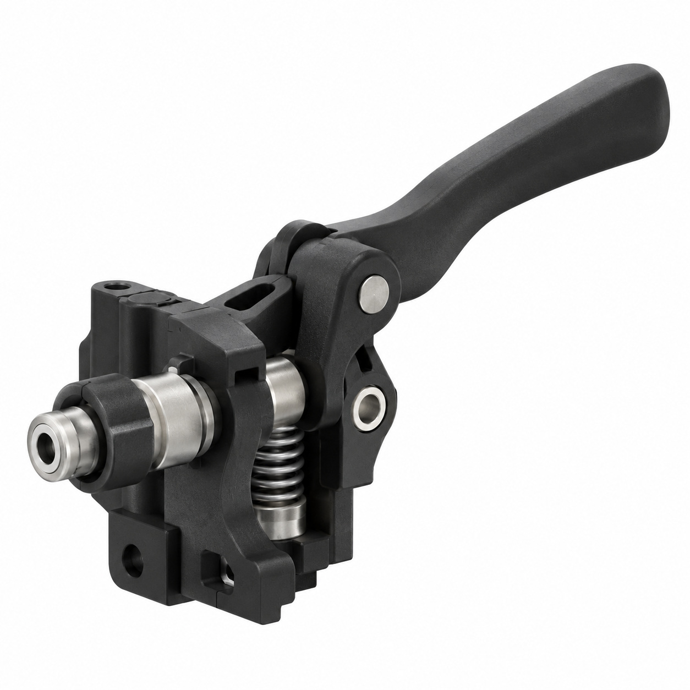
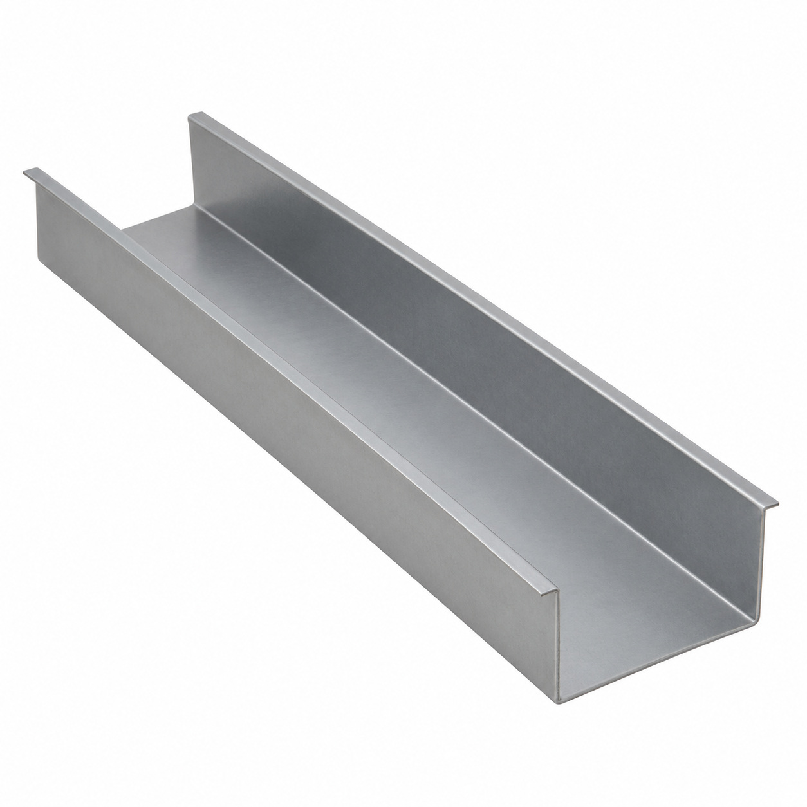
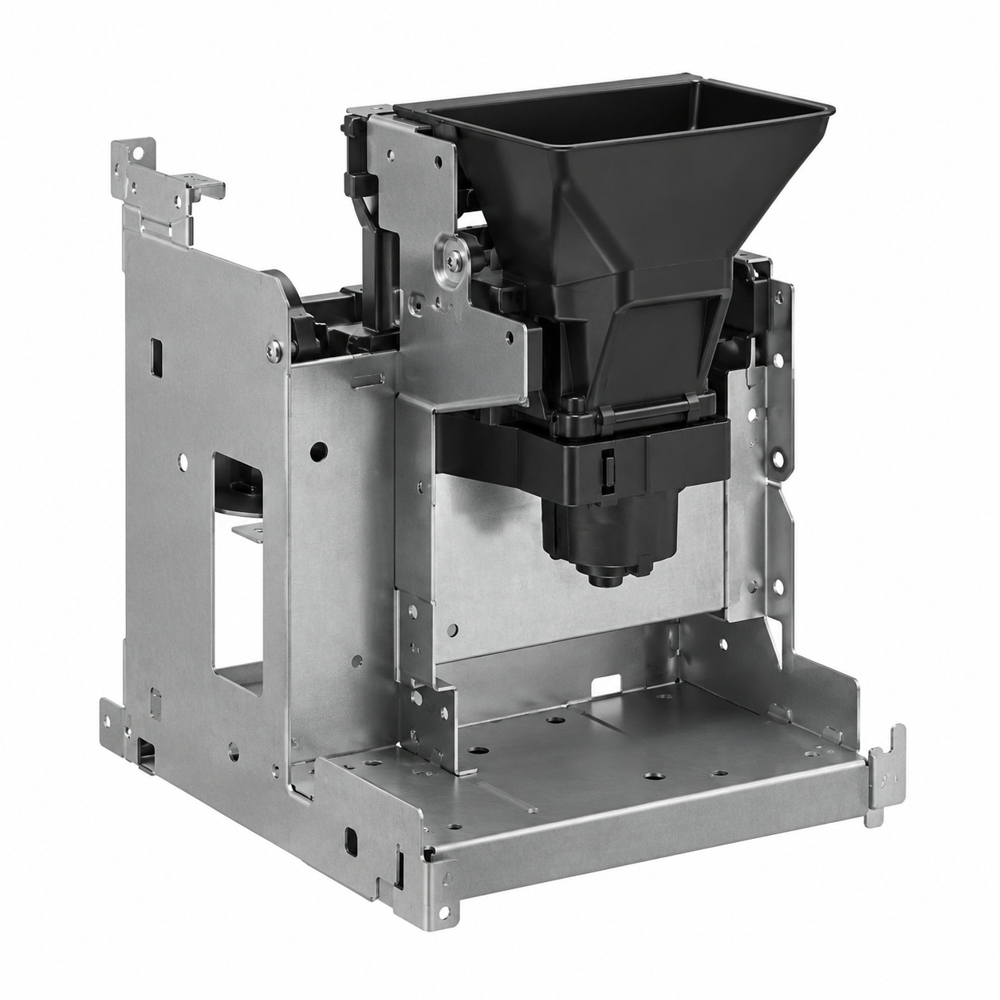
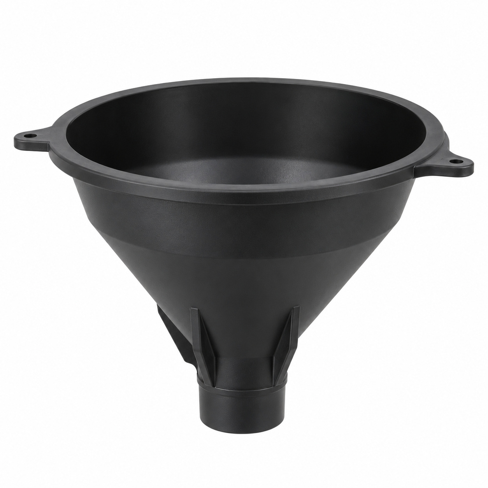
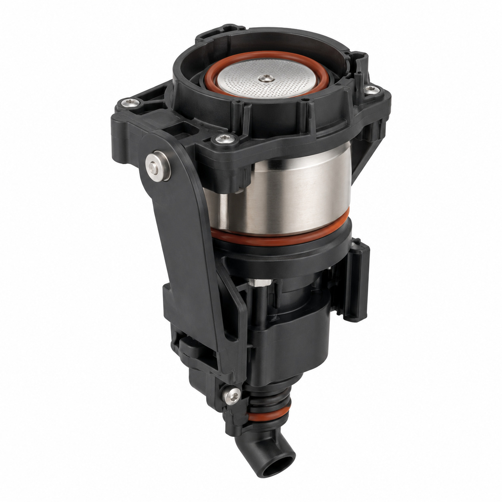
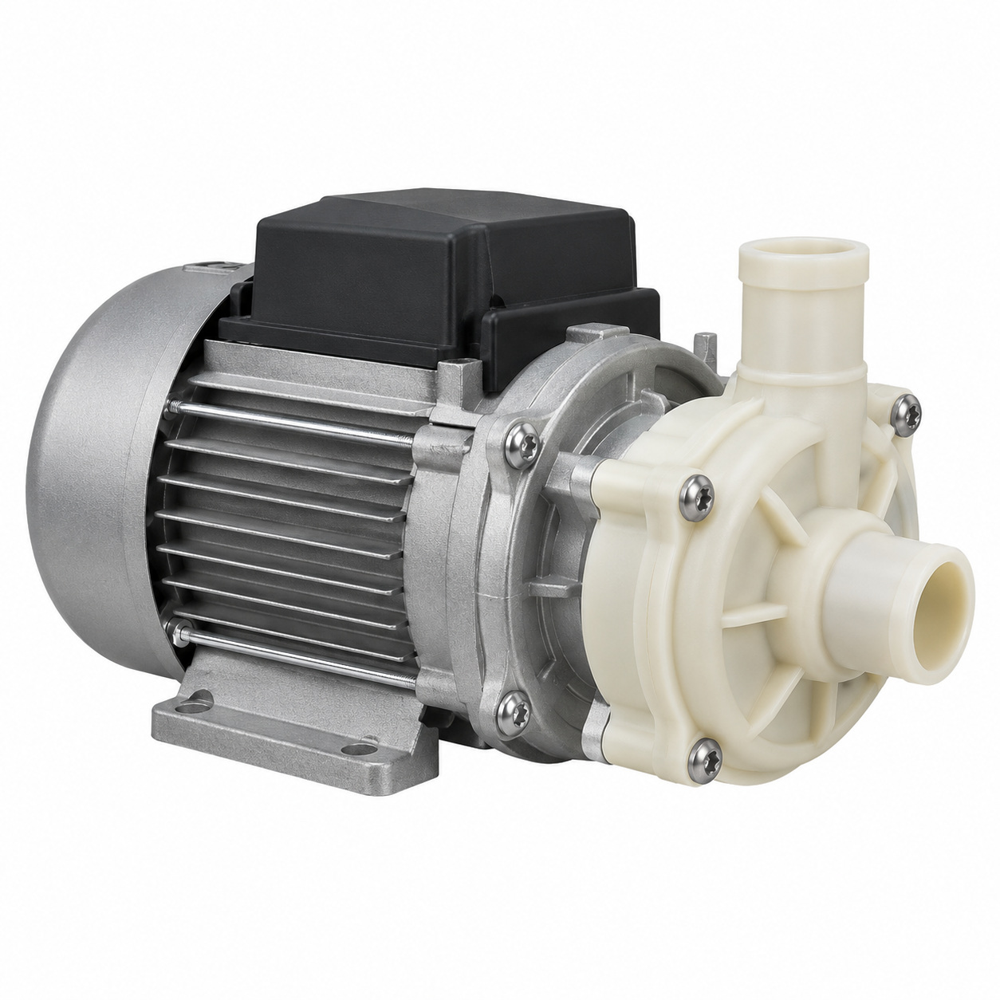
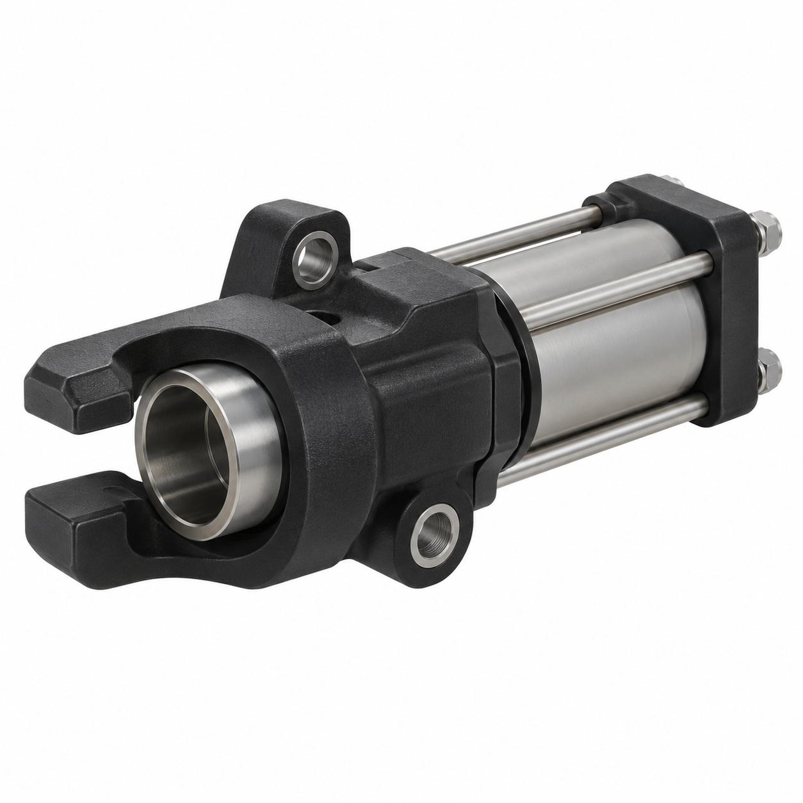
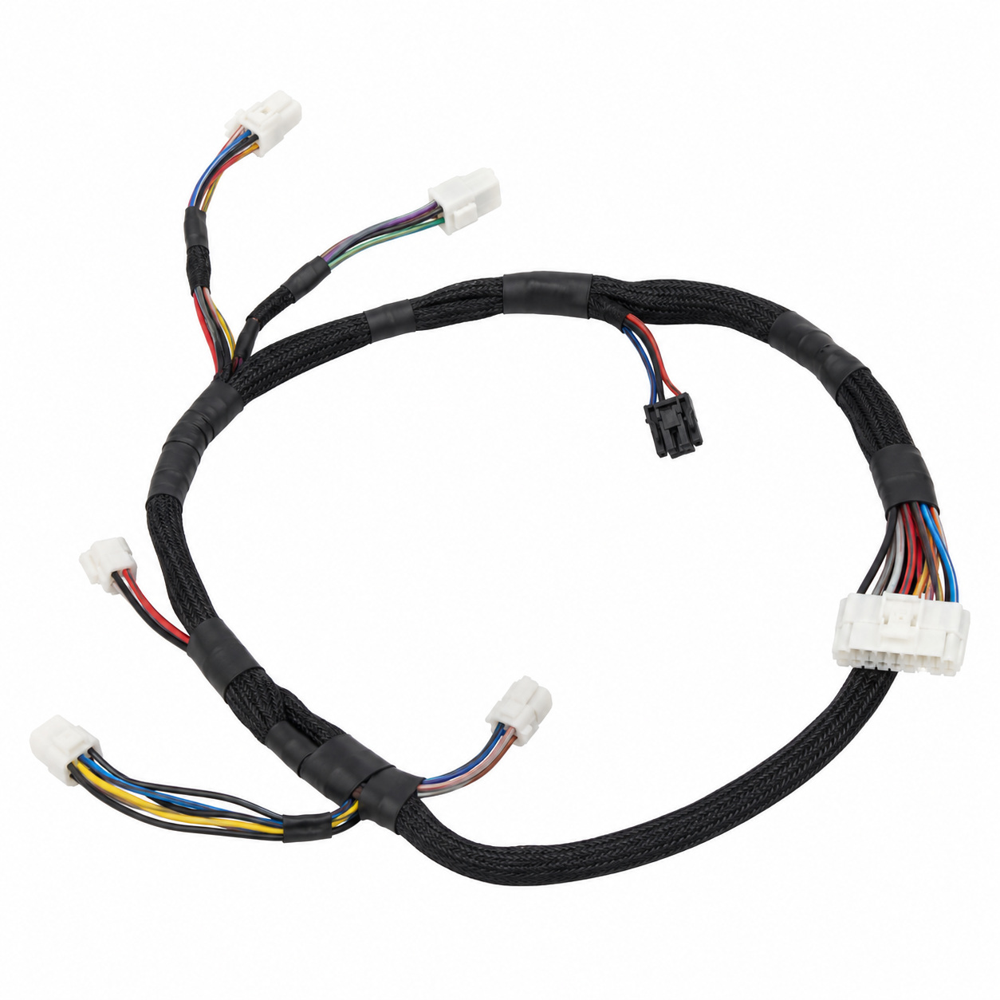

# Remaining catalog illustrations — batch 11

Generic type-based representations for review. Manufacturer-specific shape, internal construction, kit contents and fitment are unverified. Complex assemblies are broad concepts requiring a real photo or drawing. Existing catalog validation is not changed.

[Back to gallery](README.md)

| Target SKU | Description | Image |
| --- | --- | --- |
| 128.908 | Brew unit ø50 with clip hydraulic left | [Open image](generic-128.908.jpg) |
| 129.406 | Generic mechanical component | [Open image](generic-129.406.jpg) |
| 129.407 | Generic mechanical component | [Open image](generic-129.407.jpg) |
| 129.644 | Generic cover, housing or mounting component | [Open image](generic-129.644.jpg) |
| 130.263 | Generic cover, housing or mounting component | [Open image](generic-130.263.jpg) |
| 130.483 | Generic cover, housing or mounting component | [Open image](generic-130.483.jpg) |
| 127.062 | Brew unit ø50 | [Open image](generic-127.062.jpg) |
| 129.501 | Motor to brew chamber assy. | [Open image](generic-129.501.jpg) |
| 129.584 | Socket clip hydraulic left assy. | [Open image](generic-129.584.jpg) |
| 130.973 | Generic cable or wiring assembly | [Open image](generic-130.973.jpg) |

## 128.908 — Brew unit ø50 with clip hydraulic left

## 129.406 — Generic mechanical component

## 129.407 — Generic mechanical component

## 129.644 — Generic cover, housing or mounting component

## 130.263 — Generic cover, housing or mounting component

## 130.483 — Generic cover, housing or mounting component

## 127.062 — Brew unit ø50

## 129.501 — Motor to brew chamber assy.

## 129.584 — Socket clip hydraulic left assy.

## 130.973 — Generic cable or wiring assembly

