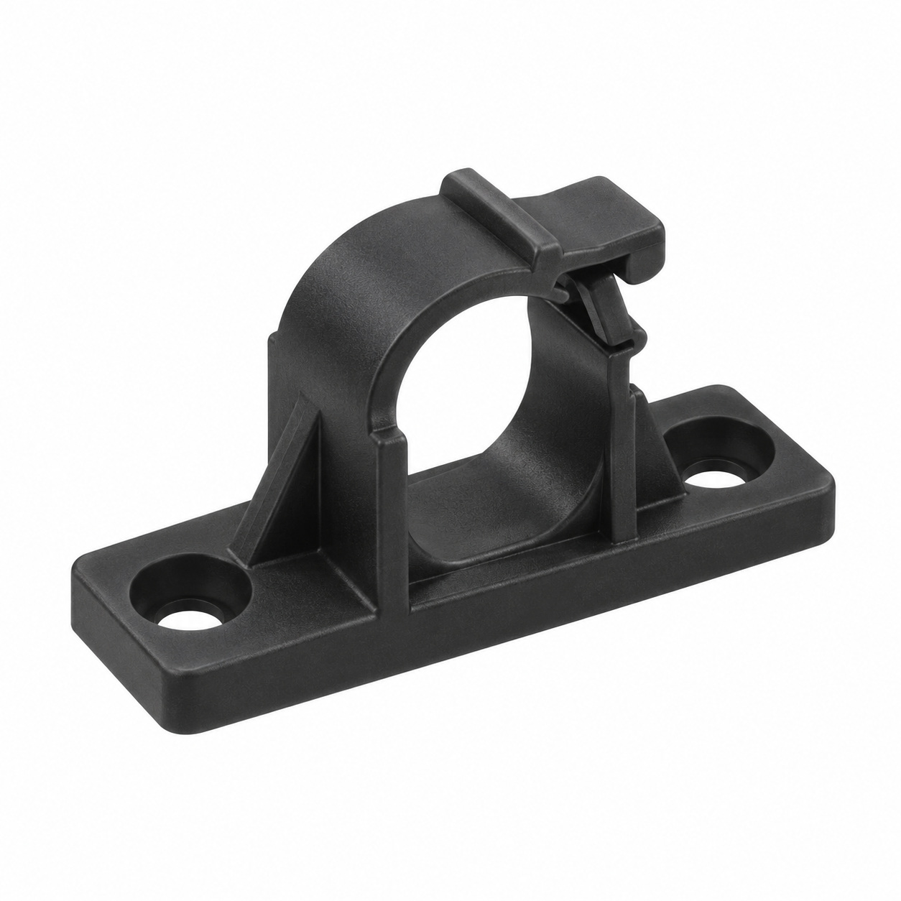
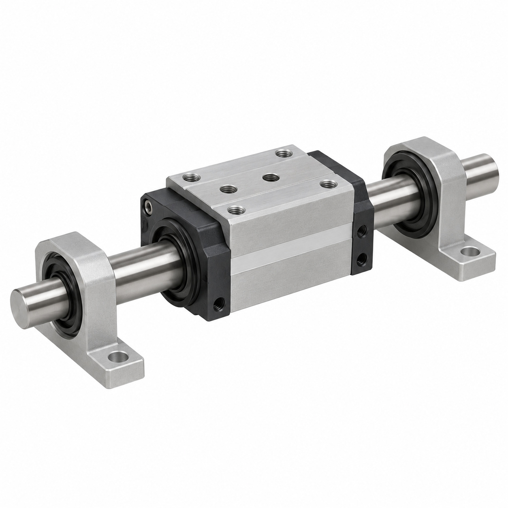
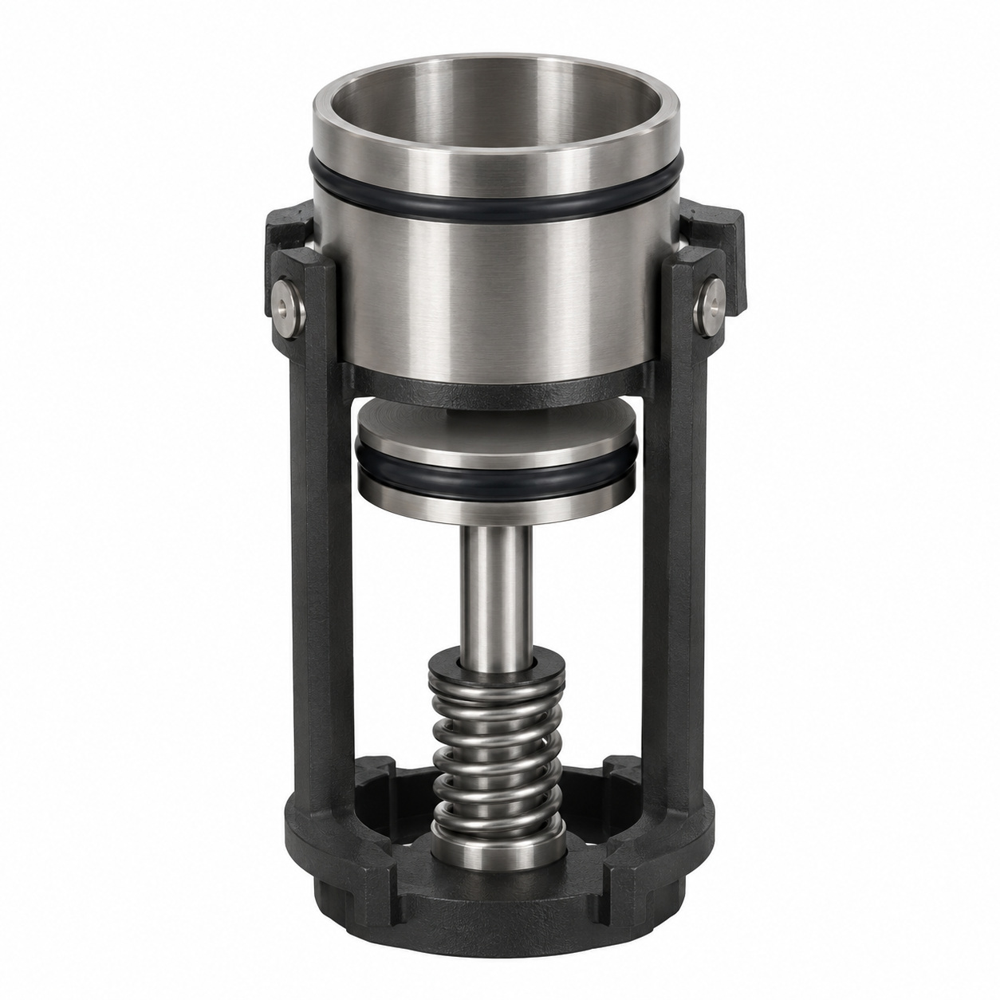
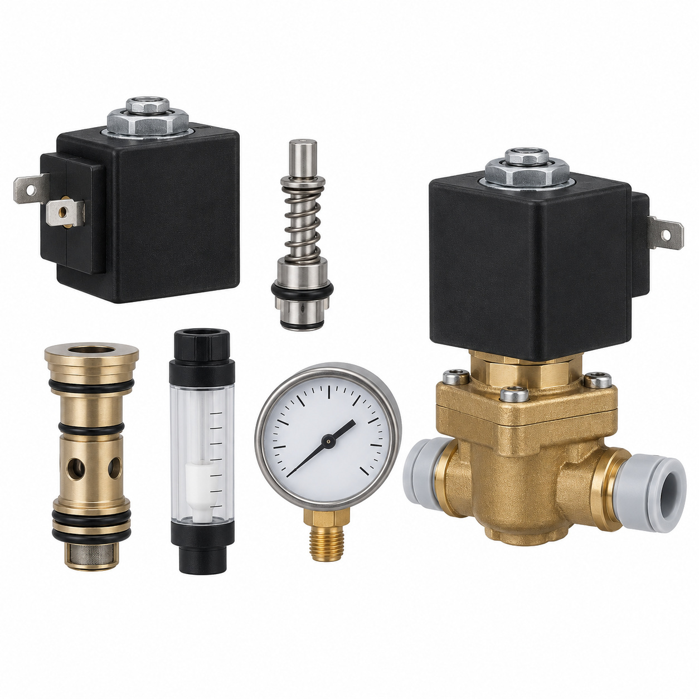
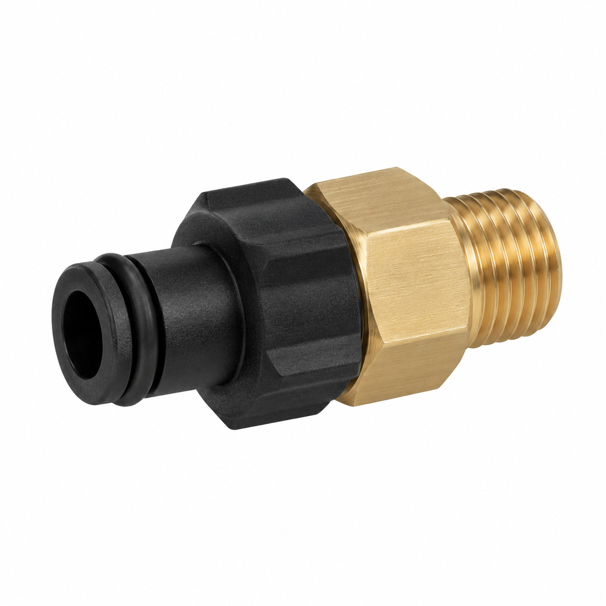
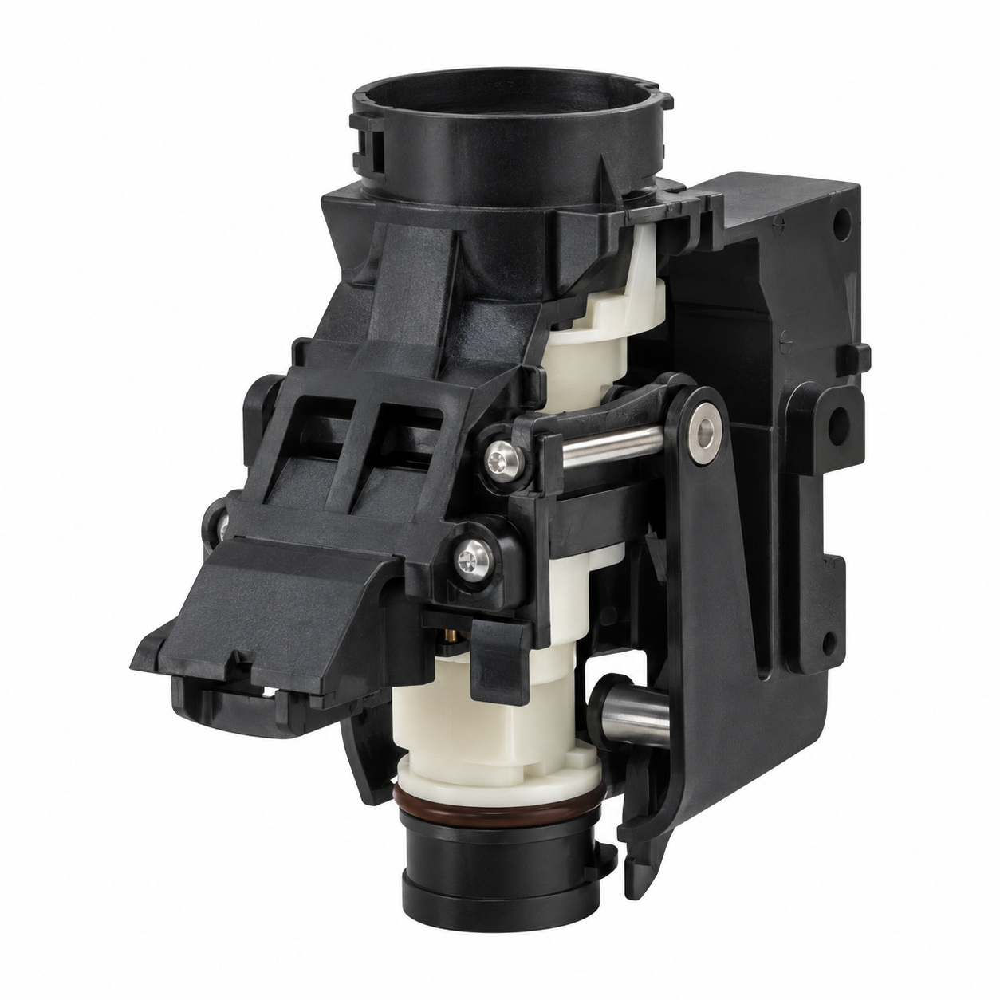
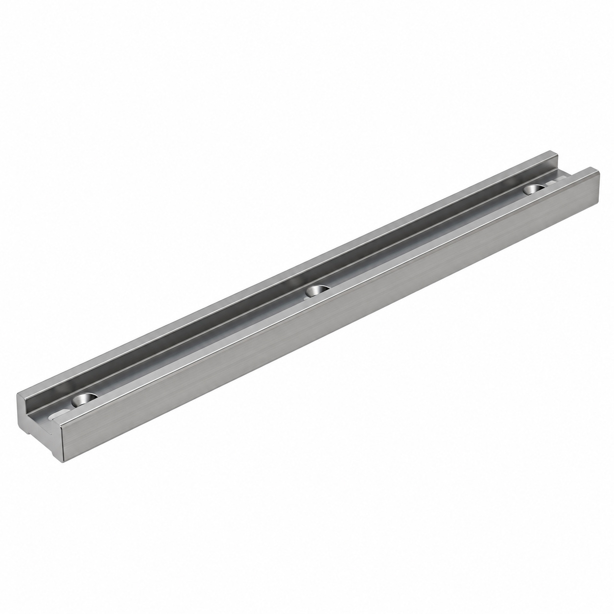
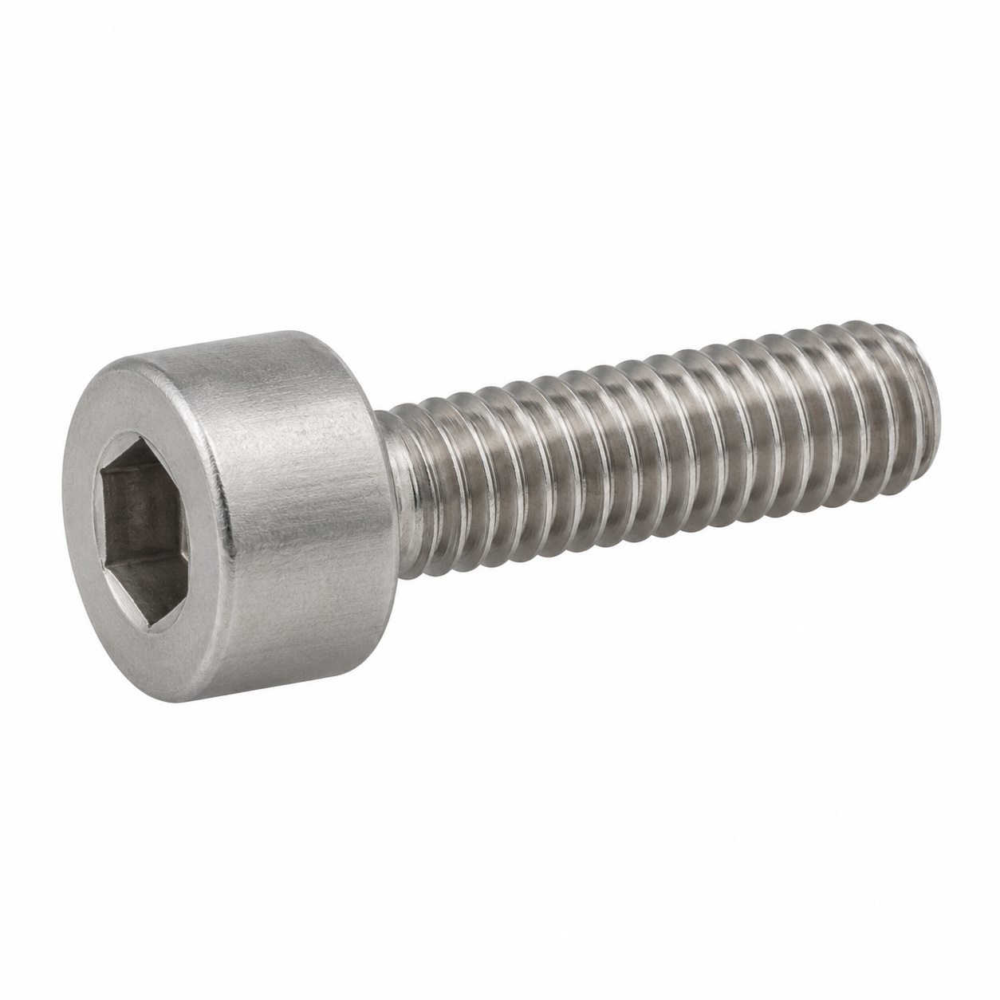
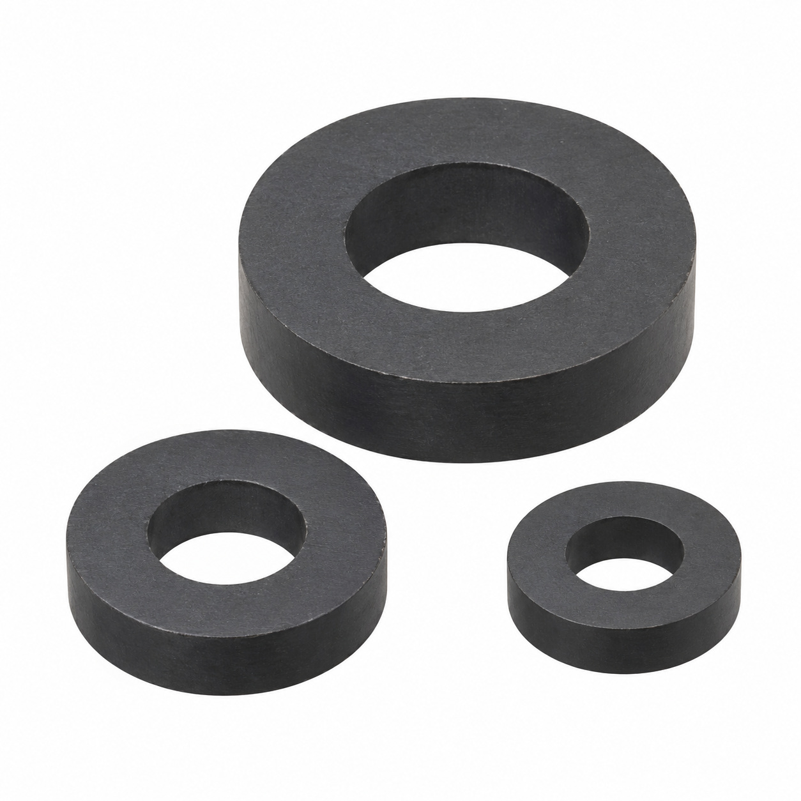
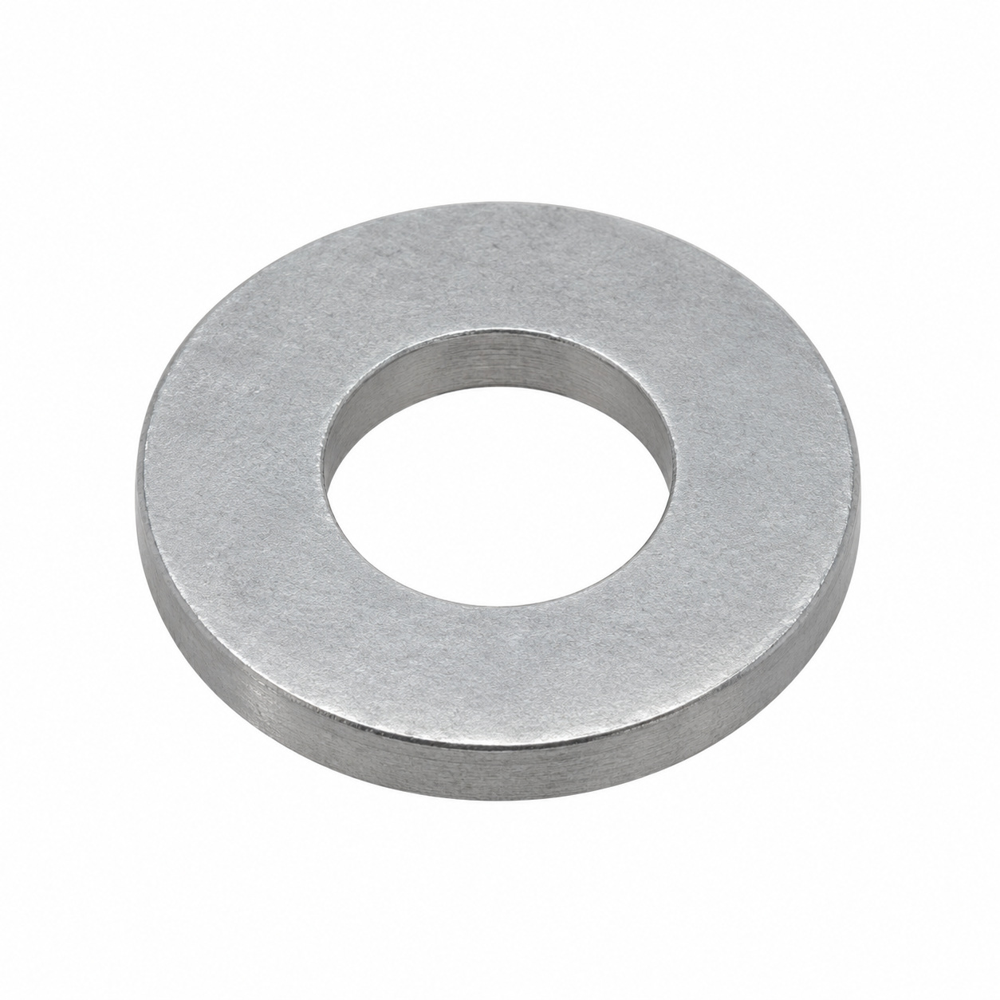

# Remaining catalog illustrations — batch 12

Generic type-based representations for review. Manufacturer-specific shape, internal construction, kit contents and fitment are unverified. Complex assemblies are broad concepts requiring a real photo or drawing. Existing catalog validation is not changed.

[Back to gallery](README.md)

| Target SKU | Description | Image |
| --- | --- | --- |
| 131.303 | Wire retainer Panduit TWR | [Open image](generic-131.303.jpg) |
| 127.064 | Guide- and bearing unit | [Open image](generic-127.064.jpg) |
| 127.365 | Brew chamber ø50 with mobile piston | [Open image](generic-127.365.jpg) |
| 127.516 | 2/2-way magnet valve ø6 DN3 | [Open image](generic-127.516.jpg) |
| 129.963 | Adapter | [Open image](generic-129.963.jpg) |
| 129.967 | Front block assy. | [Open image](generic-129.967.jpg) |
| 127.375 | Guide rail | [Open image](generic-127.375.jpg) |
| 127.569 | Drive screw 14x4 | [Open image](generic-127.569.jpg) |
| 132.619 | Ringmagnet set | [Open image](generic-132.619.jpg) |
| 139.587 | Adjusting washer BN 1976 | [Open image](generic-139.587.jpg) |

## 131.303 — Wire retainer Panduit TWR

## 127.064 — Guide- and bearing unit

## 127.365 — Brew chamber ø50 with mobile piston

## 127.516 — 2/2-way magnet valve ø6 DN3

## 129.963 — Adapter

## 129.967 — Front block assy.

## 127.375 — Guide rail

## 127.569 — Drive screw 14x4

## 132.619 — Ringmagnet set

## 139.587 — Adjusting washer BN 1976

