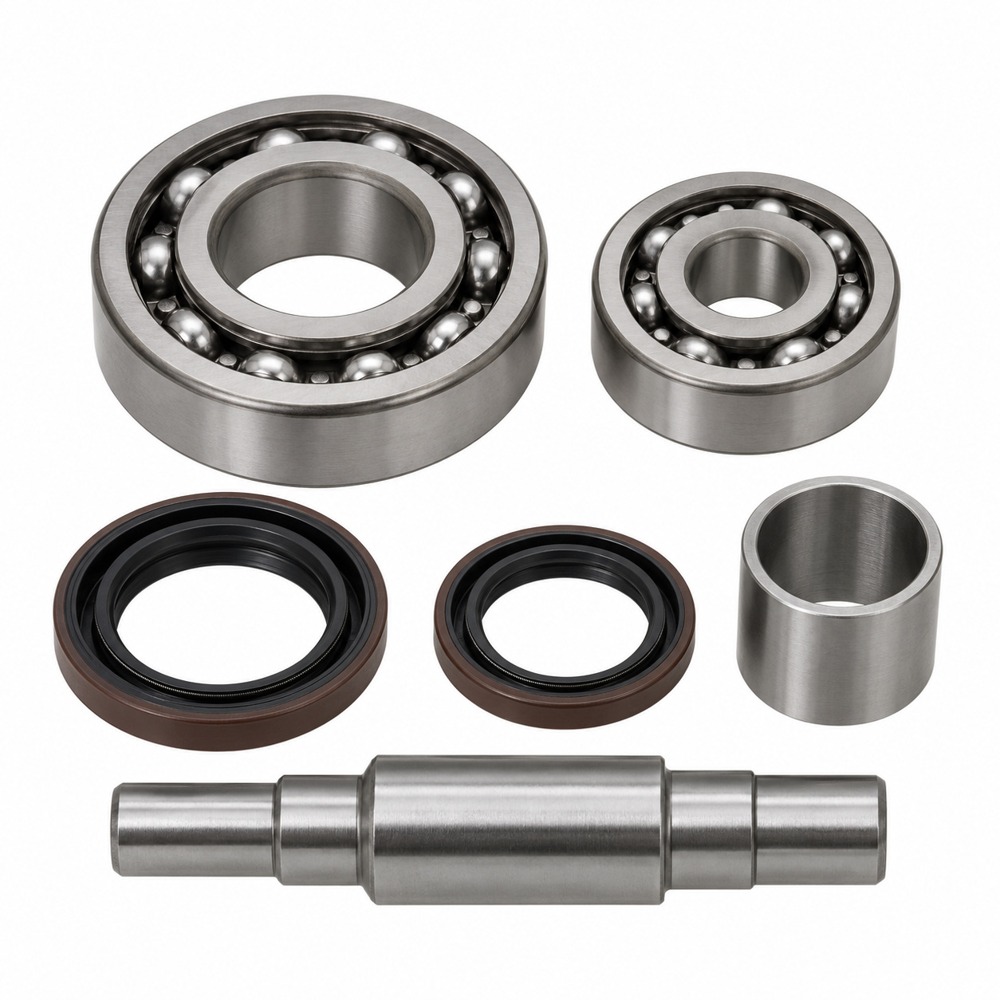
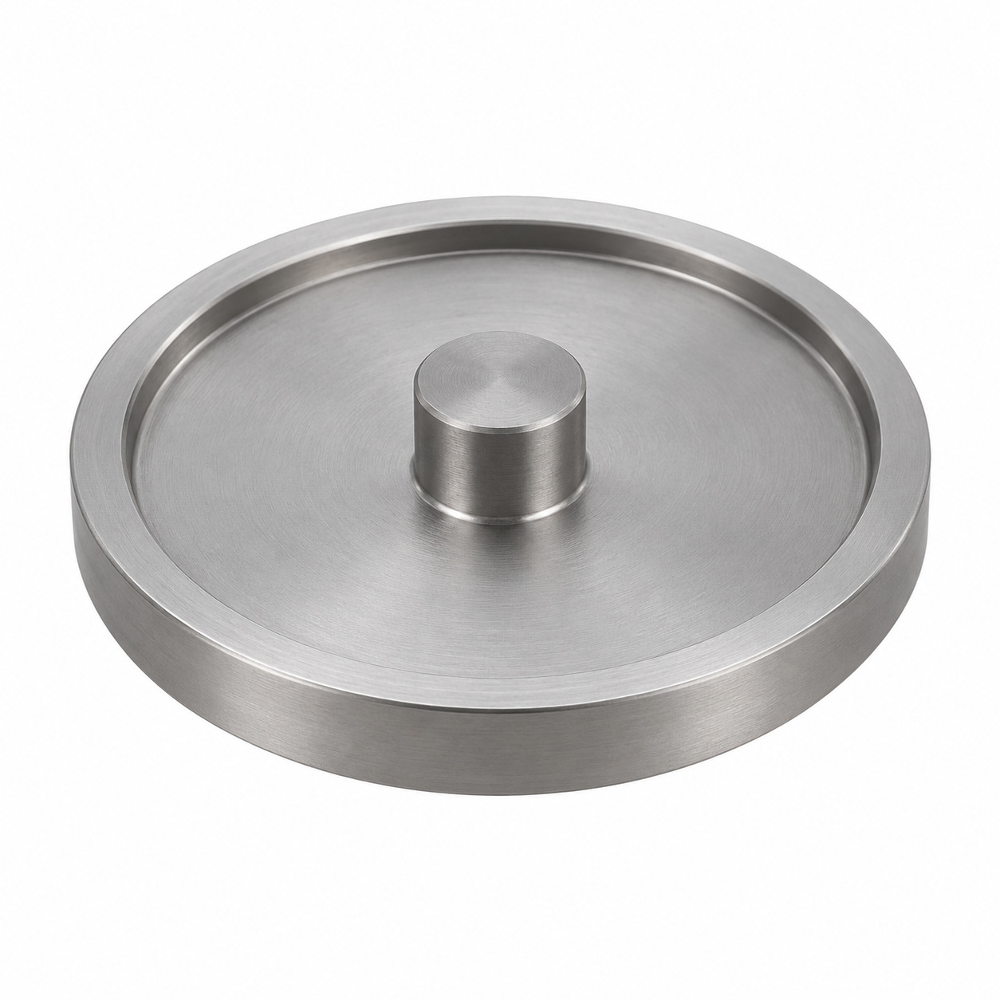
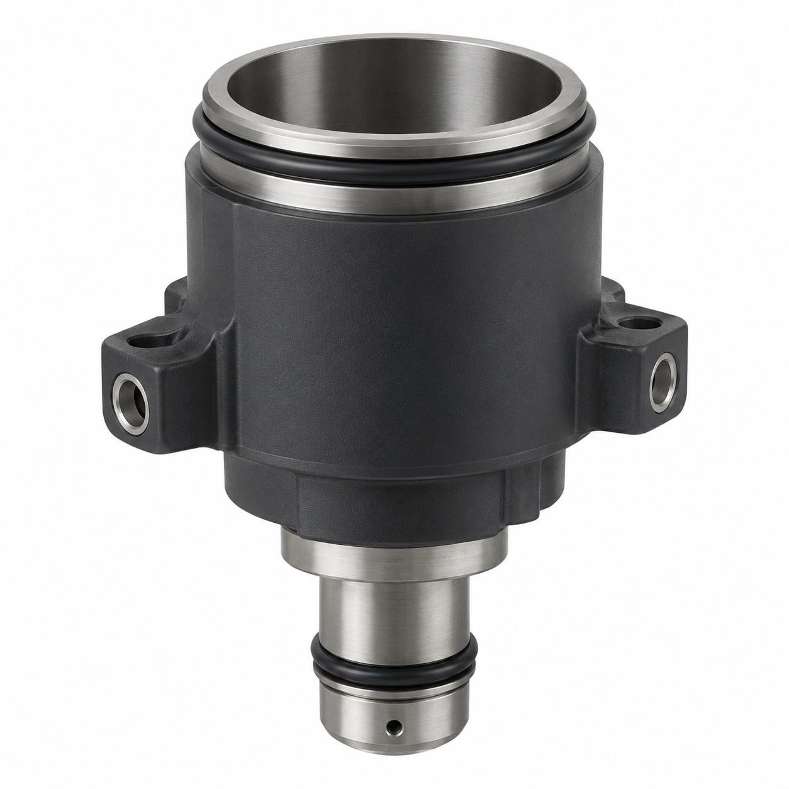
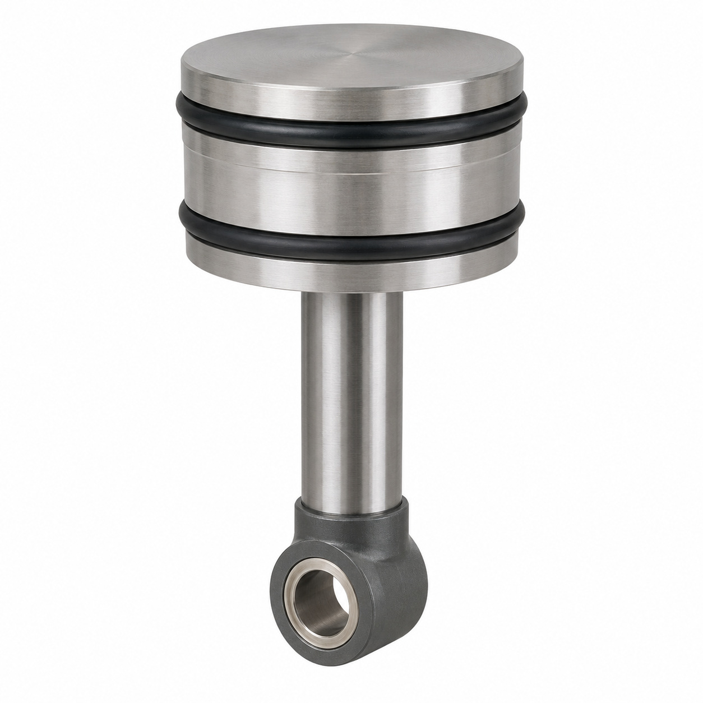
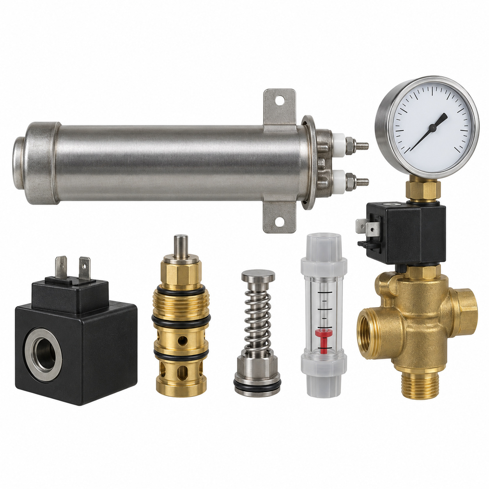
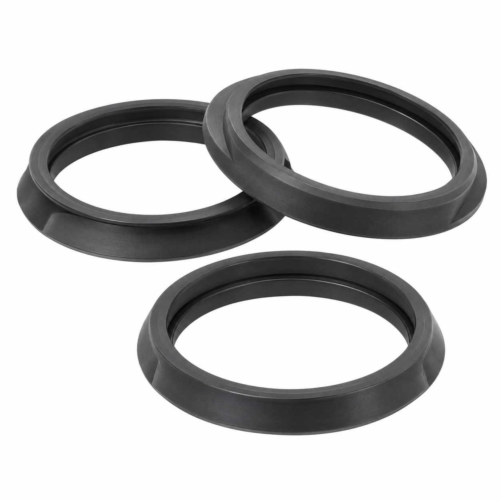
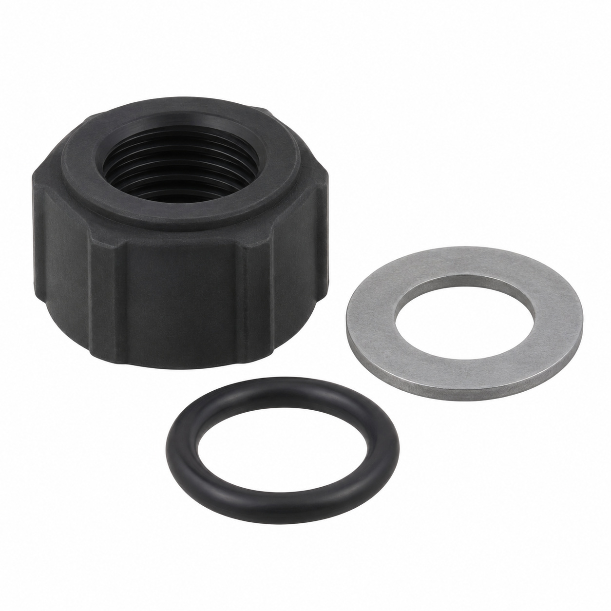
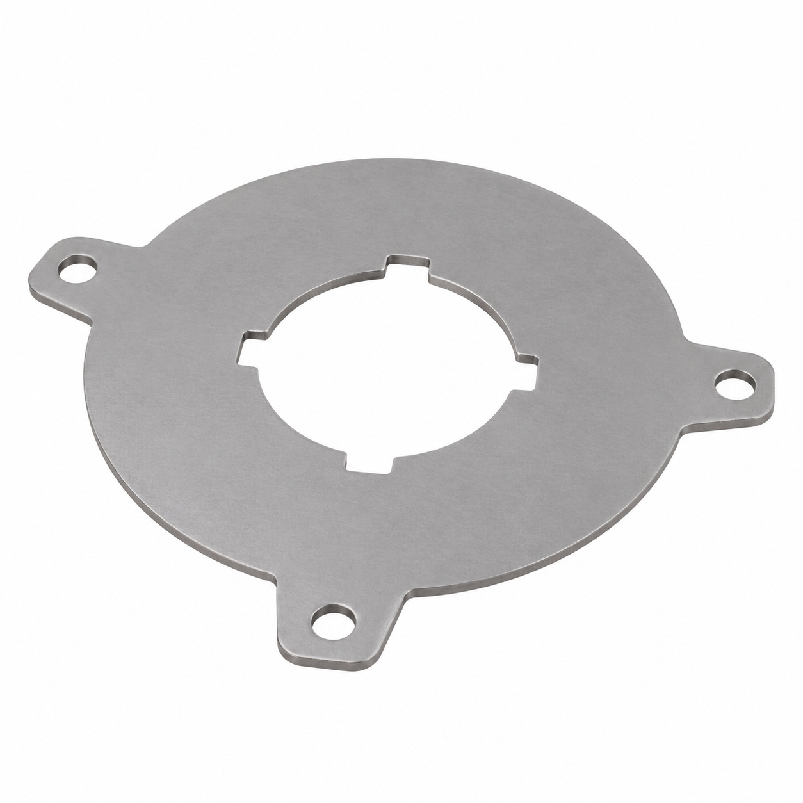
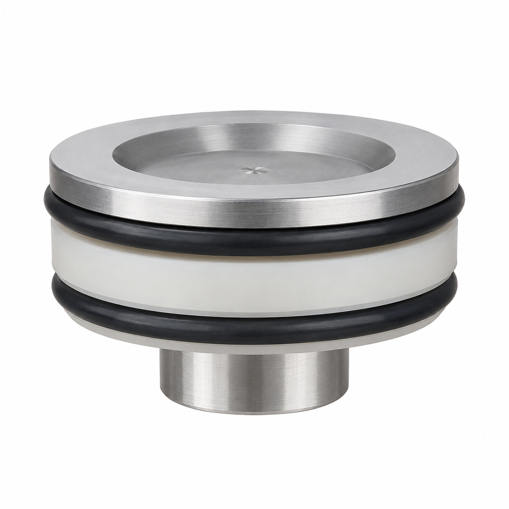
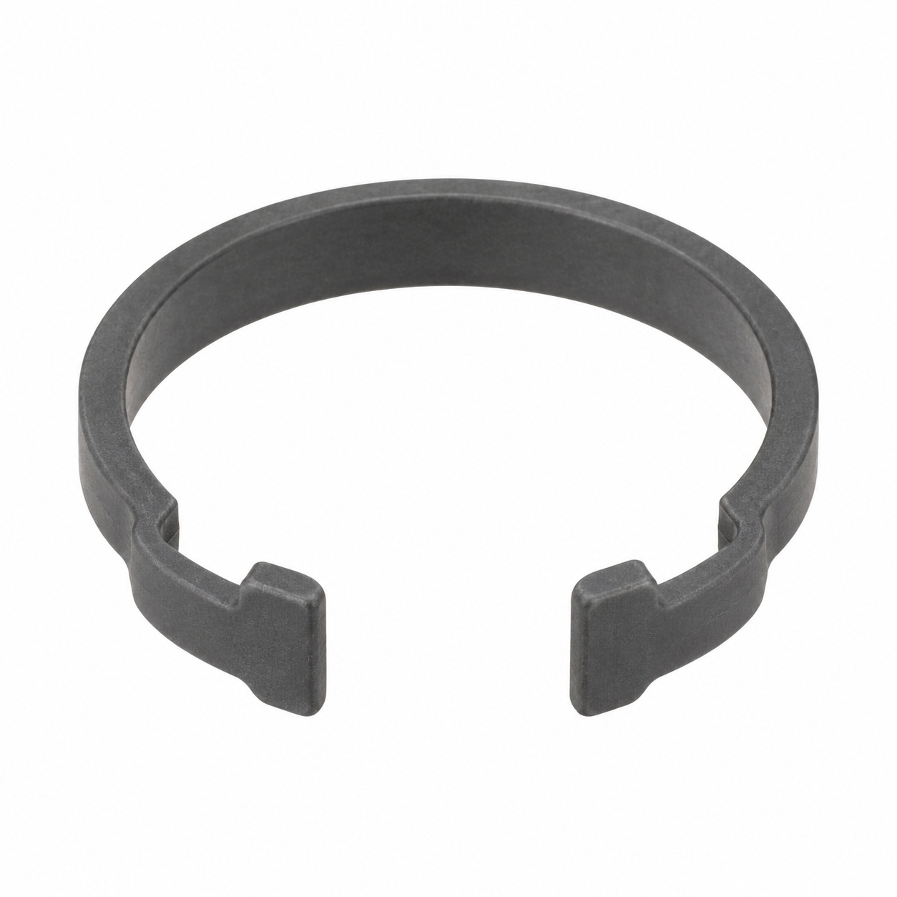

# Remaining catalog illustrations — batch 13

Generic type-based representations for review. Manufacturer-specific shape, internal construction, kit contents and fitment are unverified. Complex assemblies are broad concepts requiring a real photo or drawing. Existing catalog validation is not changed.

[Back to gallery](README.md)

| Target SKU | Description | Image |
| --- | --- | --- |
| 139.859 | Ball bearing kit rear block Mastrena II | [Open image](generic-139.859.jpg) |
| 127.054 | Plate mobile piston | [Open image](generic-127.054.jpg) |
| 127.357 | Chamber ø50 assy. | [Open image](generic-127.357.jpg) |
| 130.861 | Mobile piston ø50 assy. | [Open image](generic-130.861.jpg) |
| 142.780 | Generic fluid-control component | [Open image](generic-142.780.jpg) |
| 115.891 | Generic mechanical component | [Open image](generic-115.891.jpg) |
| 115.892 | Generic fastener | [Open image](generic-115.892.jpg) |
| 127.371 | Anti-twist device plate | [Open image](generic-127.371.jpg) |
| 127.106 | Mobile piston head ø50 | [Open image](generic-127.106.jpg) |
| 130.862 | Clip for micro screen ø50 | [Open image](generic-130.862.jpg) |

## 139.859 — Ball bearing kit rear block Mastrena II

## 127.054 — Plate mobile piston

## 127.357 — Chamber ø50 assy.

## 130.861 — Mobile piston ø50 assy.

## 142.780 — Generic fluid-control component

## 115.891 — Generic mechanical component

## 115.892 — Generic fastener

## 127.371 — Anti-twist device plate

## 127.106 — Mobile piston head ø50

## 130.862 — Clip for micro screen ø50

