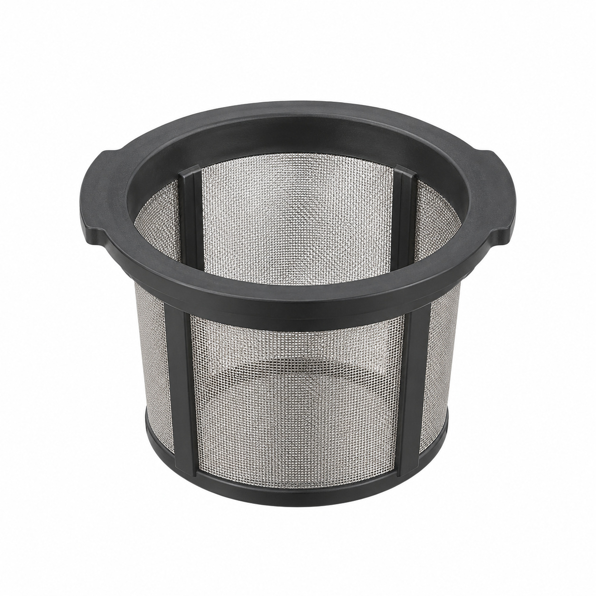
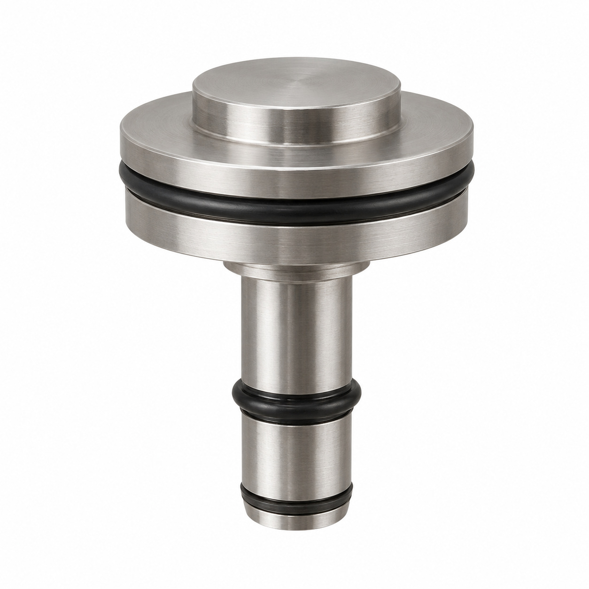
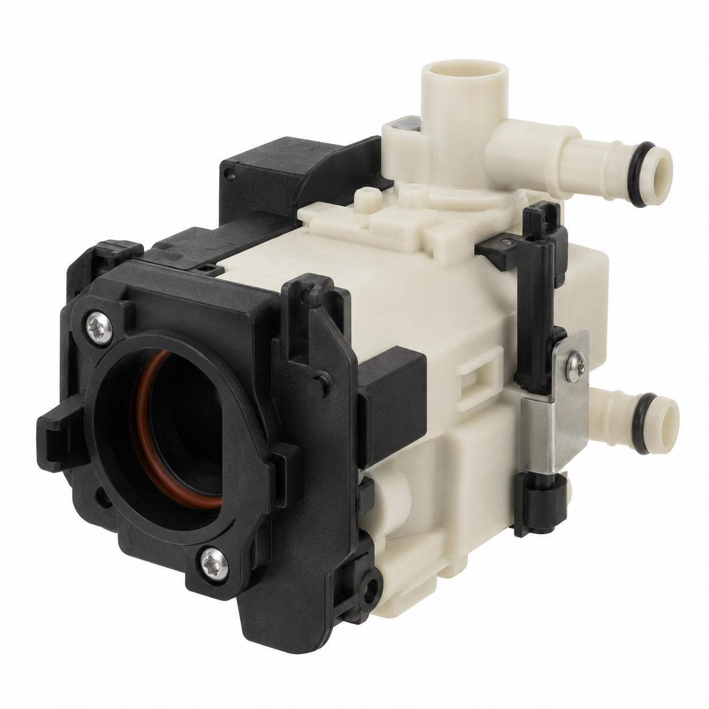
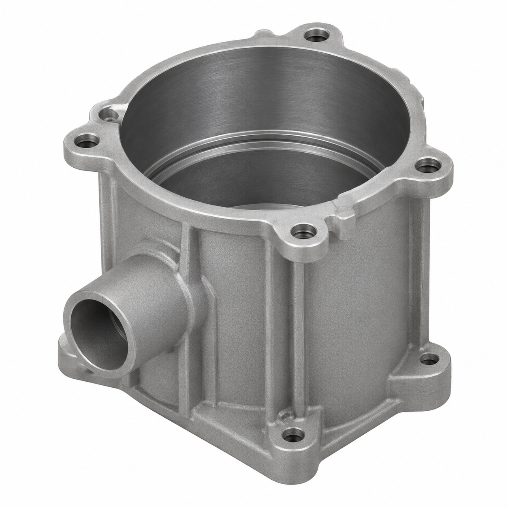
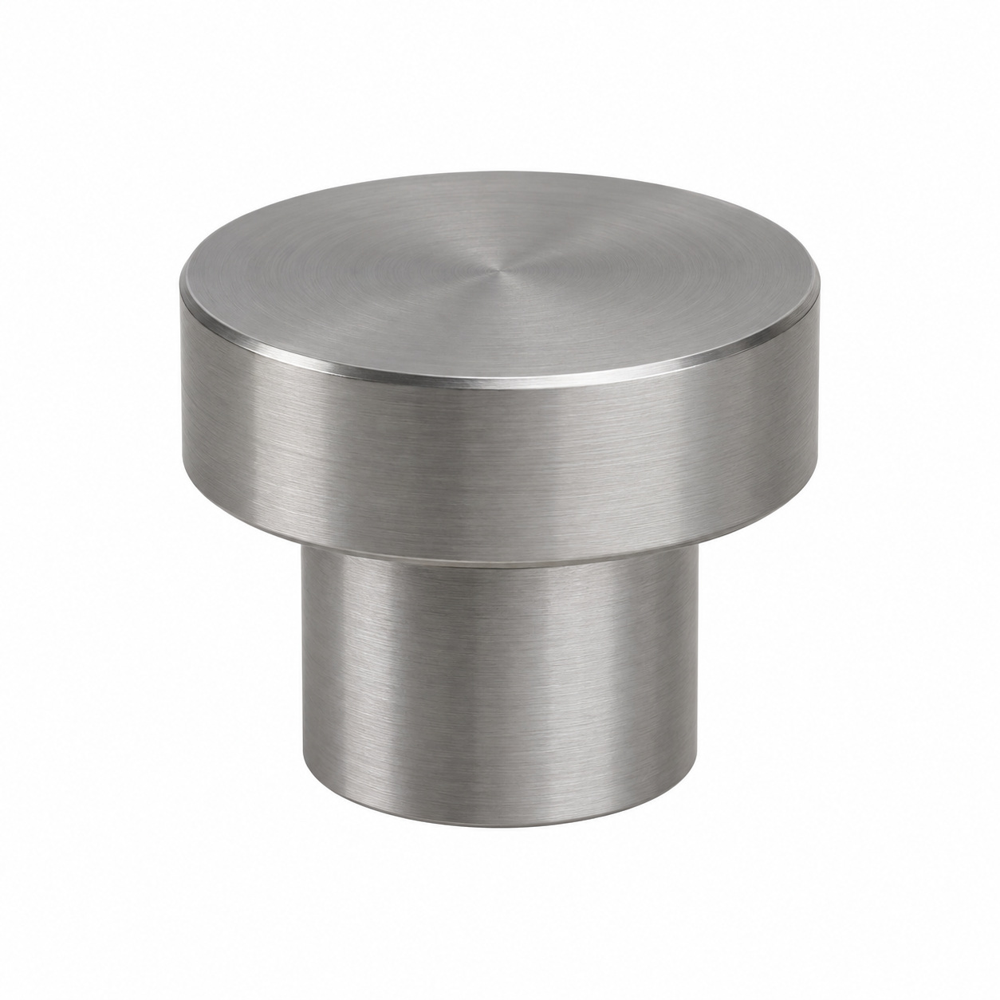
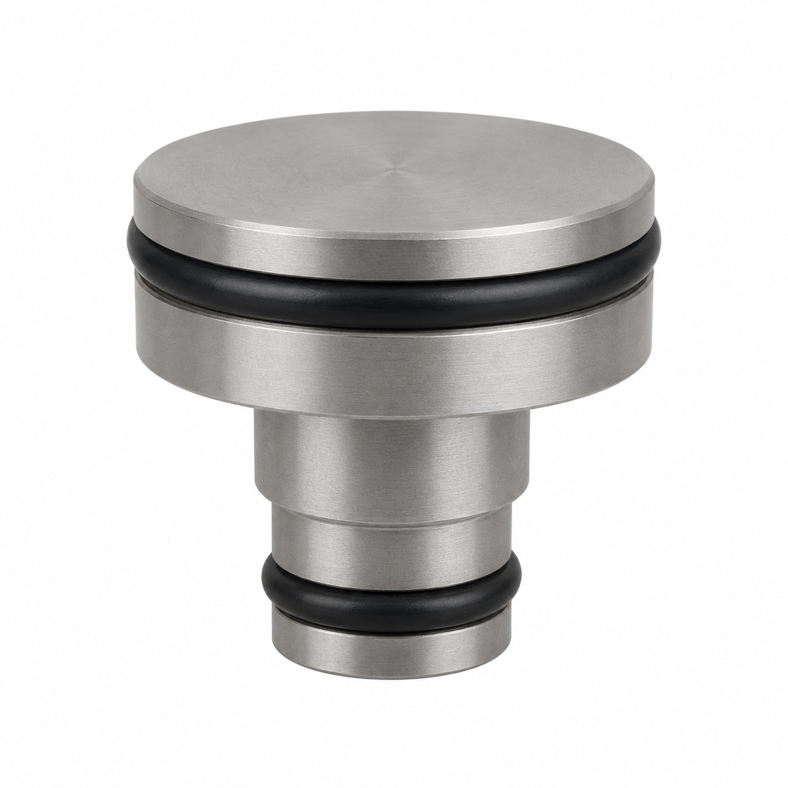
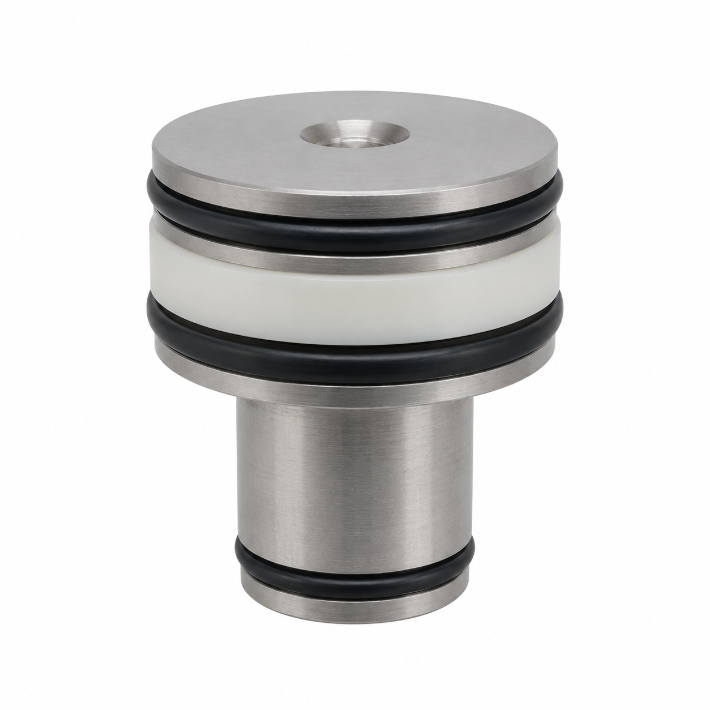
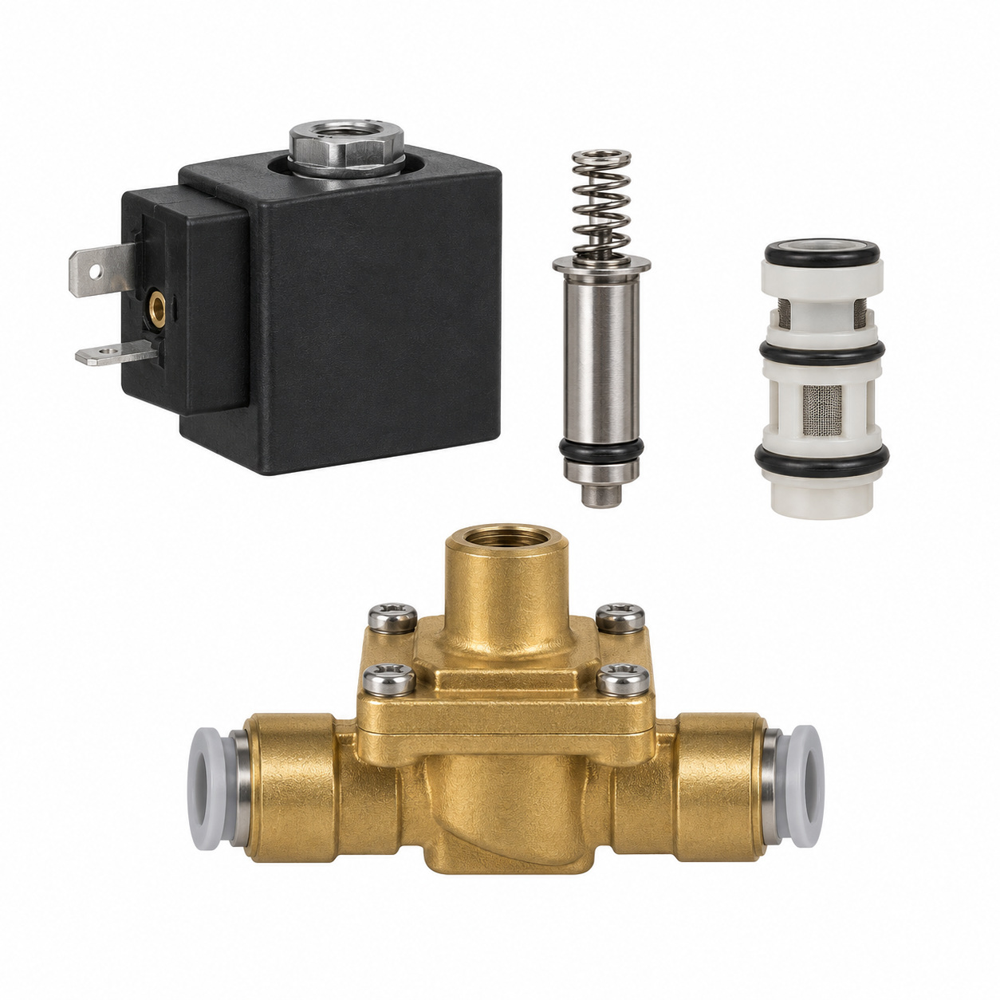
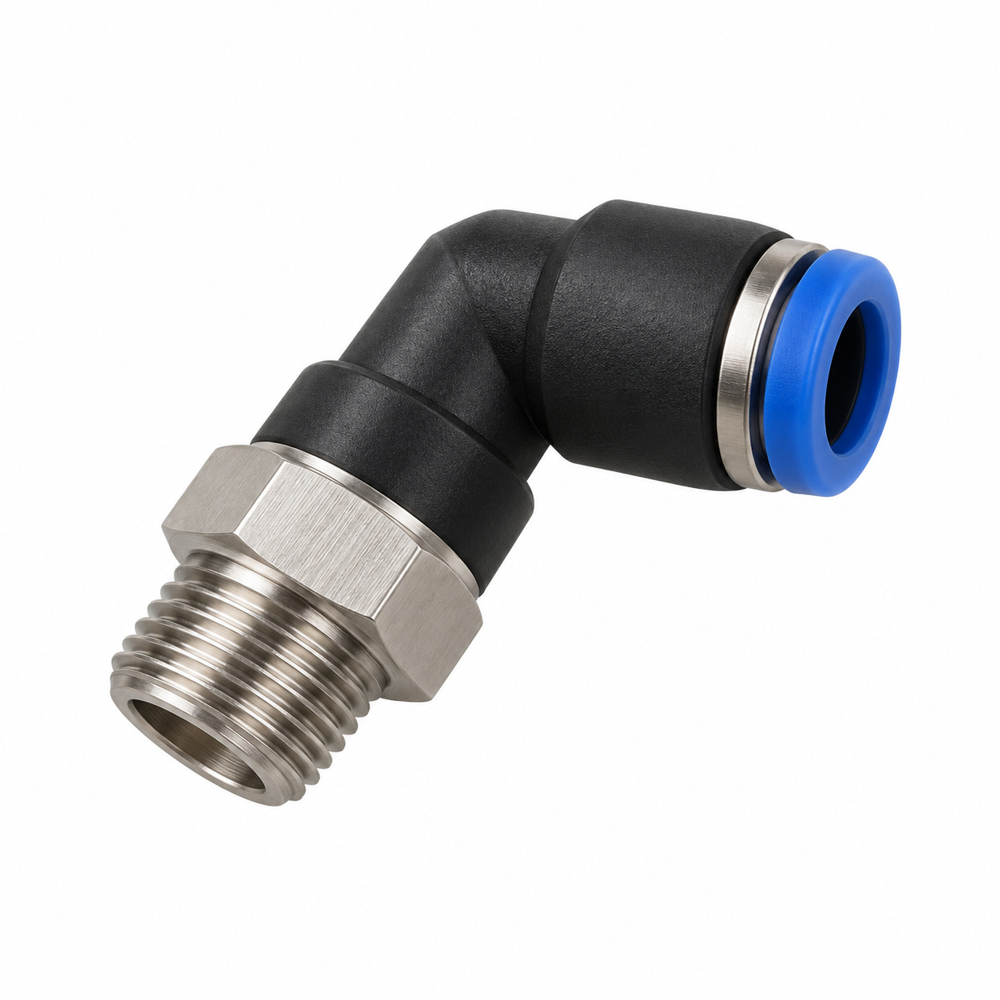
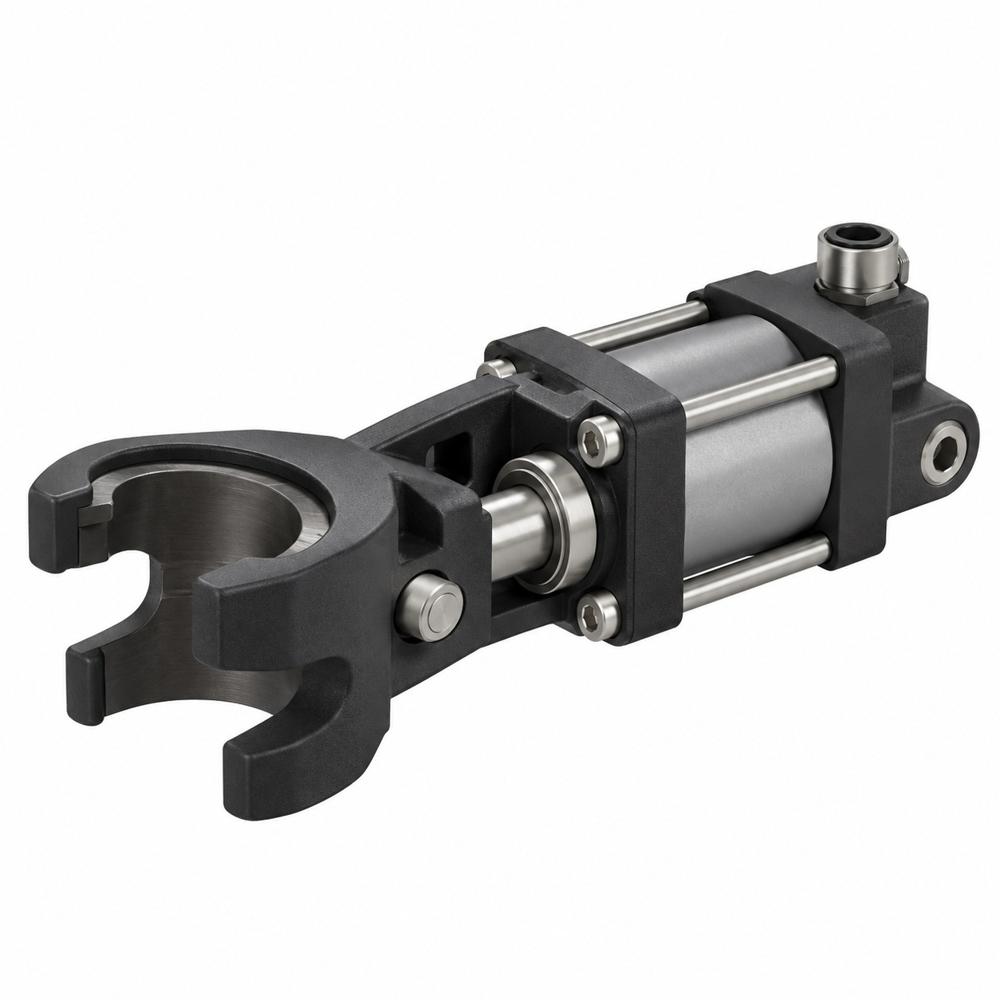

# Remaining catalog illustrations — batch 14

Generic type-based representations for review. Manufacturer-specific shape, internal construction, kit contents and fitment are unverified. Complex assemblies are broad concepts requiring a real photo or drawing. Existing catalog validation is not changed.

[Back to gallery](README.md)

| Target SKU | Description | Image |
| --- | --- | --- |
| 132.530 | Micro-screen insert | [Open image](generic-132.530.jpg) |
| 130.790 | Fix piston assy. head stepped | [Open image](generic-130.790.jpg) |
| 131.342 | Front block pre-assy. | [Open image](generic-131.342.jpg) |
| 129.965 | Generic cover, housing or mounting component | [Open image](generic-129.965.jpg) |
| 130.679 | Generic mechanical component | [Open image](generic-130.679.jpg) |
| 130.791 | Generic mechanical component | [Open image](generic-130.791.jpg) |
| 130.796 | Fix piston seal stepped ø50 assy. | [Open image](generic-130.796.jpg) |
| 132.589 | Body assy. magnet valve 2/2, ø6 | [Open image](generic-132.589.jpg) |
| 130.905 | Hydr. male connector tilted ø4 assy. | [Open image](generic-130.905.jpg) |
| 128.897 | Socket clip hydraulic right assy. | [Open image](generic-128.897.jpg) |

## 132.530 — Micro-screen insert

## 130.790 — Fix piston assy. head stepped

## 131.342 — Front block pre-assy.

## 129.965 — Generic cover, housing or mounting component

## 130.679 — Generic mechanical component

## 130.791 — Generic mechanical component

## 130.796 — Fix piston seal stepped ø50 assy.

## 132.589 — Body assy. magnet valve 2/2, ø6

## 130.905 — Hydr. male connector tilted ø4 assy.

## 128.897 — Socket clip hydraulic right assy.

