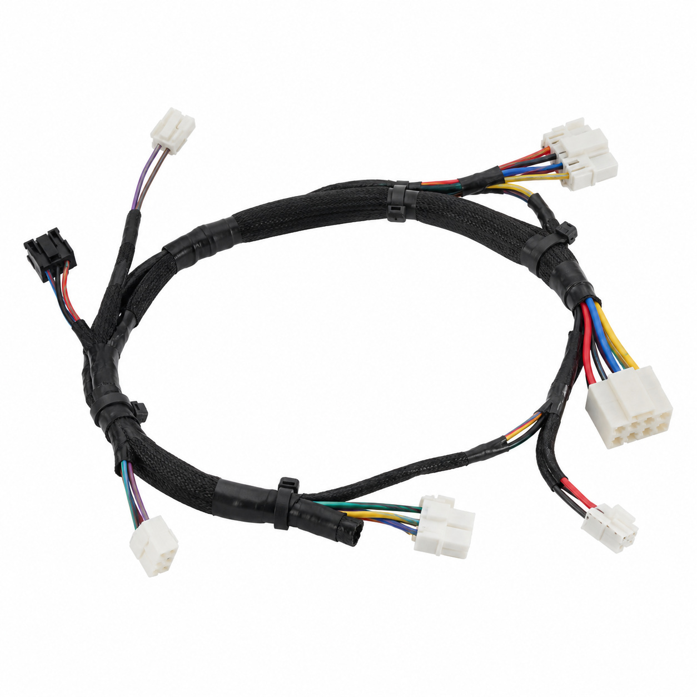
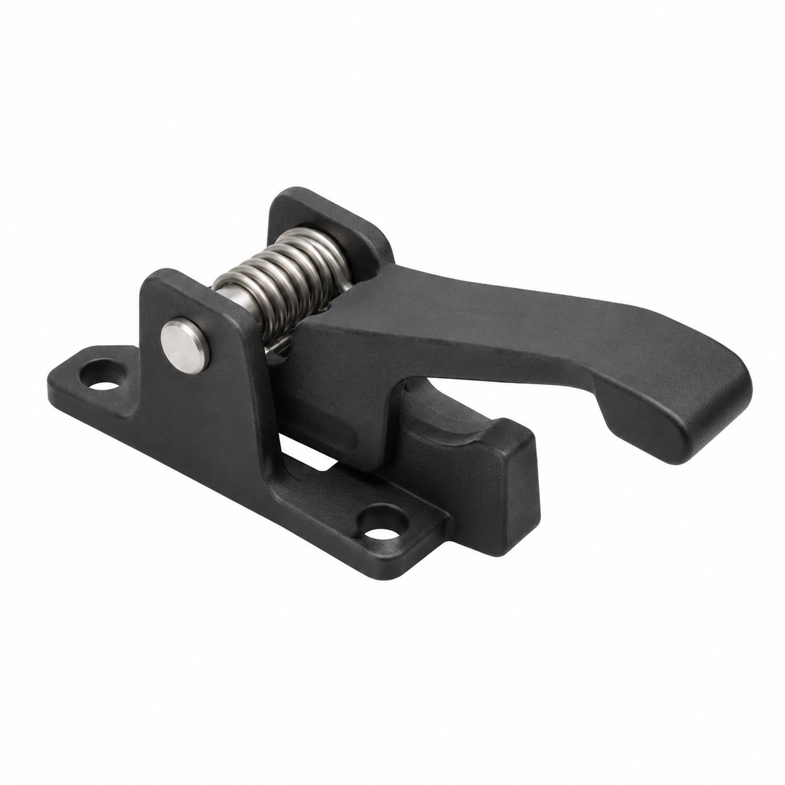
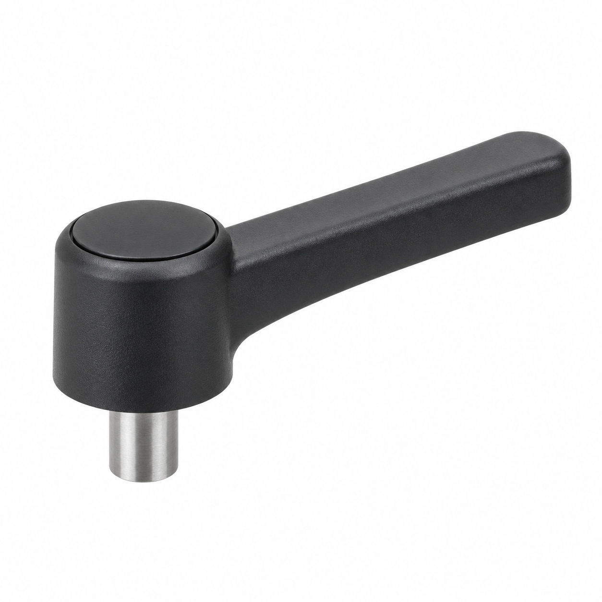
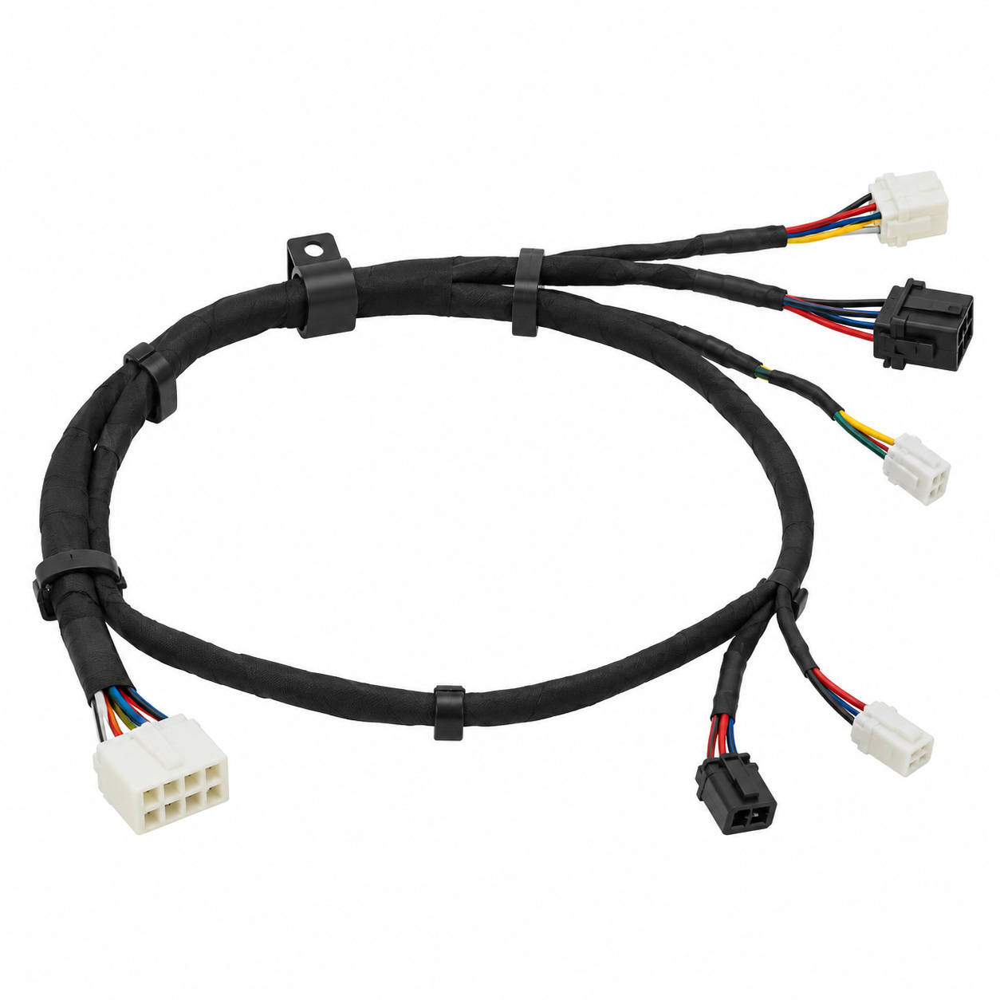
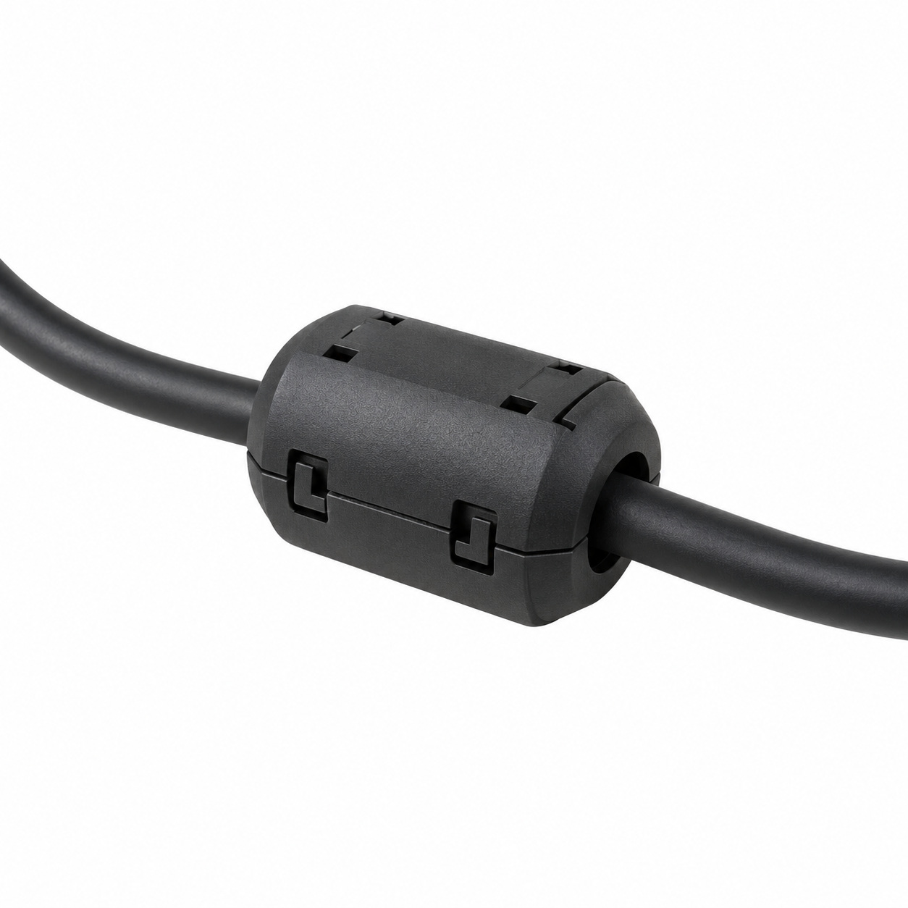
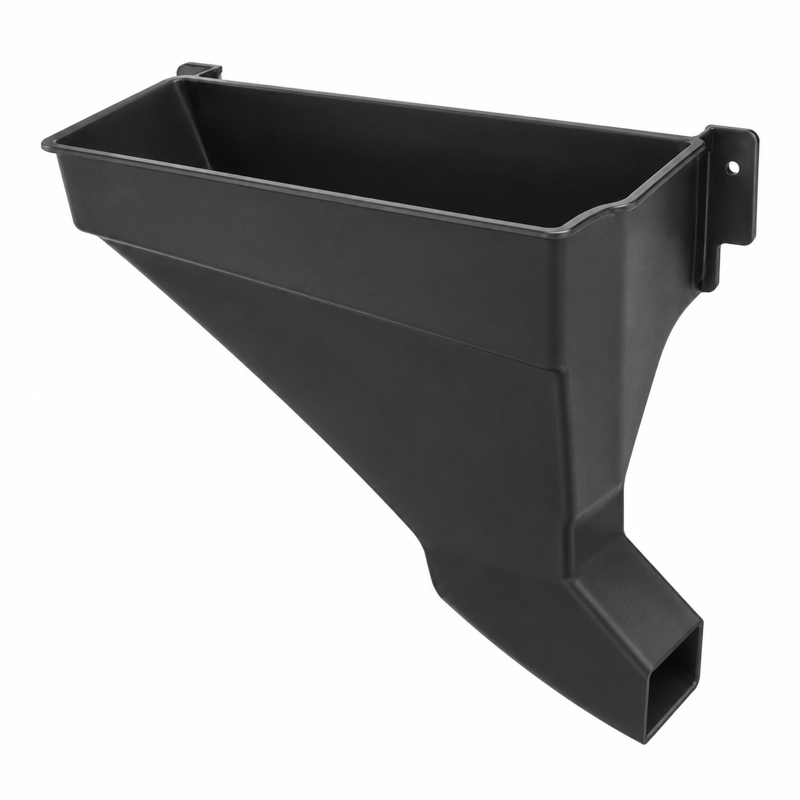
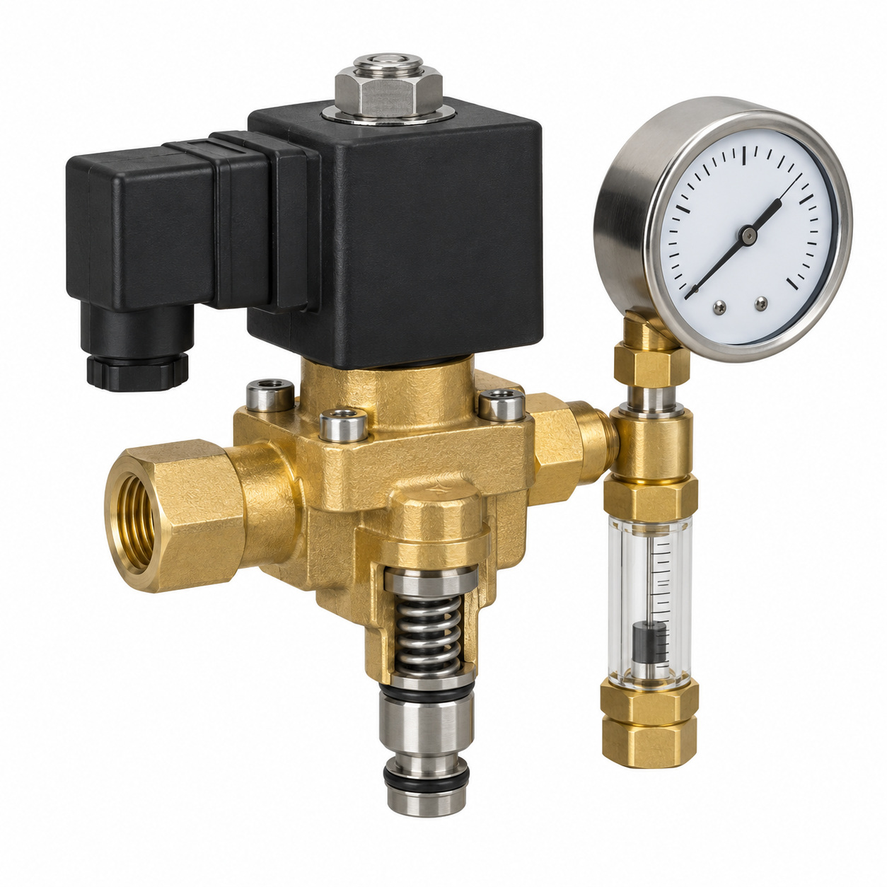
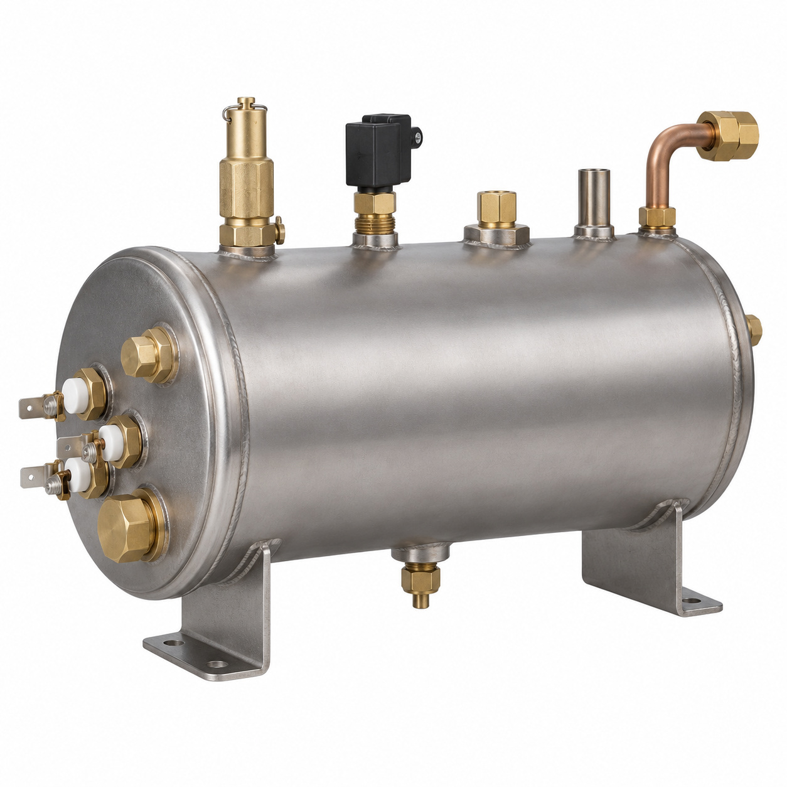
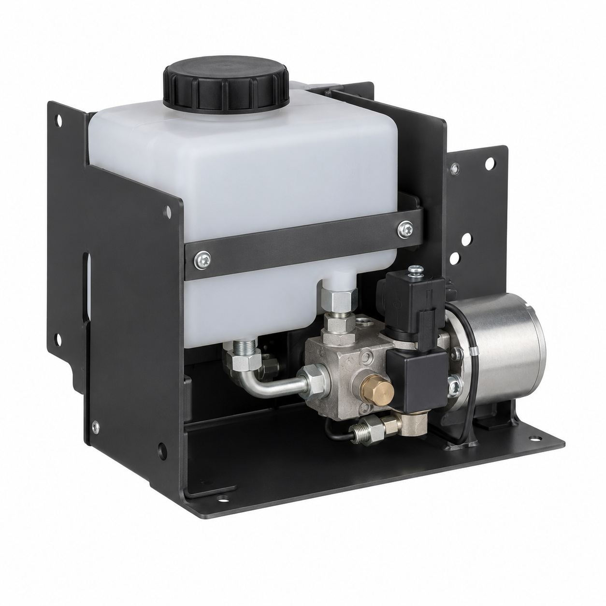
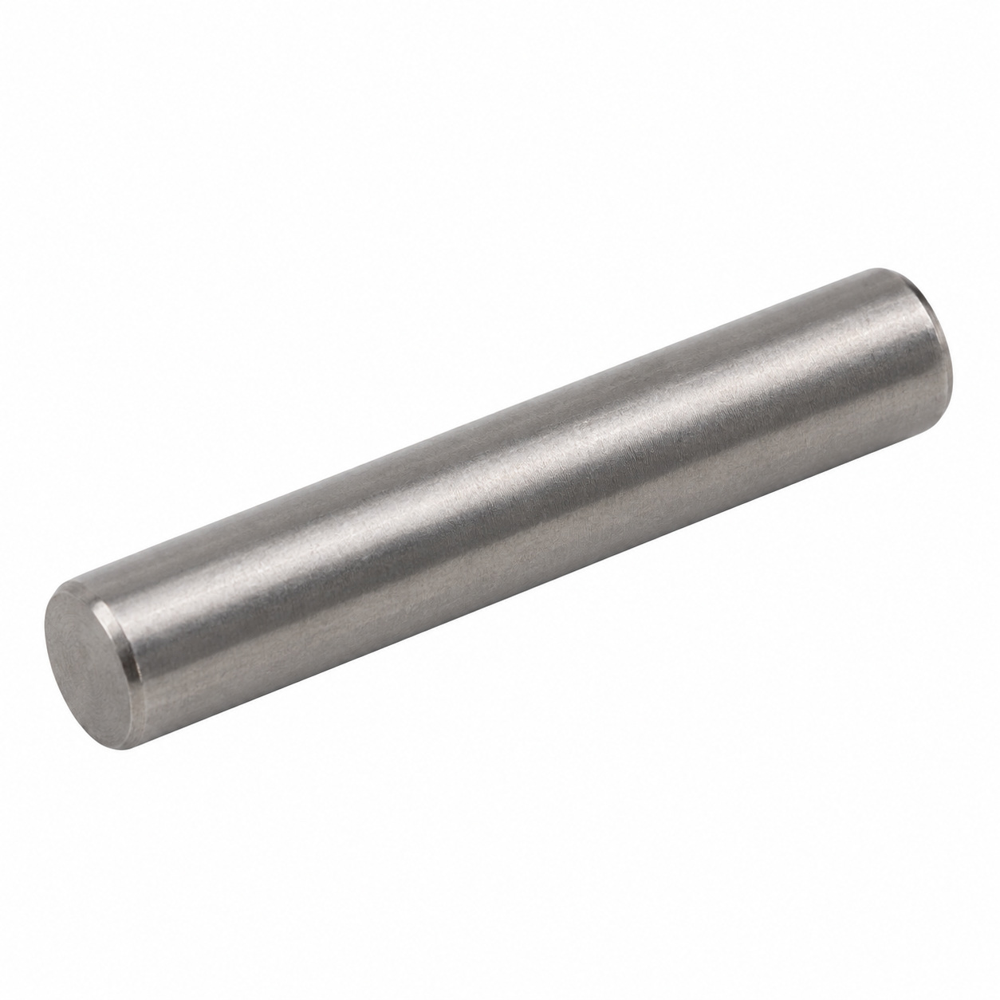

# Remaining catalog illustrations — batch 15

Generic type-based representations for review. Manufacturer-specific shape, internal construction, kit contents and fitment are unverified. Complex assemblies are broad concepts requiring a real photo or drawing. Existing catalog validation is not changed.

[Back to gallery](README.md)

| Target SKU | Description | Image |
| --- | --- | --- |
| 130.972 | Generic cable or wiring assembly | [Open image](generic-130.972.jpg) |
| 129.468 | Generic mechanical component | [Open image](generic-129.468.jpg) |
| 129.469 | Generic mechanical component | [Open image](generic-129.469.jpg) |
| 129.583 | Generic cable or wiring assembly | [Open image](generic-129.583.jpg) |
| 131.080 | Generic cable or wiring assembly | [Open image](generic-131.080.jpg) |
| 130.298 | Generic cover, housing or mounting component | [Open image](generic-130.298.jpg) |
| 129.174 | Valve assembly hydraulic | [Open image](generic-129.174.jpg) |
| 129.175 | Boiler assembly hydraulic | [Open image](generic-129.175.jpg) |
| 129.187 | Generic cover, housing or mounting component | [Open image](generic-129.187.jpg) |
| 106.882 | Generic fastener | [Open image](generic-106.882.jpg) |

## 130.972 — Generic cable or wiring assembly

## 129.468 — Generic mechanical component

## 129.469 — Generic mechanical component

## 129.583 — Generic cable or wiring assembly

## 131.080 — Generic cable or wiring assembly

## 130.298 — Generic cover, housing or mounting component

## 129.174 — Valve assembly hydraulic

## 129.175 — Boiler assembly hydraulic

## 129.187 — Generic cover, housing or mounting component

## 106.882 — Generic fastener

