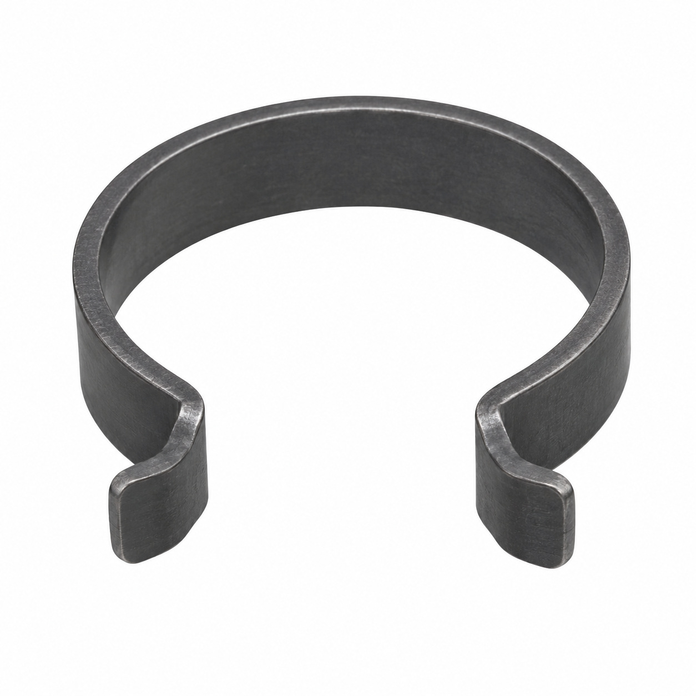
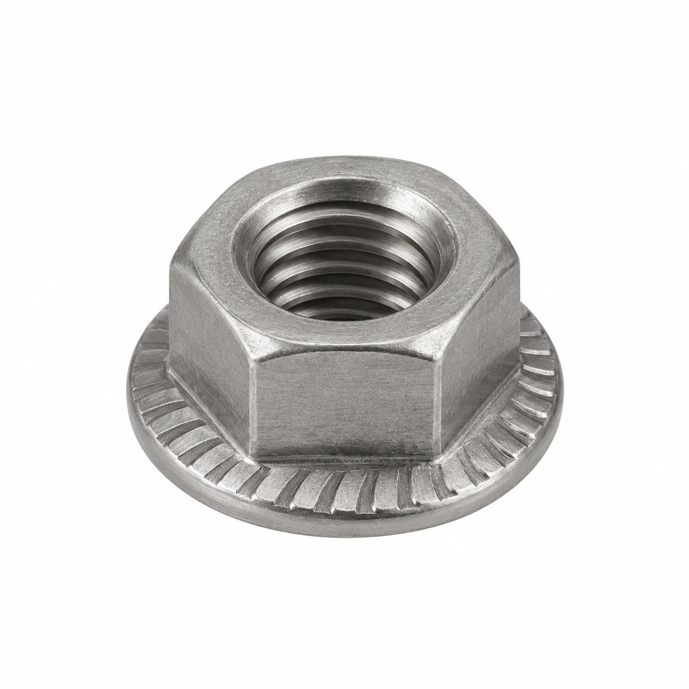
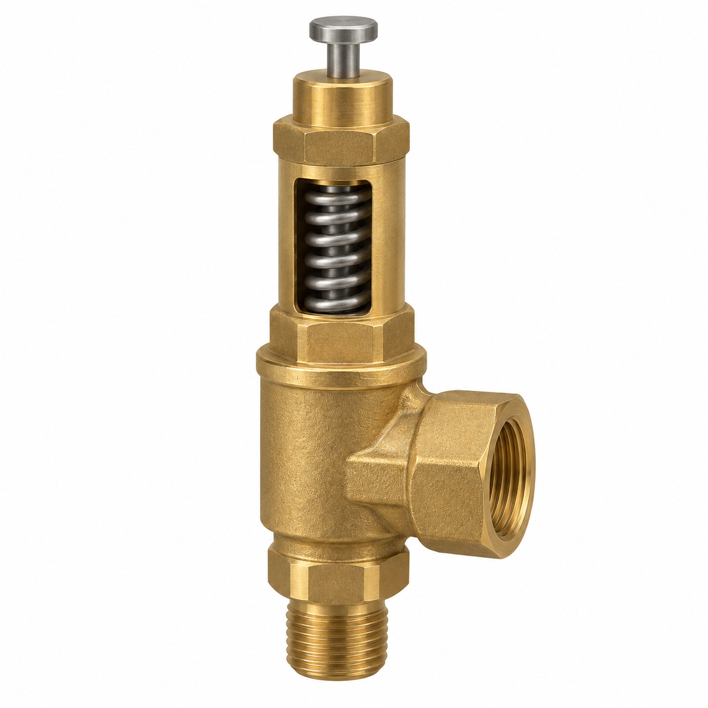
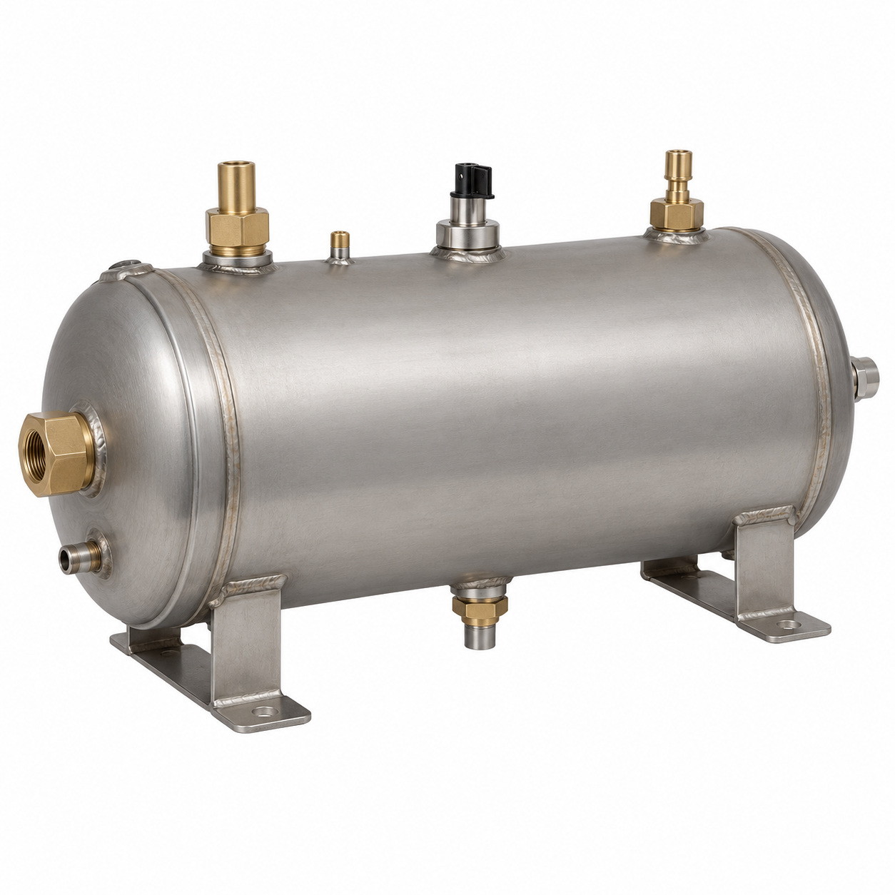
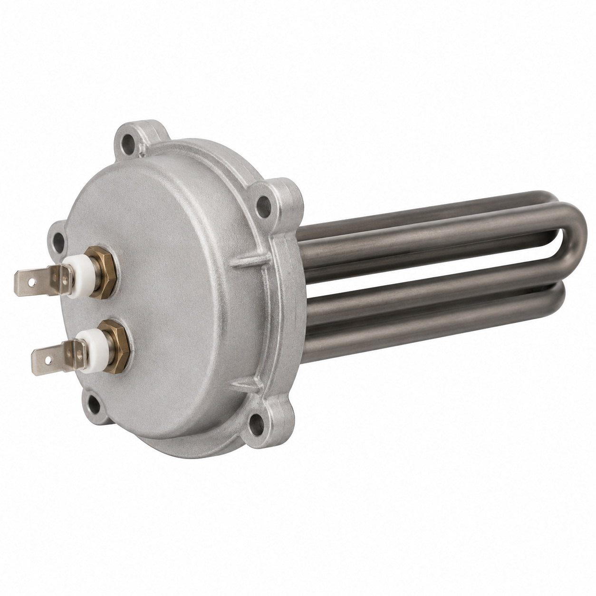
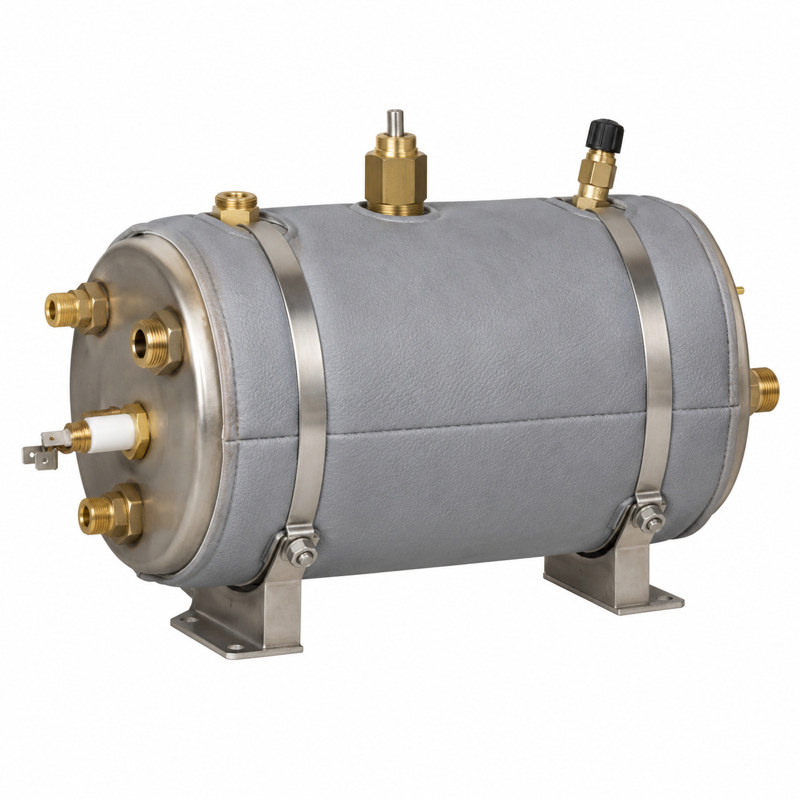
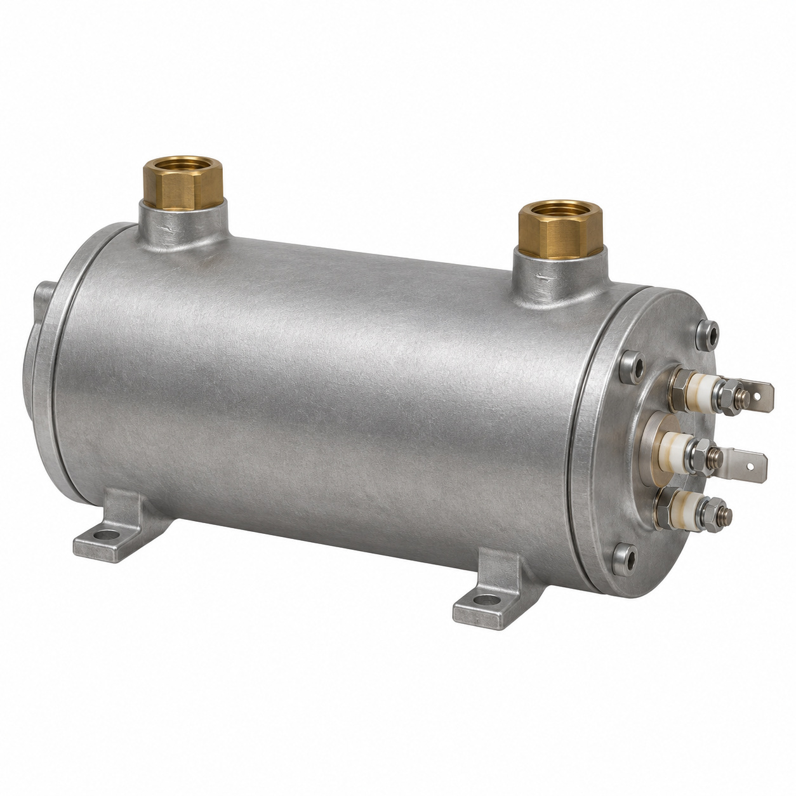
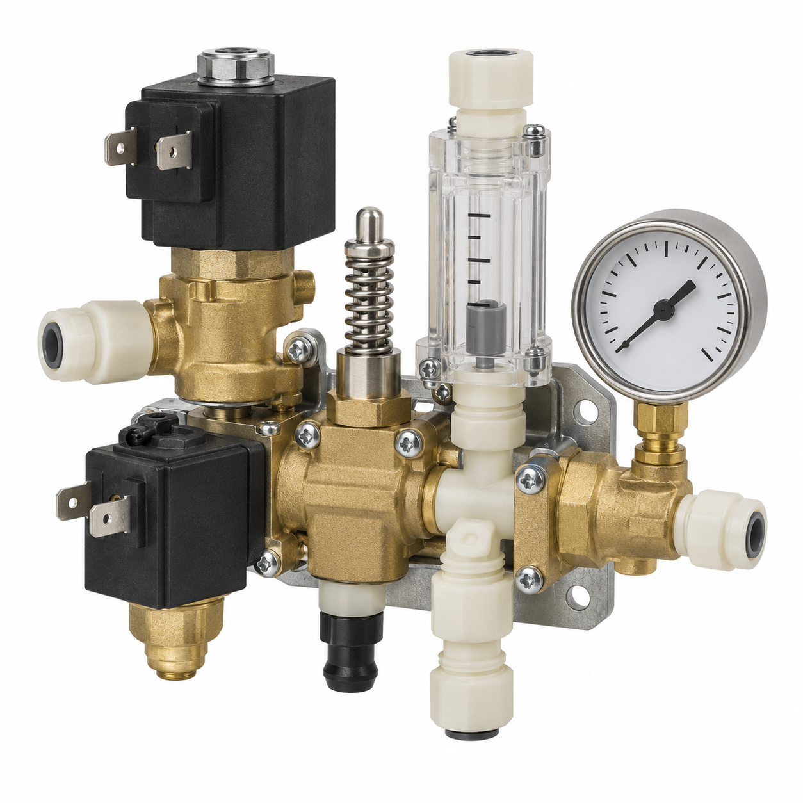
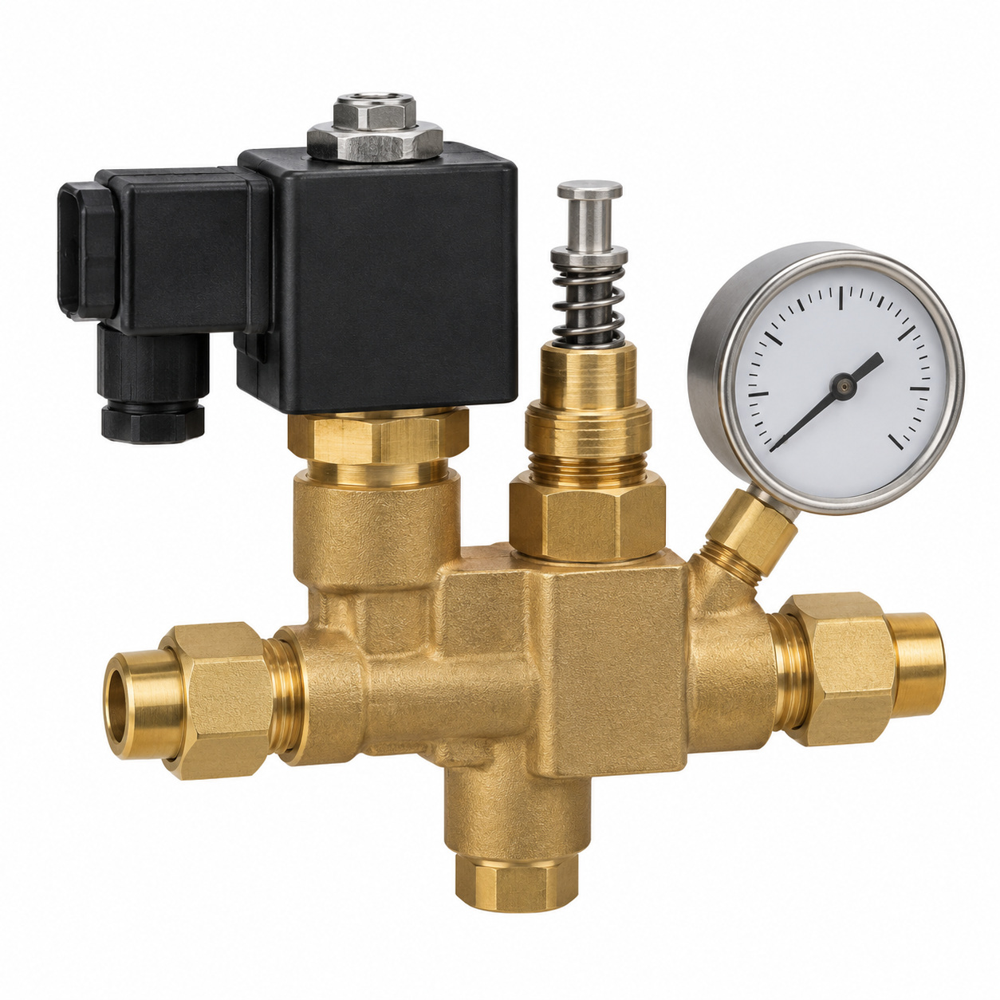
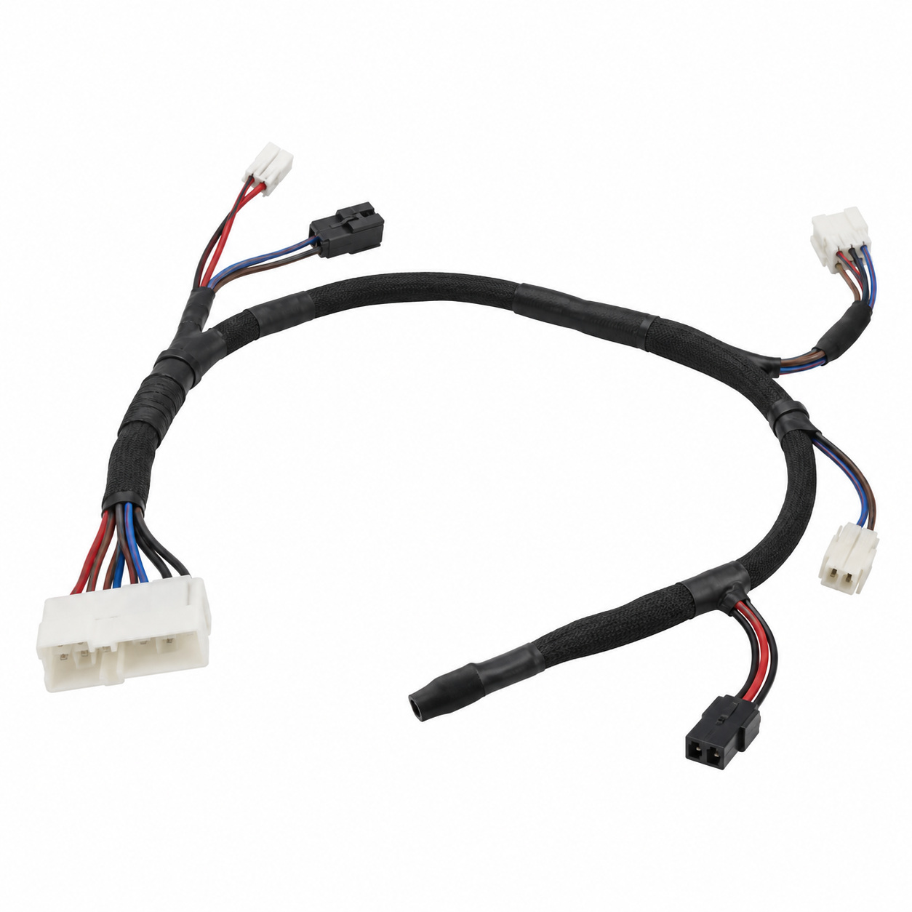

# Remaining catalog illustrations — batch 16

Generic type-based representations for review. Manufacturer-specific shape, internal construction, kit contents and fitment are unverified. Complex assemblies are broad concepts requiring a real photo or drawing. Existing catalog validation is not changed.

[Back to gallery](README.md)

| Target SKU | Description | Image |
| --- | --- | --- |
| 119.896 | Generic mechanical component | [Open image](generic-119.896.jpg) |
| 124.829 | Generic assembly concept | [Open image](generic-124.829.jpg) |
| 126.219 | Generic fluid-control component | [Open image](generic-126.219.jpg) |
| 127.266 | Boiler coffee horizontal assy. | [Open image](generic-127.266.jpg) |
| 127.265 | Generic mechanical component | [Open image](generic-127.265.jpg) |
| 132.594 | Generic boiler or steam component | [Open image](generic-132.594.jpg) |
| 127.263 | Generic mechanical component | [Open image](generic-127.263.jpg) |
| 127.788 | Valveblock brew and clean assy. | [Open image](generic-127.788.jpg) |
| 128.062 | Expansion chamber valve assy. | [Open image](generic-128.062.jpg) |
| 130.899 | Generic cable or wiring assembly | [Open image](generic-130.899.jpg) |

## 119.896 — Generic mechanical component

## 124.829 — Generic assembly concept

## 126.219 — Generic fluid-control component

## 127.266 — Boiler coffee horizontal assy.

## 127.265 — Generic mechanical component

## 132.594 — Generic boiler or steam component

## 127.263 — Generic mechanical component

## 127.788 — Valveblock brew and clean assy.

## 128.062 — Expansion chamber valve assy.

## 130.899 — Generic cable or wiring assembly

