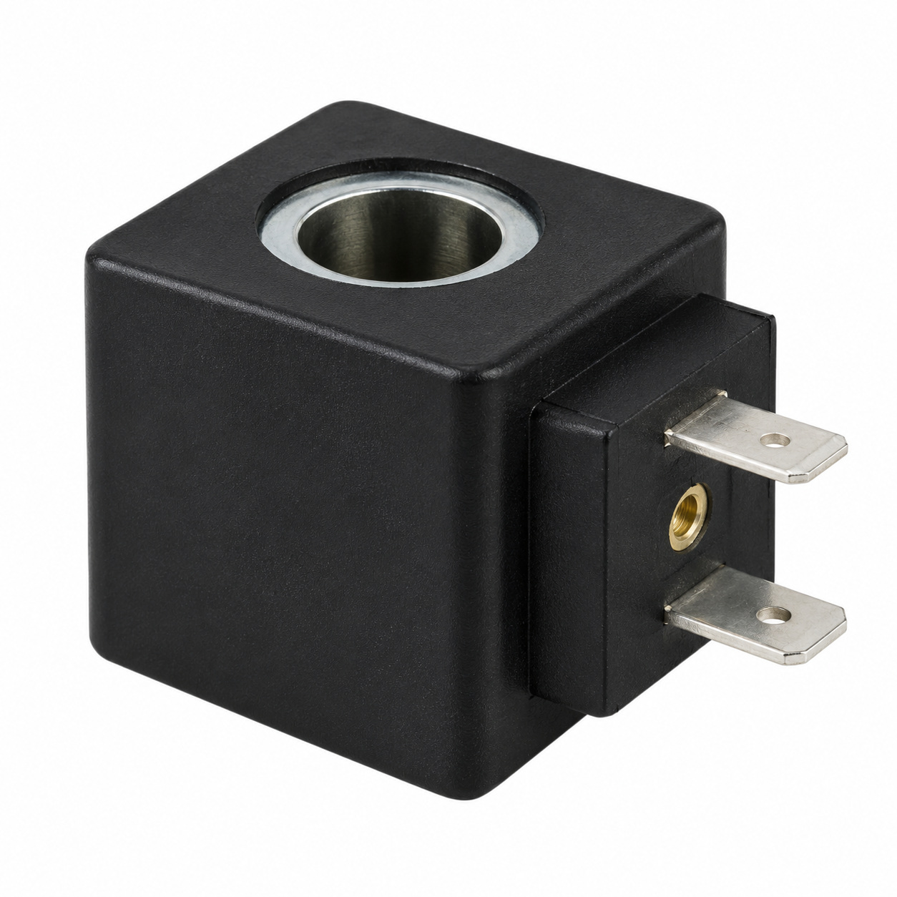
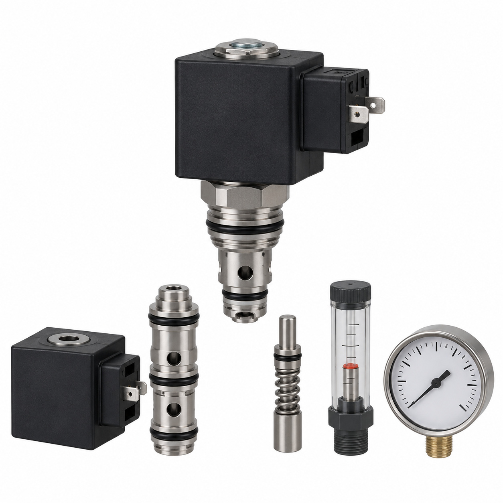
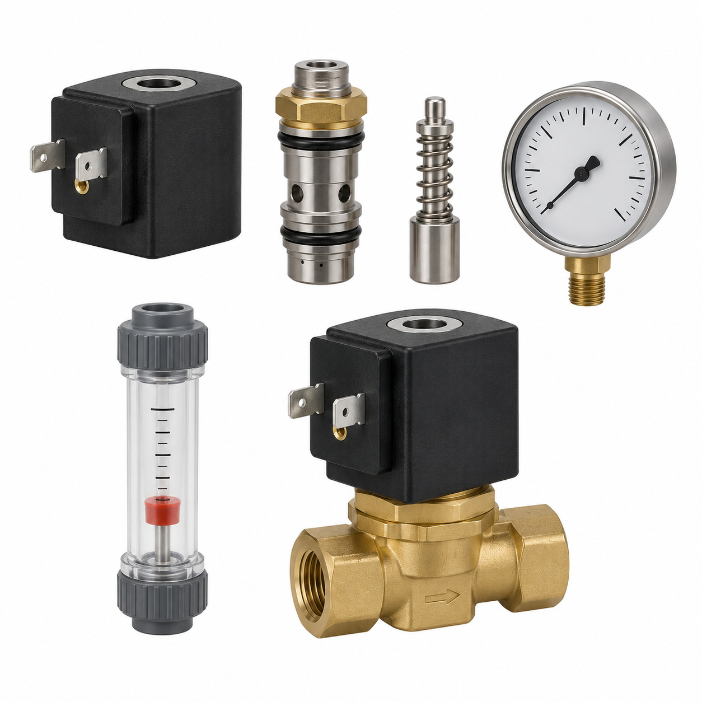
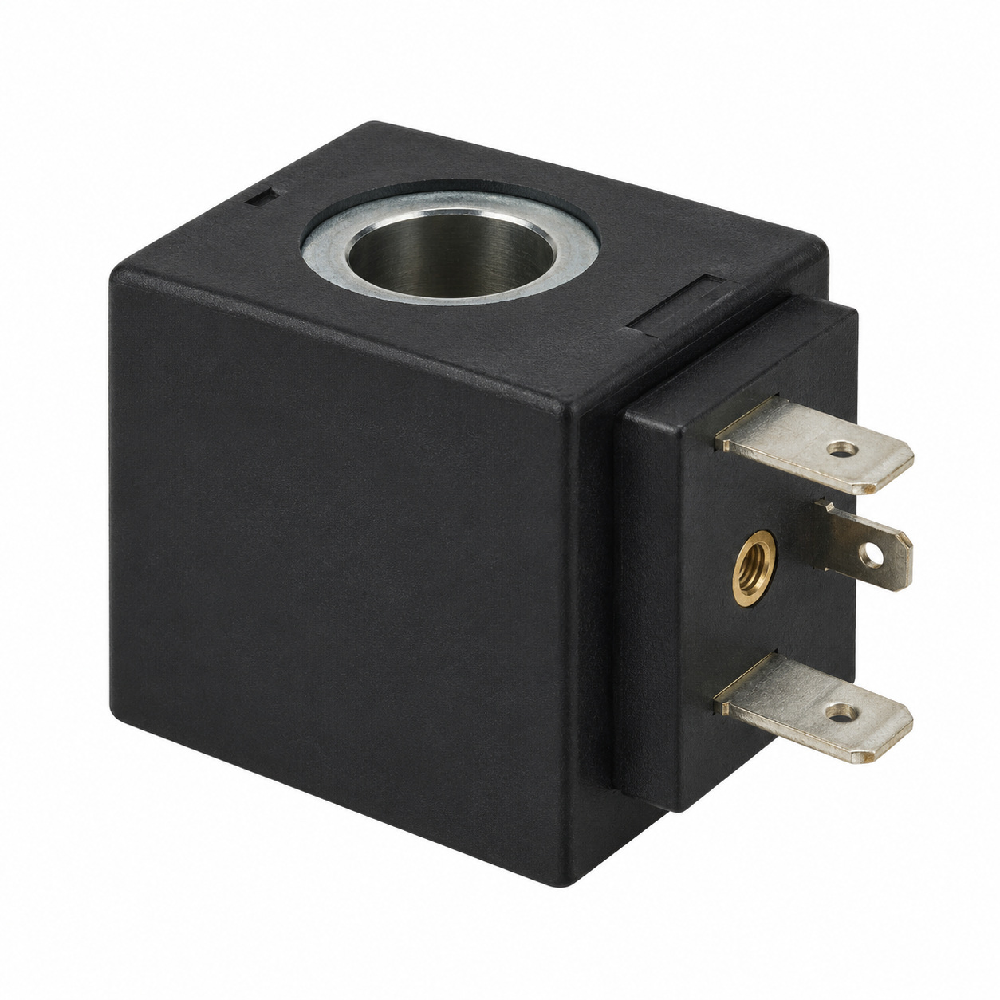
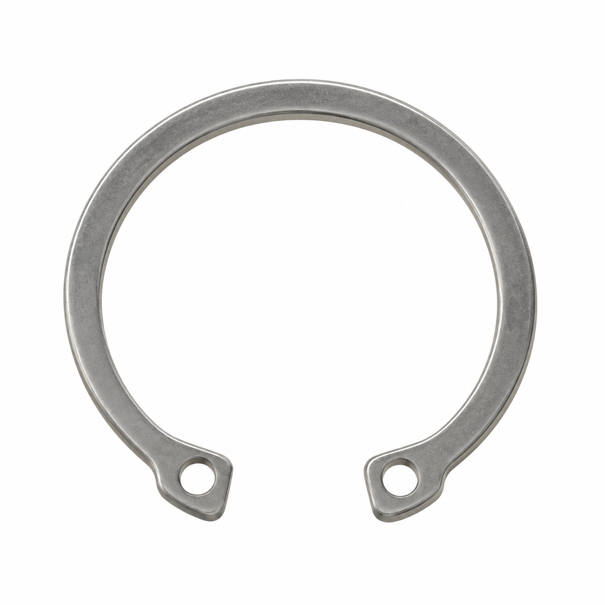
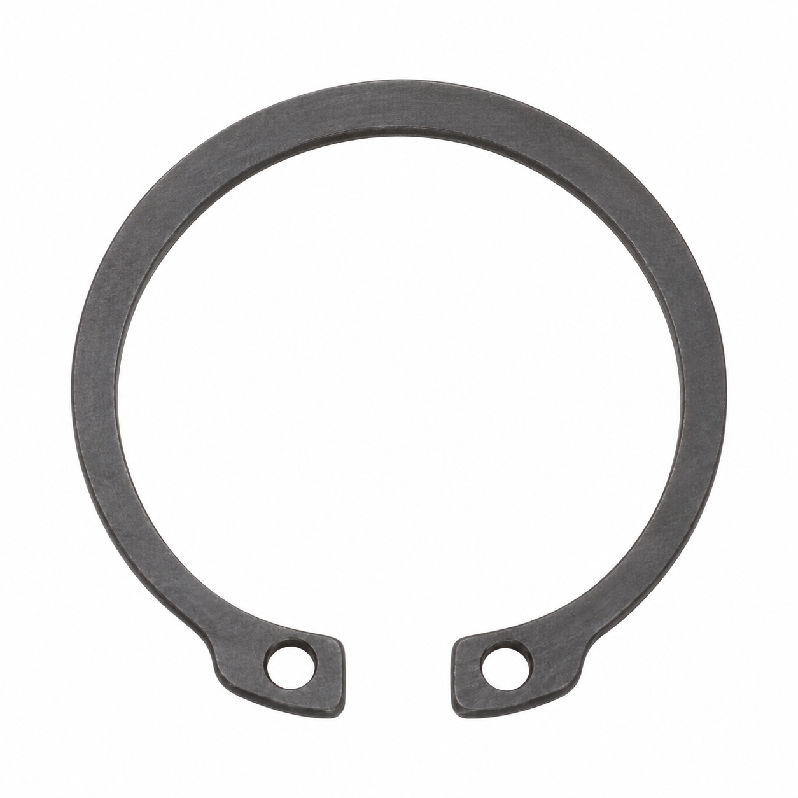
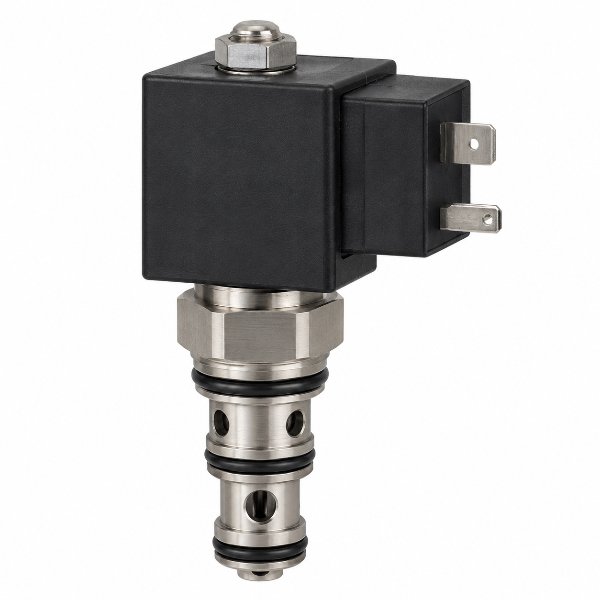
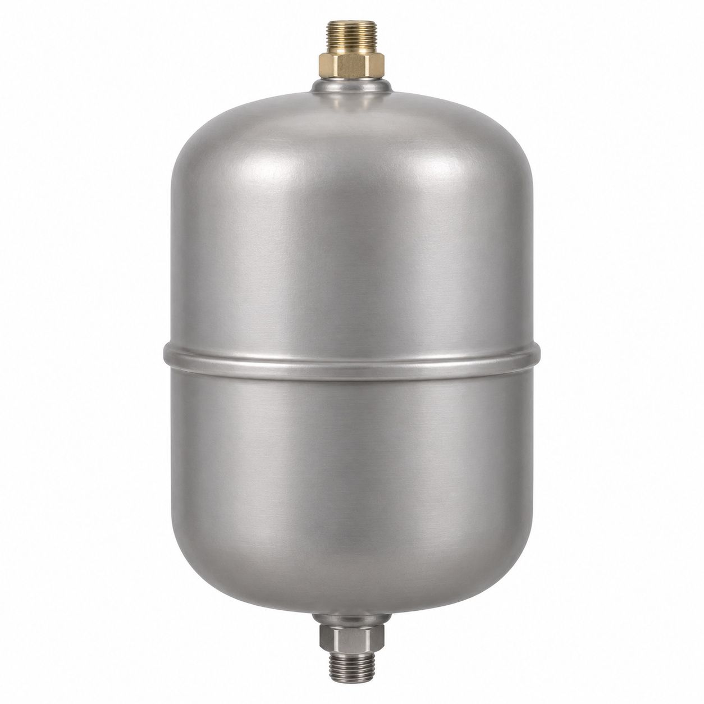
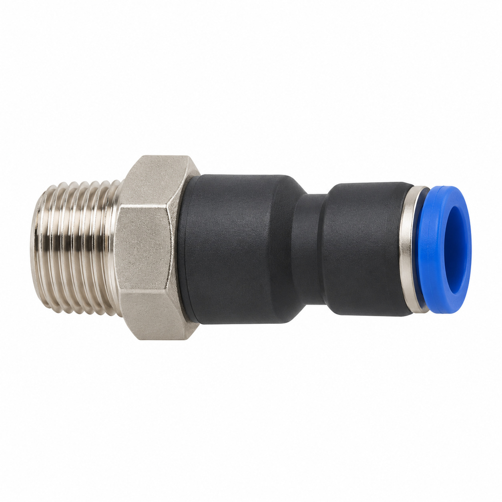
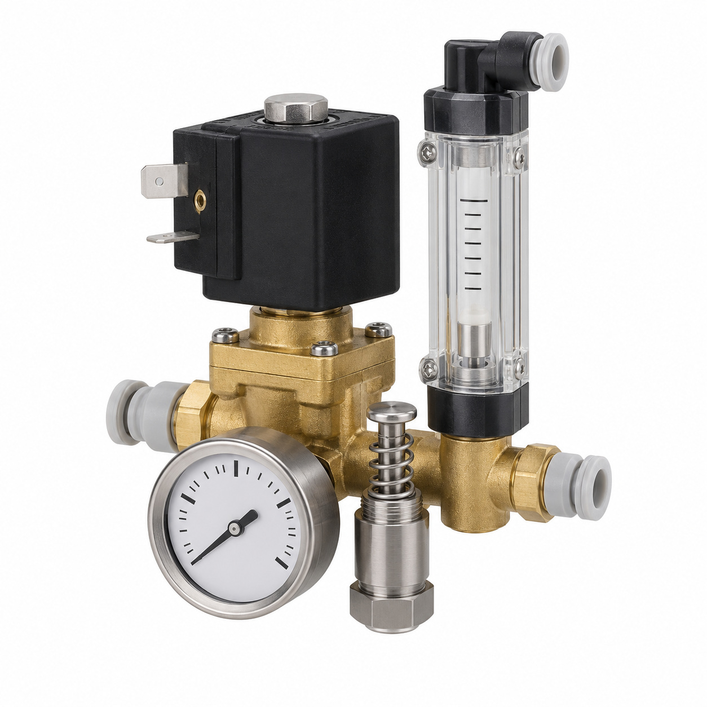

# Remaining catalog illustrations — batch 17

Generic type-based representations for review. Manufacturer-specific shape, internal construction, kit contents and fitment are unverified. Complex assemblies are broad concepts requiring a real photo or drawing. Existing catalog validation is not changed.

[Back to gallery](README.md)

| Target SKU | Description | Image |
| --- | --- | --- |
| 106.703 | Coil for Lucifer valve | [Open image](generic-106.703.jpg) |
| 127.685 | Generic fluid-control component | [Open image](generic-127.685.jpg) |
| 127.687 | Generic fluid-control component | [Open image](generic-127.687.jpg) |
| 129.762 | Solenoid 22mm UL | [Open image](generic-129.762.jpg) |
| 130.361 | Clip 22mm coil | [Open image](generic-130.361.jpg) |
| 130.362 | Generic mechanical component | [Open image](generic-130.362.jpg) |
| 128.454 | Generic fluid-control component | [Open image](generic-128.454.jpg) |
| 130.326 | Generic fluid-control component | [Open image](generic-130.326.jpg) |
| 127.998 | Generic fluid connector | [Open image](generic-127.998.jpg) |
| 128.004 | Flow meter assy. ø6/ø4 | [Open image](generic-128.004.jpg) |

## 106.703 — Coil for Lucifer valve

## 127.685 — Generic fluid-control component

## 127.687 — Generic fluid-control component

## 129.762 — Solenoid 22mm UL

## 130.361 — Clip 22mm coil

## 130.362 — Generic mechanical component

## 128.454 — Generic fluid-control component

## 130.326 — Generic fluid-control component

## 127.998 — Generic fluid connector

## 128.004 — Flow meter assy. ø6/ø4

