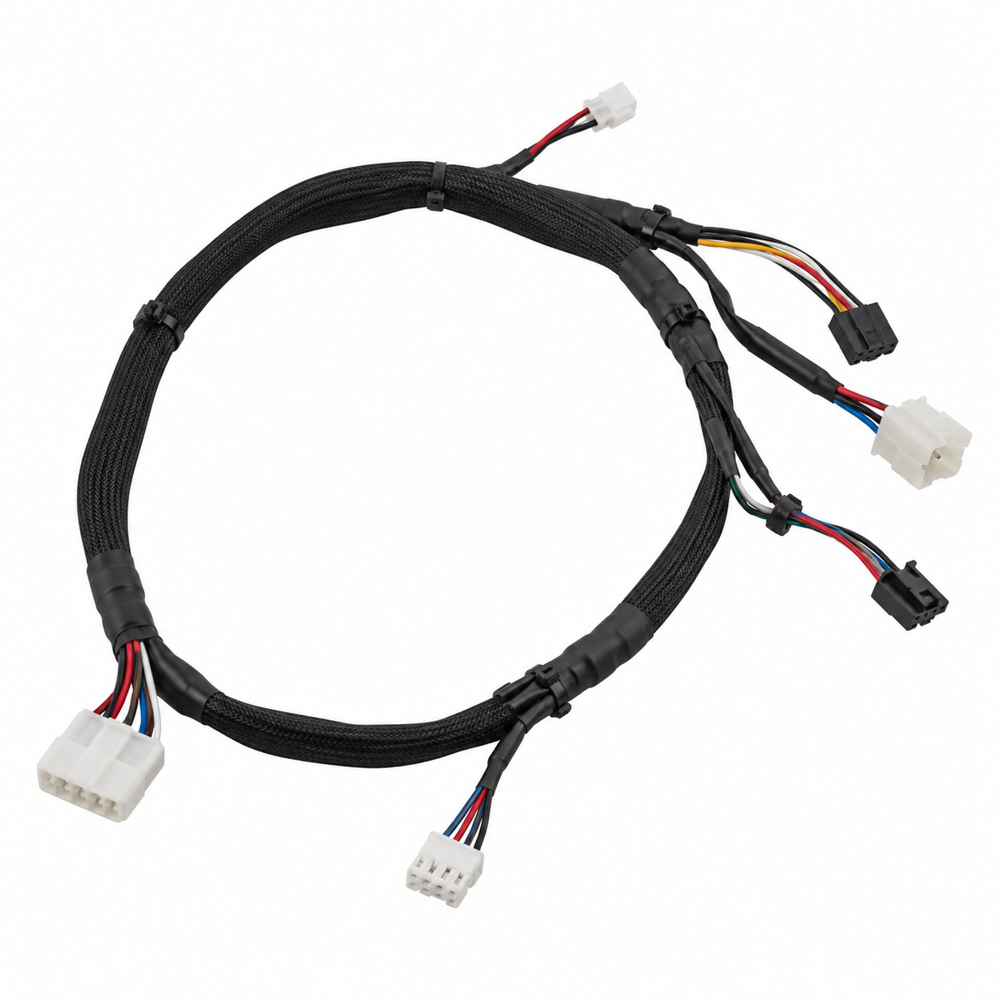
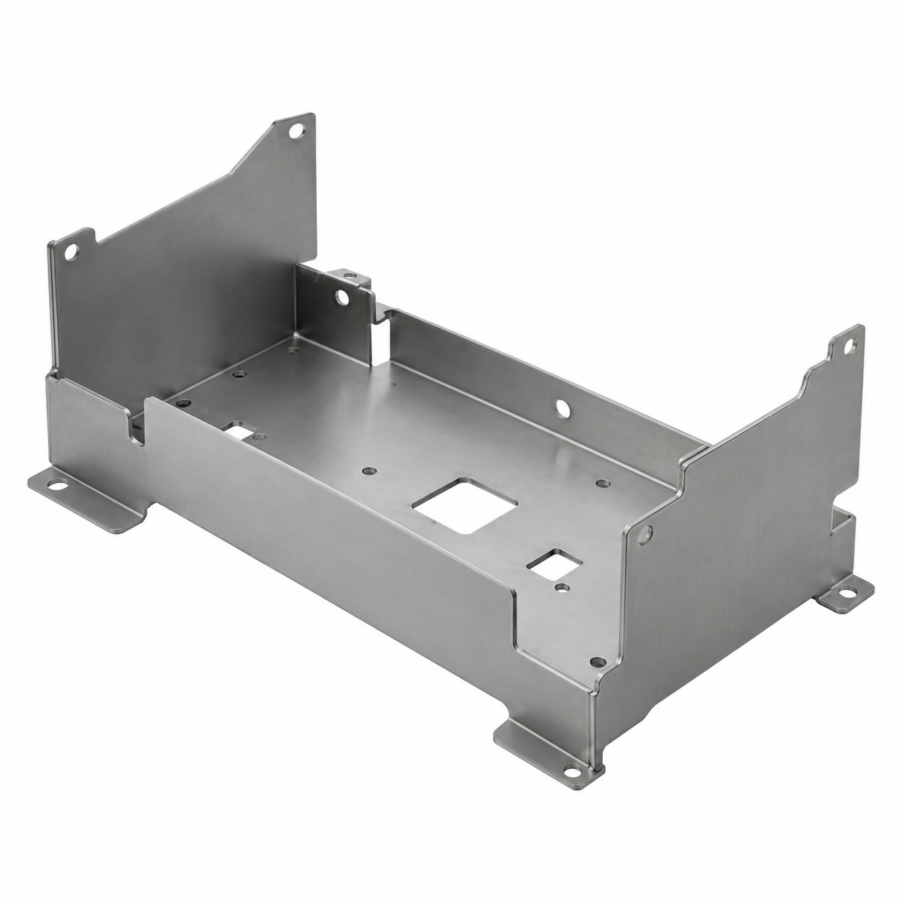
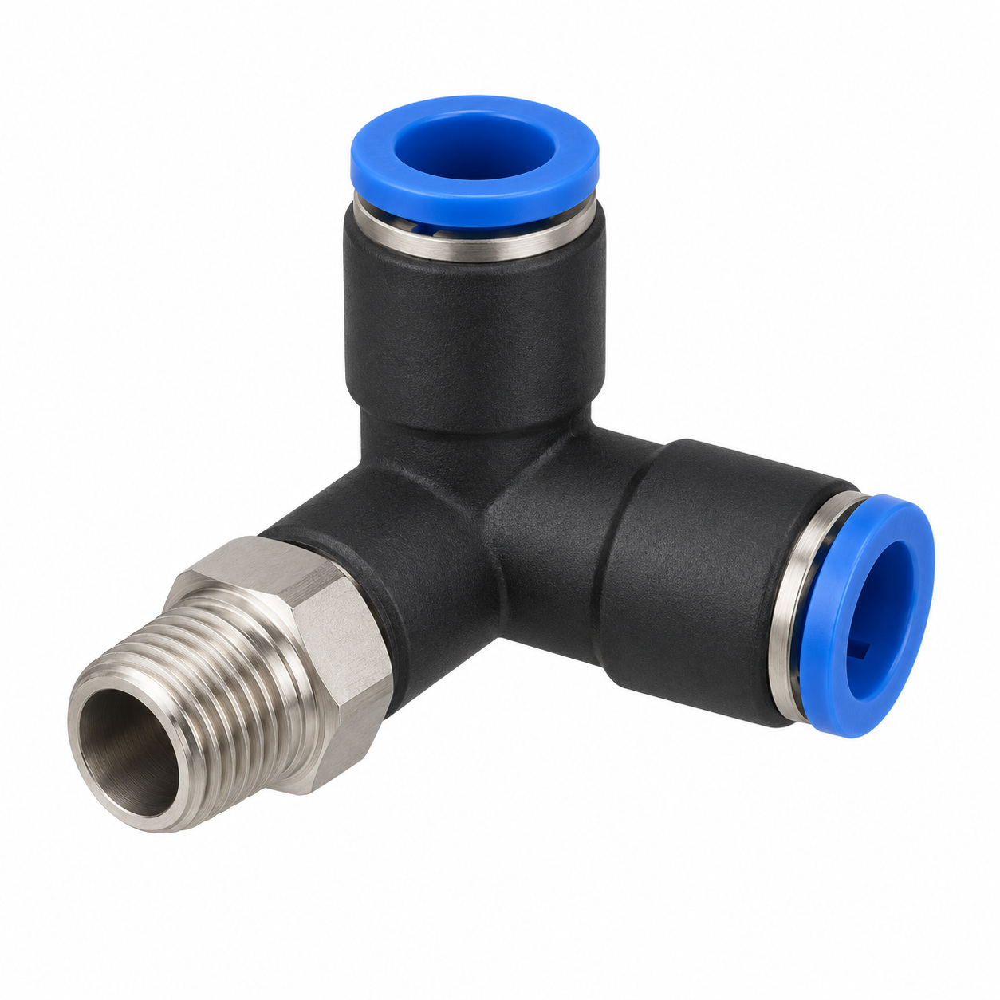
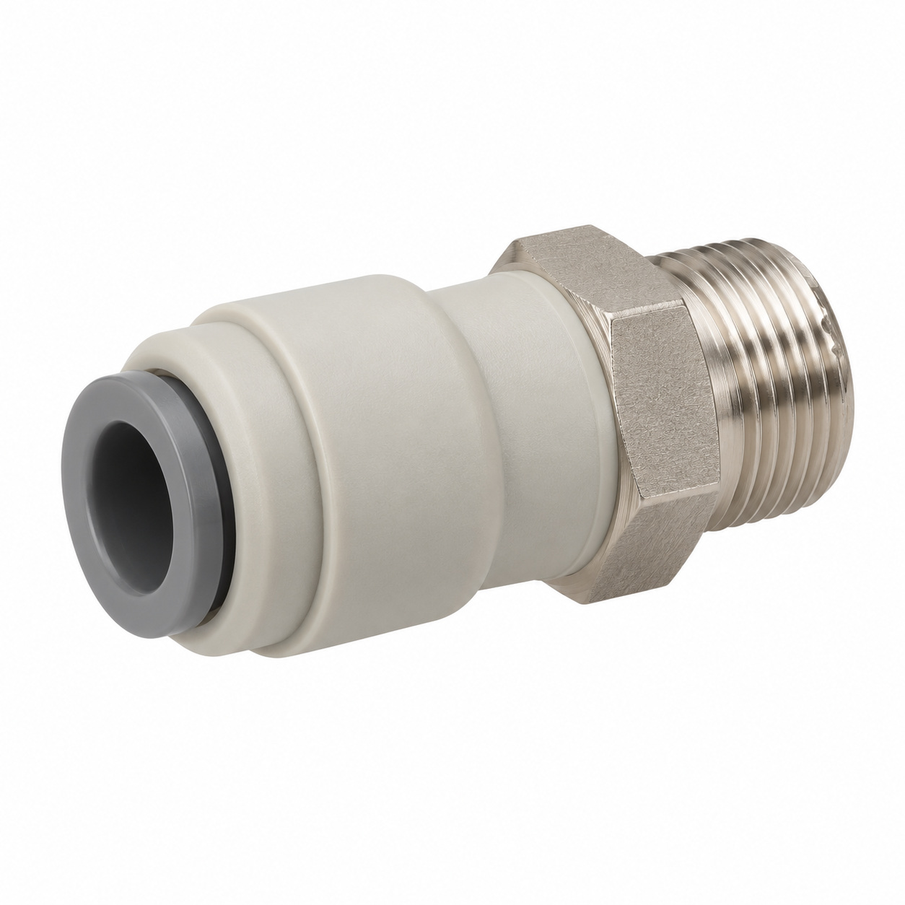
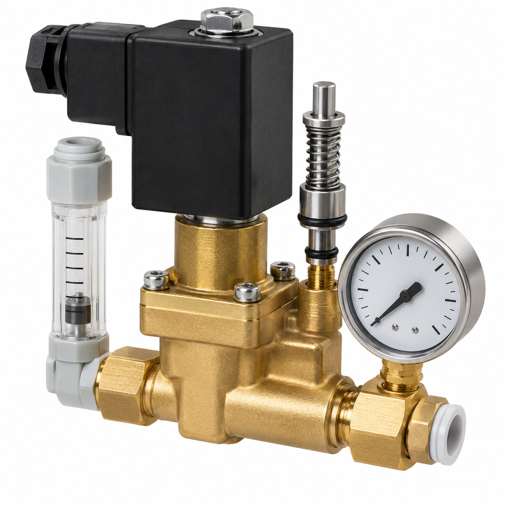
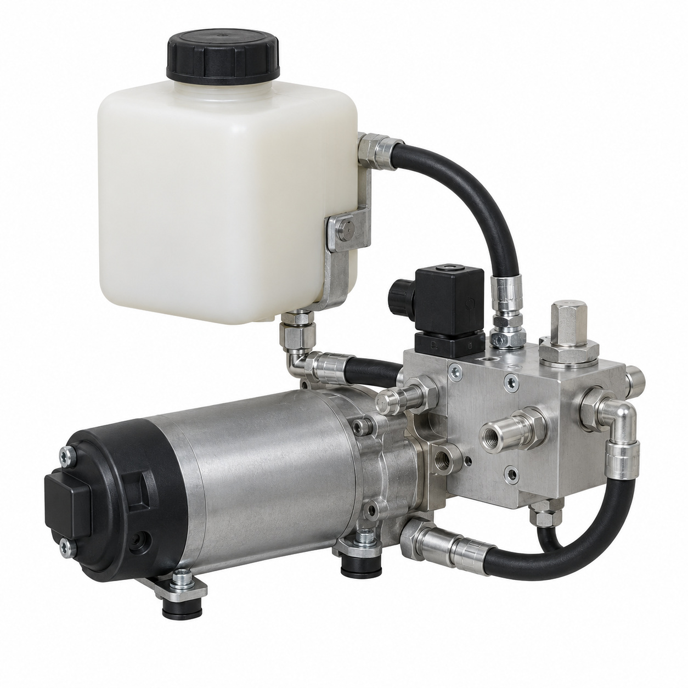
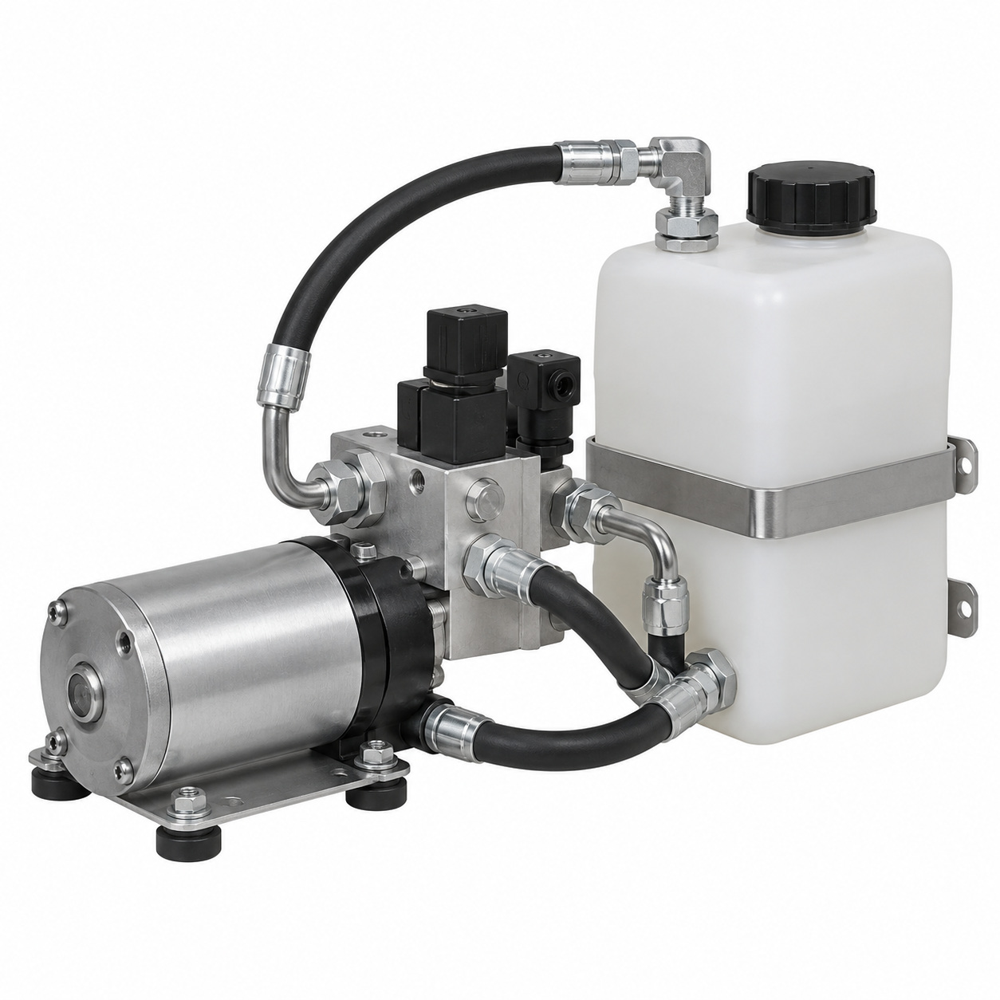
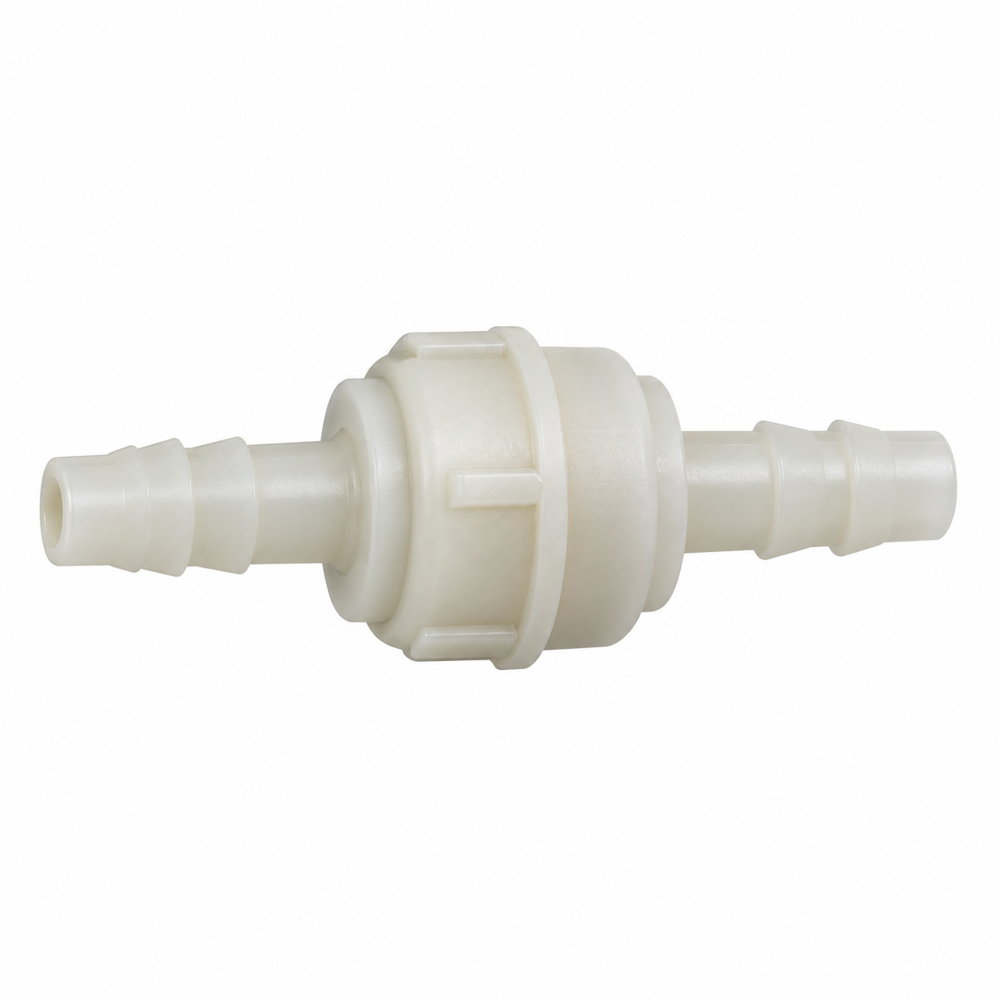
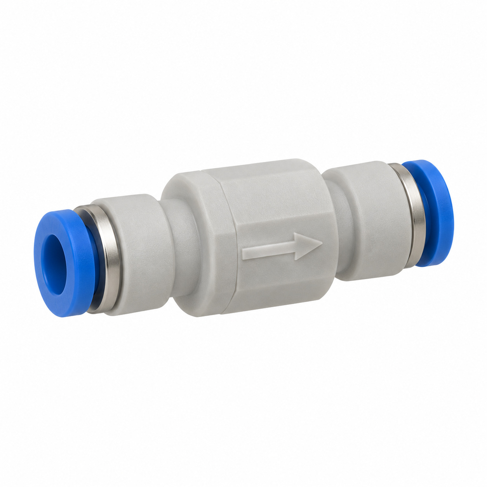
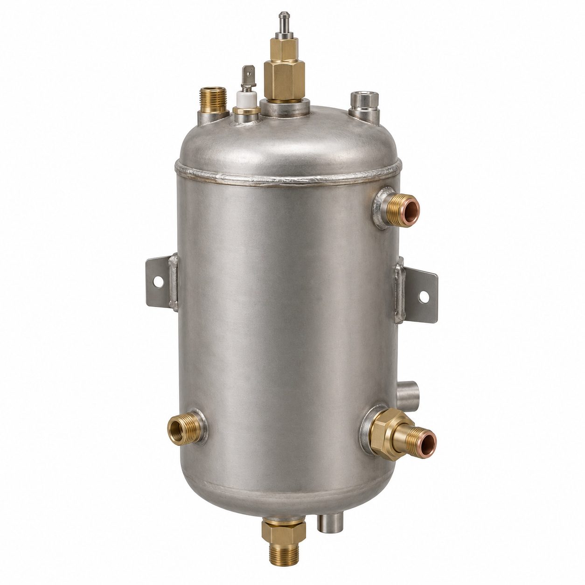

# Remaining catalog illustrations — batch 18

Generic type-based representations for review. Manufacturer-specific shape, internal construction, kit contents and fitment are unverified. Complex assemblies are broad concepts requiring a real photo or drawing. Existing catalog validation is not changed.

[Back to gallery](README.md)

| Target SKU | Description | Image |
| --- | --- | --- |
| 128.005 | Wiring harness Mastrena II hyd. module | [Open image](generic-128.005.jpg) |
| 129.185 | Generic cover, housing or mounting component | [Open image](generic-129.185.jpg) |
| 130.332 | Male connector tilted 4/4/6 assy. | [Open image](generic-130.332.jpg) |
| 130.333 | Generic fluid connector | [Open image](generic-130.333.jpg) |
| 131.082 | Generic fluid-control component | [Open image](generic-131.082.jpg) |
| 135.239 | Hydraulic set CL | [Open image](generic-135.239.jpg) |
| 135.241 | Hydraulic set CR | [Open image](generic-135.241.jpg) |
| 136.900 | Generic fluid-control component | [Open image](generic-136.900.jpg) |
| 136.901 | Checkvalve pluggable ø4_EPDM | [Open image](generic-136.901.jpg) |
| 128.009 | Generic boiler or steam component | [Open image](generic-128.009.jpg) |

## 128.005 — Wiring harness Mastrena II hyd. module

## 129.185 — Generic cover, housing or mounting component

## 130.332 — Male connector tilted 4/4/6 assy.

## 130.333 — Generic fluid connector

## 131.082 — Generic fluid-control component

## 135.239 — Hydraulic set CL

## 135.241 — Hydraulic set CR

## 136.900 — Generic fluid-control component

## 136.901 — Checkvalve pluggable ø4_EPDM

## 128.009 — Generic boiler or steam component

