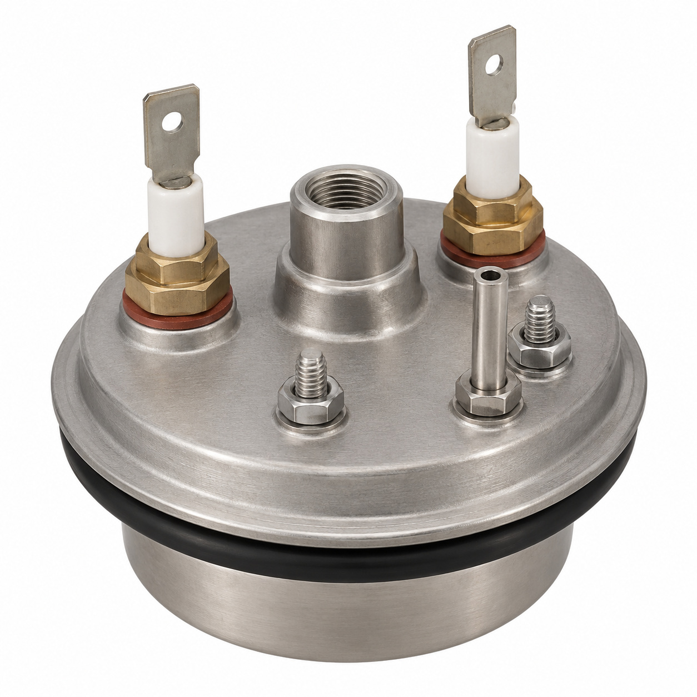
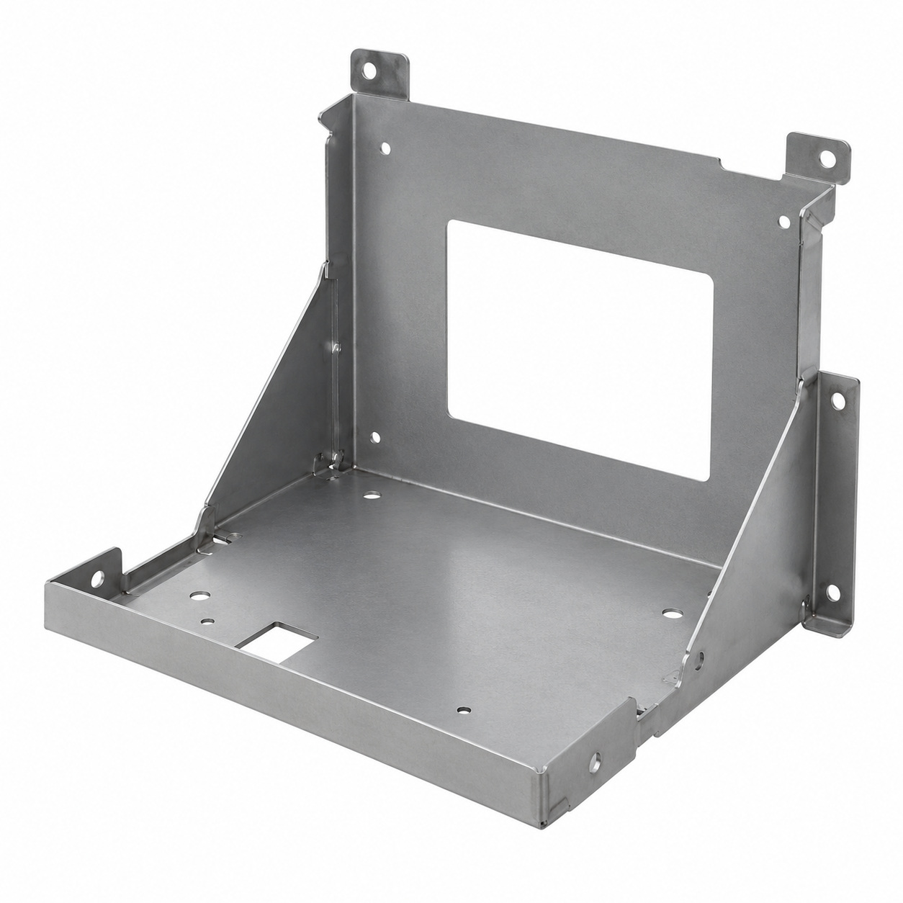
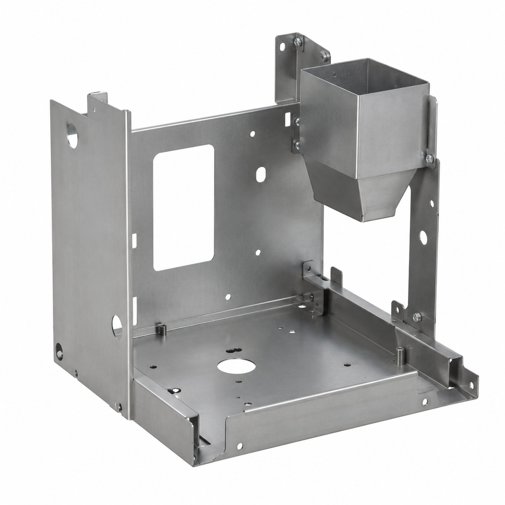
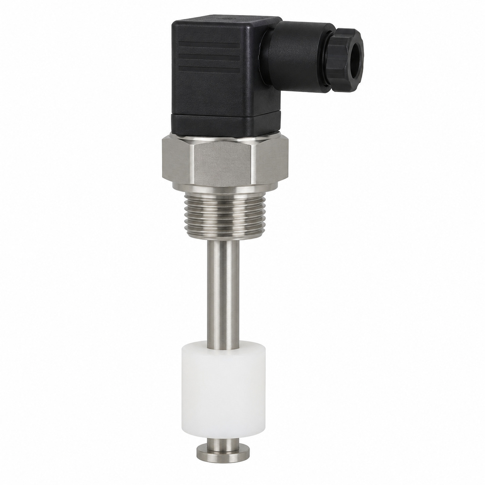
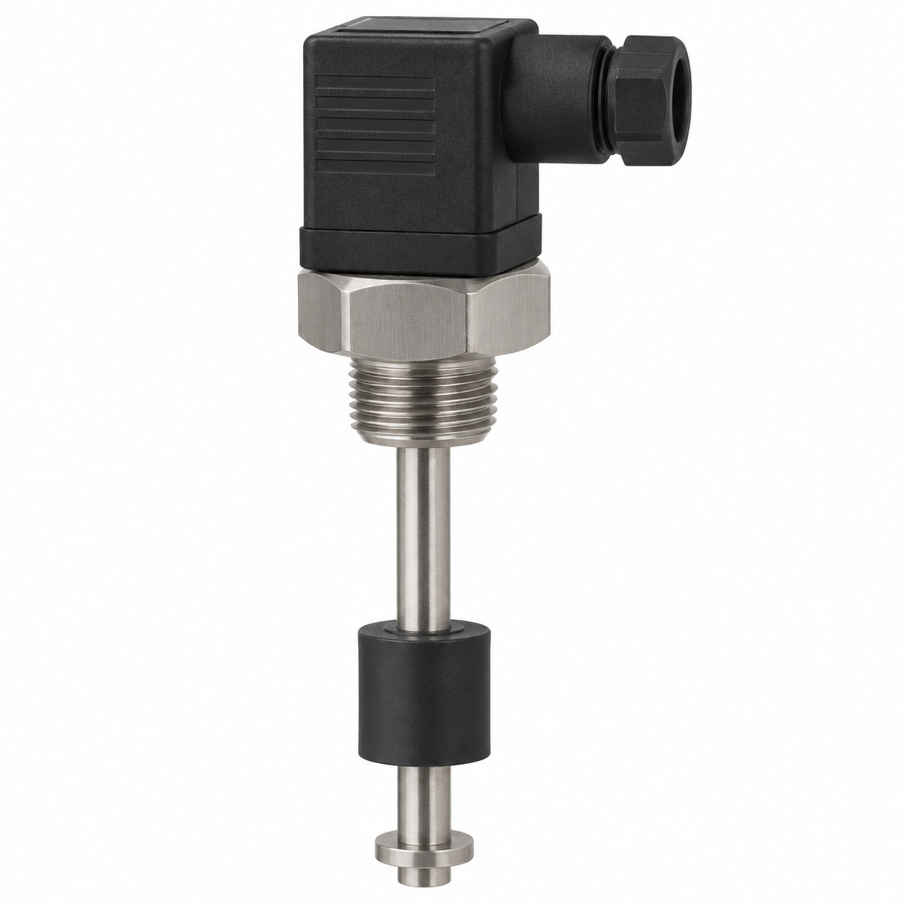
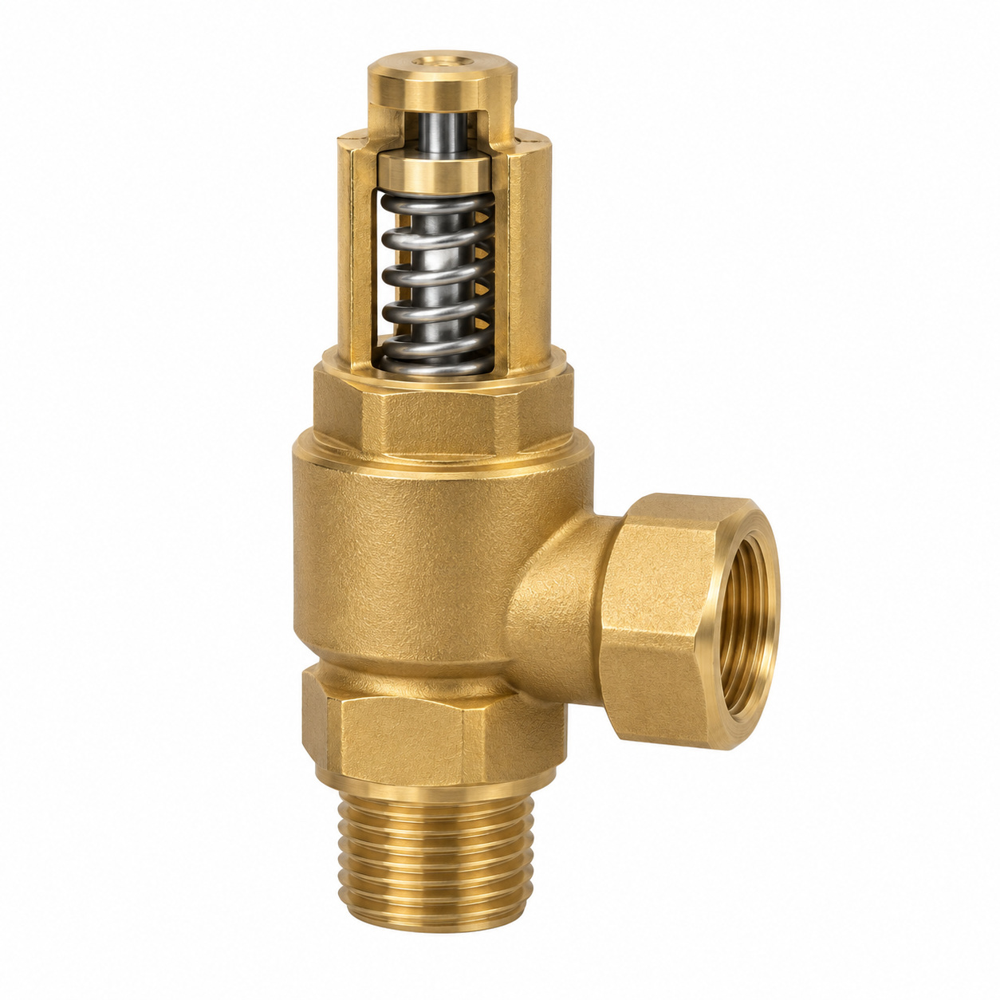
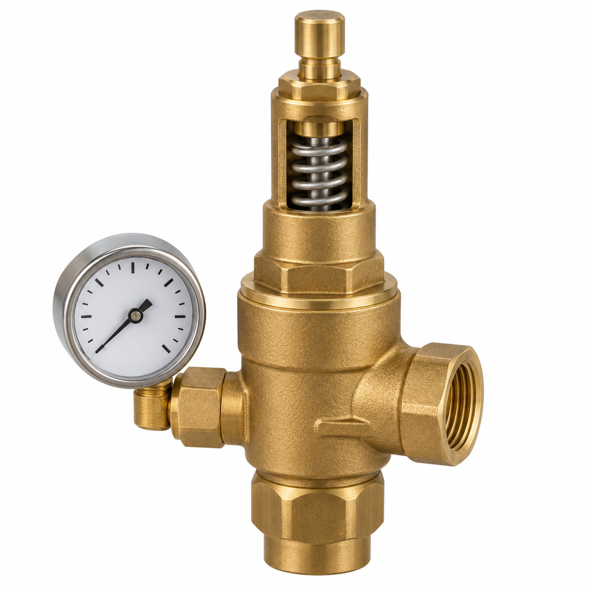
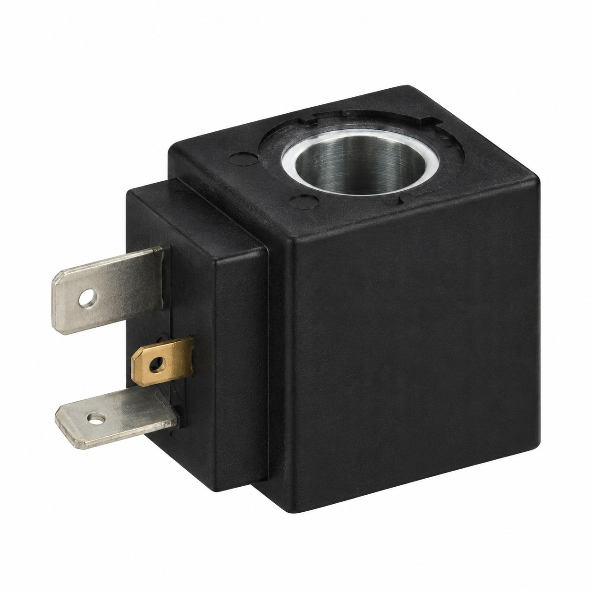
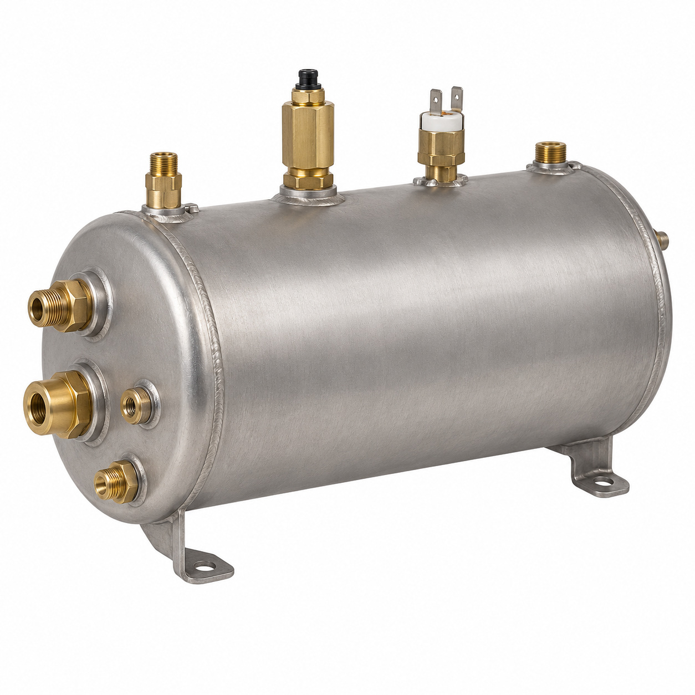

# Remaining catalog illustrations — batch 19

Generic type-based representations for review. Manufacturer-specific shape, internal construction, kit contents and fitment are unverified. Complex assemblies are broad concepts requiring a real photo or drawing. Existing catalog validation is not changed.

[Back to gallery](README.md)

| Target SKU | Description | Image |
| --- | --- | --- |
| 128.013 | Cap steam boiler 230V 5.4kW set | [Open image](generic-128.013.jpg) |
| 129.041 | Generic cover, housing or mounting component | [Open image](generic-129.041.jpg) |
| 129.065 | Base chassis steam module assy. | [Open image](generic-129.065.jpg) |
| 120.431 | Generic label | [Open image](generic-120.431.jpg) |
| 128.250 | Generic electrical component | [Open image](generic-128.250.jpg) |
| 128.251 | Generic electrical component | [Open image](generic-128.251.jpg) |
| 128.602 | Safety valve 2.8bar | [Open image](generic-128.602.jpg) |
| 129.293 | Generic fluid-control component | [Open image](generic-129.293.jpg) |
| 130.613 | Solenoid valve 2/2, ø4, G1/4" | [Open image](generic-130.613.jpg) |
| 131.362 | Generic boiler or steam component | [Open image](generic-131.362.jpg) |

## 128.013 — Cap steam boiler 230V 5.4kW set

## 129.041 — Generic cover, housing or mounting component

## 129.065 — Base chassis steam module assy.

## 120.431 — Generic label

## 128.250 — Generic electrical component

## 128.251 — Generic electrical component

## 128.602 — Safety valve 2.8bar

## 129.293 — Generic fluid-control component

## 130.613 — Solenoid valve 2/2, ø4, G1/4"

## 131.362 — Generic boiler or steam component

