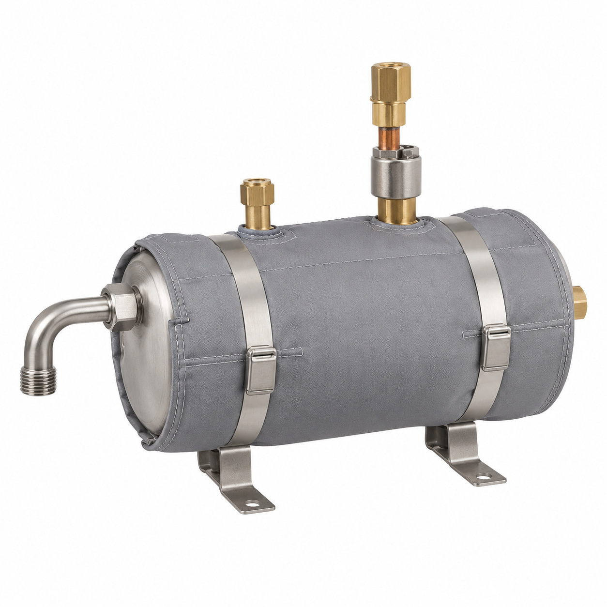
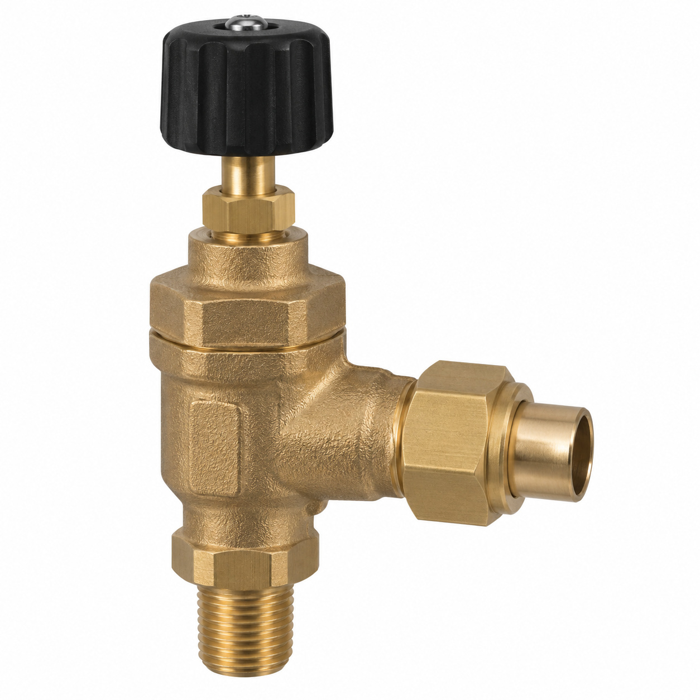
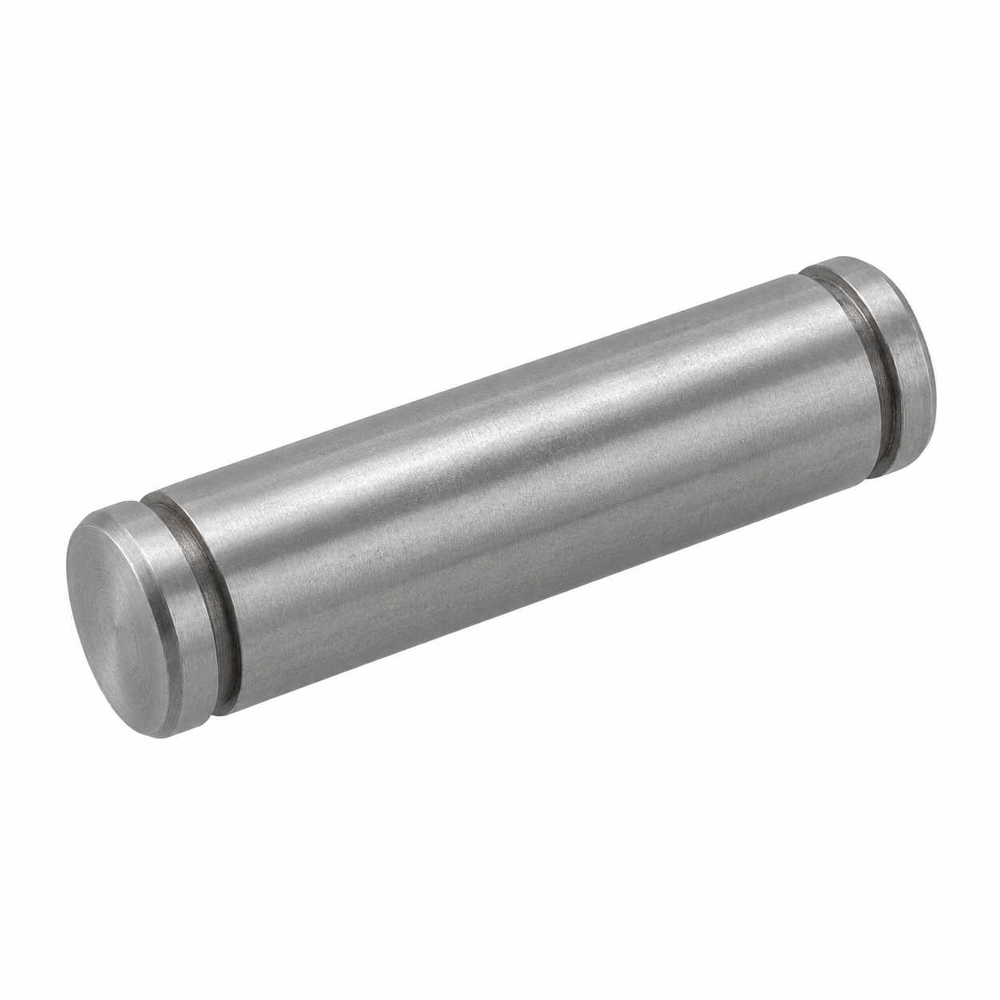
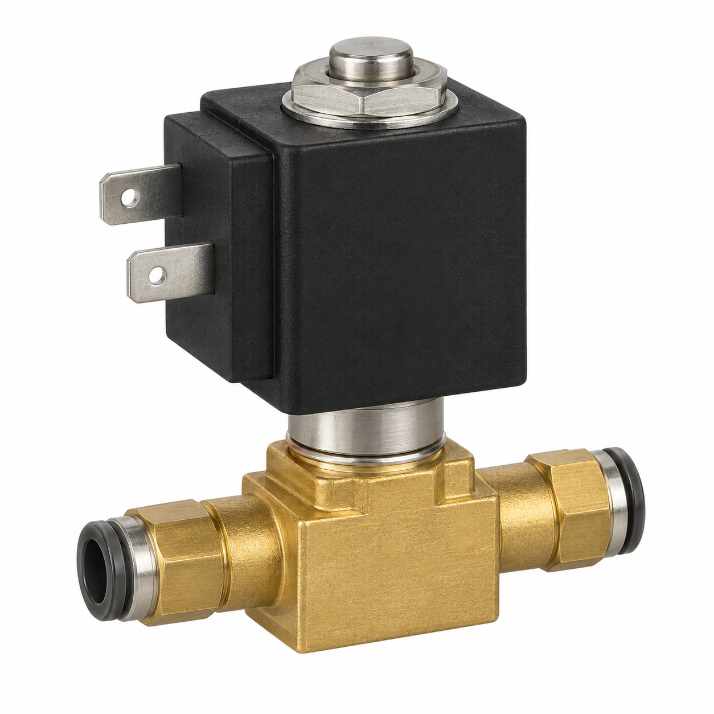
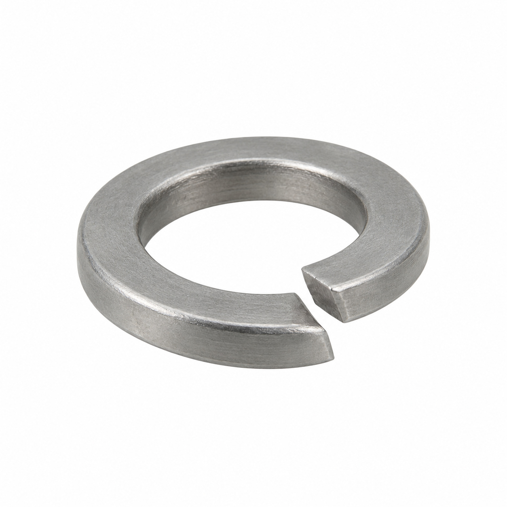
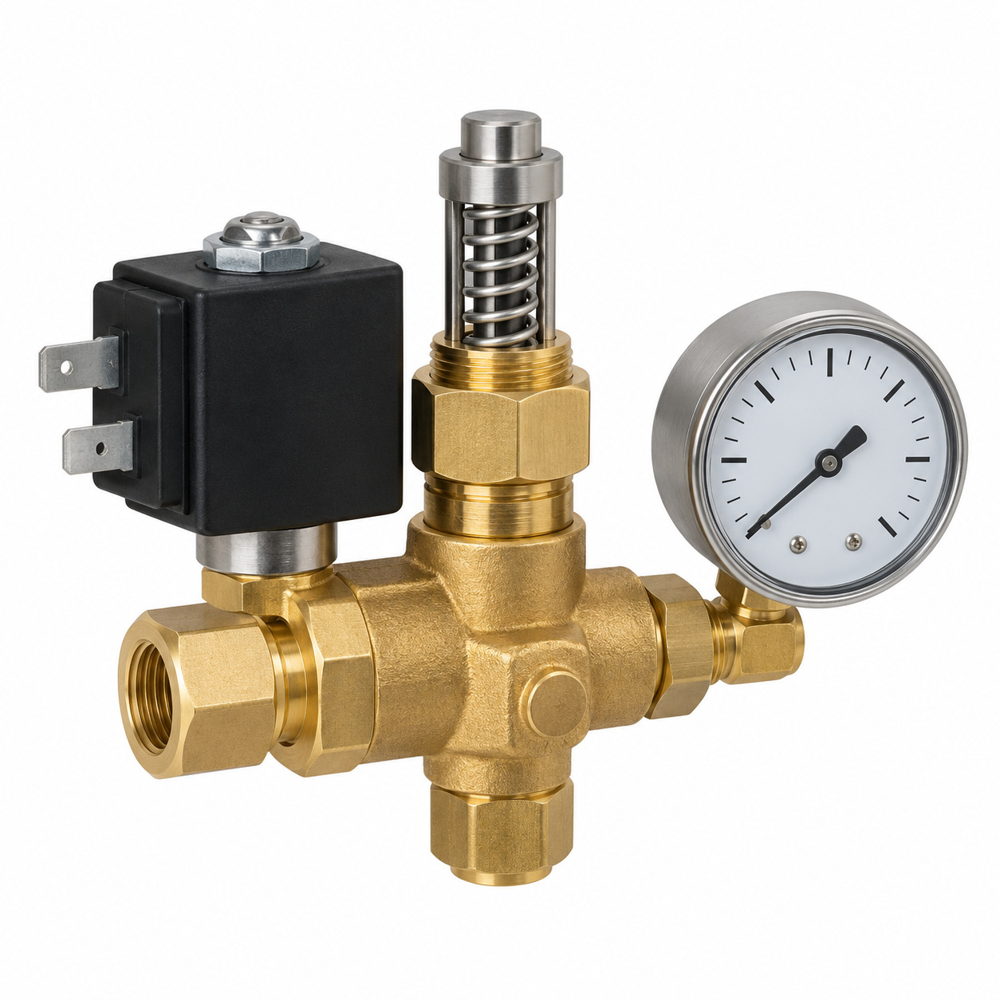
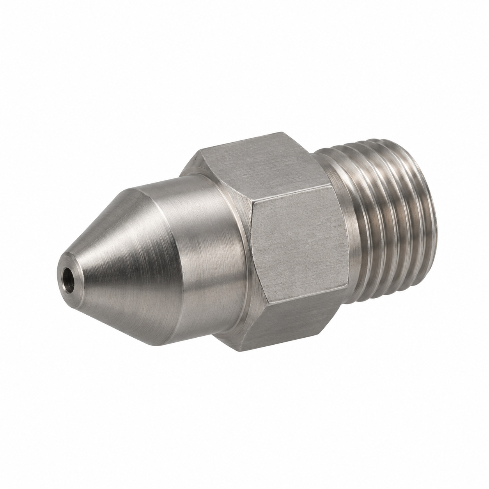
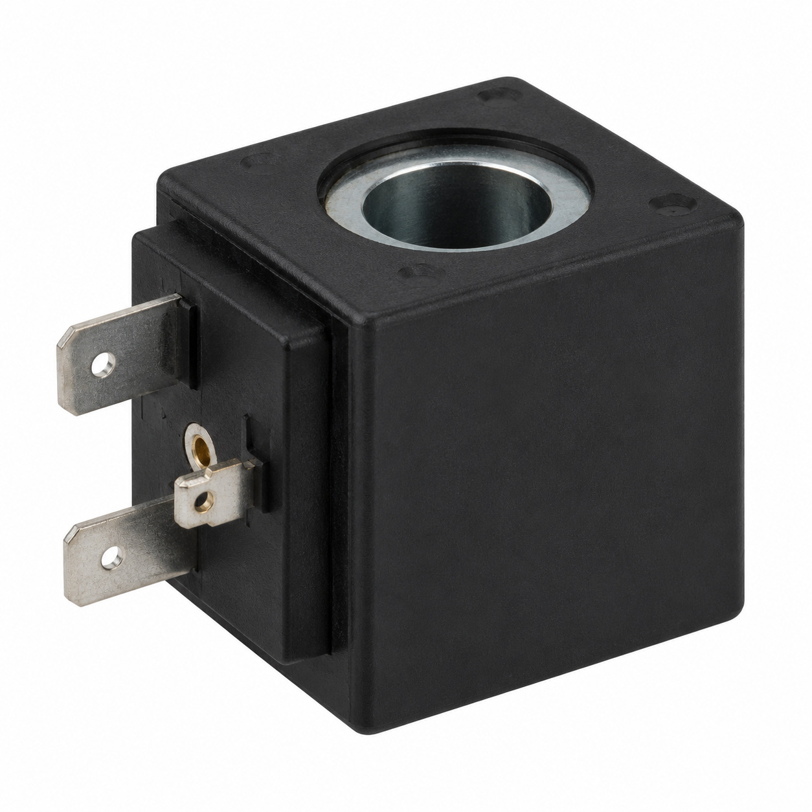
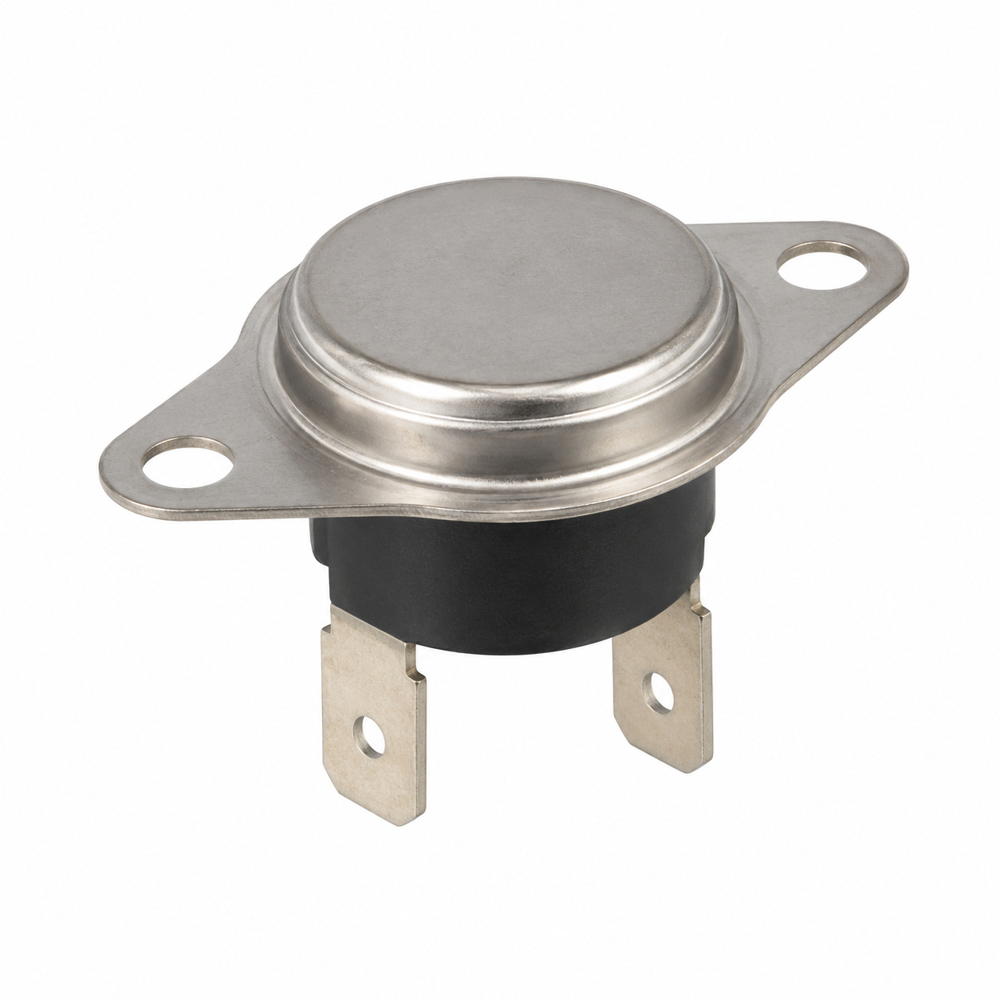
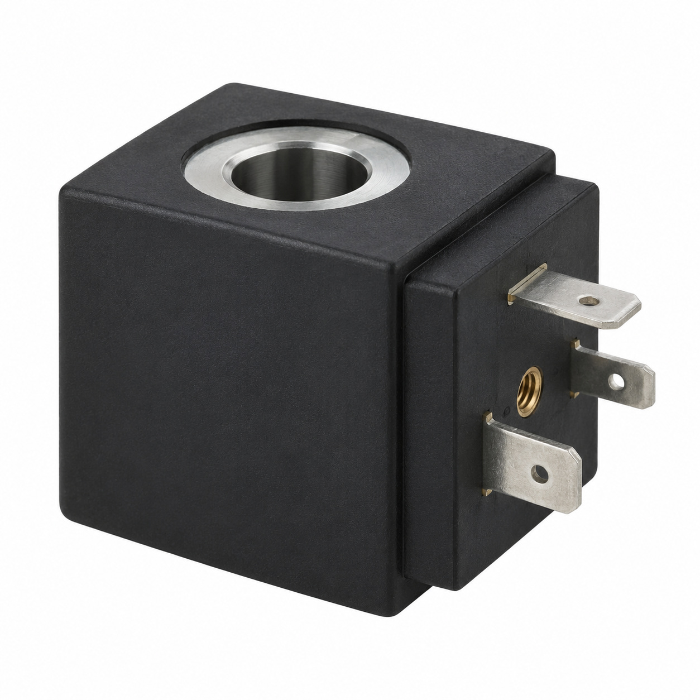

# Remaining catalog illustrations — batch 20

Generic type-based representations for review. Manufacturer-specific shape, internal construction, kit contents and fitment are unverified. Complex assemblies are broad concepts requiring a real photo or drawing. Existing catalog validation is not changed.

[Back to gallery](README.md)

| Target SKU | Description | Image |
| --- | --- | --- |
| 132.565 | Generic boiler or steam component | [Open image](generic-132.565.jpg) |
| 132.580 | Generic boiler or steam component | [Open image](generic-132.580.jpg) |
| 133.318 | Pin | [Open image](generic-133.318.jpg) |
| 100.421 | Generic fluid-control component | [Open image](generic-100.421.jpg) |
| 101.957 | Generic fastener | [Open image](generic-101.957.jpg) |
| 100.418 | Generic fluid-control component | [Open image](generic-100.418.jpg) |
| 129.189 | Generic assembly concept | [Open image](generic-129.189.jpg) |
| 126.398 | Generic solenoid coil | [Open image](generic-126.398.jpg) |
| 128.269 | Generic electrical component | [Open image](generic-128.269.jpg) |
| 128.462 | Generic solenoid coil | [Open image](generic-128.462.jpg) |

## 132.565 — Generic boiler or steam component

## 132.580 — Generic boiler or steam component

## 133.318 — Pin

## 100.421 — Generic fluid-control component

## 101.957 — Generic fastener

## 100.418 — Generic fluid-control component

## 129.189 — Generic assembly concept

## 126.398 — Generic solenoid coil

## 128.269 — Generic electrical component

## 128.462 — Generic solenoid coil

