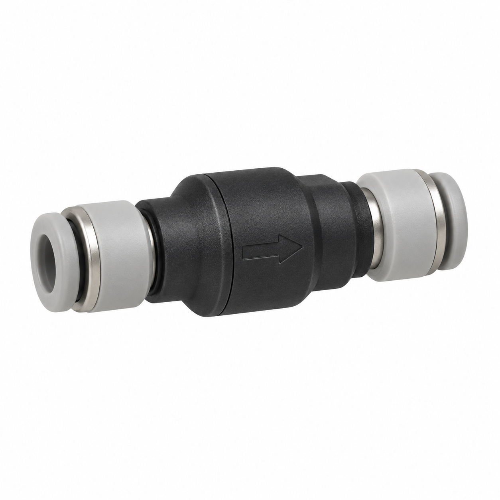
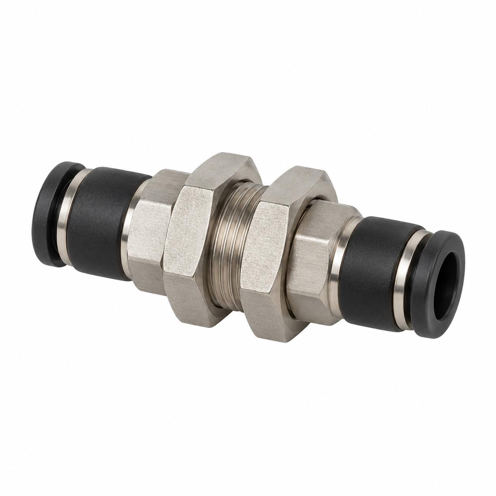
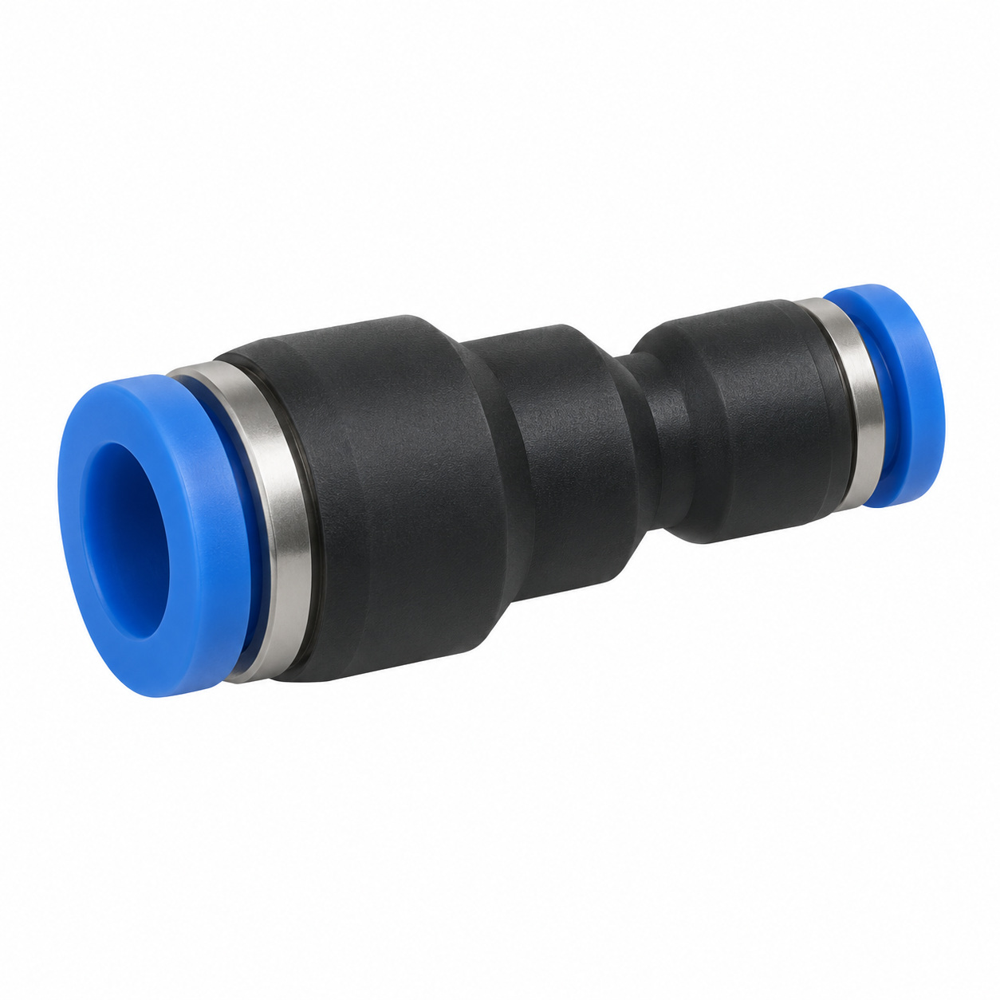
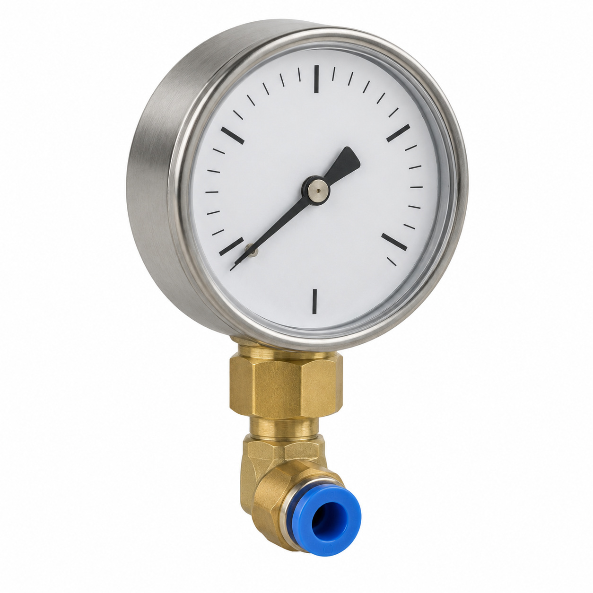
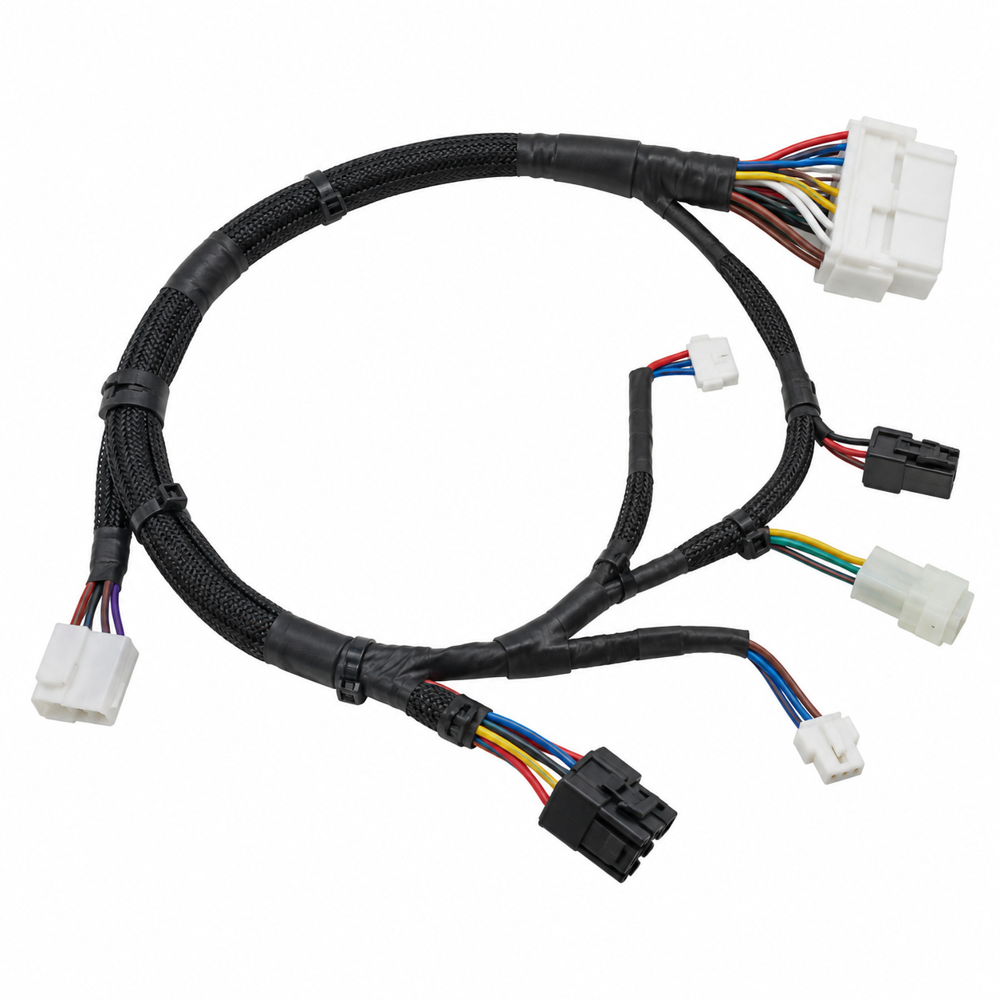
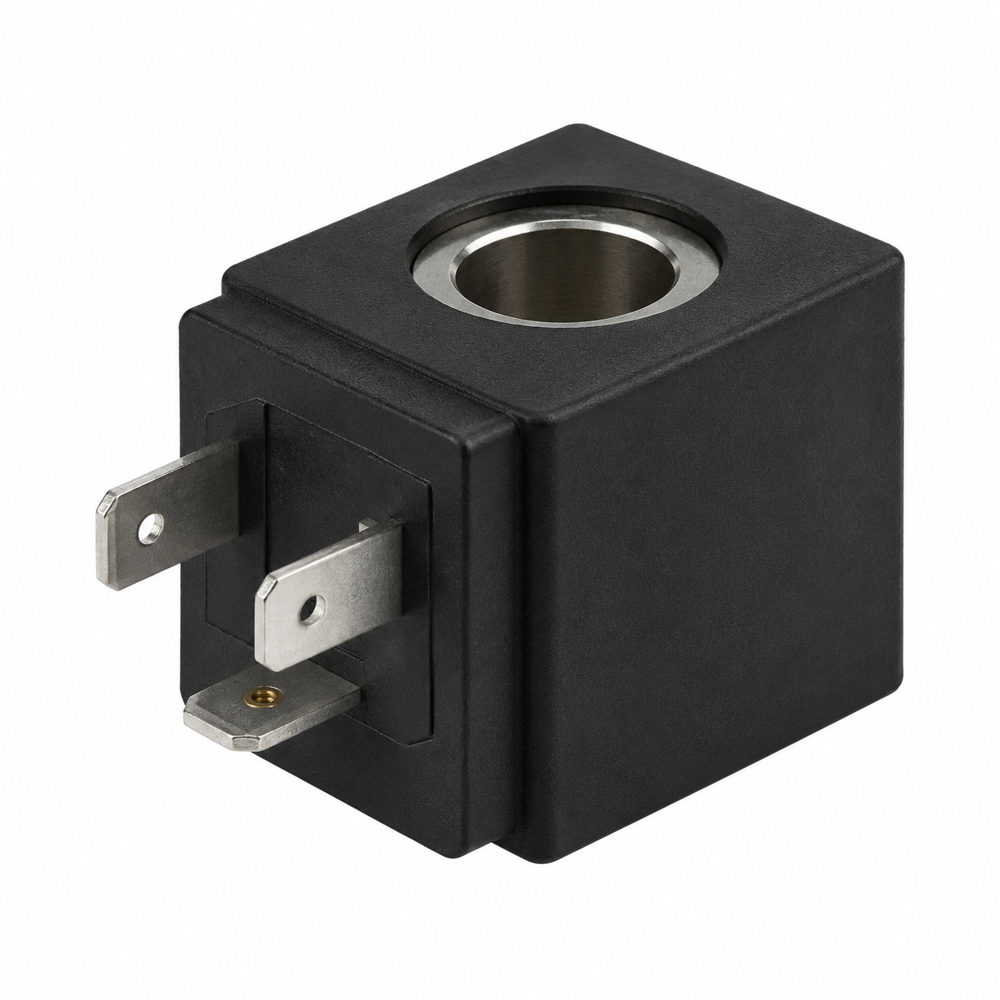
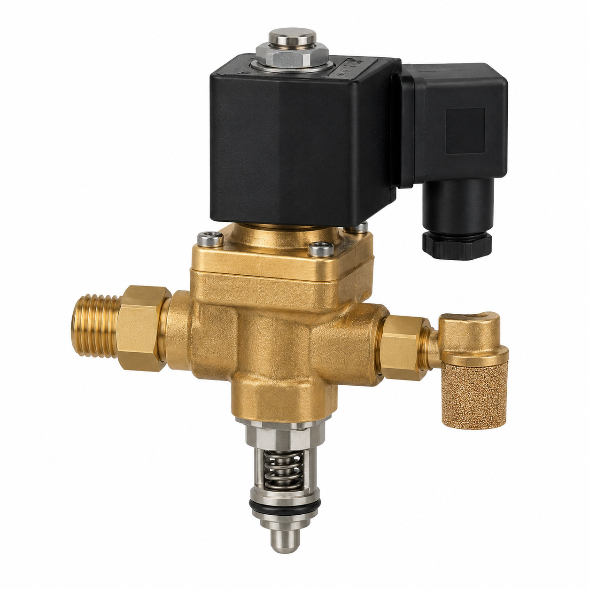
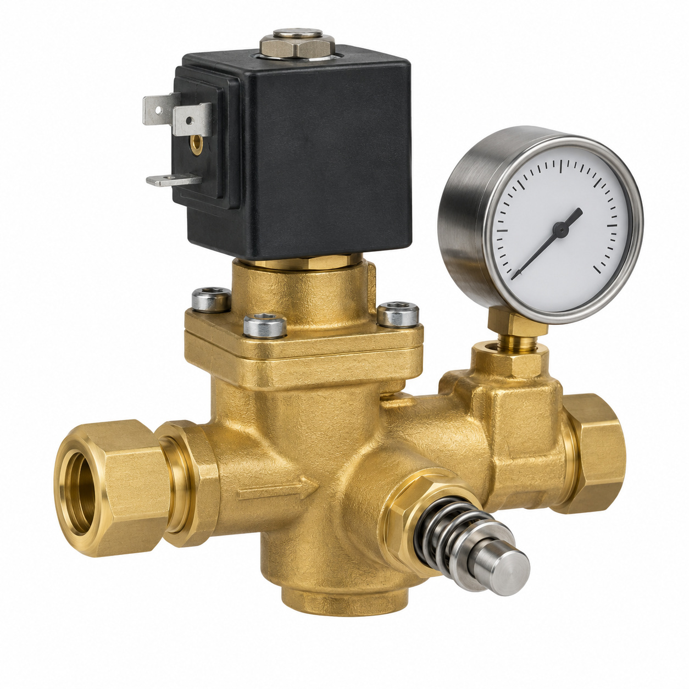
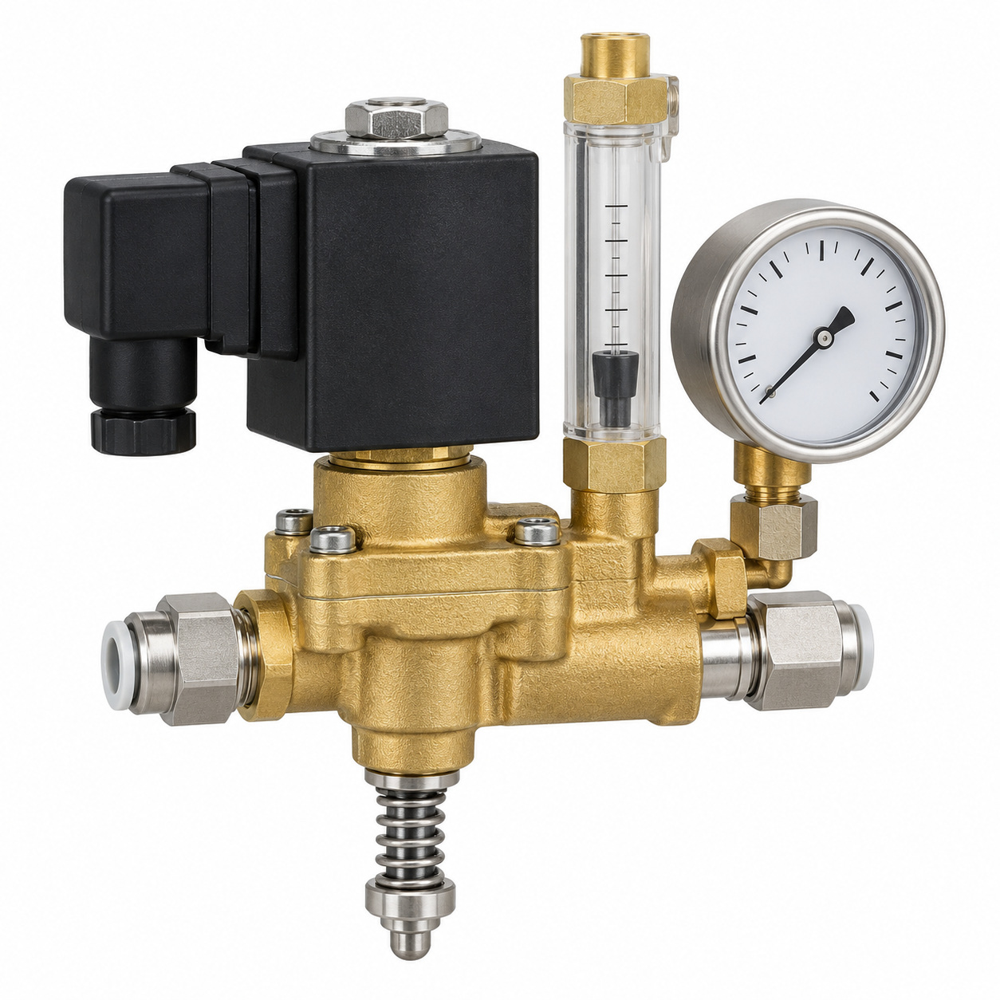
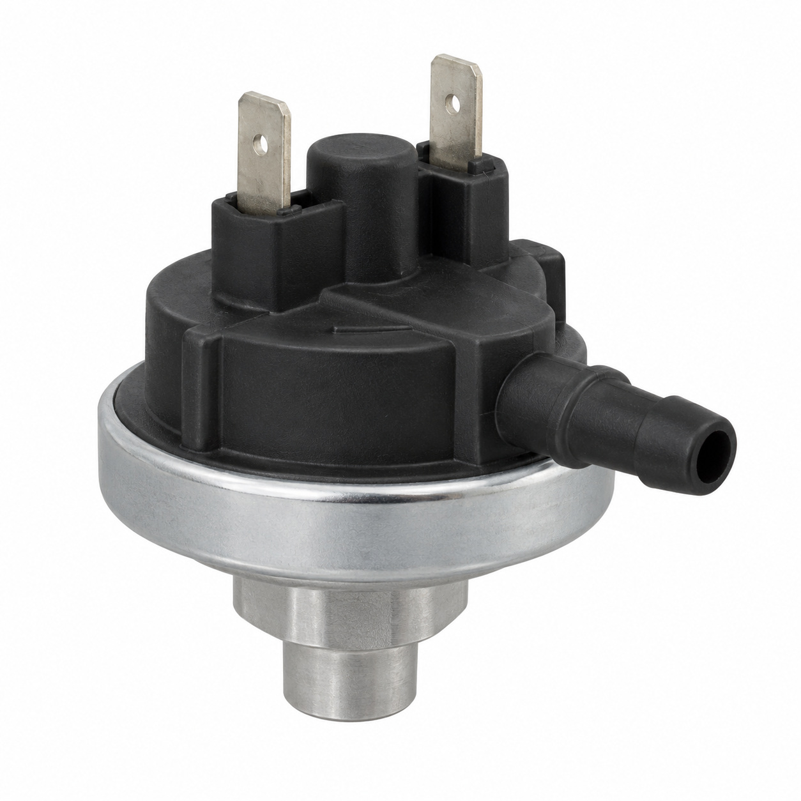

# Remaining catalog illustrations — batch 21

Generic type-based representations for review. Manufacturer-specific shape, internal construction, kit contents and fitment are unverified. Complex assemblies are broad concepts requiring a real photo or drawing. Existing catalog validation is not changed.

[Back to gallery](README.md)

| Target SKU | Description | Image |
| --- | --- | --- |
| 128.463 | Check valve plugable ø6 | [Open image](generic-128.463.jpg) |
| 129.051 | Generic assembly concept | [Open image](generic-129.051.jpg) |
| 129.080 | Male connector double ø6/ø8 assy. | [Open image](generic-129.080.jpg) |
| 129.299 | Generic fluid-control component | [Open image](generic-129.299.jpg) |
| 129.766 | Generic cable or wiring assembly | [Open image](generic-129.766.jpg) |
| 129.972 | Solenoid valve 2/2, ø2.06N, 7.5W UL assy. | [Open image](generic-129.972.jpg) |
| 130.952 | Emptying valve assy. | [Open image](generic-130.952.jpg) |
| 130.953 | Bypass valve assy. | [Open image](generic-130.953.jpg) |
| 130.954 | Generic fluid-control component | [Open image](generic-130.954.jpg) |
| 133.414 | Generic electrical component | [Open image](generic-133.414.jpg) |

## 128.463 — Check valve plugable ø6

## 129.051 — Generic assembly concept

## 129.080 — Male connector double ø6/ø8 assy.

## 129.299 — Generic fluid-control component

## 129.766 — Generic cable or wiring assembly

## 129.972 — Solenoid valve 2/2, ø2.06N, 7.5W UL assy.

## 130.952 — Emptying valve assy.

## 130.953 — Bypass valve assy.

## 130.954 — Generic fluid-control component

## 133.414 — Generic electrical component

