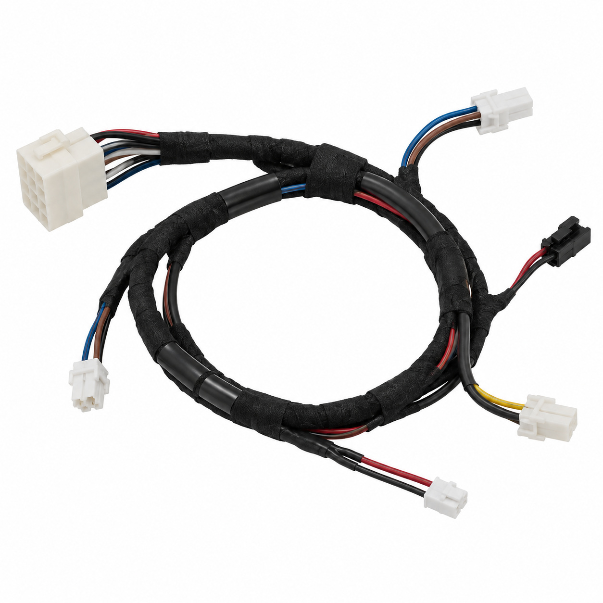
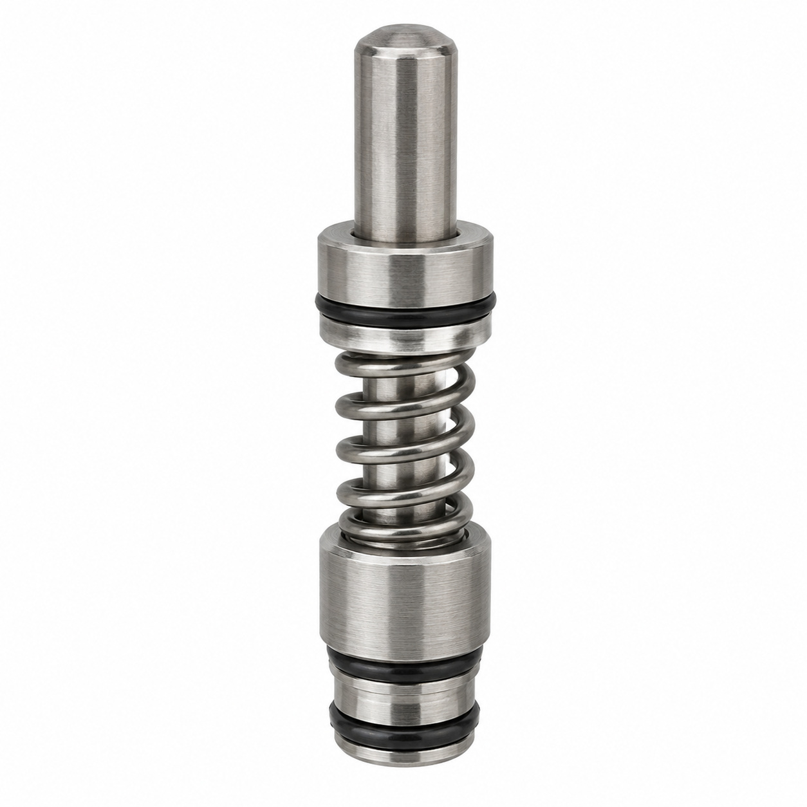
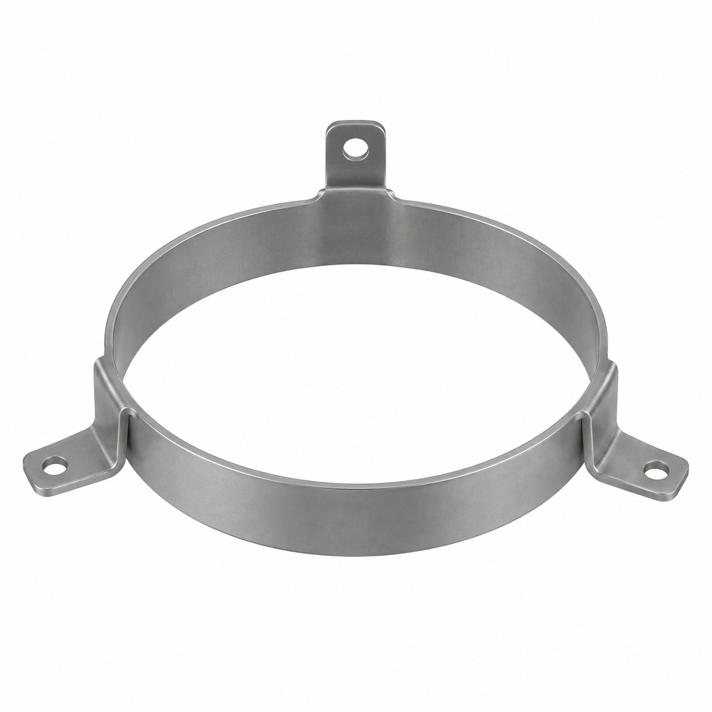
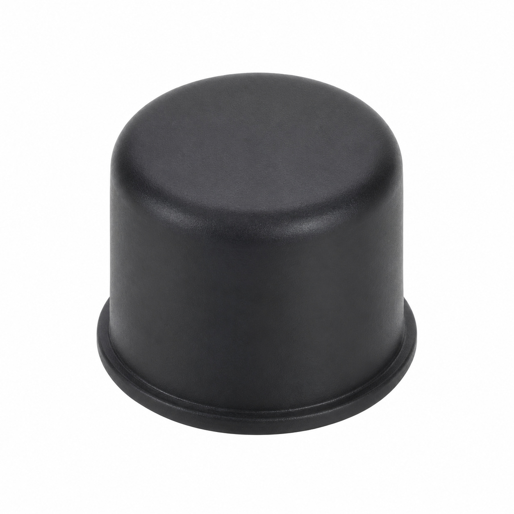
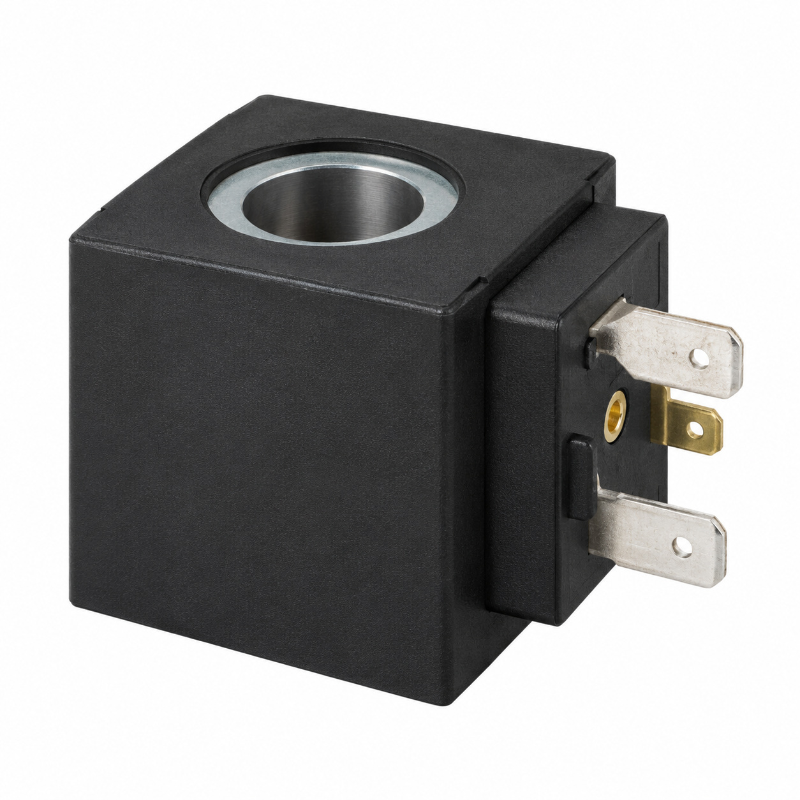
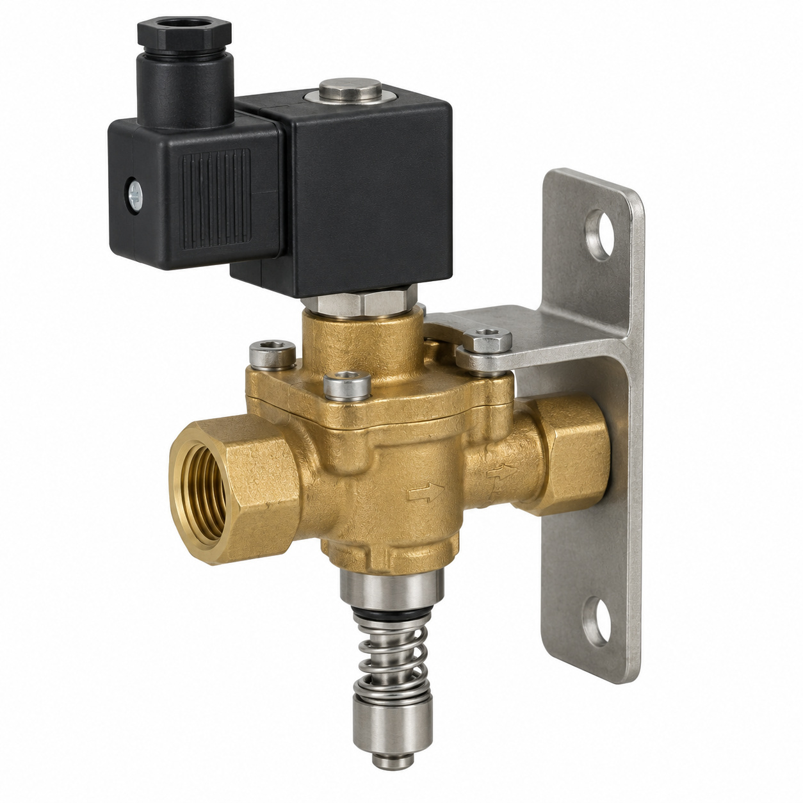
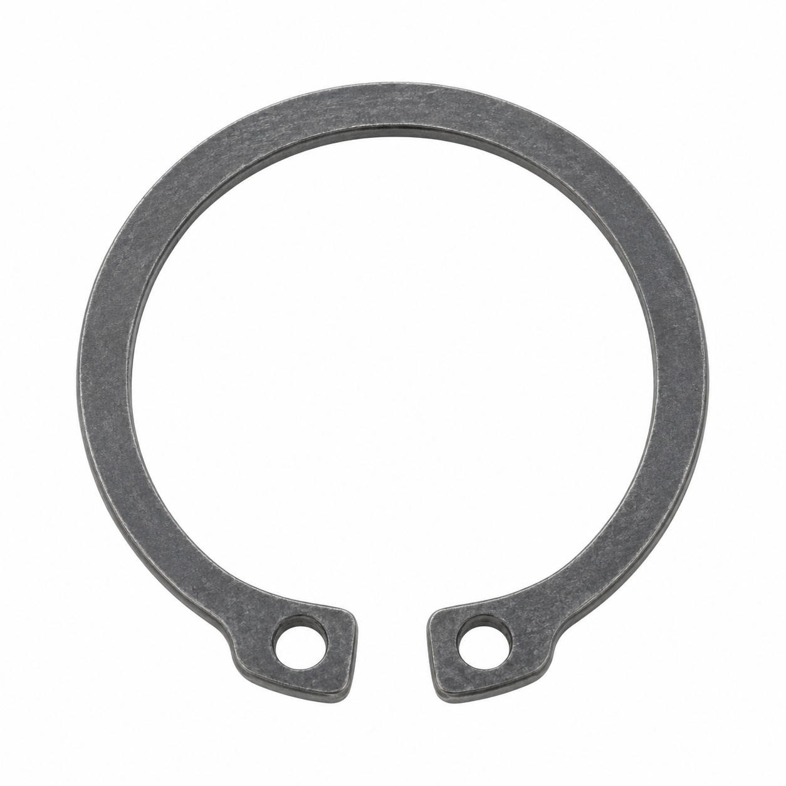
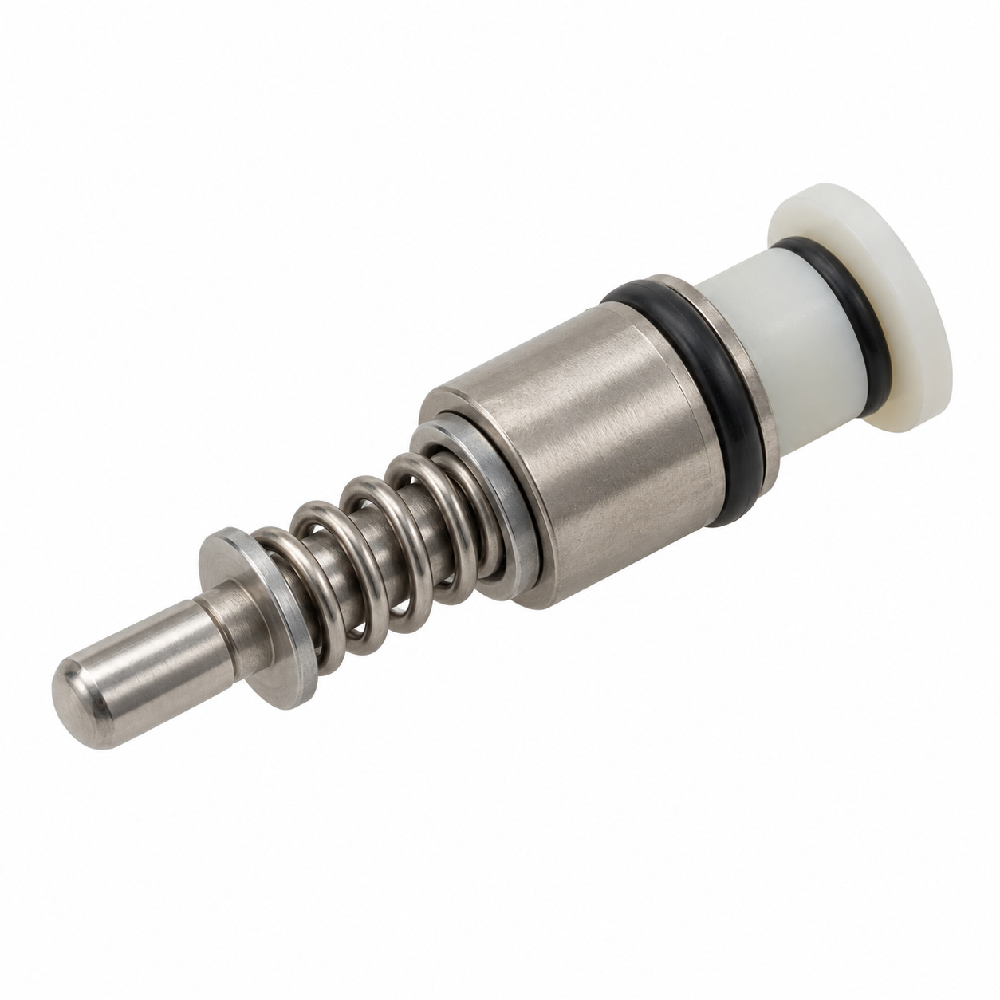
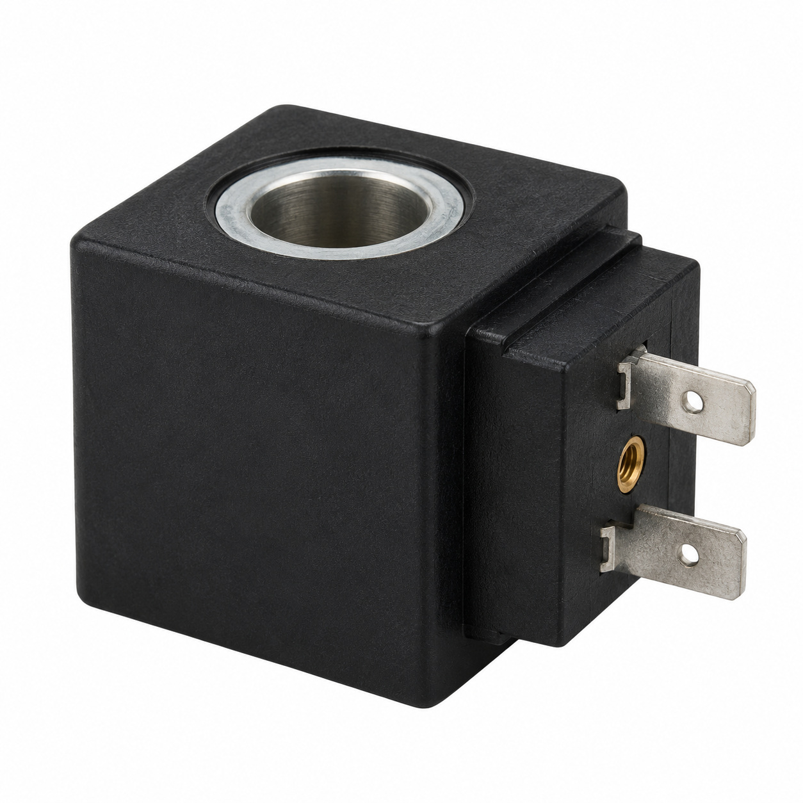
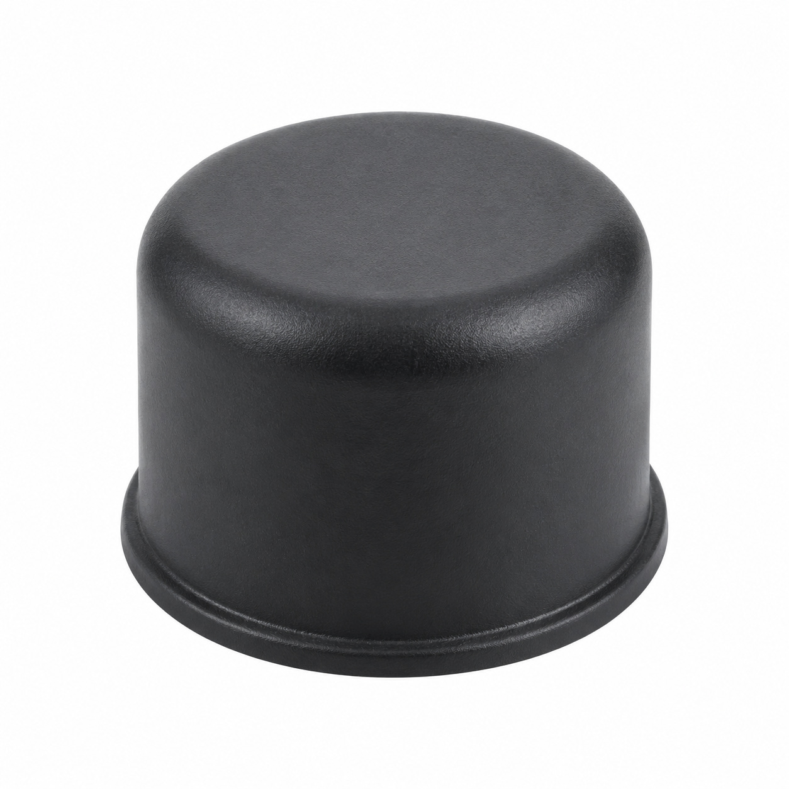

# Remaining catalog illustrations — batch 22

Generic type-based representations for review. Manufacturer-specific shape, internal construction, kit contents and fitment are unverified. Complex assemblies are broad concepts requiring a real photo or drawing. Existing catalog validation is not changed.

[Back to gallery](README.md)

| Target SKU | Description | Image |
| --- | --- | --- |
| 142.471 | Generic cable or wiring assembly | [Open image](generic-142.471.jpg) |
| 120.564 | Generic fluid-control component | [Open image](generic-120.564.jpg) |
| 123.560 | Generic cover, housing or mounting component | [Open image](generic-123.560.jpg) |
| 123.561 | Generic mechanical component | [Open image](generic-123.561.jpg) |
| 123.980 | Generic solenoid coil | [Open image](generic-123.980.jpg) |
| 120.791 | Generic fluid-control component | [Open image](generic-120.791.jpg) |
| 120.792 | Generic fastener | [Open image](generic-120.792.jpg) |
| 127.032 | Generic fluid-control component | [Open image](generic-127.032.jpg) |
| 127.784 | Generic solenoid coil | [Open image](generic-127.784.jpg) |
| 127.799 | Generic mechanical component | [Open image](generic-127.799.jpg) |

## 142.471 — Generic cable or wiring assembly

## 120.564 — Generic fluid-control component

## 123.560 — Generic cover, housing or mounting component

## 123.561 — Generic mechanical component

## 123.980 — Generic solenoid coil

## 120.791 — Generic fluid-control component

## 120.792 — Generic fastener

## 127.032 — Generic fluid-control component

## 127.784 — Generic solenoid coil

## 127.799 — Generic mechanical component

