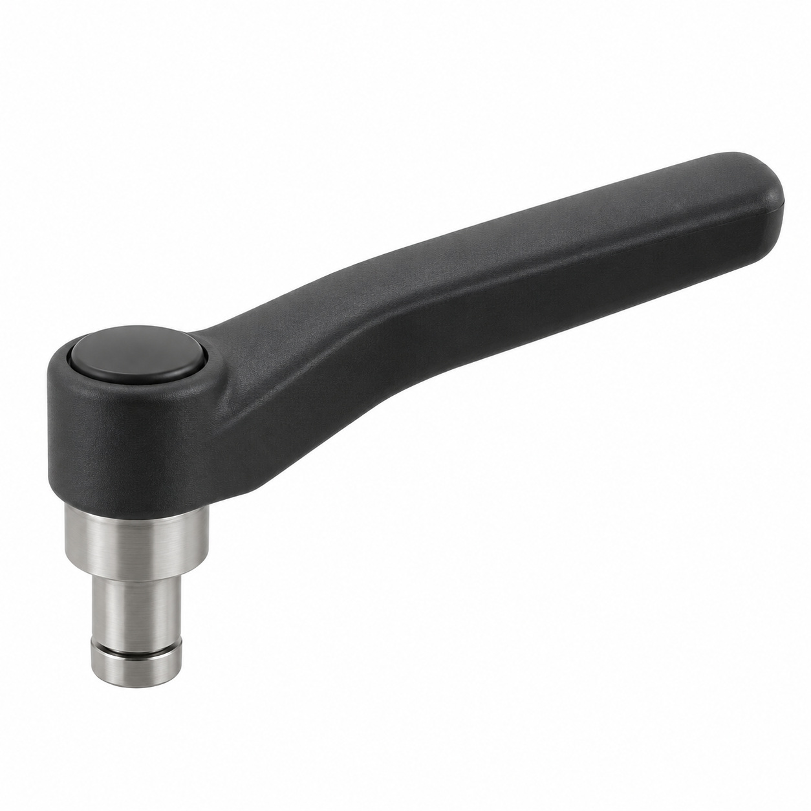
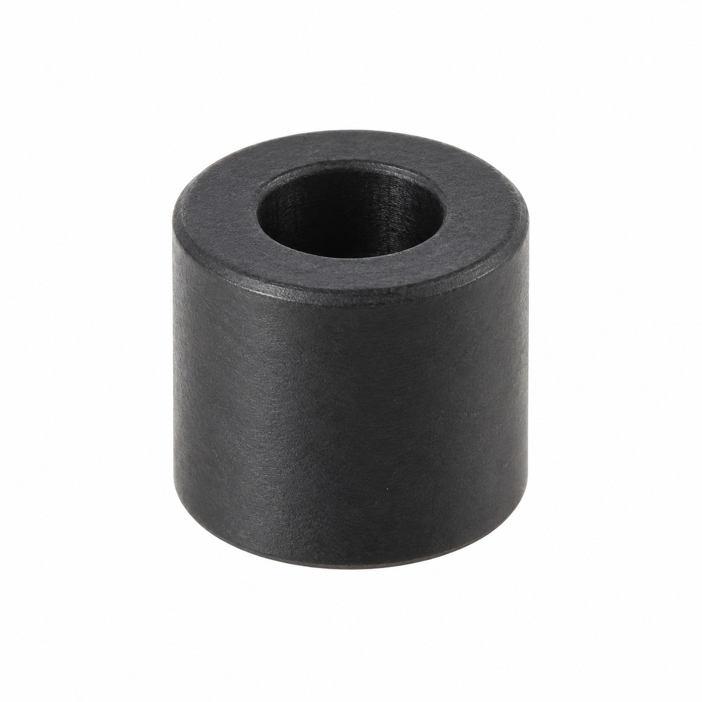
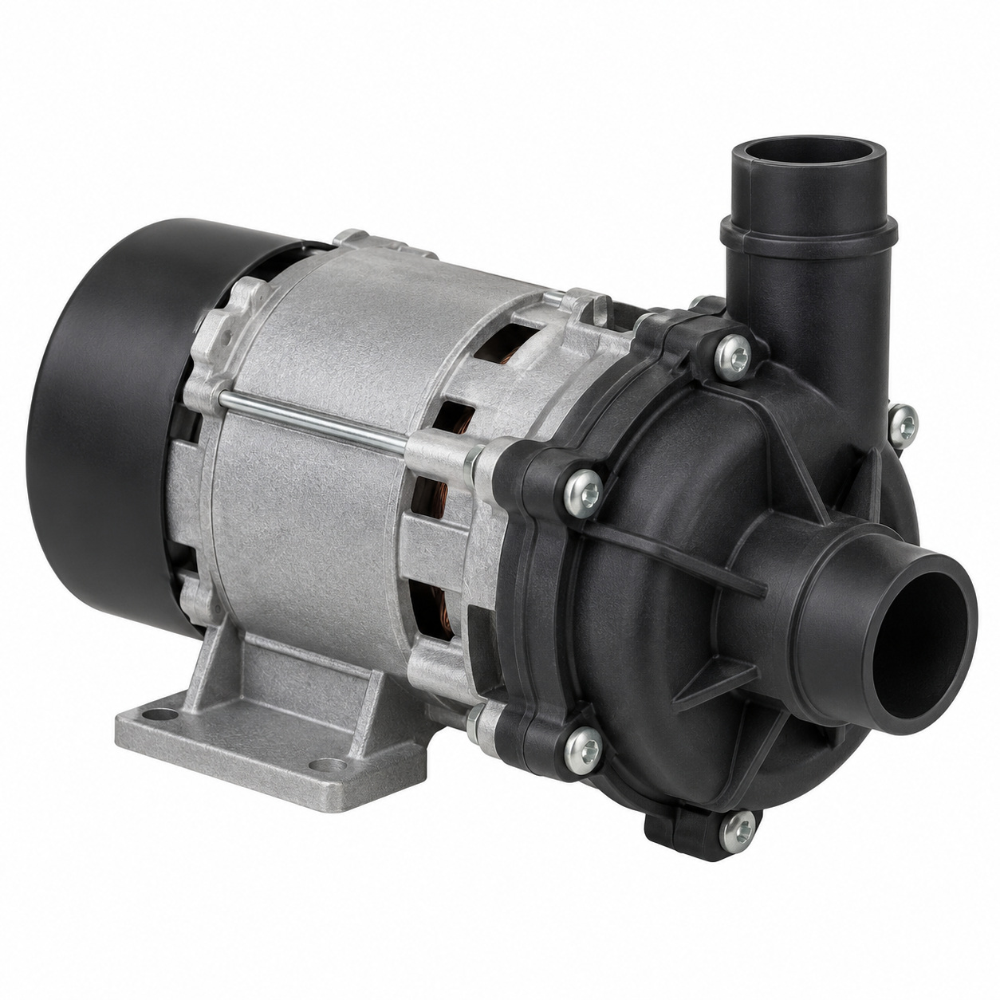
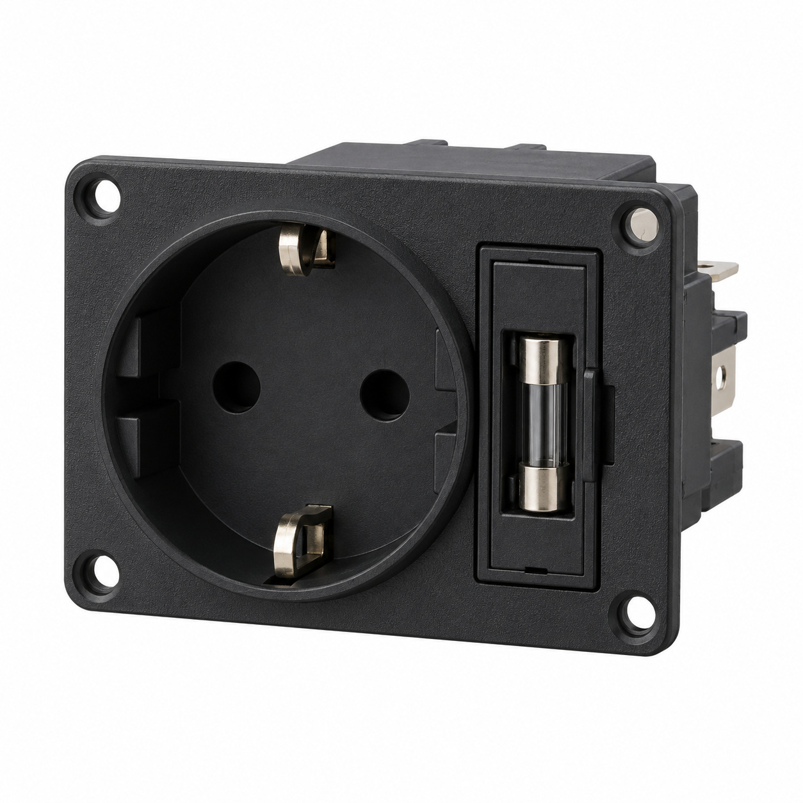
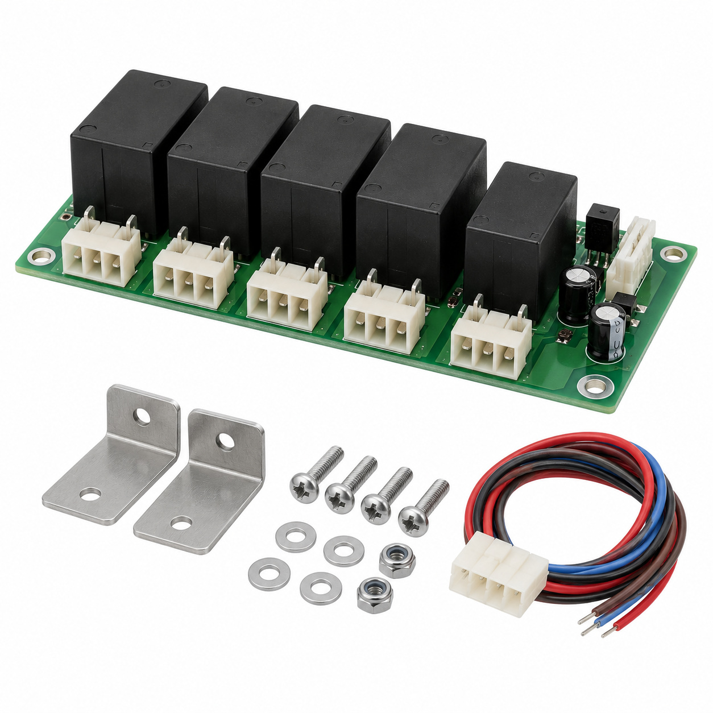
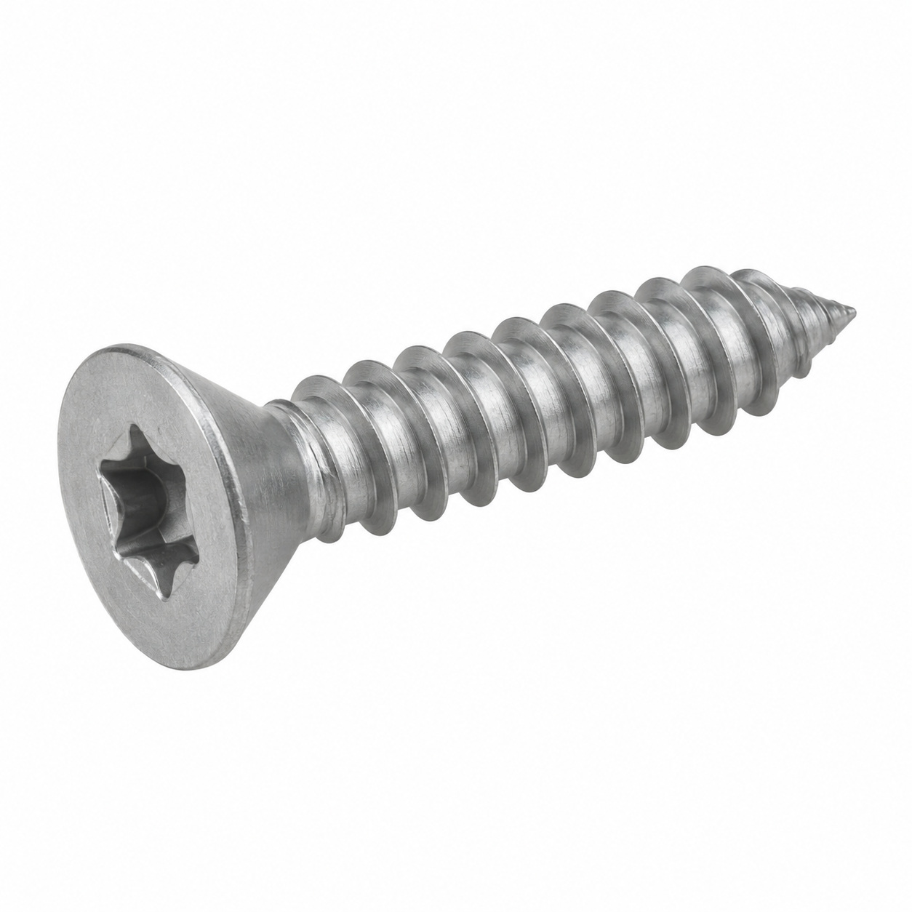
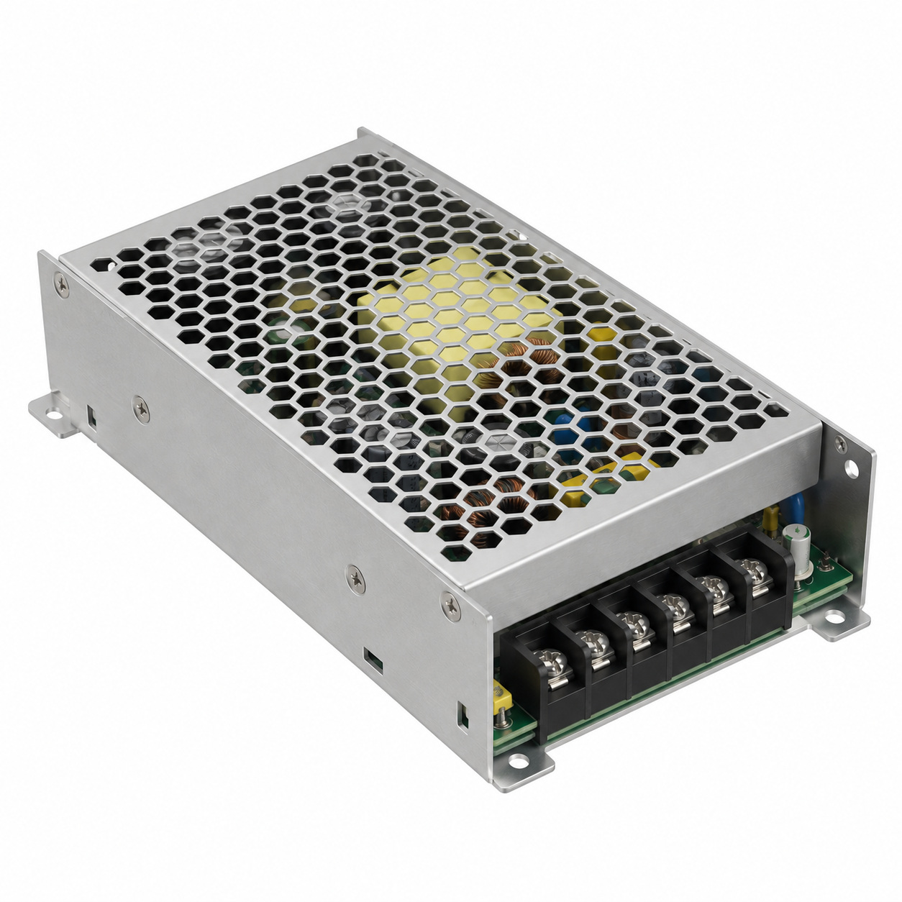
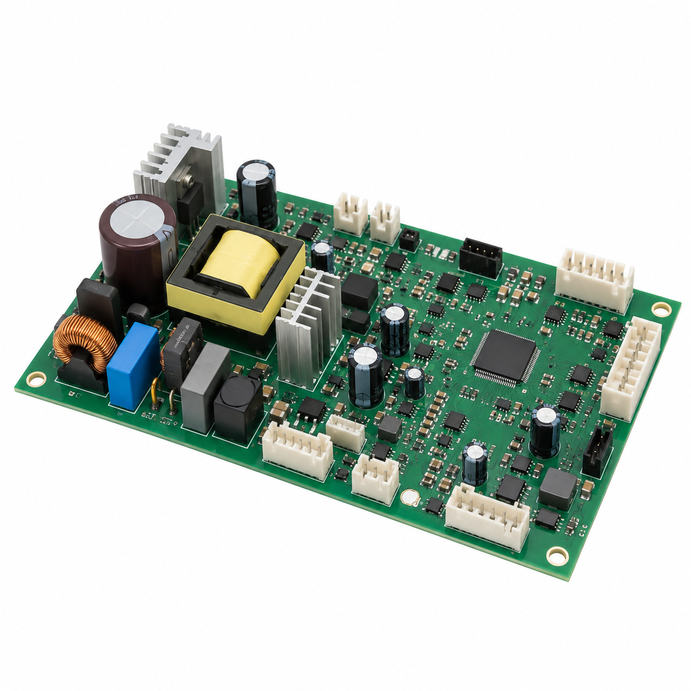
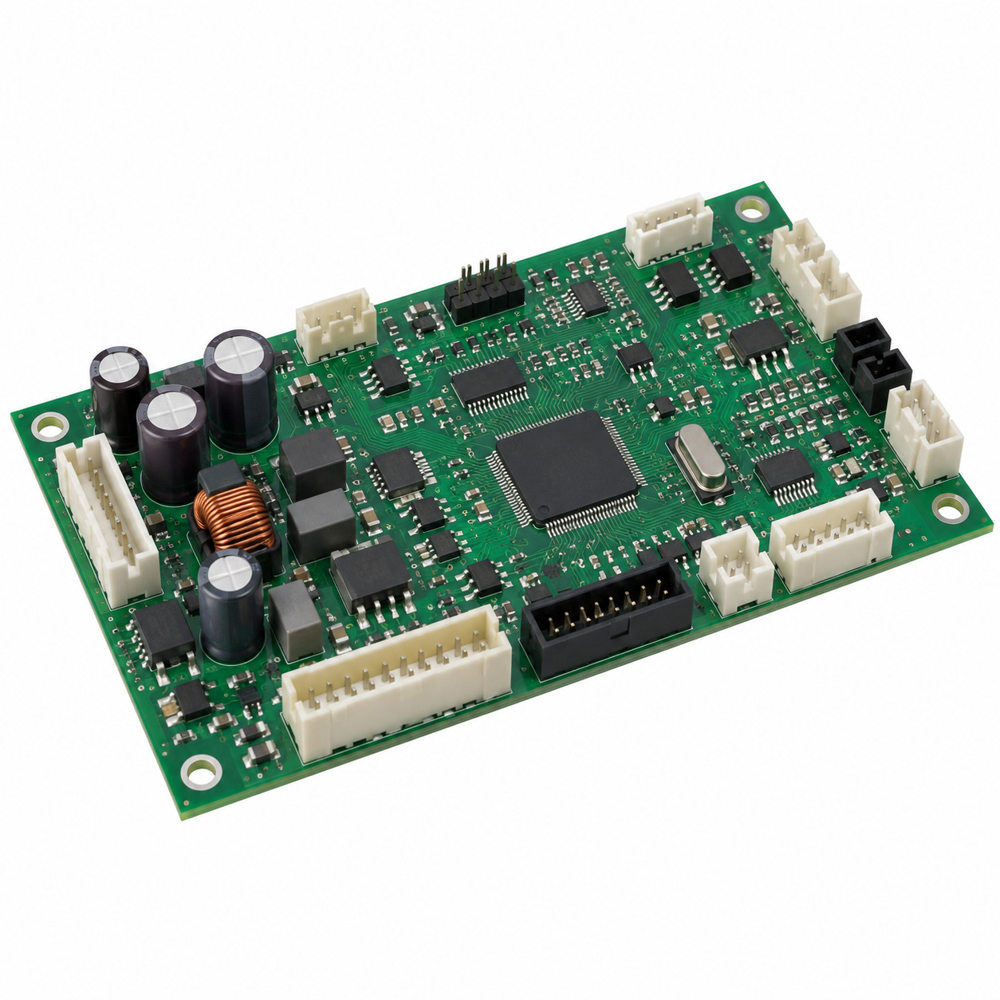
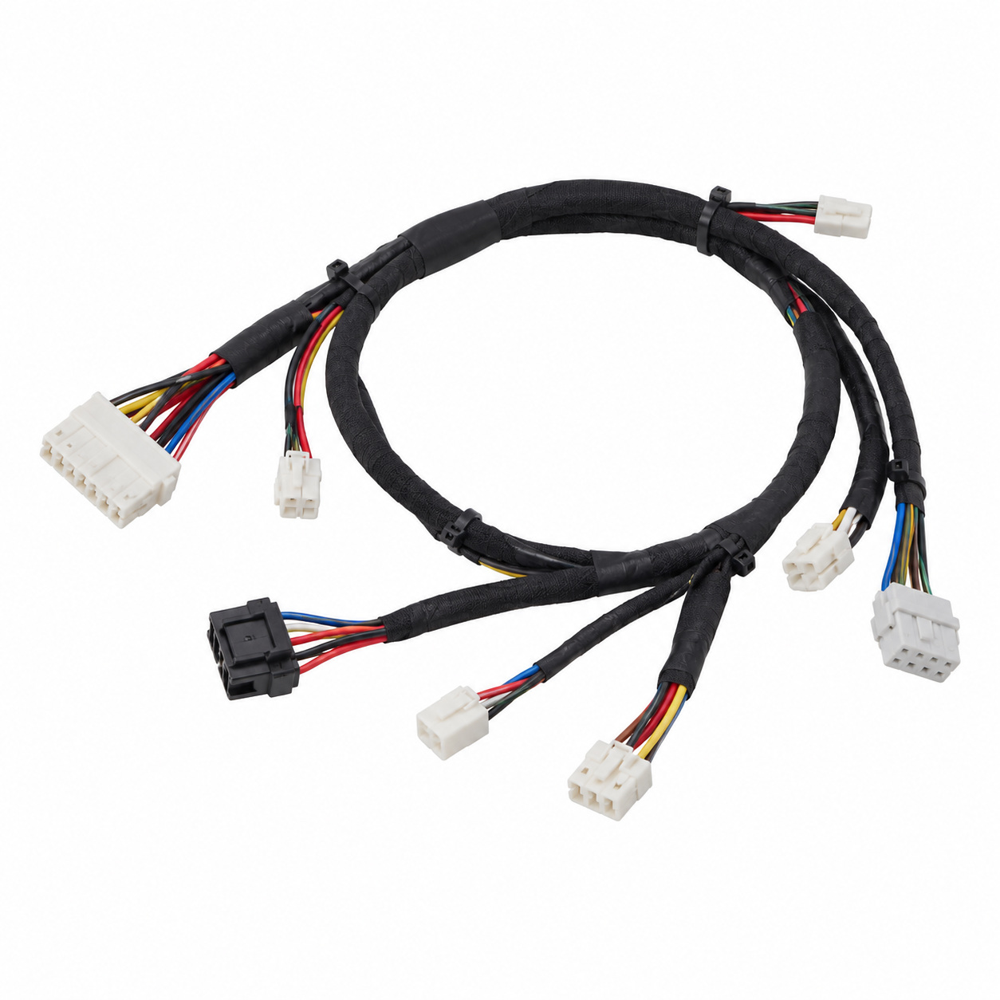

# Remaining catalog illustrations — batch 23

Generic type-based representations for review. Manufacturer-specific shape, internal construction, kit contents and fitment are unverified. Complex assemblies are broad concepts requiring a real photo or drawing. Existing catalog validation is not changed.

[Back to gallery](README.md)

| Target SKU | Description | Image |
| --- | --- | --- |
| 117.473 | Generic mechanical component | [Open image](generic-117.473.jpg) |
| 101.456 | Generic cover, housing or mounting component | [Open image](generic-101.456.jpg) |
| 101.910 | Generic pump or motor | [Open image](generic-101.910.jpg) |
| 102.486 | Generic electrical component | [Open image](generic-102.486.jpg) |
| 115.918 | Generic electrical component | [Open image](generic-115.918.jpg) |
| 116.470 | Generic fastener | [Open image](generic-116.470.jpg) |
| 123.742 | Generic electrical component | [Open image](generic-123.742.jpg) |
| 127.260 | Generic electrical component | [Open image](generic-127.260.jpg) |
| 127.544 | Generic electrical component | [Open image](generic-127.544.jpg) |
| 129.393 | Generic cable or wiring assembly | [Open image](generic-129.393.jpg) |

## 117.473 — Generic mechanical component

## 101.456 — Generic cover, housing or mounting component

## 101.910 — Generic pump or motor

## 102.486 — Generic electrical component

## 115.918 — Generic electrical component

## 116.470 — Generic fastener

## 123.742 — Generic electrical component

## 127.260 — Generic electrical component

## 127.544 — Generic electrical component

## 129.393 — Generic cable or wiring assembly

