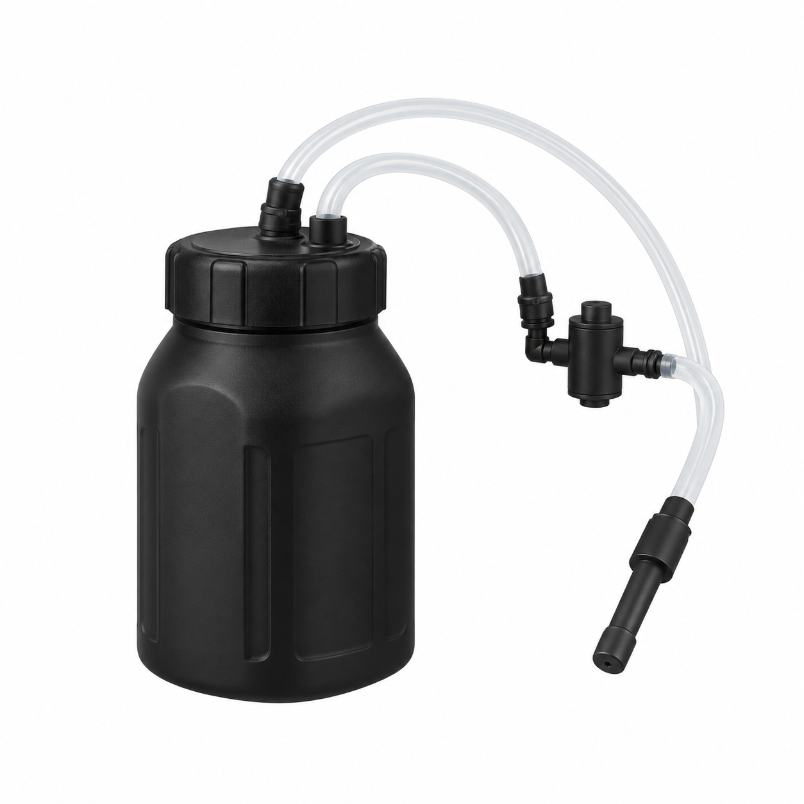
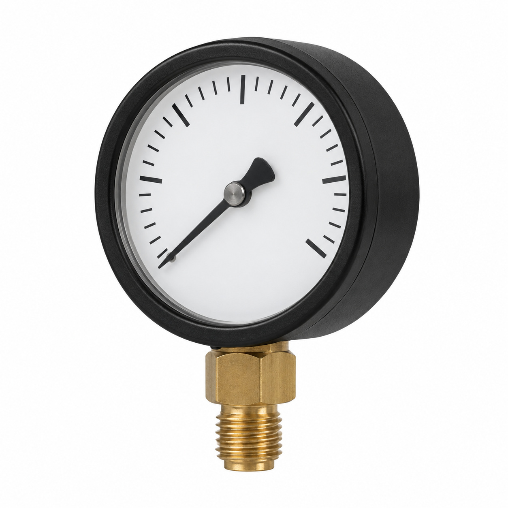
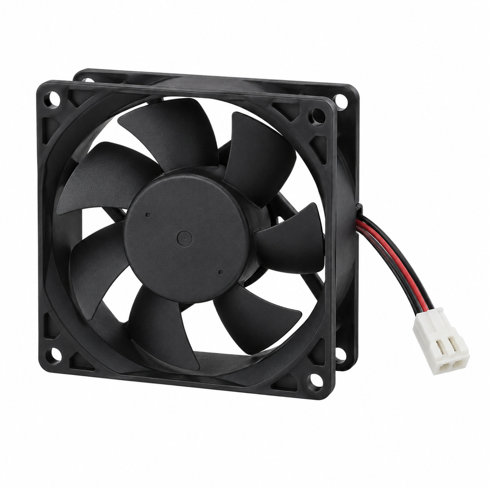
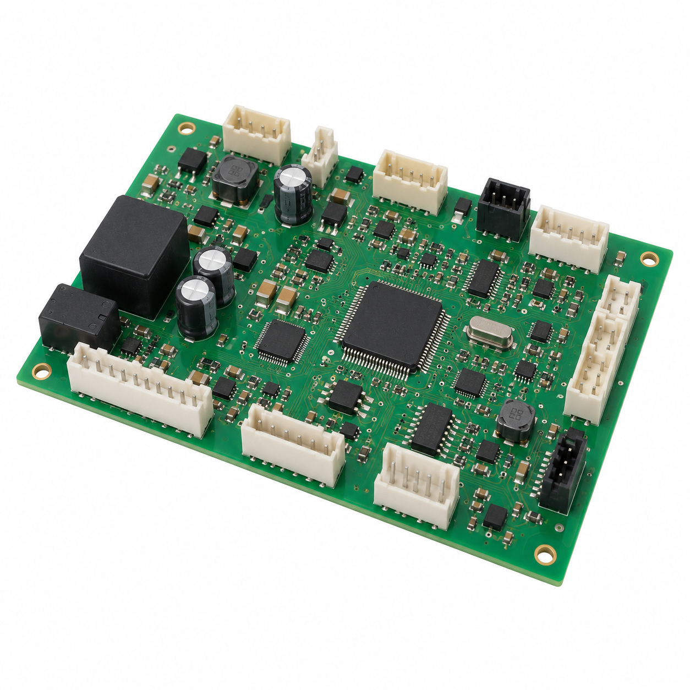
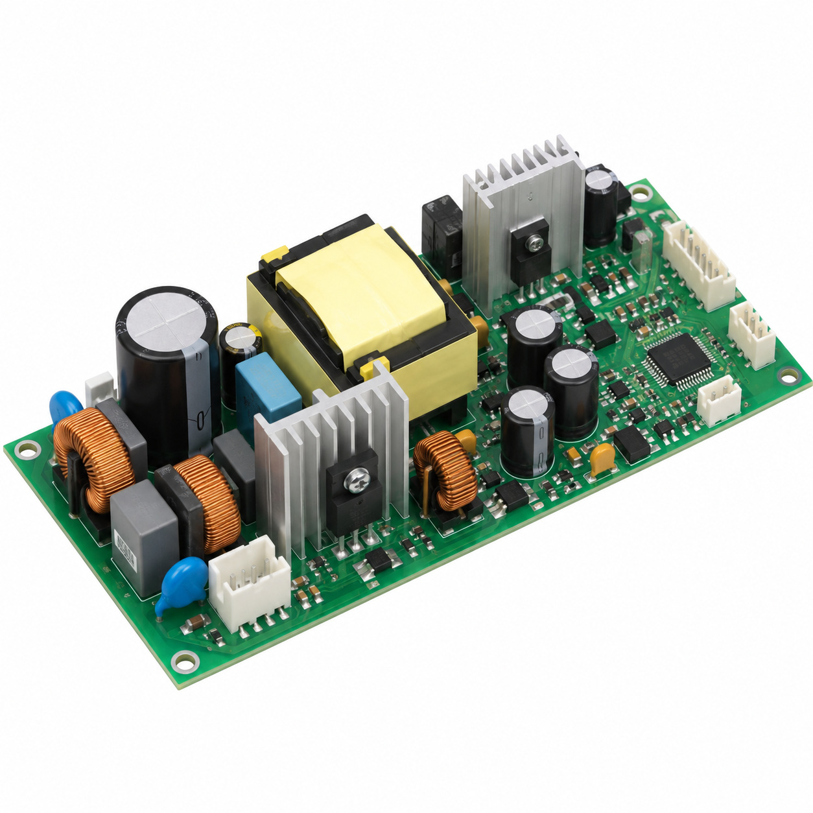
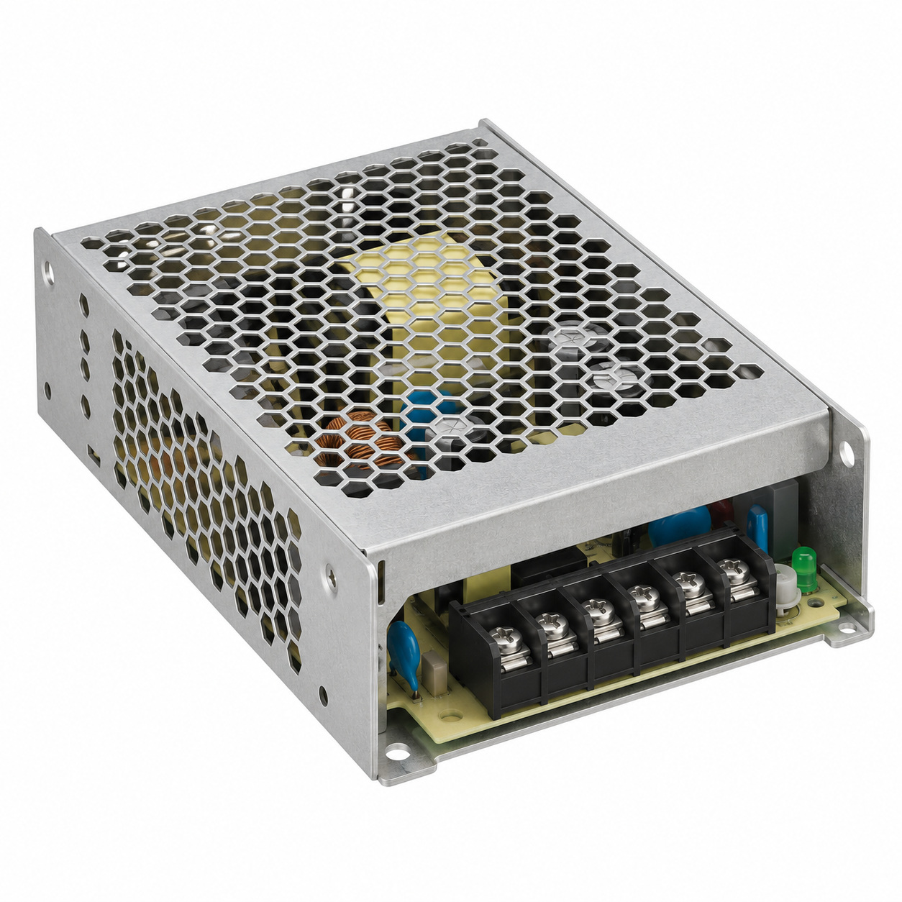
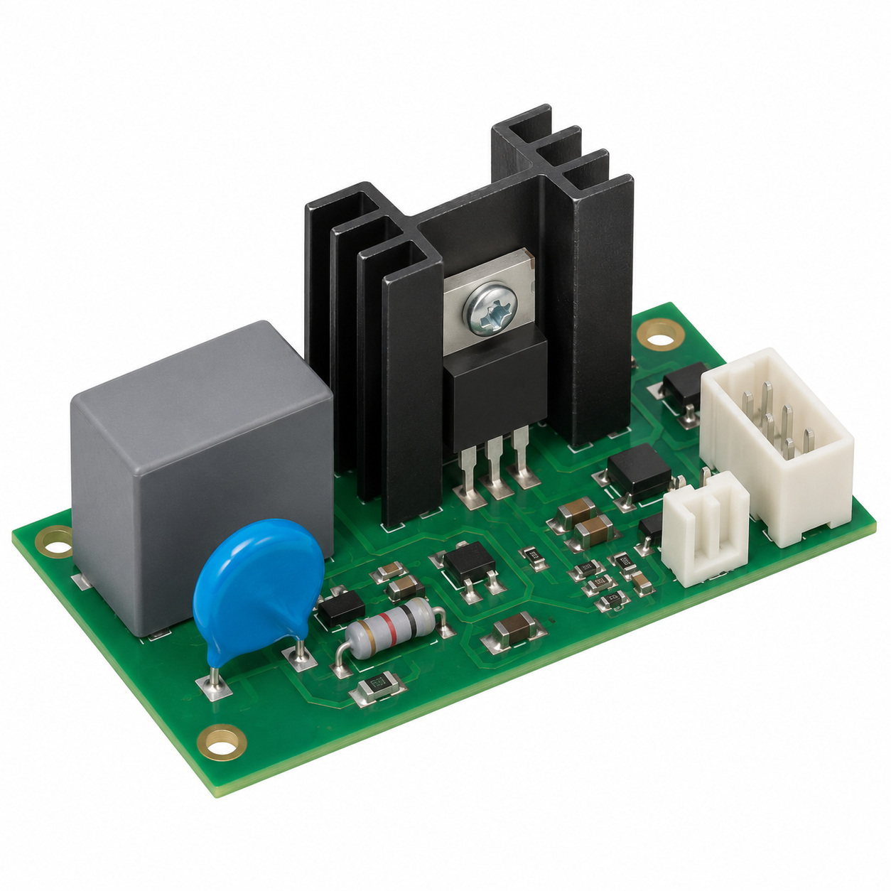
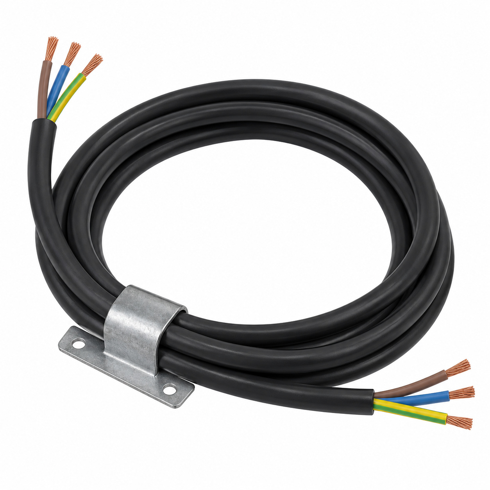
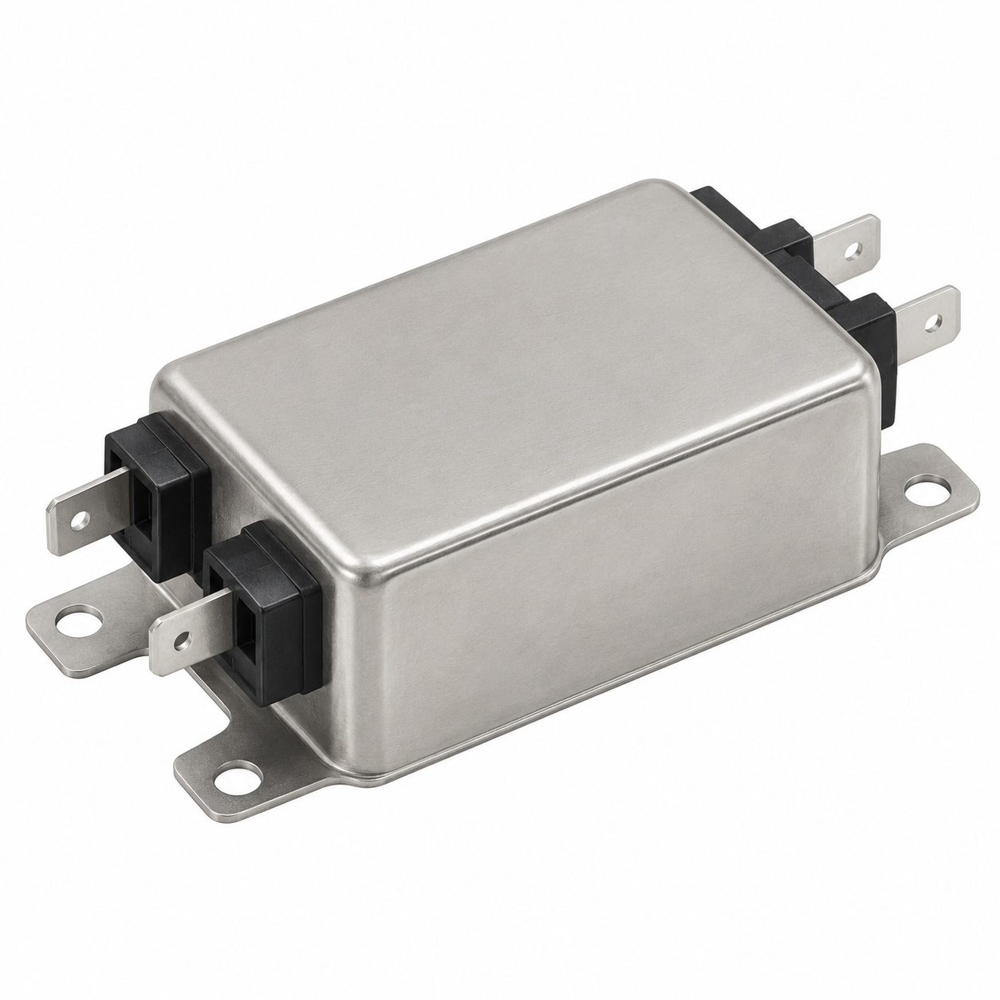
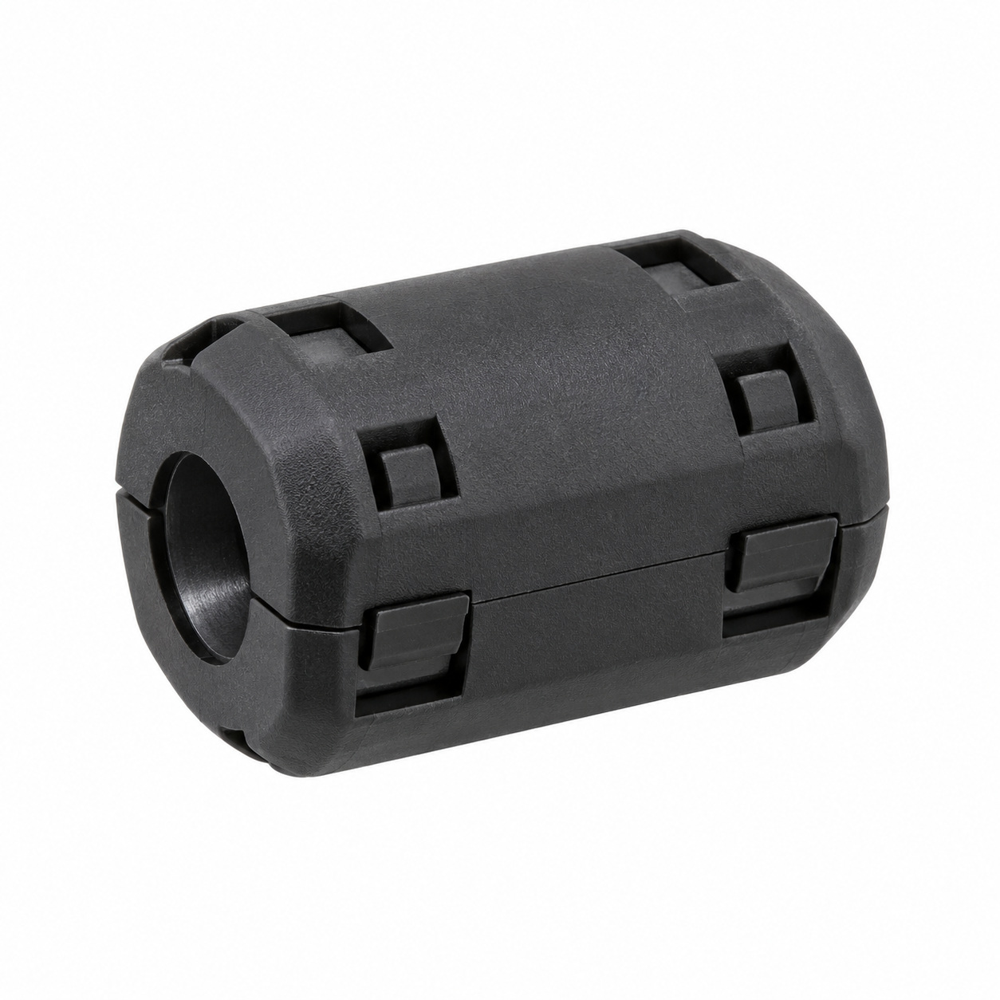

# Remaining catalog illustrations — batch 24

Generic type-based representations for review. Manufacturer-specific shape, internal construction, kit contents and fitment are unverified. Complex assemblies are broad concepts requiring a real photo or drawing. Existing catalog validation is not changed.

[Back to gallery](README.md)

| Target SKU | Description | Image |
| --- | --- | --- |
| 129.675 | Generic assembly concept | [Open image](generic-129.675.jpg) |
| 130.419 | Generic fluid-control component | [Open image](generic-130.419.jpg) |
| 130.871 | Generic electrical component | [Open image](generic-130.871.jpg) |
| 130.873 | Generic electrical component | [Open image](generic-130.873.jpg) |
| 130.874 | Generic electrical component | [Open image](generic-130.874.jpg) |
| 130.875 | Generic electrical component | [Open image](generic-130.875.jpg) |
| 131.201 | Generic electrical component | [Open image](generic-131.201.jpg) |
| 131.370 | Generic cable or wiring assembly | [Open image](generic-131.370.jpg) |
| 131.547 | Generic electrical component | [Open image](generic-131.547.jpg) |
| 133.707 | Generic cable or wiring assembly | [Open image](generic-133.707.jpg) |

## 129.675 — Generic assembly concept

## 130.419 — Generic fluid-control component

## 130.871 — Generic electrical component

## 130.873 — Generic electrical component

## 130.874 — Generic electrical component

## 130.875 — Generic electrical component

## 131.201 — Generic electrical component

## 131.370 — Generic cable or wiring assembly

## 131.547 — Generic electrical component

## 133.707 — Generic cable or wiring assembly

