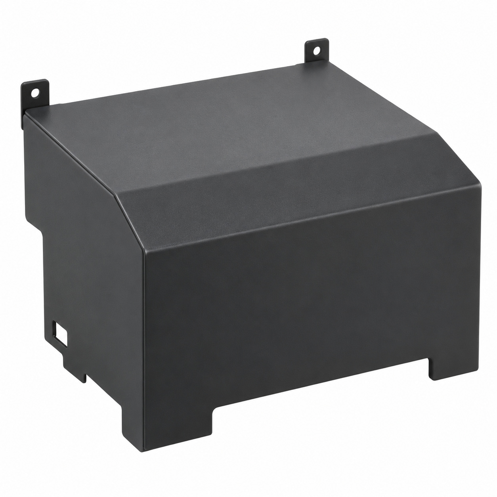
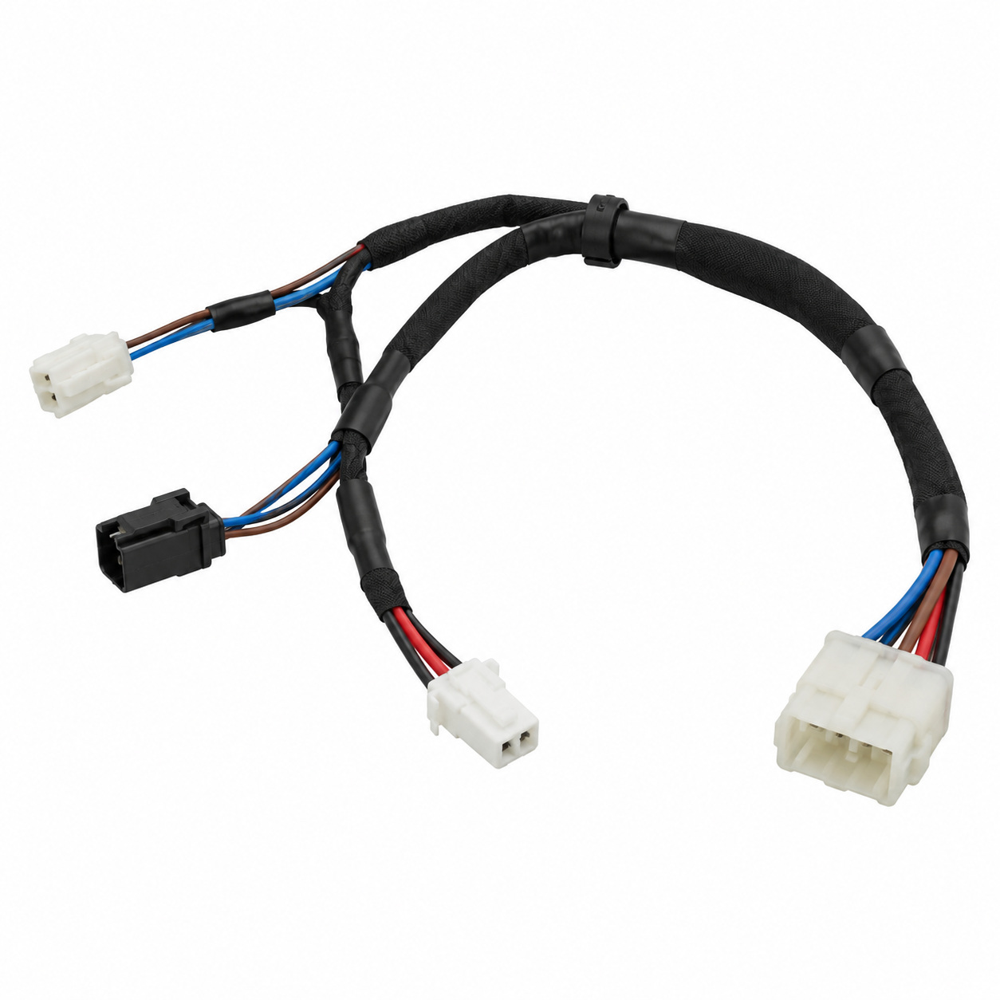
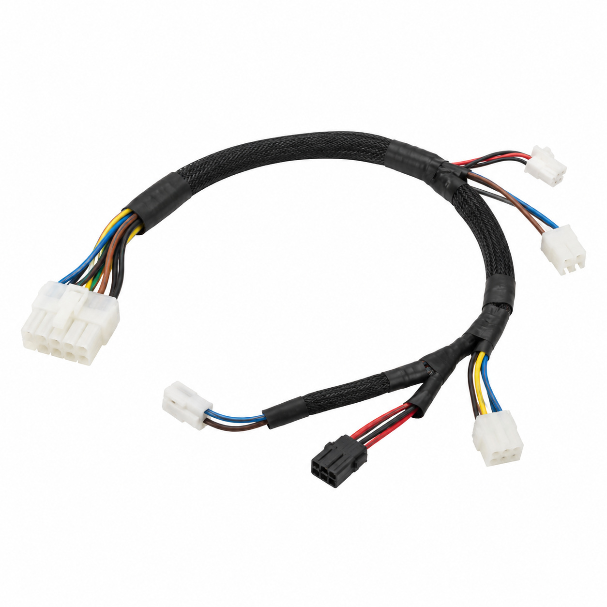
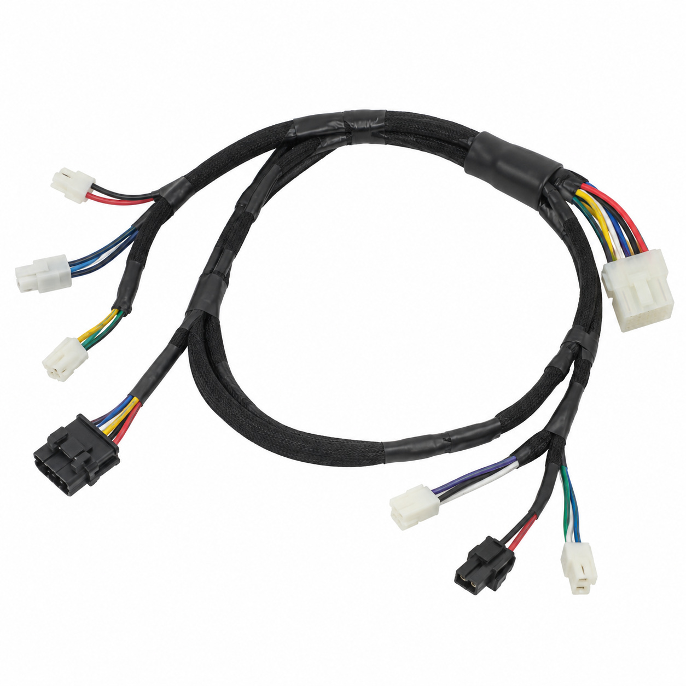
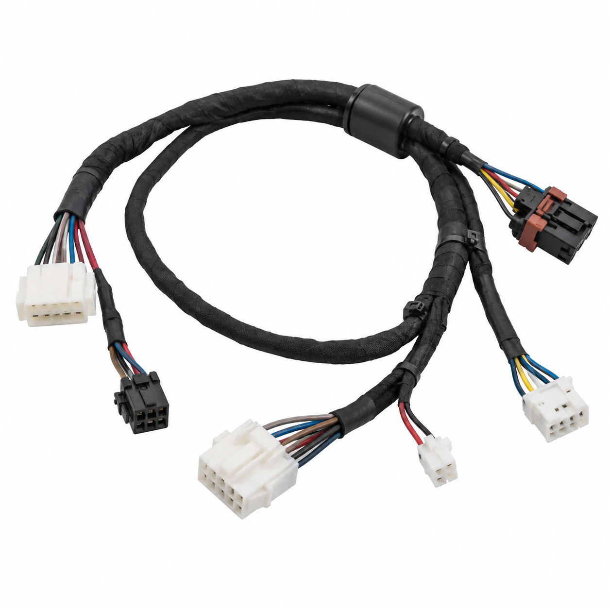
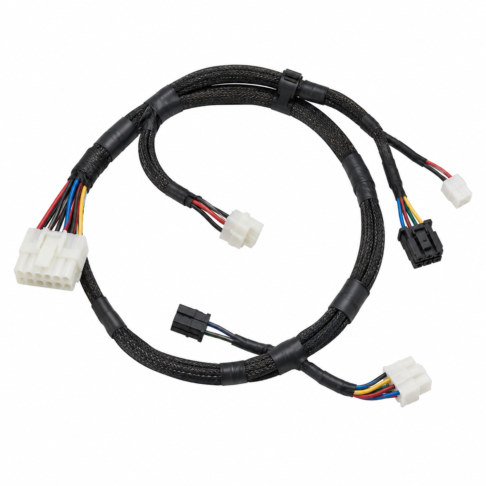
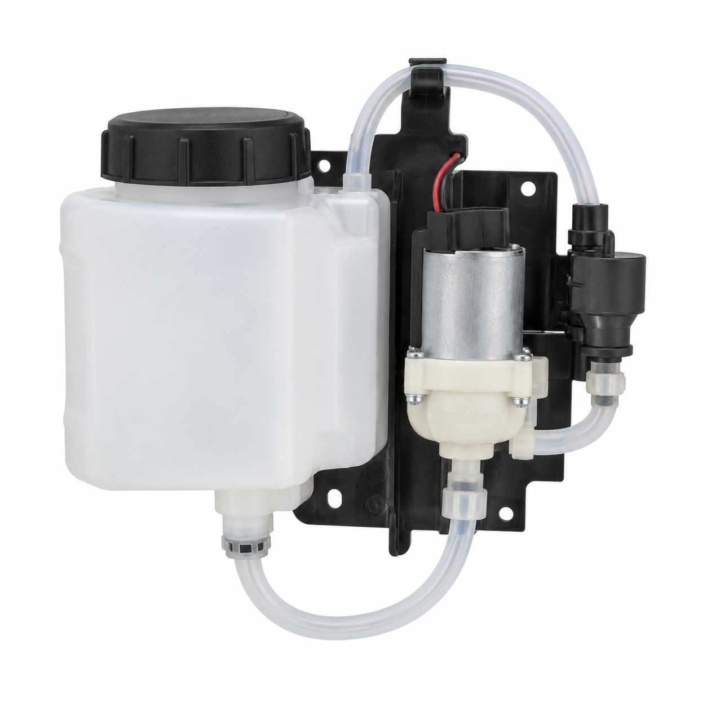
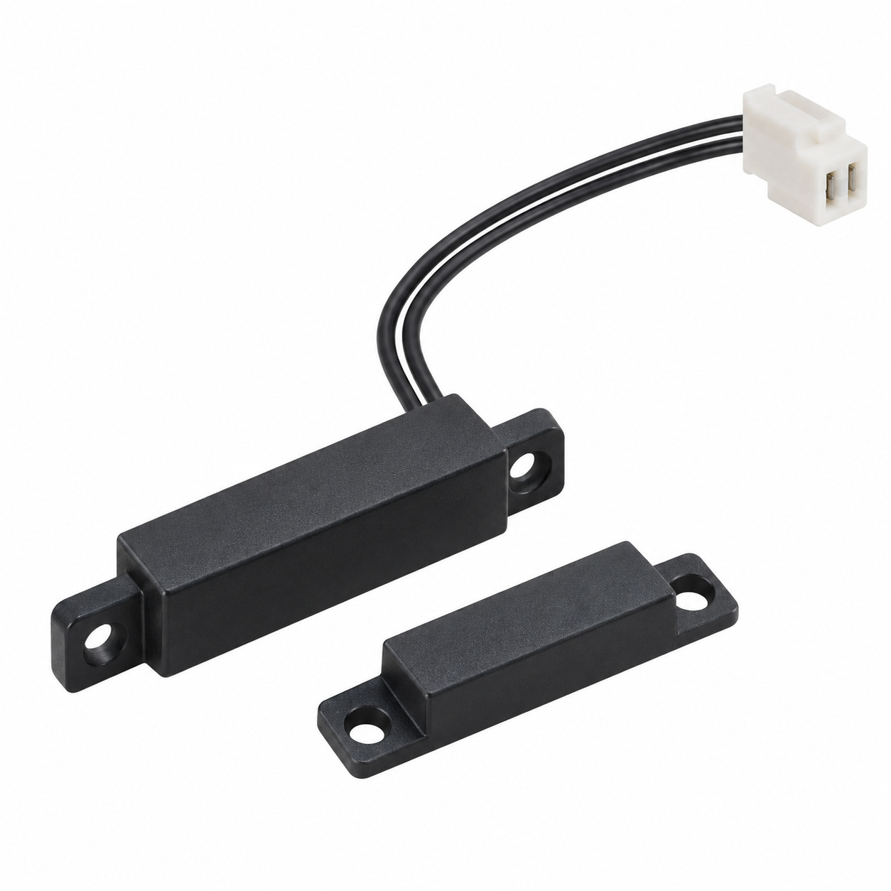
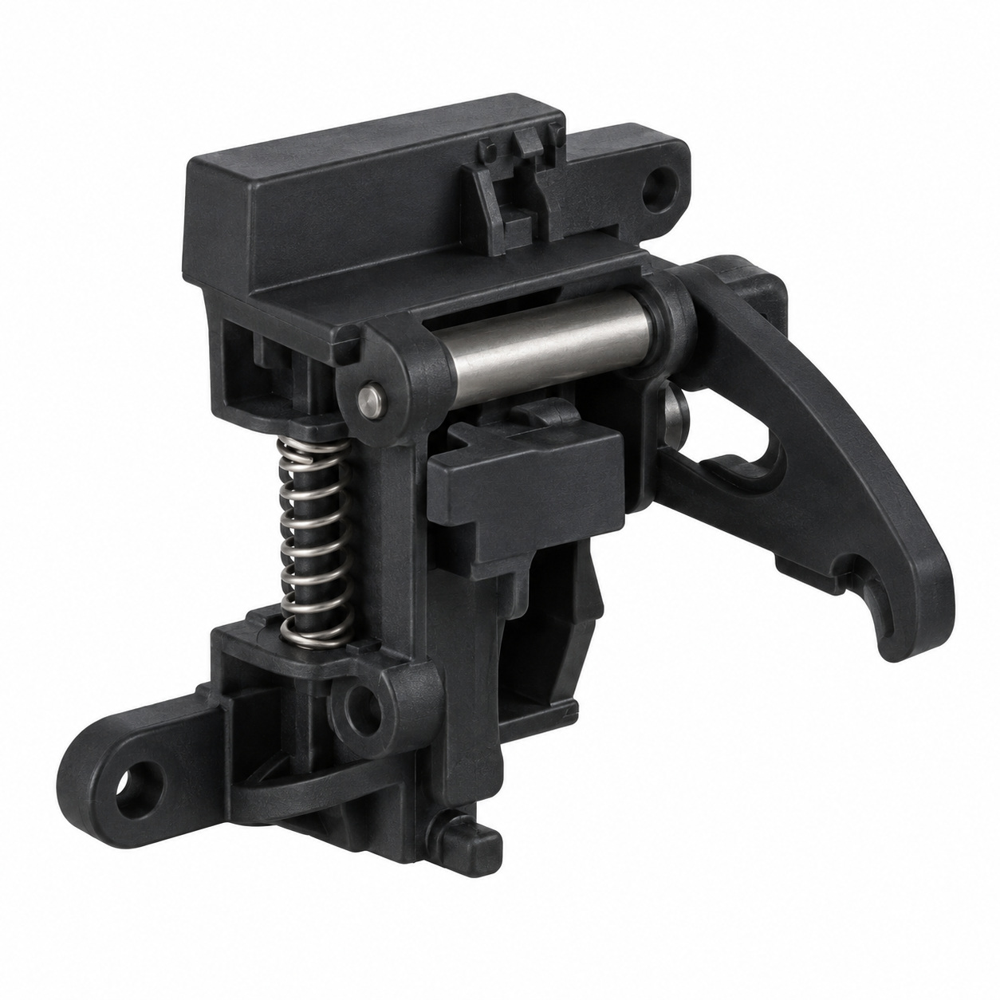
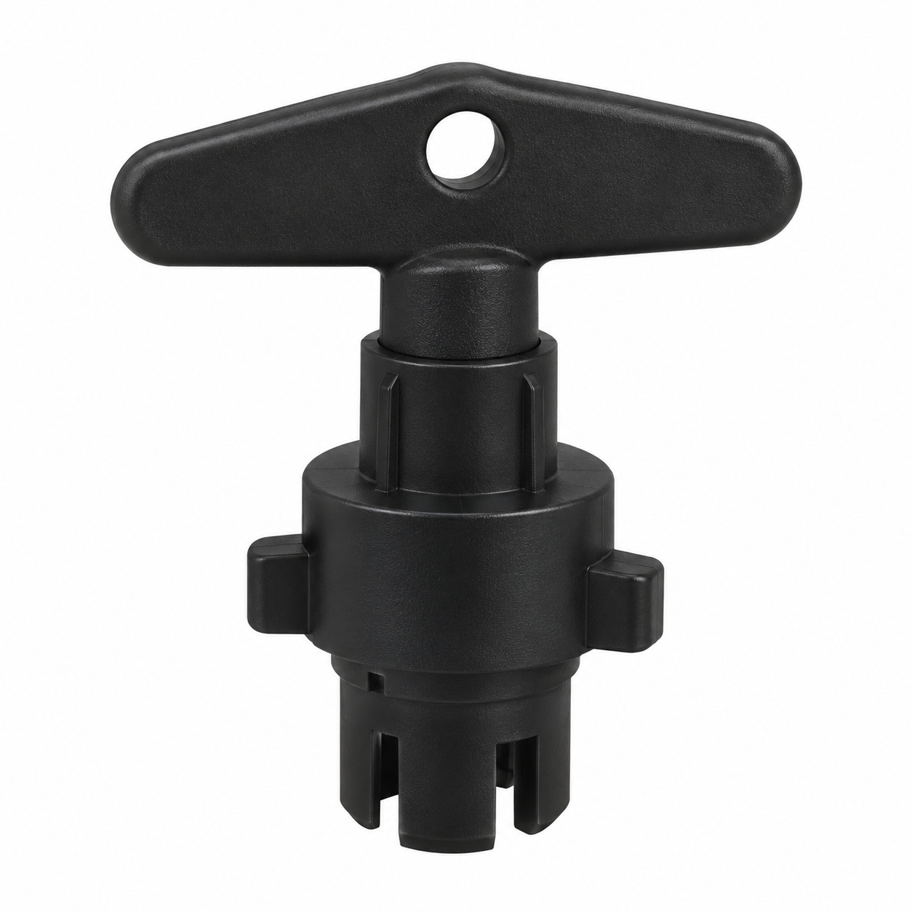

# Remaining catalog illustrations — batch 25

Generic type-based representations for review. Manufacturer-specific shape, internal construction, kit contents and fitment are unverified. Complex assemblies are broad concepts requiring a real photo or drawing. Existing catalog validation is not changed.

[Back to gallery](README.md)

| Target SKU | Description | Image |
| --- | --- | --- |
| 133.917 | Generic cover, housing or mounting component | [Open image](generic-133.917.jpg) |
| 129.388 | Generic cable or wiring assembly | [Open image](generic-129.388.jpg) |
| 129.389 | Generic cable or wiring assembly | [Open image](generic-129.389.jpg) |
| 129.390 | Generic cable or wiring assembly | [Open image](generic-129.390.jpg) |
| 129.391 | Generic cable or wiring assembly | [Open image](generic-129.391.jpg) |
| 129.392 | Generic cable or wiring assembly | [Open image](generic-129.392.jpg) |
| 129.676 | Coffee cleaning system assy. | [Open image](generic-129.676.jpg) |
| 128.749 | Generic electrical component | [Open image](generic-128.749.jpg) |
| 129.677 | Generic assembly concept | [Open image](generic-129.677.jpg) |
| 129.694 | Generic assembly concept | [Open image](generic-129.694.jpg) |

## 133.917 — Generic cover, housing or mounting component

## 129.388 — Generic cable or wiring assembly

## 129.389 — Generic cable or wiring assembly

## 129.390 — Generic cable or wiring assembly

## 129.391 — Generic cable or wiring assembly

## 129.392 — Generic cable or wiring assembly

## 129.676 — Coffee cleaning system assy.

## 128.749 — Generic electrical component

## 129.677 — Generic assembly concept

## 129.694 — Generic assembly concept

