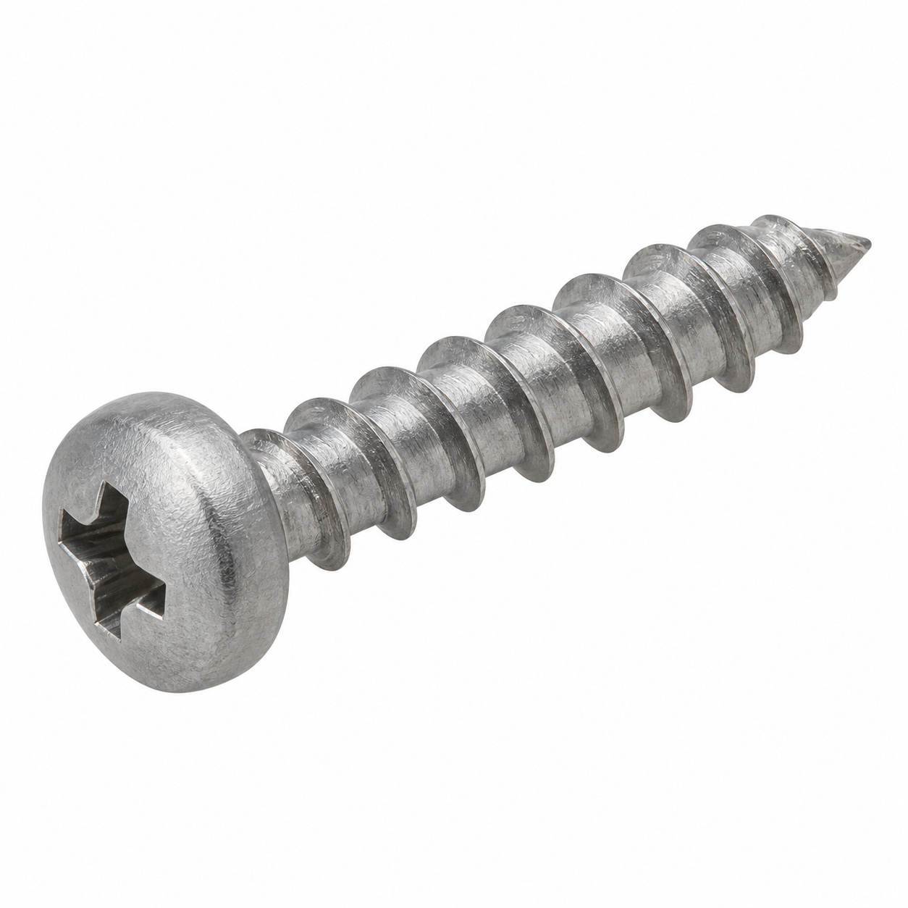

# Remaining catalog illustrations — batch 27

Generic type-based representations for review. Manufacturer-specific shape, internal construction, kit contents and fitment are unverified. Complex assemblies are broad concepts requiring a real photo or drawing. Existing catalog validation is not changed.

[Back to gallery](README.md)

| Target SKU | Description | Image |
| --- | --- | --- |
| 116.256 | Generic fastener | [Open image](generic-116.256.jpg) |

## 116.256 — Generic fastener

